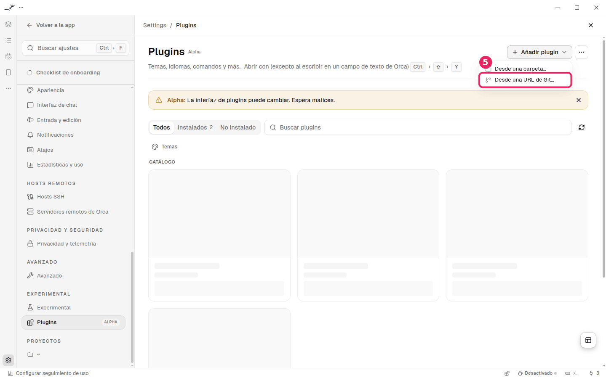
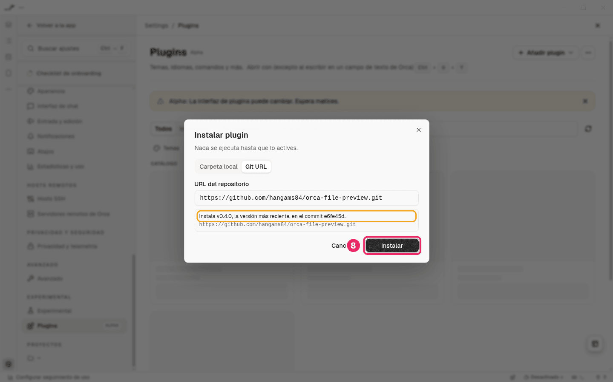
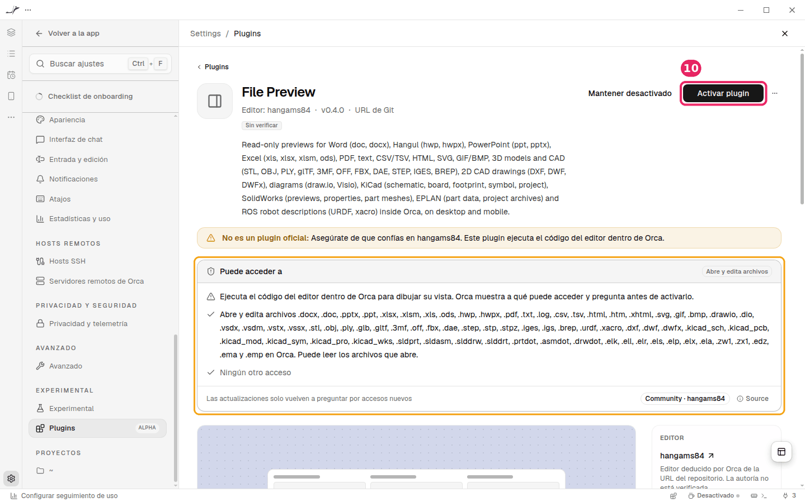

[한국어](README.md) · [English](README.en.md) · [简体中文](README.zh-CN.md) · [繁體中文](README.zh-TW.md) · [日本語](README.ja.md) · [Deutsch](README.de.md) · [Français](README.fr.md) · [Español](README.es.md) · [Português (Brasil)](README.pt-BR.md) · [Русский](README.ru.md) · [Türkçe](README.tr.md)

# File Preview for Orca

[](https://github.com/hangams84/orca-file-preview/actions/workflows/orca-compat.yml)

File Preview es un plugin para [Orca](https://github.com/stablyai/orca) que muestra, dentro de Orca, **vistas previas de solo
lectura** de archivos de Office, Hangul, PDF, texto, imágenes, 3D, CAD y diseño electrónico. Funciona en Orca para escritorio
(Windows · macOS · Linux) y en los clientes para navegador y dispositivos móviles.

- Última versión: **v0.4.0** · requiere Orca **1.4.248** o posterior (**1.4.252** o posterior para instalar desde la URL de Git)
- Se ejecuta solo como `sandboxed-ui`: sin permisos adicionales (capabilities), sin acceso a la red y sin modificar nunca sus archivos.

## Formatos compatibles

| Formato | Extensiones | Motor · qué se muestra |
| --- | --- | --- |
| Word | `.docx` `.doc` | docx-preview · analizador OLE/CFB propio (detecta automáticamente los `.doc` guardados como RTF, HTML o DOCX) |
| PowerPoint | `.pptx` `.ppt` | Renderizador OOXML propio · analizador de registros PPT propio |
| Excel | `.xlsx` `.xlsm` `.xls` `.ods` | SheetJS CE (Web Worker, cálculo de fórmulas de respaldo, desplazamiento virtual) |
| Hangul | `.hwp` `.hwpx` | HWP 5 y HWPX (OWPML), con la disposición de líneas que guardó Hangul. Con los documentos protegidos para distribución o con contraseña y con los archivos HWP 3 se muestra un mensaje claro |
| PDF | `.pdf` | pdf.js (renderizado diferido, CMap para coreano, solicitud de contraseña) |
| Imágenes | `.gif` `.bmp` `.svg` | Decodificador del navegador (scripts SVG bloqueados, fondo seleccionable) |
| Web | `.html` `.htm` `.xhtml` | DOMPurify + iframe aislado (los scripts nunca se ejecutan) |
| Tablas | `.csv` `.tsv` | Analizador RFC 4180 propio (detección de codificación y delimitador, ordenación y filtrado) |
| Texto | `.txt` `.log` | Detección de codificación (UTF-8/16, EUC-KR y otras), números de línea, ajuste de línea |
| Diagramas | `.drawio` `.dio` `.vsdx` `.vsdm` `.vstx` `.vssx` | Renderizador SVG propio: draw.io (archivos comprimidos y de varias páginas, formas integradas, conectores, estilos, etiquetas HTML saneadas con DOMPurify), Visio (herencia de patrones y hojas de estilo, todas las filas de Geometry, grupos, conectores, formato de texto, tramas de relleno, degradados, temas, imágenes EMF/WMF, páginas de fondo). Selector de página, desplazamiento, zoom, ajuste, lienzo oscuro, vínculos |
| Modelos 3D | `.stl` `.obj` `.ply` `.glb` `.gltf` `.3mf` `.off` `.fbx` `.dae` | three.js (WebGL, rotación, zoom, desplazamiento, control táctil, Draco y meshopt, análisis en un Web Worker). Los `.mtl` y texturas de OBJ, los `.bin` externos e imágenes de glTF y las texturas de DAE/FBX/3MF se leen de los archivos complementarios (📁 o arrastrar y soltar) |
| CAD (B-rep) | `.step` `.stp` `.stpz` `.iges` `.igs` `.brep` | OpenCascade (occt-import-js, WebAssembly, Web Worker): ensamblajes, lista de piezas, colores, calidad de teselado configurable. `.stpz` es STEP comprimido con gzip |
| Planos CAD 2D | `.dxf` `.dwf` `.dwfx` | Renderizador Canvas 2D propio: DXF (ASCII y binario, R12–2018+, bloques, cotas, sombreados, MTEXT, texto coreano), DWF (flujos W2D, hojas, miniatura como alternativa), DWFx (páginas XPS, fuentes incrustadas). Lista de capas, selector de modelo/presentación (ventanas gráficas)/hoja, fondo claro u oscuro, barra de información. Las referencias externas DXF (xrefs) y las entidades IMAGE se leen de los archivos complementarios (las capas de xref aparecen como `XREF\|capa`) |
| Planos de AutoCAD (plugin aparte) | `.dwg` `.dwt` | **File Preview DWG**: [repositorio aparte](https://github.com/hangams84/orca-file-preview-dwg), GPL-3.0-or-later, se instala por separado (URL de Git `https://github.com/hangams84/orca-file-preview-dwg.git`, código fuente en [dwg-plugin/](dwg-plugin/README.md)). LibreDWG (WebAssembly, Web Worker) + Canvas: espacio modelo y presentaciones, capas, bloques, texto coreano, cotas, sombreados |
| Descripciones de robots (ROS) | `.urdf` `.xacro` | Lector XML y procesador de xacro propios (reglas de ROS 2 xacro 2.x, evaluador de expresiones seguro sin eval) + three.js: árbol cinemático, formas primitivas, orígenes y materiales, los seis tipos de articulación, límites, mimic, controles deslizantes de articulaciones, mostrar u ocultar geometría visual/de colisión/sistemas de referencia/ejes de articulación. También abre `.urdf.xacro`. Las mallas y los archivos de `xacro:include` se leen de los archivos complementarios |
| KiCad | `.kicad_sch` `.kicad_pcb` `.kicad_mod` `.kicad_sym` `.kicad_pro` `.kicad_wks` | Analizador de expresiones S y renderizador SVG propios (KiCad 6–10, fuente de trazos newstroke de KiCad): esquemáticos, placas (mostrar u ocultar capas, volteo entre cara superior e inferior), huellas, bibliotecas de símbolos, resumen del proyecto, información emergente de pads, pines y redes. Con la carpeta del proyecto: navegación por hojas jerárquicas y cajetines personalizados |
| SolidWorks | `.sldprt` `.sldasm` `.slddrw` `.slddrt` `.prtdot` `.asmdot` `.drwdot` | Lector de contenedores propio (OLE/CFB hasta 2014, formato de 2015 en adelante): imágenes de vista previa guardadas, malla de visualización de la pieza en 3D, **ensamblaje 3D** (posiciones guardadas + mallas o, si no las hay, archivos de pieza proporcionados con 📁), propiedades, configuraciones, archivos referenciados, nombres de operaciones, historial de guardado |
| EPLAN Electric P8 | `.edz` `.zw1` `.elk` `.ell` `.elr` `.els` `.ela` `.elp` `.elx` `.zx1` `.ema` `.emp` | Lector propio de 7z (LZMA/LZMA2) y ZIP: datos de artículos EDZ, imágenes y documentos PDF, **gráficos de macros** (PXF: líneas, arcos, curvas, textos, por variante), copias de seguridad de proyectos con propiedades, descripciones de páginas, **lista de artículos**, imágenes y árbol de contenido, archivos de enlace + carpeta de proyecto 📁 (`.edb`) |
| (archivos ilegibles) | Todos los anteriores | Inspector genérico: identificación del formato, tamaño, entropía, volcado hexadecimal, cadenas de texto |
| **Panel File Preview** | Todos los anteriores | Un panel en la barra lateral derecha; consulte [Panel File Preview](#panel-file-preview) más abajo |

En todas las vistas previas: el tema oscuro o claro se adapta al de Orca en tiempo real, interfaz en coreano o inglés, zoom con Ctrl+rueda, gesto de
pellizco o botones, ajuste al ancho en teléfonos, actualización automática cuando cambia el archivo y un mensaje claro para los
archivos dañados.

### Los formatos de texto se abren directamente en la vista previa (0.4.0)

Orca trata como texto los archivos URDF, xacro, KiCad, draw.io, DXF ASCII, STEP/IGES/BREP, OBJ y los demás formatos 3D en texto, así
como los `.doc` guardados como RTF/HTML y los `.xls` en XML. El plugin registra editores de texto para ellos, de modo que ahora se
abren en la vista previa de forma predeterminada. Los archivos que Orca abre por sí mismo (`.txt` `.csv` `.tsv` `.html` `.htm`)
se siguen abriendo primero en la vista **Código fuente**, según las reglas de Orca; elija la vista previa con el selector de vista de la esquina
superior derecha de la pestaña.

### Archivos complementarios (📁 o arrastrar y soltar)

Orca solo entrega al editor el archivo que usted abrió. Elija una carpeta con el botón 📁 de la barra de herramientas (mantenga
pulsada la tecla Mayús para elegir archivos sueltos) o suelte archivos sobre la vista previa, y el plugin los leerá dentro de su
marco aislado:

| Vista previa | Qué añade una carpeta o los archivos soltados |
| --- | --- |
| Robot (URDF/xacro) | Las mallas (STL, DAE con texturas, OBJ con `.mtl`, glTF) sustituyen a los marcadores de posición y se mantiene la postura de las articulaciones; se resuelve `xacro:include` (`$(find pkg)`, rutas relativas, inclusiones anidadas) |
| 3D | Materiales y texturas de OBJ, `.bin` externos e imágenes de glTF, texturas de DAE |
| Plano CAD (DXF) | Referencias externas (xrefs) insertadas como `XREF\|capa`, entidades IMAGE dibujadas |
| KiCad | Navegación por subhojas con referencias por instancia, `.kicad_pro` → esquemático y placa, `.kicad_wks` personalizado |
| SolidWorks | **Ensamblaje 3D** a partir de las posiciones guardadas (los archivos de 2015 en adelante no necesitan las piezas; los de 2014 usan las piezas proporcionadas) |
| EPLAN | Macros dibujadas (`.ema` `.emp`, macros dentro de `.edz`); `.elk` + carpeta `.edb` → propiedades del proyecto, páginas, lista de artículos |

### Panel File Preview

Abra el panel **File Preview** en la barra lateral derecha y use «Open file…», «Open folder…» o arrastre y suelte archivos (la interfaz
del plugin solo está en coreano e inglés). El archivo se muestra con los mismos renderizadores, sin el límite de 50 MB del editor de
Orca (solo rigen los límites de los renderizadores, hasta 1 GB), incluso si el archivo está fuera de un espacio de trabajo. Los archivos abiertos
juntos sirven como archivos complementarios. El panel no necesita permisos adicionales.

## Instalación

### (a) En la aplicación Orca (recomendado)

Requiere Orca **1.4.252** o posterior.

1. Abra **Ajustes** → **Plugins**.
2. Elija **Añadir plugin** → **Desde una URL de Git…**.
3. Pegue `https://github.com/hangams84/orca-file-preview.git` en **URL del repositorio** y haga clic en **Continuar** → **Instalar**.
4. Revise los permisos que muestra Orca (solo interfaz aislada) y haga clic en **Activar plugin**.

Guía paso a paso con capturas de pantalla: [docs/install-guide/es.md](docs/install-guide/es.md)

<!-- install-guide-thumbs -->
<a href="docs/install-guide/es.md"></a>

Para `.dwg` y `.dwt`, instale del mismo modo `https://github.com/hangams84/orca-file-preview-dwg.git`.

### (b) Desde la línea de comandos

```sh
# Instalar la versión más reciente desde GitHub (Orca 1.4.252+). Orca muestra los accesos solicitados y una huella de aprobación.
orca plugin install https://github.com/hangams84/orca-file-preview
orca plugin install https://github.com/hangams84/orca-file-preview --approve <fingerprint>
# Una versión concreta: https://github.com/hangams84/orca-file-preview#v0.4.0

# O desde una carpeta local
orca plugin install ./plugin
```

### (c) Paquetes de versión, ejecutables y scripts

Descárguelos desde [GitHub Releases](https://github.com/hangams84/orca-file-preview/releases). Se necesita un equipo con Orca
1.4.248 o posterior instalado y abierto al menos una vez; no hacen falta permisos de administrador. Todos los instaladores muestran
los permisos que Orca le pide aprobar y solo los aprueban después de que usted confirme.

| Sistema | Ejecutable | Scripts (paquete zip o tar.gz) |
| --- | --- | --- |
| Windows 10/11 | `FilePreviewSetup-<versión>.exe` (menú: instalar · actualizar · desinstalar · estado) | `installer\windows\install.cmd` |
| macOS | `File-Preview-Setup-<versión>-macos.zip` → *File Preview Setup.app* | `installer/macos/Install File Preview.command` |
| macOS · Linux | `sh file-preview-setup-<versión>.run [install\|update\|uninstall\|status]` | `sh installer/linux/install.sh` (Linux) |

Los ejecutables no están firmados. Si Windows SmartScreen bloquea uno, elija *Más información* → *Ejecutar de todas formas*; en
macOS, haga clic con la tecla Control pulsada → *Abrir* para pasar Gatekeeper. Orca 1.4.248–1.4.251 no incluyen `plugin install`, por
lo que los instaladores registran la carpeta con `plugin dev load`; en ese caso, no elimine la carpeta. Los instaladores rechazan Windows 7/8 con
un mensaje claro, ya que Orca requiere Windows 10 o posterior. Todas las opciones: [installer/README.md](installer/README.md)

### (d) Actualizar y desinstalar

- **Si lo instaló desde la aplicación Orca o la CLI**: busque la clave del plugin con `orca plugin list`, actualícelo con
  `orca plugin update <clave>` y elimínelo con `orca plugin uninstall <clave>`. Una instalación desde la URL de Git pasa a la etiqueta de
  versión más reciente al actualizarse.
- **Ejecutables**: el menú de `FilePreviewSetup-<versión>.exe` (o `/update` · `/uninstall`), `file-preview-setup-<versión>.run update|uninstall`
  o *File Preview Setup.app* en macOS.
- **Scripts**: Windows `installer\windows\update.cmd` · `uninstall.cmd`, macOS `Update File Preview.command` ·
  `Uninstall File Preview.command`, Linux `sh installer/linux/update.sh` · `sh installer/linux/uninstall.sh`.
- Una actualización consulta la última versión de este repositorio en GitHub, descarga el paquete, verifica su SHA-256 y lo reinstala
  tras su aprobación. Se conserva la versión anterior. `--check` (en Windows, `-Check`) solo comprueba si hay una versión nueva.

## Limitaciones

- **Límite de lectura de 50 MB**: Orca entrega al editor de un plugin como máximo 50 MB de un archivo (salvo imágenes y PDF; un plugin
  no puede cambiarlo, consulte [stablyai/orca#46775](https://github.com/stablyai/orca/issues/46775)). El plugin en sí admite hasta 1 GB.
  Abra los archivos más grandes en el [panel File Preview](#panel-file-preview). Los archivos STEP también pueden comprimirse con gzip y
  abrirse como `.stpz` (un STEP suele reducirse entre 5 y 8 veces): `gzip -c model.step > model.stpz`.
- **Tamaño que admite el motor CAD**: OpenCascade (WebAssembly de 32 bits, hasta 4 GB de memoria) es práctico hasta unos 200 MB de STEP.
  Medido con ensamblajes sintéticos de muchas piezas: 61 MB en 1,5 min · 189 MB en 14 min · 343 MB no termina en 30 min · 412 MB se
  queda sin memoria.
- **Formatos que se abren primero en la vista Código fuente**: Orca abre por sí mismo `.txt` `.csv` `.tsv` `.html` `.htm`, así que
  primero aparece la vista **Código fuente**. Elija la vista previa con el selector de vista.
- **Lo que no se dibuja**:
  - EPLAN: las páginas de esquema (almacén de objetos binario propio de EPLAN, `.eod`/`.eox`) y los gráficos de las bibliotecas de símbolos.
  - SolidWorks: la geometría B-rep exacta y las vistas de dibujo no se vuelven a dibujar; en su lugar se muestran las imágenes guardadas.
    Los componentes ocultos y suprimidos se enumeran, pero no se dibujan.
  - draw.io: las bibliotecas de plantillas de formas no incluidas (`mxgraph.aws4.*` y otras) se muestran como un recuadro discontinuo con
    el nombre de la plantilla; las imágenes remotas, como un marcador de posición.
  - Visio: las fórmulas no se evalúan (se usan los valores guardados). El formato binario `.vsd` no es compatible (se muestra un mensaje claro).
  - DWF: una hoja con comandos de dibujo que el lector no sabe procesar muestra la miniatura guardada en el paquete y un aviso.
  - DWG (plugin aparte): los sólidos y regiones 3D (ACIS), el contenido de imágenes ráster, los objetos OLE y las xrefs no se dibujan; se
    enumeran en una nota.
  - Office: los gráficos y SmartArt de PPTX y los estilos de celda de las hojas de cálculo se simplifican; las hojas de cálculo muestran
    las primeras 20 000 filas. Las ecuaciones, gráficos y objetos OLE de `.hwp` se muestran como recuadros con su nombre.
- Los clientes móviles se probaron con el entorno de pruebas del navegador (perfiles de teléfono, WebKit, modo de motor antiguo), no
  en dispositivos físicos.

## Compatibilidad

Orca **1.4.248** o posterior; la instalación desde la URL de Git requiere **1.4.252** o posterior. La CI de compatibilidad instala
desde cero cada versión de Orca en Ubuntu, macOS y Windows, instala el plugin y lo prueba. Su tabla de resultados se mantiene en un
único lugar, el README en coreano: [Compatibilidad con Orca (CI)](README.md#ci-matrix). Evidencias de las pruebas por plataforma:
`docs/evidence/platforms/`.

## Desarrollo

```sh
npm ci
npm run vendor            # empaquetar las bibliotecas de terceros en plugin/vendor
orca plugin dev load plugin --approve <fingerprint>
npm run typecheck
node tools/harness/run.mjs --only docx,pdf --profiles desktop-dark,mobile-light
node tools/verify.mjs --round <n> && node tools/build-docs.mjs
node tools/check-readmes.mjs   # comprobar la barra de idiomas, los vínculos y la tabla de formatos de los 11 README
```

### Estructura del repositorio

```text
plugin/            el plugin que se distribuye (orca-plugin.json, editor/, panel/, vendor/)
dwg-plugin/        código fuente de File Preview DWG (GPL-3.0-or-later, plugin aparte)
installer/         scripts de instalación para Windows · macOS · Linux
samples/           archivos de prueba (tools/make-samples.py y otros)
tools/harness/     entorno de pruebas en navegador con una CSP similar a la de Orca y un host simulado (Playwright)
tools/verify.mjs   ejecutor de las rondas de verificación (tsc, validate, pruebas unitarias, 4 perfiles, fuzzing, capturas de la app Orca)
docs/              documentación de desarrollo y verificación (README.md, index.html, evidence/, release-notes/)
```

Registros de verificación y capturas de pantalla: [docs/README.md](docs/README.md) · [docs/index.html](docs/index.html). Historial de cambios:
[CHANGELOG.md](CHANGELOG.md).

## Licencia

Este proyecto se distribuye bajo la licencia MIT ([LICENSE](LICENSE)). Las bibliotecas incluidas conservan sus propias licencias:
[plugin/THIRD_PARTY_NOTICES.md](plugin/THIRD_PARTY_NOTICES.md).
**File Preview DWG**, para `.dwg` y `.dwt`, es un plugin aparte bajo GPL-3.0-or-later y no forma parte de este plugin MIT.
