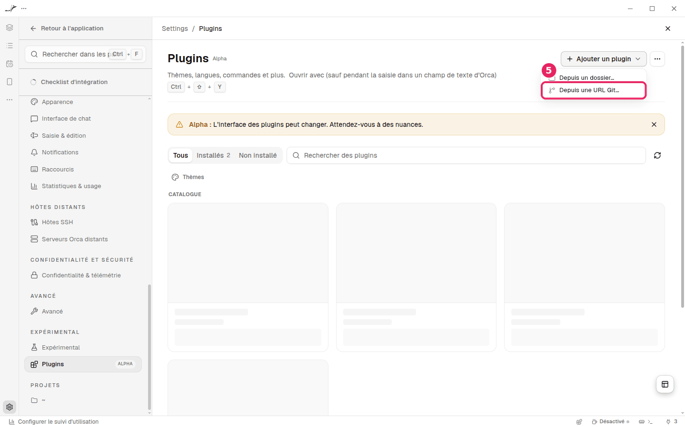
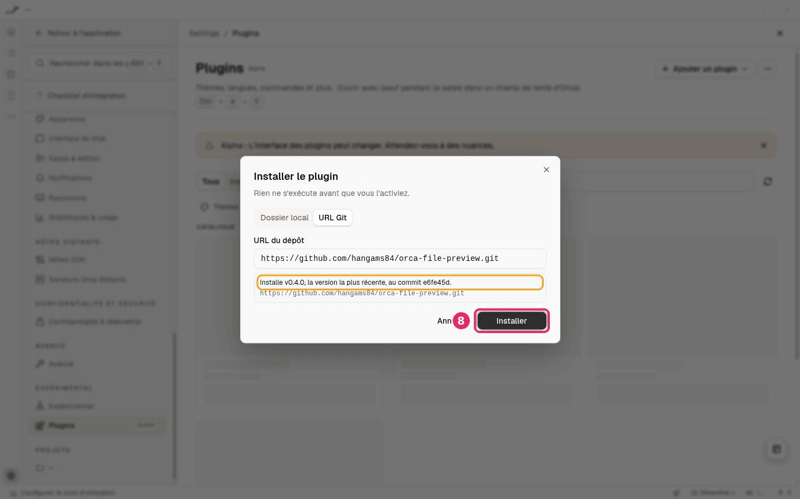
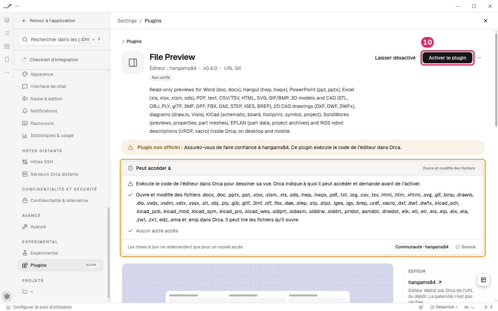

[한국어](README.md) · [English](README.en.md) · [简体中文](README.zh-CN.md) · [繁體中文](README.zh-TW.md) · [日本語](README.ja.md) · [Deutsch](README.de.md) · [Français](README.fr.md) · [Español](README.es.md) · [Português (Brasil)](README.pt-BR.md) · [Русский](README.ru.md) · [Türkçe](README.tr.md)

# File Preview for Orca

[](https://github.com/hangams84/orca-file-preview/actions/workflows/orca-compat.yml)

File Preview est un plugin pour [Orca](https://github.com/stablyai/orca) qui affiche, directement dans Orca, des **aperçus en
lecture seule** de fichiers Office, Hangul, PDF, texte, image, 3D, CAO et conception électronique. Il fonctionne dans la version de bureau
d’Orca (Windows · macOS · Linux) ainsi que dans les clients navigateur et mobiles.

- Dernière version : **v0.4.0** · nécessite Orca **1.4.248** ou version ultérieure (**1.4.252** ou version ultérieure pour l’installation par URL Git)
- S’exécute uniquement en mode `sandboxed-ui` : aucune autorisation supplémentaire (capability), aucun accès réseau, et vos
  fichiers ne sont jamais modifiés.

## Formats pris en charge

| Format | Extensions | Moteur · affichage |
| --- | --- | --- |
| Word | `.docx` `.doc` | docx-preview · analyseur OLE/CFB maison (détecte les `.doc` enregistrés en RTF, HTML ou DOCX) |
| PowerPoint | `.pptx` `.ppt` | Moteur de rendu OOXML maison · analyseur d’enregistrements PPT maison |
| Excel | `.xlsx` `.xlsm` `.xls` `.ods` | SheetJS CE (Web Worker, calcul de repli des formules, défilement virtuel) |
| Hangul | `.hwp` `.hwpx` | HWP 5 et HWPX (OWPML), mis en page selon le découpage des lignes enregistré par Hangul. Les documents protégés pour la distribution ou par mot de passe et les fichiers HWP 3 affichent un message explicite |
| PDF | `.pdf` | pdf.js (rendu différé, CMap coréennes, saisie du mot de passe) |
| Images | `.gif` `.bmp` `.svg` | Décodeur du navigateur (scripts SVG bloqués, choix de l’arrière-plan) |
| Web | `.html` `.htm` `.xhtml` | DOMPurify + iframe en bac à sable (les scripts ne sont jamais exécutés) |
| Tableaux | `.csv` `.tsv` | Analyseur RFC 4180 maison (détection de l’encodage et du séparateur, tri, filtre) |
| Texte | `.txt` `.log` | Détection de l’encodage (UTF-8/16, EUC-KR, etc.), numéros de ligne, retour automatique à la ligne |
| Diagrammes | `.drawio` `.dio` `.vsdx` `.vsdm` `.vstx` `.vssx` | Moteur de rendu SVG maison : draw.io (fichiers compressés et multipages, formes intégrées, connecteurs, styles, libellés HTML nettoyés par DOMPurify), Visio (héritage des formes maîtres et des feuilles de style, toutes les lignes Geometry, groupes, connecteurs, mise en forme du texte, motifs de remplissage, dégradés, thèmes, images EMF/WMF, pages d’arrière-plan). Choix de la page, déplacement, zoom, ajustement, canevas sombre, liens |
| Modèles 3D | `.stl` `.obj` `.ply` `.glb` `.gltf` `.3mf` `.off` `.fbx` `.dae` | three.js (WebGL, rotation, zoom, déplacement, tactile, Draco et meshopt, analyse dans un Web Worker). Les fichiers `.mtl` et textures des OBJ, les `.bin` externes et images des glTF, et les textures DAE/FBX/3MF sont lus depuis les fichiers associés (📁 ou glisser-déposer) |
| CAO (B-rep) | `.step` `.stp` `.stpz` `.iges` `.igs` `.brep` | OpenCascade (occt-import-js, WebAssembly, Web Worker) : assemblages, liste des pièces, couleurs, qualité de tessellation au choix. `.stpz` désigne un STEP compressé avec gzip |
| Dessins CAO 2D | `.dxf` `.dwf` `.dwfx` | Moteur de rendu Canvas 2D maison : DXF (ASCII et binaire, R12–2018+, blocs, cotes, hachures, MTEXT, texte coréen), DWF (flux W2D, feuilles, vignette de repli), DWFx (pages XPS, polices incorporées). Liste des calques, choix objet/présentation (fenêtres)/feuille, fond clair ou sombre, barre d’informations. Les références externes DXF (xrefs) et les entités IMAGE sont lues depuis les fichiers associés (calques des xrefs sous la forme `XREF\|calque`) |
| Dessins AutoCAD (plugin distinct) | `.dwg` `.dwt` | **File Preview DWG** — [dépôt distinct](https://github.com/hangams84/orca-file-preview-dwg), GPL-3.0-or-later, à installer séparément (URL Git `https://github.com/hangams84/orca-file-preview-dwg.git`, sources dans [dwg-plugin/](dwg-plugin/README.md)). LibreDWG (WebAssembly, Web Worker) + Canvas : espace objet et présentations, calques, blocs, texte coréen, cotes, hachures |
| Descriptions de robots (ROS) | `.urdf` `.xacro` | Lecteur XML et processeur xacro maison (règles de ROS 2 xacro 2.x, évaluateur d’expressions sûr sans eval) + three.js : arbre cinématique, formes primitives, origines et matériaux, les six types d’articulations, limites, mimic, curseurs d’articulation, affichage visuel/collision/repères/axes au choix. Ouvre aussi les `.urdf.xacro`. Les maillages et les fichiers `xacro:include` sont lus depuis les fichiers associés |
| KiCad | `.kicad_sch` `.kicad_pcb` `.kicad_mod` `.kicad_sym` `.kicad_pro` `.kicad_wks` | Analyseur d’expressions S et moteur de rendu SVG maison (KiCad 6–10, police filaire newstroke de KiCad) : schémas, circuits imprimés (affichage des couches, retournement recto/verso), empreintes, bibliothèques de symboles, résumé du projet, infobulles sur les pastilles, broches et réseaux. Avec le dossier du projet : navigation dans les feuilles hiérarchiques et cartouches personnalisés |
| SolidWorks | `.sldprt` `.sldasm` `.slddrw` `.slddrt` `.prtdot` `.asmdot` `.drwdot` | Lecteur de conteneur maison (OLE/CFB jusqu’à 2014, nouveau format depuis 2015) : images d’aperçu enregistrées, maillage d’affichage de la pièce en 3D, **assemblage 3D** (positions enregistrées + maillages, sinon fichiers de pièces fournis via 📁), propriétés, configurations, fichiers référencés, noms des fonctions, historique d’enregistrement |
| EPLAN Electric P8 | `.edz` `.zw1` `.elk` `.ell` `.elr` `.els` `.ela` `.elp` `.elx` `.zx1` `.ema` `.emp` | Lecteur 7z (LZMA/LZMA2) et ZIP maison : données d’articles EDZ, images et documents PDF, **graphismes des macros** (PXF : lignes, arcs, courbes, textes, par variante), sauvegardes de projet avec propriétés, descriptions de pages, **liste des articles**, images et arborescence du contenu, fichiers de liaison + dossier de projet 📁 (`.edb`) |
| Modèles d’IA (PyTorch) | `.pt` `.pth` `.ckpt` `.chkpt` `.pt2` `.ptl` `.safetensors` | Interpréteur pickle maison qui **n’exécute jamais de code** : state_dict, modules sauvegardés en entier, TorchScript, torch.export, checkpoints Lightning, pickles à l’ancien format, safetensors. Sept vues (**graphe d’opérateurs**, arbre des modules, tableau des couches, carte des paramètres, schéma d’architecture déduit, **inspecteur de tenseurs**, informations du checkpoint) et export SVG/PNG/JSON/Markdown. Le panneau File Preview lit les fichiers par plages d’octets : il ouvre des fichiers de plusieurs Go, ainsi que les fichiers bin et pkl reconnus par leur contenu |
| Modèles d’IA (ONNX, TFLite, GGUF, Keras, NumPy) | `.onnx` `.tflite` `.gguf` `.keras` `.h5` `.hdf5` `.npy` `.npz` | Mêmes vues : graphes d’opérateurs ONNX, TFLite et Keras, métadonnées GGUF et valeurs des tenseurs quantifiés (Q4_K, etc.), tableaux HDF5 et NumPy. Données externes ONNX via le dossier 📁 |
| (fichiers illisibles) | Tous les formats ci-dessus | Inspecteur générique : identification du format, taille, entropie, vidage hexadécimal, chaînes de caractères |
| **Panneau File Preview** | Tous les formats ci-dessus | Un panneau dans la barre latérale droite ; voir [Panneau File Preview](#panneau-file-preview) ci-dessous |

Pour tous les formats : le thème sombre ou clair suit Orca en direct, interface en coréen ou en anglais, zoom avec Ctrl+molette, pincement ou
boutons, ajustement à la largeur sur téléphone, actualisation automatique quand le fichier change, et message explicite pour les
fichiers endommagés.

### Les formats texte s’ouvrent directement dans l’aperçu (0.4.0)

Orca considère comme du texte les fichiers URDF, xacro, KiCad, draw.io, DXF ASCII, STEP/IGES/BREP, OBJ et les autres formats 3D
textuels, ainsi que les `.doc` enregistrés en RTF/HTML et les `.xls` XML. Le plugin enregistre des éditeurs de texte pour ces
fichiers, qui s’ouvrent donc désormais dans l’aperçu par défaut. Les fichiers qu’Orca ouvre lui-même (`.txt` `.csv` `.tsv` `.html`
`.htm`) s’ouvrent toujours d’abord dans la vue Source, conformément aux règles d’Orca ; choisissez l’aperçu avec le sélecteur de
vue en haut à droite de l’onglet.

### Fichiers associés (📁 ou glisser-déposer)

Orca ne transmet à un éditeur que le fichier ouvert. Choisissez un dossier avec le bouton 📁 de la barre d’outils (maintenez Maj
pour choisir des fichiers individuels) ou déposez des fichiers sur l’aperçu : le plugin les lit alors dans son cadre en bac à sable.

| Aperçu | Ce qu’apporte un dossier ou des fichiers déposés |
| --- | --- |
| Robot (URDF/xacro) | Les maillages (STL, DAE avec textures, OBJ avec `.mtl`, glTF) remplacent les espaces réservés, la pose des articulations est conservée ; `xacro:include` est résolu (`$(find pkg)`, chemins relatifs, imbrication) |
| 3D | Matériaux et textures OBJ, `.bin` externes et images glTF, textures DAE |
| Dessin CAO (DXF) | Références externes (xrefs) insérées sous la forme `XREF\|calque`, entités IMAGE dessinées |
| KiCad | Navigation dans les sous-feuilles avec les références propres à chaque instance, `.kicad_pro` → schéma et circuit imprimé, `.kicad_wks` personnalisé |
| SolidWorks | **Assemblage 3D** à partir des positions enregistrées (les fichiers enregistrés depuis 2015 n’ont pas besoin des pièces ; ceux jusqu’à 2014 utilisent les pièces fournies) |
| EPLAN | Macros dessinées (`.ema` `.emp`, macros contenues dans un `.edz`) ; `.elk` + dossier `.edb` → propriétés du projet, pages, liste des articles |

### Panneau File Preview

Ouvrez le panneau **File Preview** dans la barre latérale droite et utilisez « Open file… », « Open folder… » ou le
glisser-déposer (l’interface du plugin n’existe qu’en coréen et en anglais). Le fichier s’affiche avec les mêmes moteurs de rendu,
sans la limite de 50 Mo de l’éditeur d’Orca (seules les limites des moteurs de rendu s’appliquent, jusqu’à 1 Go), y compris pour les
fichiers situés hors d’un espace de travail. Les fichiers ouverts ensemble servent de fichiers associés. Le panneau ne demande
aucune autorisation supplémentaire.

## Installation

### (a) Dans l’application Orca (recommandé)

Nécessite Orca **1.4.252** ou version ultérieure.

1. Ouvrez **Paramètres** → **Plugins**.
2. Choisissez **Ajouter un plugin** → **Depuis une URL Git…**.
3. Collez `https://github.com/hangams84/orca-file-preview.git` dans le champ **URL du dépôt**, puis cliquez sur **Continuer** → **Installer**.
4. Vérifiez les accès affichés par Orca (interface en bac à sable uniquement) et cliquez sur **Activer le plugin**.

Guide pas à pas avec captures d’écran : [docs/install-guide/fr.md](docs/install-guide/fr.md)

<!-- install-guide-thumbs -->
<a href="docs/install-guide/fr.md"></a>

Pour les fichiers `.dwg` et `.dwt`, installez de la même manière `https://github.com/hangams84/orca-file-preview-dwg.git`.

### (b) En ligne de commande

```sh
# Installer la dernière version depuis GitHub (Orca 1.4.252+). Orca affiche les accès demandés et une empreinte d'approbation.
orca plugin install https://github.com/hangams84/orca-file-preview
orca plugin install https://github.com/hangams84/orca-file-preview --approve <fingerprint>
# Une version précise : https://github.com/hangams84/orca-file-preview#v0.5.0

# Ou depuis un dossier local
orca plugin install ./plugin
```

### (c) Paquets de version, exécutables et scripts

Téléchargez-les depuis [GitHub Releases](https://github.com/hangams84/orca-file-preview/releases). Il faut un ordinateur sur lequel
Orca 1.4.248 ou une version ultérieure est installé et a été lancé au moins une fois ; aucun droit d’administrateur n’est nécessaire. Chaque
programme d’installation affiche les accès qu’Orca vous demande d’approuver et ne les approuve qu’après votre confirmation.

| Système | Exécutable | Scripts (paquet zip ou tar.gz) |
| --- | --- | --- |
| Windows 10/11 | `FilePreviewSetup-<version>.exe` (menu : installer · mettre à jour · désinstaller · état) | `installer\windows\install.cmd` |
| macOS | `File-Preview-Setup-<version>-macos.zip` → *File Preview Setup.app* | `installer/macos/Install File Preview.command` |
| macOS · Linux | `sh file-preview-setup-<version>.run [install\|update\|uninstall\|status]` | `sh installer/linux/install.sh` (Linux) |

Les exécutables ne sont pas signés. Si Windows SmartScreen en bloque un, choisissez *Informations complémentaires* → *Exécuter quand
même* ; sur macOS, faites Contrôle-clic → *Ouvrir* pour contourner Gatekeeper. Orca 1.4.248 à 1.4.251 ne disposent pas de
`plugin install` : les programmes d’installation y enregistrent le dossier avec `plugin dev load` ; ne supprimez pas ce dossier.
Windows 7/8 sont refusés avec un message clair, car Orca nécessite Windows 10 ou une version ultérieure. Toutes les options :
[installer/README.md](installer/README.md)

### (d) Mise à jour et désinstallation

- **Installé depuis l’application Orca ou la CLI** : trouvez la clé du plugin avec `orca plugin list`, puis mettez-le à jour avec
  `orca plugin update <clé>` et désinstallez-le avec `orca plugin uninstall <clé>`. Une installation par URL Git passe à la dernière
  étiquette (tag) de version lors de la mise à jour.
- **Exécutables** : le menu de `FilePreviewSetup-<version>.exe` (ou `/update` · `/uninstall`), `file-preview-setup-<version>.run update|uninstall`,
  ou *File Preview Setup.app* sur macOS.
- **Scripts** : Windows `installer\windows\update.cmd` · `uninstall.cmd`, macOS `Update File Preview.command` ·
  `Uninstall File Preview.command`, Linux `sh installer/linux/update.sh` · `sh installer/linux/uninstall.sh`.
- Une mise à jour consulte la dernière release GitHub de ce dépôt, télécharge le paquet, vérifie son empreinte SHA-256 et réinstalle après
  votre approbation. La version précédente est conservée. `--check` (sous Windows : `-Check`) se contente de vérifier.

## Limites

- **Limite de lecture de 50 Mo** : Orca transmet au plus 50 Mo d’un fichier à l’éditeur d’un plugin (sauf images et PDF ; un plugin
  ne peut pas modifier cette limite, voir [stablyai/orca#46775](https://github.com/stablyai/orca/issues/46775)). Le plugin accepte lui-même
  jusqu’à 1 Go. Ouvrez les fichiers plus volumineux dans le [panneau File Preview](#panneau-file-preview). Les fichiers STEP peuvent
  aussi être compressés avec gzip et ouverts en `.stpz` (un STEP se réduit généralement d’un facteur 5 à 8) :
  `gzip -c model.step > model.stpz`.
- **Taille gérée par le moteur de CAO** : OpenCascade (WebAssembly 32 bits, jusqu’à 4 Go de mémoire) reste utilisable jusqu’à environ
  200 Mo de STEP. Mesures sur des assemblages synthétiques comportant de nombreuses pièces : 61 Mo en 1,5 min · 189 Mo en 14 min ·
  343 Mo non terminé en 30 min · 412 Mo : mémoire insuffisante.
- **Formats ouverts d’abord dans la vue Source** : Orca ouvre lui-même `.txt` `.csv` `.tsv` `.html` `.htm` ; sa vue Source s’affiche donc
  en premier. Choisissez l’aperçu avec le sélecteur de vue.
- **Ce qui n’est pas dessiné** :
  - EPLAN : les pages de schéma (stockage d’objets binaire propre à EPLAN, `.eod`/`.eox`) et les graphismes des bibliothèques de symboles.
  - SolidWorks : la géométrie B-rep exacte et les vues de mise en plan ne sont pas redessinées ; les images enregistrées sont affichées
    à la place. Les composants cachés ou supprimés sont seulement listés, sans être dessinés.
  - draw.io : les bibliothèques de formes (stencils) non intégrées (`mxgraph.aws4.*`, etc.) s’affichent sous forme de cadre en pointillés
    portant le nom de la forme ; les images distantes, sous forme d’espace réservé.
  - Visio : les formules ne sont pas évaluées (les valeurs enregistrées sont utilisées). Le format binaire `.vsd` n’est pas pris en
    charge (un message clair s’affiche).
  - DWF : une feuille contenant des commandes de dessin que le lecteur ne sait pas traiter affiche la vignette enregistrée dans le paquet,
    avec un avertissement.
  - DWG (plugin distinct) : les solides et régions 3D (ACIS), le contenu des images raster, les objets OLE et les xrefs ne sont pas
    dessinés ; ils sont listés dans une note.
  - Office : les graphiques et SmartArt des PPTX et les styles de cellule des feuilles de calcul sont simplifiés ; les feuilles de calcul
    affichent les 20 000 premières lignes. Les équations, graphiques et objets OLE des `.hwp` s’affichent sous forme de cadres légendés.
- Les clients mobiles ont été testés avec le banc de test navigateur (profils téléphone, WebKit, mode moteur ancien), pas sur des
  appareils physiques.

## Compatibilité

Orca **1.4.248** ou version ultérieure ; l’installation par URL Git nécessite **1.4.252** ou version ultérieure. La CI de compatibilité installe chaque
version d’Orca sur un système vierge (Ubuntu, macOS et Windows), puis installe et teste le plugin. Son tableau de résultats n’est tenu à jour
qu’à un seul endroit, le README coréen : [Compatibilité Orca (CI)](README.md#ci-matrix). Preuves des tests par plateforme :
`docs/evidence/platforms/`.

## Développement

```sh
npm ci
npm run vendor            # empaqueter les bibliothèques tierces dans plugin/vendor
orca plugin dev load plugin --approve <fingerprint>
npm run typecheck
node tools/harness/run.mjs --only docx,pdf --profiles desktop-dark,mobile-light
node tools/verify.mjs --round <n> && node tools/build-docs.mjs
node tools/check-readmes.mjs   # vérifier la barre de langues, les liens et le tableau des formats des 11 README
```

### Organisation du dépôt

```text
plugin/            le plugin distribué (orca-plugin.json, editor/, panel/, vendor/)
dwg-plugin/        sources de File Preview DWG (GPL-3.0-or-later, plugin distinct)
installer/         scripts d'installation pour Windows · macOS · Linux
samples/           fichiers de test (tools/make-samples.py, etc.)
tools/harness/     banc de test navigateur avec une CSP de type Orca et un hôte simulé (Playwright)
tools/verify.mjs   exécution des cycles de vérification (tsc, validate, tests unitaires, 4 profils du banc, fuzzing, captures de l'app Orca)
docs/              documentation de développement et de vérification (README.md, index.html, evidence/, release-notes/)
```

Comptes rendus de vérification et captures d’écran : [docs/README.md](docs/README.md) · [docs/index.html](docs/index.html).
Historique des modifications : [CHANGELOG.md](CHANGELOG.md).

## Licence

Ce projet est distribué sous licence MIT ([LICENSE](LICENSE)). Les bibliothèques incluses conservent leur propre licence :
[plugin/THIRD_PARTY_NOTICES.md](plugin/THIRD_PARTY_NOTICES.md).
**File Preview DWG**, pour les fichiers `.dwg` et `.dwt`, est un plugin distinct sous GPL-3.0-or-later et ne fait pas partie de ce
plugin MIT.
