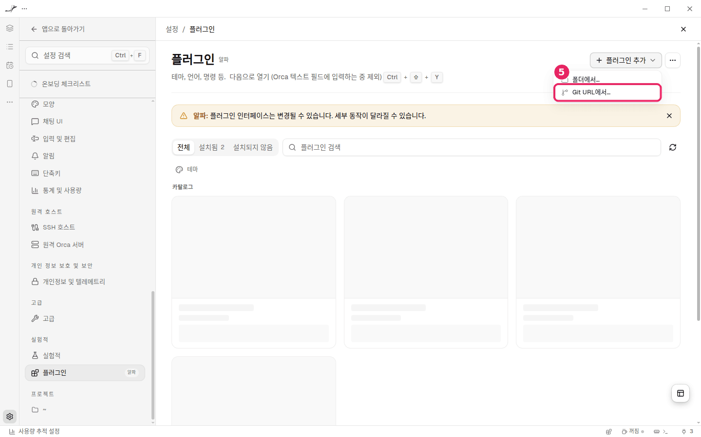
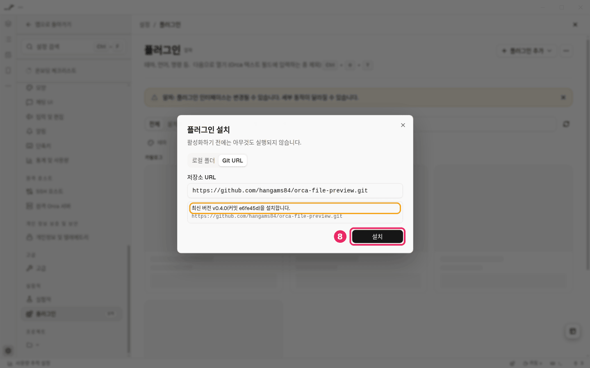
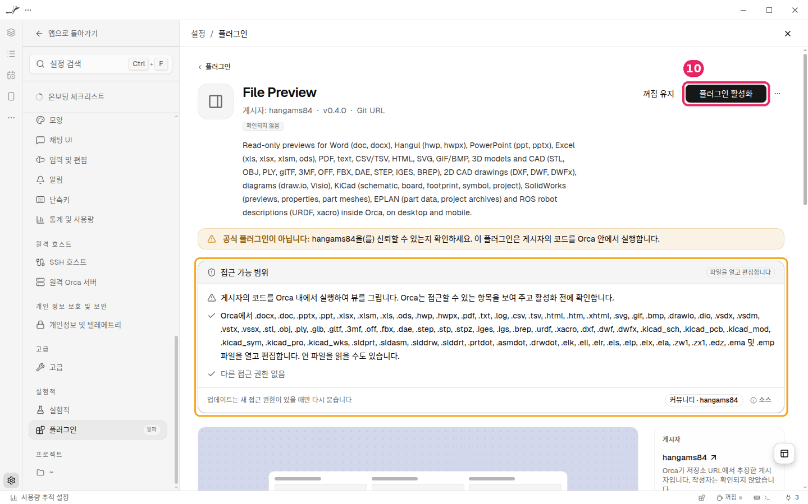

[한국어](README.md) · [English](README.en.md) · [简体中文](README.zh-CN.md) · [繁體中文](README.zh-TW.md) · [日本語](README.ja.md) · [Deutsch](README.de.md) · [Français](README.fr.md) · [Español](README.es.md) · [Português (Brasil)](README.pt-BR.md) · [Русский](README.ru.md) · [Türkçe](README.tr.md)

# File Preview for Orca

[](https://github.com/hangams84/orca-file-preview/actions/workflows/orca-compat.yml)

File Preview는 [Orca](https://github.com/stablyai/orca) 안에서 Office · 한글 · PDF · 텍스트 · 이미지 · 3D · CAD · 전자 설계 파일을
**읽기 전용으로 미리 보여 주는** 플러그인입니다. Orca 데스크톱(Windows · macOS · Linux)과 브라우저/모바일 클라이언트에서 동작합니다.

- 최신 릴리스: **v0.4.0** · Orca **1.4.248** 이상 필요 (Git URL 설치는 **1.4.252** 이상)
- `sandboxed-ui` 방식으로만 실행됩니다. 추가 권한(capability)이나 네트워크 접근을 사용하지 않으며, 파일을 수정하지도 않습니다.

## 지원 형식

| 형식 | 확장자 | 엔진 · 표시 내용 |
| --- | --- | --- |
| Word | `.docx` `.doc` | docx-preview · 자체 OLE/CFB 파서 (RTF·HTML·DOCX로 저장된 `.doc` 자동 감지) |
| PowerPoint | `.pptx` `.ppt` | 자체 OOXML 렌더러 · 자체 PPT 레코드 파서 |
| Excel | `.xlsx` `.xlsm` `.xls` `.ods` | SheetJS CE (Web Worker, 수식 계산 대체, 가상 스크롤) |
| 한글 문서 | `.hwp` `.hwpx` | HWP 5 · HWPX(OWPML)를 한글이 저장한 줄 배치대로 표시. 배포용·암호 문서와 HWP 3은 안내 메시지 표시 |
| PDF | `.pdf` | pdf.js (지연 렌더링, 한글 CMap, 암호 입력) |
| 이미지 | `.gif` `.bmp` `.svg` | 브라우저 디코더 (SVG 스크립트 차단, 배경 선택) |
| 웹 | `.html` `.htm` `.xhtml` | DOMPurify + 샌드박스 iframe (스크립트 미실행) |
| 표 | `.csv` `.tsv` | 자체 RFC 4180 파서 (인코딩·구분자 감지, 정렬, 필터) |
| 텍스트 | `.txt` `.log` | 인코딩 감지 (UTF-8/16, EUC-KR 등), 줄 번호, 자동 줄바꿈 |
| 다이어그램 | `.drawio` `.dio` `.vsdx` `.vsdm` `.vstx` `.vssx` | 자체 SVG 렌더러: draw.io(압축·여러 페이지, 기본 도형·연결선·스타일, HTML 레이블은 DOMPurify로 정제), Visio(마스터·스타일 시트 상속, Geometry 행 전체, 그룹·연결선·텍스트 서식·채우기 패턴·그라데이션·테마·EMF/WMF 그림·배경 페이지). 페이지 선택, 이동·확대·맞춤, 어두운 캔버스, 링크 |
| 3D 모델 | `.stl` `.obj` `.ply` `.glb` `.gltf` `.3mf` `.off` `.fbx` `.dae` | three.js (WebGL, 회전·확대·이동, 터치, Draco·meshopt, Web Worker 파싱). OBJ의 `.mtl`·텍스처, glTF의 외부 `.bin`·이미지, DAE·FBX·3MF 텍스처는 참조 파일(📁 · 끌어 놓기)에서 읽음 |
| CAD (B-rep) | `.step` `.stp` `.stpz` `.iges` `.igs` `.brep` | OpenCascade (occt-import-js, WebAssembly, Web Worker): 어셈블리·부품 목록·색상, 테셀레이션 품질 선택. `.stpz`는 gzip으로 압축한 STEP |
| CAD 2D 도면 | `.dxf` `.dwf` `.dwfx` | 자체 Canvas 2D 렌더러: DXF(ASCII·바이너리, R12–2018+, 블록·치수·해치·MTEXT·한글), DWF(W2D 스트림, 시트, 썸네일 대체), DWFx(XPS 페이지, 내장 글꼴). 레이어 목록, 모형·배치(뷰포트)·시트 선택, 밝은/어두운 배경, 정보 표시줄. DXF 외부 참조(xref)와 IMAGE 엔터티는 참조 파일에서 읽음 (xref 레이어는 `XREF\|레이어`) |
| AutoCAD 도면 (별도 플러그인) | `.dwg` `.dwt` | **File Preview DWG** — [별도 저장소](https://github.com/hangams84/orca-file-preview-dwg), GPL-3.0-or-later, 따로 설치합니다 (Git URL `https://github.com/hangams84/orca-file-preview-dwg.git`, 소스 [dwg-plugin/](dwg-plugin/README.md)). LibreDWG (WebAssembly, Web Worker) + Canvas: 모형/배치, 레이어, 블록, 한글 문자, 치수, 해치 |
| 로봇 모델 (ROS) | `.urdf` `.xacro` | 자체 XML 리더 + xacro 처리기(ROS 2 xacro 2.x 규칙, eval 없는 안전한 식 계산기) + three.js: 기구학 트리, 기본 형상, 원점·재질, 조인트 6종·한계·mimic, 조인트 슬라이더, 외형/충돌/좌표계/조인트 축 표시. `.urdf.xacro`도 엽니다. 메시와 `xacro:include`는 참조 파일에서 읽음 |
| KiCad | `.kicad_sch` `.kicad_pcb` `.kicad_mod` `.kicad_sym` `.kicad_pro` `.kicad_wks` | 자체 S-expression 파서 + SVG 렌더러 (KiCad 6–10, 스트로크 글꼴 newstroke): 회로도, PCB(레이어 표시/숨김, 앞/뒷면 뒤집기), 풋프린트, 심볼 라이브러리, 프로젝트 요약, 패드·핀·넷 정보 툴팁. 프로젝트 폴더를 지정하면 계층 시트 탐색과 사용자 도면 틀 표시 |
| SolidWorks | `.sldprt` `.sldasm` `.slddrw` `.slddrt` `.prtdot` `.asmdot` `.drwdot` | 자체 컨테이너 리더 (2014 이전 OLE/CFB, 2015 이후 형식): 저장된 미리보기 그림, 파트의 표시 메시(3D), **어셈블리 3D**(저장된 배치 + 메시, 없으면 📁로 지정한 파트 파일), 속성·구성·참조 파일·피처 이름·저장 기록 |
| EPLAN Electric P8 | `.edz` `.zw1` `.elk` `.ell` `.elr` `.els` `.ela` `.elp` `.elx` `.zx1` `.ema` `.emp` | 자체 7z(LZMA/LZMA2)·ZIP 리더: EDZ 부품 데이터·그림·PDF 문서, **매크로 그래픽**(PXF: 선·호·곡선·문자, 변형별), 프로젝트 백업의 속성·페이지 설명·**부품 목록**·그림·내용 트리, 링크 파일 + 📁 프로젝트 폴더(`.edb`) |
| AI 모델 (PyTorch) | `.pt` `.pth` `.ckpt` `.chkpt` `.pt2` `.ptl` `.safetensors` | 코드를 **실행하지 않는** 자체 pickle 해석기: state_dict·통째 저장한 모듈·TorchScript·torch.export·Lightning 체크포인트·레거시 pickle, safetensors. 보기 7종(**연산 그래프**·모듈 트리·레이어 표·파라미터 맵·아키텍처 도식(추론)·**텐서 검사기**·체크포인트 정보)과 SVG/PNG/JSON/Markdown 내보내기. File Preview 패널은 범위 읽기로 GB 단위 파일도 열고, 내용으로 판별한 bin·pkl 파일도 엽니다 |
| AI 모델 (ONNX·TFLite·GGUF·Keras·NumPy) | `.onnx` `.tflite` `.gguf` `.keras` `.h5` `.hdf5` `.npy` `.npz` | 같은 보기로 표시: ONNX·TFLite·Keras 연산 그래프, GGUF 메타데이터와 양자화 텐서(Q4_K 등) 값, HDF5·NumPy 배열. ONNX 외부 데이터는 📁 폴더로 연결 |
| (읽을 수 없는 파일) | 위 형식 전체 | 일반 검사기: 형식 식별, 크기, 엔트로피, 16진수 덤프, 문자열 |
| **File Preview 패널** | 위 형식 전체 | 오른쪽 사이드바 패널. 아래 [File Preview 패널](#file-preview-패널) 참고 |

공통: 다크/라이트 테마 실시간 반영, 한국어/영어 UI, Ctrl+휠 · 핀치 · 버튼으로 확대/축소, 휴대폰 화면 폭 맞춤,
파일이 바뀌면 자동 갱신, 손상된 파일은 친절한 오류 안내.

### 텍스트 형식도 바로 미리보기로 열립니다 (0.4.0)

URDF·xacro, KiCad, draw.io, ASCII DXF, STEP·IGES·BREP, OBJ 등 텍스트로 된 3D 형식, RTF/HTML로 저장된 `.doc`,
XML `.xls`는 Orca가 텍스트 파일로 인식합니다. 플러그인이 이러한 파일용 텍스트 편집기를 따로 등록하므로 이제 기본적으로
미리보기로 열립니다. 단, Orca가 직접 여는 형식(`.txt` `.csv` `.tsv` `.html` `.htm`)은 Orca 규칙에 따라 ‘소스’ 보기로 먼저 열립니다.
탭 오른쪽 위의 보기 전환 버튼에서 미리보기를 선택하면 됩니다.

### 참조 파일 (📁 · 끌어 놓기)

Orca는 편집기에 연 파일 하나만 플러그인에 전달합니다. 툴바의 📁 버튼으로 폴더를 선택하거나(Shift를 누른 채 누르면 파일 선택) 파일을 미리보기에
끌어다 놓으면, 플러그인이 샌드박스 프레임 안에서 그 파일들을 함께 읽습니다.

| 미리보기 | 폴더나 파일을 지정하면 추가되는 기능 |
| --- | --- |
| 로봇 (URDF/xacro) | 메시(STL, 텍스처가 있는 DAE, `.mtl`이 있는 OBJ, glTF)가 자리 표시자를 대체하고 조인트 자세는 유지. `xacro:include` 처리(`$(find pkg)`, 상대 경로, 중첩) |
| 3D | OBJ 재질과 텍스처, glTF 외부 `.bin`과 이미지, DAE 텍스처 |
| CAD 도면 (DXF) | 외부 참조(xref)를 `XREF\|레이어`로 삽입, IMAGE 엔터티 표시 |
| KiCad | 하위 시트 탐색(인스턴스별 참조 기호), `.kicad_pro` → 회로도·보드, 사용자 `.kicad_wks` |
| SolidWorks | 저장된 배치로 **어셈블리 3D** 표시 (2015 이후 파일은 파트 파일 불필요, 2014 파일은 지정한 파트 파일 사용) |
| EPLAN | 매크로 그래픽 표시(`.ema` `.emp`, `.edz` 안의 매크로), `.elk` + `.edb` 폴더 → 프로젝트 속성, 페이지, 부품 목록 |

### File Preview 패널

오른쪽 사이드바의 **File Preview** 패널에서 "파일 열기…", "폴더 열기…" 또는 끌어 놓기로 파일을 열면 같은 렌더러로 표시합니다.
Orca 편집기의 50 MB 한도가 적용되지 않으며(렌더러 자체 한도만 적용, 최대 1 GB) 워크스페이스 밖의 파일도 열 수 있습니다. 함께 연 파일은
참조 파일로 사용됩니다. 추가 권한은 필요하지 않습니다.

## 설치

### (a) Orca 앱에서 설치 (권장)

Orca **1.4.252** 이상에서 사용할 수 있습니다.

1. **설정** → **플러그인**을 엽니다.
2. **플러그인 추가** → **Git URL에서…**를 선택합니다.
3. **저장소 URL**에 `https://github.com/hangams84/orca-file-preview.git`을 붙여 넣고 **계속** → **설치**를 누릅니다.
4. Orca가 보여 주는 권한(샌드박스 화면 표시만)을 확인하고 **플러그인 활성화**를 누릅니다.

화면별 안내: [docs/install-guide/ko.md](docs/install-guide/ko.md)

<!-- install-guide-thumbs -->
<a href="docs/install-guide/ko.md"></a>

`.dwg` · `.dwt` 미리보기가 필요하면 같은 방법으로 `https://github.com/hangams84/orca-file-preview-dwg.git`도 설치합니다.

### (b) CLI로 설치

```sh
# GitHub에서 최신 버전 설치 (Orca 1.4.252+). Orca가 요청 권한과 승인 지문을 출력합니다.
orca plugin install https://github.com/hangams84/orca-file-preview
orca plugin install https://github.com/hangams84/orca-file-preview --approve <fingerprint>
# 특정 버전: https://github.com/hangams84/orca-file-preview#v0.5.0

# 또는 로컬 폴더
orca plugin install ./plugin
```

### (c) 릴리스 패키지 · 실행 파일 · 스크립트

[GitHub Releases](https://github.com/hangams84/orca-file-preview/releases)에서 내려받습니다. Orca 1.4.248 이상이 설치되어 있고
한 번 이상 실행된 PC가 필요하며, 관리자 권한은 필요 없습니다. 모든 설치 프로그램은 Orca가 요청하는 권한을 보여 주고,
사용자가 확인한 뒤에만 승인합니다.

| OS | 실행 파일 | 스크립트 (zip · tar.gz 패키지) |
| --- | --- | --- |
| Windows 10/11 | `FilePreviewSetup-<버전>.exe` (메뉴: 설치 · 업데이트 · 제거 · 상태) | `installer\windows\install.cmd` |
| macOS | `File-Preview-Setup-<버전>-macos.zip` → *File Preview Setup.app* | `installer/macos/Install File Preview.command` |
| macOS · Linux | `sh file-preview-setup-<버전>.run [install\|update\|uninstall\|status]` | `sh installer/linux/install.sh` (Linux) |

실행 파일은 코드 서명이 되어 있지 않습니다. Windows SmartScreen이 차단하면 *추가 정보* → *실행*을, macOS Gatekeeper가 차단하면 Control-클릭 → *열기*를 선택합니다.
Orca 1.4.248–1.4.251에는 `plugin install`이 없어 설치 스크립트가 개발 폴더 등록(`plugin dev load`) 방식으로 설치합니다. 이 경우 해당 폴더를 삭제하지 마세요.
Windows 7/8은 Orca가 지원하지 않으므로 설치 프로그램이 안내 메시지를 표시하고 설치를 거부합니다(Windows 10 이상 필요).
자세한 옵션: [installer/README.md](installer/README.md)

### (d) 업데이트와 제거

- **Orca 앱·CLI로 설치한 경우**: `orca plugin list`로 플러그인 키를 확인한 뒤 `orca plugin update <키>`로 업데이트하고
  `orca plugin uninstall <키>`로 제거합니다. Git URL로 설치한 경우 업데이트하면 최신 버전 태그로 이동합니다.
- **실행 파일**: `FilePreviewSetup-<버전>.exe`의 메뉴(또는 `/update` · `/uninstall`), `file-preview-setup-<버전>.run update|uninstall`,
  macOS는 *File Preview Setup.app*에서 선택합니다.
- **스크립트**: Windows `installer\windows\update.cmd` · `uninstall.cmd`, macOS `Update File Preview.command` ·
  `Uninstall File Preview.command`, Linux `sh installer/linux/update.sh` · `sh installer/linux/uninstall.sh`.
- 업데이트는 이 저장소의 최신 GitHub 릴리스를 확인하고, 패키지를 내려받아 SHA-256을 검증한 뒤 승인을 거쳐 다시 설치합니다.
  직전 버전 하나를 보관합니다. `--check`(Windows `-Check`)는 업데이트 여부만 확인합니다.

## 제한 사항

- **50 MB 읽기 한도**: Orca는 플러그인 편집기에 파일을 최대 50 MB까지만 전달합니다(이미지·PDF 제외, 플러그인에서 바꿀 수 없음,
  [stablyai/orca#46775](https://github.com/stablyai/orca/issues/46775)). 플러그인 자체 한도는 1 GB입니다. 더 큰 파일은
  [File Preview 패널](#file-preview-패널)로 여세요. STEP 파일은 gzip으로 압축해 `.stpz`로 열 수도 있습니다(보통 5–8배 줄어듭니다):
  `gzip -c model.step > model.stpz`.
- **CAD 엔진 크기**: OpenCascade(32비트 WebAssembly, 최대 4 GB 메모리)의 실질적인 상한은 STEP 원본 기준 약 200 MB입니다.
  실측(부품이 많은 합성 어셈블리): 61 MB 1.5분 · 189 MB 14분 · 343 MB는 30분 안에 끝나지 않음 · 412 MB는 메모리 부족.
- **‘소스’ 보기로 먼저 열리는 형식**: `.txt` `.csv` `.tsv` `.html` `.htm`은 Orca가 직접 여는 형식이라 ‘소스’ 보기가 먼저 열립니다.
  미리보기는 보기 전환 버튼에서 선택합니다.
- **표시하지 않는 내용**:
  - EPLAN: 회로도 페이지(EPLAN 고유 바이너리 객체 저장소 `.eod`/`.eox`)와 심볼 라이브러리 그래픽.
  - SolidWorks: 정확한 B-rep 형상과 도면 뷰는 다시 그리지 않고 저장된 그림을 보여 줍니다. 숨김·억제된 구성 요소는 목록에만 표시됩니다.
  - draw.io: 내장되지 않은 스텐실 라이브러리(`mxgraph.aws4.*` 등)는 이름이 적힌 점선 상자로, 원격 그림은 자리 표시자로 표시됩니다.
  - Visio: 수식은 계산하지 않고 저장된 값을 씁니다. 바이너리 `.vsd`는 지원하지 않습니다(안내 메시지).
  - DWF: 해석할 수 없는 명령이 포함된 시트는 패키지에 저장된 썸네일과 안내 메시지를 보여 줍니다.
  - DWG(별도 플러그인): 3D 솔리드·영역(ACIS), 래스터 이미지 내용, OLE, xref는 그리지 않고 목록으로 알립니다.
  - Office: PPTX의 차트·SmartArt와 스프레드시트의 셀 스타일은 단순화해 표시하며, 스프레드시트는 처음 20,000행만 보여 줍니다.
    `.hwp`의 수식·차트·OLE 개체는 이름이 붙은 상자로 표시합니다.
- 모바일 클라이언트는 실제 기기가 아니라 브라우저 하네스(휴대폰 프로필, WebKit, 구형 엔진 모드)로 테스트했습니다.

<a id="ci-matrix"></a>

## Orca 버전별 호환성 (CI)

아래 표는 `.github/workflows/orca-compat.yml`이 각 Orca 릴리스를 새로 설치한 뒤 플러그인을 설치하고 테스트한 결과입니다.
플러그인, 설치 스크립트, 테스트 도구의 변경 사항이 `main`에 푸시되면 워크플로가 자동으로 실행되고 표도 함께 갱신됩니다.

<!-- ci-matrix:start -->
**Orca compatibility CI** — ✅ all passing · 2026-11-27 07:07 UTC · [run](https://github.com/hangams84/orca-file-preview/actions/runs/45954026948)

| Orca | Ubuntu 24.04 (Docker) | Ubuntu 26.04 (Docker) | macOS 15 arm64 | Windows 10 kernel (Server 2022) | Windows 11 kernel (Server 2025) |
| --- | --- | --- | --- | --- | --- |
| 1.4.277 | ✅ 9/9 | ✅ 9/9 | ✅ 12/12 | ✅ 10/10 | ✅ 10/10 |
| 1.4.258 | ✅ 9/9 | ✅ 9/9 | ✅ 12/12 | ✅ 10/10 | ✅ 10/10 |
| 1.4.257 | ✅ 9/9 | — | — | — | — |
| 1.4.256 | ✅ 9/9 | — | — | — | — |
| 1.4.255 | ✅ 9/9 | — | — | — | — |
| 1.4.254 | ✅ 9/9 | — | — | — | — |
| 1.4.253 | ✅ 9/9 | ✅ 9/9 | ✅ 12/12 | ✅ 10/10 | ✅ 10/10 |
| 1.4.252 | ✅ 9/9 | — | — | — | — |
| 1.4.251 | ✅ 9/9 | — | — | — | — |
| 1.4.250 | ✅ 9/9 | — | — | — | — |
| 1.4.249 | ✅ 9/9 | — | — | — | — |
| 1.4.248 | ✅ 9/9 | ✅ 9/9 | ✅ 12/12 | ✅ 10/10 | ✅ 10/10 |
| 1.4.247 (below min, informational) | ✅ 9/9 | — | — | — | — |

Windows 7: ✅ the installer refuses with a clear message — Orca (Electron 23+) needs Windows 10 or later, and no Windows 7 CI runners exist. Windows 10/11 columns run on GitHub's Windows Server images, which share the Windows 10 (build 20348) and Windows 11 24H2 (build 26100) kernels; Windows 11 Pro 26200 was also tested on a real PC.

Each cell: a fresh Orca install of that version → plugin install with approval → validate · unit tests · static check → every fixture opened in the plugin editor → finished renders captured → plugin log free of errors (Windows also installs and removes through `installer/windows`). 1.4.247 is below the declared minimum (`engines.orca` >=1.4.248): Orca does not enforce that for folder installs, so its row is informational.
<!-- ci-matrix:end -->

### 운영체제별 테스트

실제 Orca(1.4.258)를 새로 설치하고 플러그인 설치 → 검사 → 단위 테스트 → 전체 픽스처 마운트 → 렌더 캡처를 수행합니다.

| 환경 | 실행 | 결과 |
| --- | --- | --- |
| Ubuntu 22.04 / 24.04 / 26.04 | `bash tools/platform-test/run-docker.sh 22.04 24.04 26.04` (WSL2 또는 Linux의 Docker, Xvfb) | 9/9 · 9/9 · 9/9 (26.04.1, Orca 1.4.277) |
| macOS 15 (arm64) | GitHub Actions `platform-macos` 워크플로 (`gh workflow run platform-macos --ref ci/macos-orca`) | 12/12 |
| Windows 11 | `node tools/verify.mjs --round <n>` (설치된 Orca 앱) | 10/10 |

증빙: `docs/evidence/platforms/` (summary.md, contact-sheet.png, 캡처, 로그)

## 개발

```sh
npm ci
npm run vendor            # 서드파티 라이브러리를 plugin/vendor로 번들
orca plugin dev load plugin --approve <fingerprint>
npm run typecheck
node tools/harness/run.mjs --only docx,pdf --profiles desktop-dark,mobile-light
node tools/verify.mjs --round <n> && node tools/build-docs.mjs
node tools/check-readmes.mjs   # README 11개 언어의 언어 표시줄·링크·형식 표 검사
```

### 저장소 구조

```text
plugin/            배포되는 플러그인 (orca-plugin.json, editor/, panel/, vendor/)
dwg-plugin/        File Preview DWG 소스 (GPL-3.0-or-later, 별도 플러그인)
installer/         Windows · macOS · Linux 설치 스크립트
samples/           테스트 픽스처 (tools/make-samples.py 등)
tools/harness/     Orca와 같은 CSP + 모의 호스트 브라우저 하네스 (Playwright)
tools/verify.mjs   검증 라운드 실행기 (tsc, validate, 단위 테스트, 하네스 4종, fuzz, Orca 앱 캡처)
docs/              개발·검증 문서 (README.md, index.html, evidence/, release-notes/)
```

검증 기록과 스크린샷은 [docs/README.md](docs/README.md) · [docs/index.html](docs/index.html)에, 변경 내역은 [CHANGELOG.md](CHANGELOG.md)에 있습니다.

## 라이선스

이 프로젝트는 MIT 라이선스로 배포됩니다([LICENSE](LICENSE)). 번들된 라이브러리는 각각의 라이선스를 따릅니다:
[plugin/THIRD_PARTY_NOTICES.md](plugin/THIRD_PARTY_NOTICES.md).
`.dwg` · `.dwt`용 **File Preview DWG**는 GPL-3.0-or-later인 별도 플러그인이며 이 MIT 플러그인에 포함되지 않습니다.
