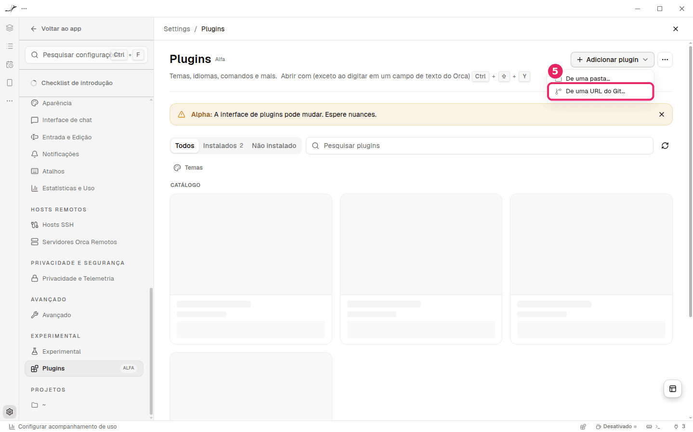
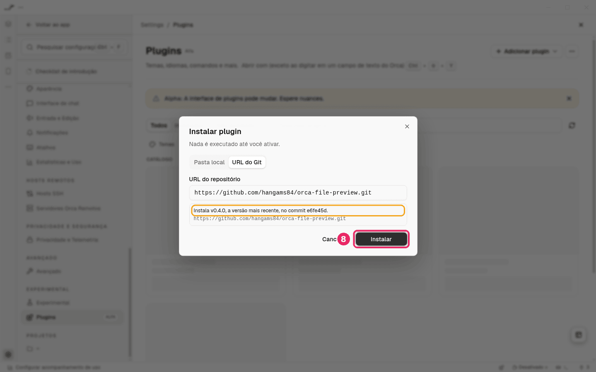
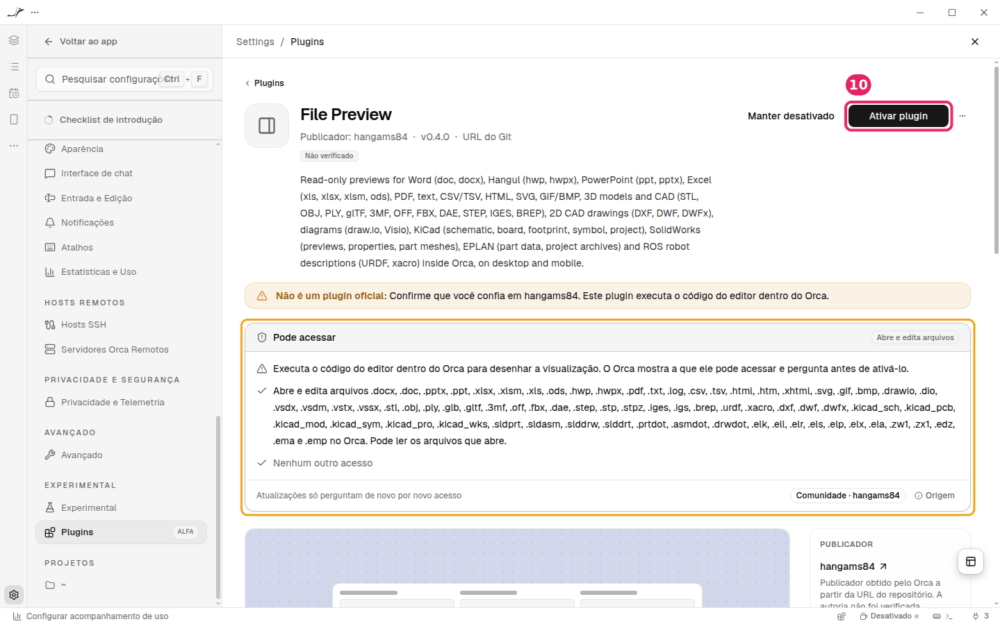

[한국어](README.md) · [English](README.en.md) · [简体中文](README.zh-CN.md) · [繁體中文](README.zh-TW.md) · [日本語](README.ja.md) · [Deutsch](README.de.md) · [Français](README.fr.md) · [Español](README.es.md) · [Português (Brasil)](README.pt-BR.md) · [Русский](README.ru.md) · [Türkçe](README.tr.md)

# File Preview for Orca

[](https://github.com/hangams84/orca-file-preview/actions/workflows/orca-compat.yml)

O File Preview é um plugin para o [Orca](https://github.com/stablyai/orca) que mostra, dentro do Orca, **visualizações somente
leitura** de arquivos do Office, Hangul, PDF, texto, imagem, 3D, CAD e projeto eletrônico. Funciona no Orca para desktop
(Windows · macOS · Linux) e nos clientes para navegador e dispositivos móveis.

- Versão mais recente: **v0.4.0** · requer o Orca **1.4.248** ou posterior (**1.4.252** ou posterior para instalar pela URL do Git)
- Usa apenas a execução `sandboxed-ui`: sem permissões extras (capabilities) nem acesso à rede, e nunca altera os seus arquivos.

## Formatos compatíveis

| Formato | Extensões | Mecanismo · o que é exibido |
| --- | --- | --- |
| Word | `.docx` `.doc` | docx-preview · analisador OLE/CFB próprio (detecta arquivos `.doc` salvos como RTF, HTML ou DOCX) |
| PowerPoint | `.pptx` `.ppt` | Renderizador OOXML próprio · analisador de registros PPT próprio |
| Excel | `.xlsx` `.xlsm` `.xls` `.ods` | SheetJS CE (Web Worker, cálculo alternativo de fórmulas, rolagem virtual) |
| Hangul | `.hwp` `.hwpx` | HWP 5 e HWPX (OWPML), com o layout de linhas que o Hangul salvou. Para documentos protegidos para distribuição ou com senha e arquivos HWP 3, é exibida uma mensagem clara |
| PDF | `.pdf` | pdf.js (renderização sob demanda, CMaps coreanos, solicitação de senha) |
| Imagens | `.gif` `.bmp` `.svg` | Decodificador do navegador (scripts SVG bloqueados, escolha do plano de fundo) |
| Web | `.html` `.htm` `.xhtml` | DOMPurify + iframe em sandbox (os scripts nunca são executados) |
| Tabelas | `.csv` `.tsv` | Analisador RFC 4180 próprio (detecção de codificação e delimitador, ordenação, filtro) |
| Texto | `.txt` `.log` | Detecção de codificação (UTF-8/16, EUC-KR e outras), números de linha, quebra de linha |
| Diagramas | `.drawio` `.dio` `.vsdx` `.vsdm` `.vstx` `.vssx` | Renderizador SVG próprio: draw.io (arquivos compactados e com várias páginas, formas integradas, conectores, estilos, rótulos HTML higienizados com DOMPurify), Visio (herança de mestres e folhas de estilo, todas as linhas Geometry, grupos, conectores, formatação de texto, padrões de preenchimento, gradientes, temas, imagens EMF/WMF, páginas de plano de fundo). Seletor de páginas, deslocamento, zoom e ajuste à tela, área de desenho escura, links |
| Modelos 3D | `.stl` `.obj` `.ply` `.glb` `.gltf` `.3mf` `.off` `.fbx` `.dae` | three.js (WebGL, rotação, zoom, deslocamento, toque, Draco e meshopt, análise em um Web Worker). Arquivos `.mtl` e texturas de OBJ, `.bin` externos e imagens de glTF e texturas de DAE/FBX/3MF são lidos dos arquivos complementares (📁 ou arrastar e soltar) |
| CAD (B-rep) | `.step` `.stp` `.stpz` `.iges` `.igs` `.brep` | OpenCascade (occt-import-js, WebAssembly, Web Worker): montagens, lista de peças, cores, qualidade de tesselação ajustável. `.stpz` é STEP compactado com gzip |
| Desenhos CAD 2D | `.dxf` `.dwf` `.dwfx` | Renderizador Canvas 2D próprio: DXF (ASCII e binário, R12–2018+, blocos, cotas, hachuras, MTEXT, texto em coreano), DWF (fluxos W2D, folhas, miniatura como alternativa), DWFx (páginas XPS, fontes incorporadas). Lista de camadas, seletor de modelo/layout (viewports)/folha, fundo claro ou escuro, barra de informações. Referências externas (xrefs) do DXF e entidades IMAGE são lidas dos arquivos complementares (camadas de xref aparecem como `XREF\|camada`) |
| Desenhos do AutoCAD (plugin separado) | `.dwg` `.dwt` | **File Preview DWG**: [repositório separado](https://github.com/hangams84/orca-file-preview-dwg), GPL-3.0-or-later, instalado à parte (URL do Git `https://github.com/hangams84/orca-file-preview-dwg.git`, código-fonte em [dwg-plugin/](dwg-plugin/README.md)). LibreDWG (WebAssembly, Web Worker) + Canvas: modelo e layouts, camadas, blocos, texto em coreano, cotas, hachuras |
| Modelos de robôs (ROS) | `.urdf` `.xacro` | Leitor XML e processador xacro próprios (regras do ROS 2 xacro 2.x, avaliador de expressões seguro sem eval) + three.js: árvore cinemática, formas primitivas, origens e materiais, os seis tipos de junta, limites, mimic, controles deslizantes das juntas, exibição de visual/colisão/sistemas de coordenadas/eixos das juntas. Também abre `.urdf.xacro`. Malhas e arquivos de `xacro:include` são lidos dos arquivos complementares |
| KiCad | `.kicad_sch` `.kicad_pcb` `.kicad_mod` `.kicad_sym` `.kicad_pro` `.kicad_wks` | Analisador de S-expressions e renderizador SVG próprios (KiCad 6–10, fonte de traços newstroke do KiCad): esquemáticos, placas (mostrar/ocultar camadas, inverter frente/verso), footprints, bibliotecas de símbolos, resumo do projeto, dicas de ferramenta com informações de pads, pinos e redes. Com a pasta do projeto: navegação pelas folhas hierárquicas e folhas de desenho (moldura e carimbo) personalizadas |
| SolidWorks | `.sldprt` `.sldasm` `.slddrw` `.slddrt` `.prtdot` `.asmdot` `.drwdot` | Leitor de contêiner próprio (OLE/CFB até 2014, formato de 2015 em diante): imagens de visualização salvas, malha de exibição da peça em 3D, **montagem 3D** (posições salvas + malhas ou, se não houver, arquivos de peça fornecidos com 📁), propriedades, configurações, arquivos referenciados, nomes de recursos, histórico de salvamento |
| EPLAN Electric P8 | `.edz` `.zw1` `.elk` `.ell` `.elr` `.els` `.ela` `.elp` `.elx` `.zx1` `.ema` `.emp` | Leitor 7z (LZMA/LZMA2) e ZIP próprio: dados de peças EDZ, imagens e documentos PDF, **gráficos de macros** (PXF: linhas, arcos, curvas, textos, por variante), backups de projeto com propriedades, descrições de páginas, **lista de peças**, imagens e árvore de conteúdo, arquivos de link + pasta do projeto 📁 (`.edb`) |
| Modelos de IA (PyTorch) | `.pt` `.pth` `.ckpt` `.chkpt` `.pt2` `.ptl` `.safetensors` | Interpretador pickle próprio que **nunca executa código**: state_dict, módulos salvos por inteiro, TorchScript, torch.export, checkpoints do Lightning, pickles no formato antigo e safetensors. Sete visualizações (**grafo de operadores**, árvore de módulos, tabela de camadas, mapa de parâmetros, diagrama de arquitetura inferido, **inspetor de tensores**, informações do checkpoint) e exportação para SVG/PNG/JSON/Markdown. O painel File Preview lê por intervalos de bytes, então abre arquivos de vários GB e também arquivos bin e pkl reconhecidos pelo conteúdo |
| Modelos de IA (ONNX, TFLite, GGUF, Keras, NumPy) | `.onnx` `.tflite` `.gguf` `.keras` `.h5` `.hdf5` `.npy` `.npz` | As mesmas visualizações: grafos de operadores de ONNX, TFLite e Keras, metadados GGUF e valores de tensores quantizados (Q4_K e outros), arrays HDF5 e NumPy. Dados externos do ONNX pela pasta 📁 |
| (arquivos ilegíveis) | Todos os formatos acima | Inspetor genérico: identificação do formato, tamanho, entropia, dump hexadecimal, strings |
| **Painel File Preview** | Todos os formatos acima | Um painel na barra lateral direita; veja [Painel File Preview](#painel-file-preview) abaixo |

Em todos os casos: o tema escuro ou claro acompanha o Orca em tempo real, interface em coreano ou inglês, zoom com Ctrl+roda do mouse,
gesto de pinça ou botões, ajuste à largura da tela em celulares, atualização automática quando o arquivo muda e uma mensagem clara para
arquivos danificados.

### Formatos de texto abrem direto na visualização (0.4.0)

O Orca trata como texto os arquivos URDF, xacro, KiCad, draw.io, DXF ASCII, STEP/IGES/BREP, OBJ e os demais formatos 3D em texto, além
de arquivos `.doc` salvos como RTF/HTML e `.xls` em XML. O plugin registra editores de texto para eles, então agora esses arquivos
abrem na visualização por padrão. Os arquivos que o próprio Orca abre (`.txt` `.csv` `.tsv` `.html` `.htm`) continuam abrindo
primeiro na visualização “Origem”, conforme as regras do Orca; escolha a visualização com o alternador de modo de exibição no canto
superior direito da aba.

### Arquivos complementares (📁 ou arrastar e soltar)

O Orca entrega ao editor apenas o arquivo que você abriu. Escolha uma pasta com o botão 📁 da barra de ferramentas (segure Shift
para escolher arquivos avulsos) ou solte arquivos sobre a visualização, e o plugin os lê junto com o arquivo, dentro do próprio quadro em sandbox:

| Visualização | O que uma pasta ou os arquivos soltos acrescentam |
| --- | --- |
| Robô (URDF/xacro) | As malhas (STL, DAE com texturas, OBJ com `.mtl`, glTF) substituem os marcadores de posição e a pose das juntas é mantida; `xacro:include` é resolvido (`$(find pkg)`, caminhos relativos, inclusões aninhadas) |
| 3D | Materiais e texturas de OBJ, `.bin` externos e imagens de glTF, texturas de DAE |
| Desenho CAD (DXF) | Referências externas (xrefs) inseridas como `XREF\|camada`, entidades IMAGE desenhadas |
| KiCad | Navegação pelas subfolhas com designadores de referência por instância, `.kicad_pro` → esquemático e placa, `.kicad_wks` personalizado |
| SolidWorks | **Montagem 3D** a partir das posições salvas (arquivos de 2015 em diante não precisam das peças; os de 2014 usam as peças fornecidas) |
| EPLAN | Macros desenhadas (`.ema` `.emp`, macros dentro de `.edz`); `.elk` + pasta `.edb` → propriedades do projeto, páginas, lista de peças |

### Painel File Preview

Abra o painel **File Preview** na barra lateral direita e use "Open file…", "Open folder…" ou arrastar e soltar (a interface do
plugin está disponível apenas em coreano e inglês). O arquivo é exibido com os mesmos renderizadores, sem o limite de 50 MB do editor
do Orca (valem apenas os limites dos renderizadores, até 1 GB), inclusive arquivos fora de um espaço de trabalho. Arquivos abertos
juntos servem como arquivos complementares. O painel não precisa de permissões extras.

## Instalação

### (a) No aplicativo Orca (recomendado)

Requer o Orca **1.4.252** ou posterior.

1. Abra **Configurações** → **Plugins**.
2. Escolha **Adicionar plugin** → **De uma URL do Git…**.
3. Cole `https://github.com/hangams84/orca-file-preview.git` em **URL do repositório** e clique em **Continuar** → **Instalar**.
4. Confira as permissões que o Orca mostra (somente exibição em sandbox) e clique em **Ativar plugin**.

Guia passo a passo com capturas de tela: [docs/install-guide/pt-BR.md](docs/install-guide/pt-BR.md)

<!-- install-guide-thumbs -->
<a href="docs/install-guide/pt-BR.md"></a>

Para `.dwg` e `.dwt`, instale da mesma forma `https://github.com/hangams84/orca-file-preview-dwg.git`.

### (b) Pela linha de comando

```sh
# Instalar a versão mais recente do GitHub (Orca 1.4.252+). O Orca mostra os acessos solicitados e uma impressão digital de aprovação.
orca plugin install https://github.com/hangams84/orca-file-preview
orca plugin install https://github.com/hangams84/orca-file-preview --approve <fingerprint>
# Uma versão específica: https://github.com/hangams84/orca-file-preview#v0.5.0

# Ou a partir de uma pasta local
orca plugin install ./plugin
```

### (c) Pacotes de versão, executáveis e scripts

Baixe-os em [GitHub Releases](https://github.com/hangams84/orca-file-preview/releases). É preciso um computador com o Orca 1.4.248
ou posterior instalado e aberto pelo menos uma vez; não são necessários privilégios de administrador. Todos os instaladores mostram
as permissões que o Orca solicita e só as aprovam depois da sua confirmação.

| Sistema | Executável | Scripts (pacote zip ou tar.gz) |
| --- | --- | --- |
| Windows 10/11 | `FilePreviewSetup-<versão>.exe` (menu: instalar · atualizar · desinstalar · status) | `installer\windows\install.cmd` |
| macOS | `File-Preview-Setup-<versão>-macos.zip` → *File Preview Setup.app* | `installer/macos/Install File Preview.command` |
| macOS · Linux | `sh file-preview-setup-<versão>.run [install\|update\|uninstall\|status]` | `sh installer/linux/install.sh` (Linux) |

Os executáveis não são assinados. Se o Windows SmartScreen bloquear algum, escolha *Mais informações* → *Executar assim mesmo*; no
macOS, use Control-clique → *Abrir* para passar pelo Gatekeeper. O Orca 1.4.248–1.4.251 não tem `plugin install`, então os
instaladores registram a pasta como plugin de desenvolvimento (`plugin dev load`); nesse caso, não exclua a pasta. No Windows 7/8, os
instaladores recusam a instalação com uma mensagem clara, pois o Orca exige o Windows 10 ou posterior. Todas as opções: [installer/README.md](installer/README.md)

### (d) Atualizar e desinstalar

- **Instalado pelo aplicativo Orca ou pela CLI**: encontre a chave do plugin com `orca plugin list`, atualize com
  `orca plugin update <chave>` e remova com `orca plugin uninstall <chave>`. Uma instalação pela URL do Git passa para a tag de versão
  mais recente ao ser atualizada.
- **Executáveis**: o menu do `FilePreviewSetup-<versão>.exe` (ou `/update` · `/uninstall`), `file-preview-setup-<versão>.run update|uninstall`
  ou o *File Preview Setup.app* no macOS.
- **Scripts**: Windows `installer\windows\update.cmd` · `uninstall.cmd`, macOS `Update File Preview.command` ·
  `Uninstall File Preview.command`, Linux `sh installer/linux/update.sh` · `sh installer/linux/uninstall.sh`.
- A atualização verifica a versão mais recente deste repositório no GitHub, baixa o pacote, confere o SHA-256 e reinstala após a sua
  aprovação. A versão anterior é mantida. `--check` (no Windows, `-Check`) apenas verifica.

## Limitações

- **Limite de leitura de 50 MB**: o Orca entrega ao editor de um plugin no máximo 50 MB de um arquivo (exceto imagens e PDFs; um plugin
  não pode mudar isso, veja [stablyai/orca#46775](https://github.com/stablyai/orca/issues/46775)). O próprio plugin aceita até 1 GB.
  Abra arquivos maiores no [painel File Preview](#painel-file-preview). Arquivos STEP também podem ser compactados com gzip e abertos
  como `.stpz` (o STEP costuma ficar de 5 a 8 vezes menor): `gzip -c model.step > model.stpz`.
- **Tamanho suportado pelo mecanismo CAD**: o OpenCascade (WebAssembly de 32 bits, até 4 GB de memória) tem limite prático de cerca
  de 200 MB de arquivo STEP. Medições em montagens sintéticas com muitas peças: 61 MB em 1,5 min · 189 MB em 14 min · 343 MB não termina em 30 min ·
  412 MB fica sem memória.
- **Formatos que abrem primeiro na visualização “Origem”**: o próprio Orca abre `.txt` `.csv` `.tsv` `.html` `.htm`, então a visualização
  “Origem” aparece primeiro. Escolha a visualização com o alternador de modo de exibição.
- **O que não é desenhado**:
  - EPLAN: páginas de esquema (armazenamento binário de objetos próprio do EPLAN, `.eod`/`.eox`) e gráficos das bibliotecas de símbolos.
  - SolidWorks: a geometria B-rep exata e as vistas de desenho não são redesenhadas; em seu lugar aparecem as imagens salvas. Componentes
    ocultos e suprimidos são listados, mas não desenhados.
  - draw.io: bibliotecas de formas (stencils) não incluídas (`mxgraph.aws4.*` e outras) aparecem como uma caixa tracejada com o nome da forma;
    imagens remotas, como um marcador de posição.
  - Visio: as fórmulas não são avaliadas (são usados os valores salvos). O formato binário `.vsd` não é compatível (é exibida uma mensagem clara).
  - DWF: uma folha com comandos de desenho que o leitor não consegue processar mostra a miniatura salva no pacote e um aviso.
  - DWG (plugin separado): sólidos 3D e regiões (ACIS), conteúdo de imagens raster, objetos OLE e xrefs não são desenhados; são apenas
    listados em uma nota.
  - Office: gráficos e SmartArt em PPTX e estilos de célula em planilhas são simplificados; as planilhas mostram as primeiras 20.000
    linhas. Equações, gráficos e objetos OLE em `.hwp` aparecem como caixas rotuladas.
- Os clientes móveis foram testados com o ambiente de testes no navegador (perfis de celular, WebKit, modo de mecanismo antigo), não em
  aparelhos físicos.

## Compatibilidade

Orca **1.4.248** ou posterior; a instalação pela URL do Git exige **1.4.252** ou posterior. A CI de compatibilidade instala do zero cada
versão do Orca no Ubuntu, no macOS e no Windows, instala o plugin e o testa. A tabela de resultados é mantida em um único lugar, o
README em coreano: [Compatibilidade com o Orca (CI)](README.md#ci-matrix). Evidências dos testes por plataforma:
`docs/evidence/platforms/`.

## Desenvolvimento

```sh
npm ci
npm run vendor            # empacotar as bibliotecas de terceiros em plugin/vendor
orca plugin dev load plugin --approve <fingerprint>
npm run typecheck
node tools/harness/run.mjs --only docx,pdf --profiles desktop-dark,mobile-light
node tools/verify.mjs --round <n> && node tools/build-docs.mjs
node tools/check-readmes.mjs   # verificar a barra de idiomas, os links e a tabela de formatos dos 11 READMEs
```

### Estrutura do repositório

```text
plugin/            o plugin distribuído (orca-plugin.json, editor/, panel/, vendor/)
dwg-plugin/        código-fonte do File Preview DWG (GPL-3.0-or-later, plugin separado)
installer/         scripts de instalação para Windows · macOS · Linux
samples/           arquivos de teste (tools/make-samples.py e outros)
tools/harness/     ambiente de testes no navegador com CSP semelhante à do Orca e host simulado (Playwright)
tools/verify.mjs   executor das rodadas de verificação (tsc, validate, testes unitários, 4 perfis, fuzzing, capturas do app Orca)
docs/              documentação de desenvolvimento e verificação (README.md, index.html, evidence/, release-notes/)
```

Registros de verificação e capturas de tela: [docs/README.md](docs/README.md) · [docs/index.html](docs/index.html). Alterações:
[CHANGELOG.md](CHANGELOG.md).

## Licença

Este projeto é distribuído sob a licença MIT ([LICENSE](LICENSE)). As bibliotecas incluídas mantêm as próprias licenças:
[plugin/THIRD_PARTY_NOTICES.md](plugin/THIRD_PARTY_NOTICES.md).
O **File Preview DWG**, para `.dwg` e `.dwt`, é um plugin separado sob GPL-3.0-or-later e não faz parte deste plugin MIT.
