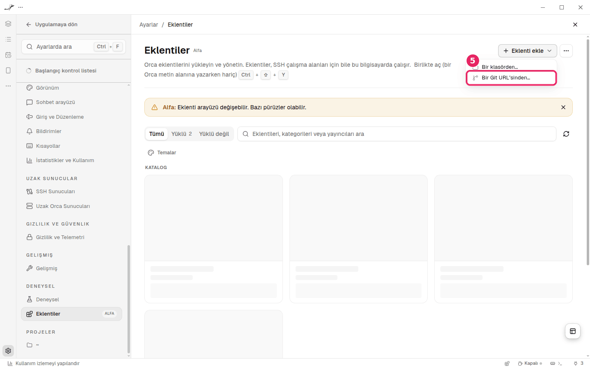
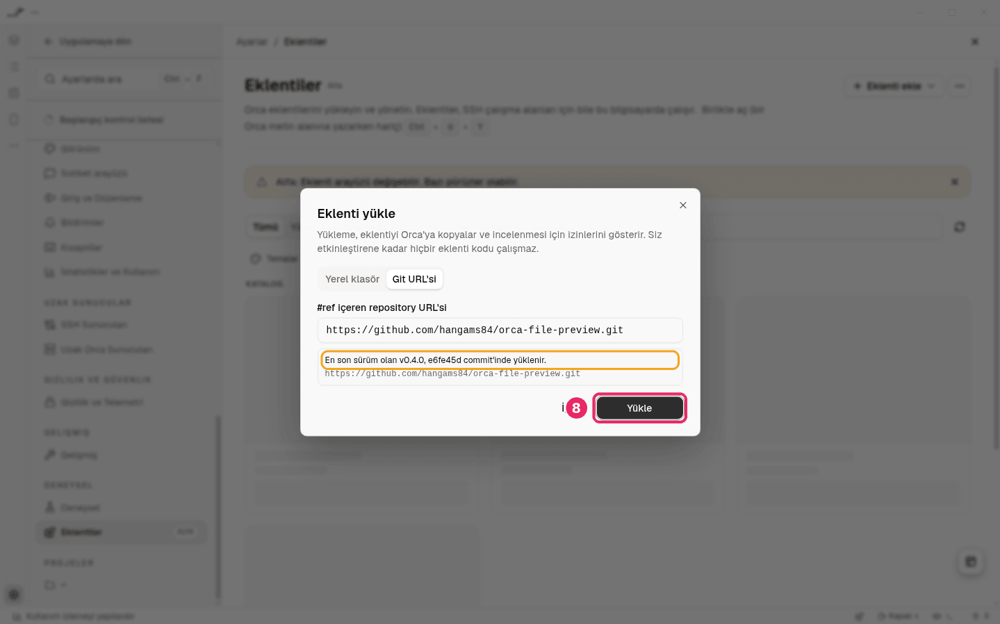
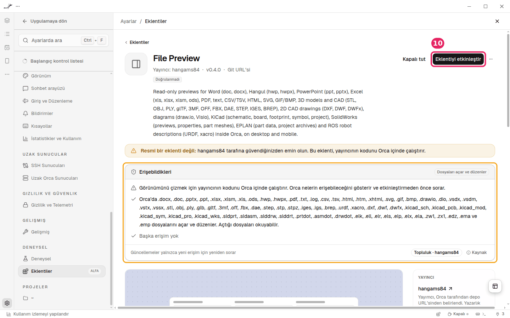

[한국어](README.md) · [English](README.en.md) · [简体中文](README.zh-CN.md) · [繁體中文](README.zh-TW.md) · [日本語](README.ja.md) · [Deutsch](README.de.md) · [Français](README.fr.md) · [Español](README.es.md) · [Português (Brasil)](README.pt-BR.md) · [Русский](README.ru.md) · [Türkçe](README.tr.md)

# File Preview for Orca

[](https://github.com/hangams84/orca-file-preview/actions/workflows/orca-compat.yml)

File Preview, [Orca](https://github.com/stablyai/orca) için bir eklentidir: Office, Hangul, PDF, metin, görsel, 3D, CAD ve elektronik
tasarım dosyalarının **salt okunur önizlemesini** doğrudan Orca içinde gösterir. Masaüstü Orca'da (Windows · macOS · Linux) ve
tarayıcı/mobil istemcilerde çalışır.

- Son sürüm: **v0.4.0** · Orca **1.4.248** veya üzeri gerekir (Git URL'si ile kurulum için **1.4.252** veya üzeri)
- Yalnızca `sandboxed-ui` çalışma modunu kullanır: ek izin (capability) istemez, ağa erişmez ve dosyalarınızı hiçbir zaman değiştirmez.

## Desteklenen biçimler

| Biçim | Uzantılar | Motor · gösterilenler |
| --- | --- | --- |
| Word | `.docx` `.doc` | docx-preview · kendi OLE/CFB ayrıştırıcımız (RTF, HTML veya DOCX olarak kaydedilmiş `.doc` dosyalarını otomatik algılar) |
| PowerPoint | `.pptx` `.ppt` | Kendi OOXML işleyicimiz · kendi PPT kayıt ayrıştırıcımız |
| Excel | `.xlsx` `.xlsm` `.xls` `.ods` | SheetJS CE (Web Worker, yedek formül hesaplama, sanal kaydırma) |
| Hangul | `.hwp` `.hwpx` | HWP 5 ve HWPX (OWPML), Hangul'un kaydettiği satır düzeniyle gösterilir. Dağıtım korumalı ve parolalı belgeler ile HWP 3 dosyaları için bilgilendirici bir mesaj gösterilir |
| PDF | `.pdf` | pdf.js (gecikmeli işleme, Korece CMap'ler, parola girişi) |
| Görseller | `.gif` `.bmp` `.svg` | Tarayıcı kod çözücüsü (SVG betikleri engellenir, arka plan seçilebilir) |
| Web | `.html` `.htm` `.xhtml` | DOMPurify + korumalı alan (sandbox) iframe'i (betikler hiçbir zaman çalıştırılmaz) |
| Tablolar | `.csv` `.tsv` | Kendi RFC 4180 ayrıştırıcımız (kodlama ve ayırıcı algılama, sıralama, filtreleme) |
| Metin | `.txt` `.log` | Kodlama algılama (UTF-8/16, EUC-KR vb.), satır numaraları, satır kaydırma |
| Diyagramlar | `.drawio` `.dio` `.vsdx` `.vsdm` `.vstx` `.vssx` | Kendi SVG işleyicimiz: draw.io (sıkıştırılmış ve çok sayfalı dosyalar, temel şekiller, bağlayıcılar, stiller, DOMPurify ile temizlenen HTML etiket metinleri), Visio (ana şekil ve stil sayfası kalıtımı, tüm Geometry satırları, gruplar, bağlayıcılar, metin biçimlendirme, dolgu desenleri, degradeler, temalar, EMF/WMF resimler, arka plan sayfaları). Sayfa seçimi, kaydırma, yakınlaştırma, sığdırma, koyu tuval, bağlantılar |
| 3D modeller | `.stl` `.obj` `.ply` `.glb` `.gltf` `.3mf` `.off` `.fbx` `.dae` | three.js (WebGL, döndürme, yakınlaştırma, kaydırma, dokunmatik kontrol, Draco ve meshopt, Web Worker'da ayrıştırma). OBJ'nin `.mtl` dosyaları ve dokuları, glTF'nin harici `.bin` dosyaları ve görselleri ile DAE/FBX/3MF dokuları eşlik eden dosyalardan (📁 veya sürükleyip bırakma) okunur |
| CAD (B-rep) | `.step` `.stp` `.stpz` `.iges` `.igs` `.brep` | OpenCascade (occt-import-js, WebAssembly, Web Worker): montajlar, parça listesi, renkler, seçilebilir üçgenleme (tessellation) kalitesi. `.stpz`, gzip ile sıkıştırılmış STEP'tir |
| 2D CAD çizimleri | `.dxf` `.dwf` `.dwfx` | Kendi Canvas 2D işleyicimiz: DXF (ASCII ve ikili, R12–2018+, bloklar, ölçülendirmeler, taramalar, MTEXT, Korece metin), DWF (W2D akışları, paftalar, yedek küçük resim), DWFx (XPS sayfaları, gömülü yazı tipleri). Katman listesi, model/yerleşim (görünüm pencereleri)/pafta seçimi, açık/koyu arka plan, bilgi çubuğu. DXF dış referansları (xref) ve IMAGE nesneleri eşlik eden dosyalardan okunur (xref katmanları `XREF\|katman` olarak görünür) |
| AutoCAD çizimleri (ayrı eklenti) | `.dwg` `.dwt` | **File Preview DWG**: [ayrı depo](https://github.com/hangams84/orca-file-preview-dwg), GPL-3.0-or-later, ayrıca kurulur (Git URL'si `https://github.com/hangams84/orca-file-preview-dwg.git`, kaynak kodu [dwg-plugin/](dwg-plugin/README.md) içinde). LibreDWG (WebAssembly, Web Worker) + Canvas: model/yerleşimler, katmanlar, bloklar, Korece metin, ölçülendirmeler, taramalar |
| Robot tanımları (ROS) | `.urdf` `.xacro` | Kendi XML okuyucumuz ve xacro işlemcimiz (ROS 2 xacro 2.x kurallarına uygun, eval kullanmayan güvenli ifade değerlendirici) + three.js: kinematik ağaç, temel şekiller, orijinler ve malzemeler, altı eklem türünün tümü, sınırlar, mimic, eklem kaydırıcıları, görsel/çarpışma/koordinat çerçevesi/eklem ekseni gösterimi. `.urdf.xacro` dosyalarını da açar. Mesh'ler ve `xacro:include` dosyaları eşlik eden dosyalardan okunur |
| KiCad | `.kicad_sch` `.kicad_pcb` `.kicad_mod` `.kicad_sym` `.kicad_pro` `.kicad_wks` | Kendi S-ifadesi ayrıştırıcımız + SVG işleyicimiz (KiCad 6–10, KiCad'ın newstroke çizgi yazı tipi): şemalar, baskılı devre kartları (katman gösterme/gizleme, ön/arka yüz çevirme), ayak izleri (footprint), sembol kütüphaneleri, proje özeti, pad, pin ve net araç ipuçları. Proje klasörü verildiğinde: hiyerarşik sayfalar arasında gezinme ve özel çizim çerçevesi (antet) gösterimi |
| SolidWorks | `.sldprt` `.sldasm` `.slddrw` `.slddrt` `.prtdot` `.asmdot` `.drwdot` | Kendi kapsayıcı okuyucumuz (2014'e kadar OLE/CFB, 2015 ve sonrası biçim): kayıtlı önizleme resimleri, parçanın görüntü mesh'i (3D), **3D montaj** (kayıtlı yerleşimler + mesh'ler; yoksa 📁 ile verilen parça dosyaları), özellikler, yapılandırmalar, başvurulan dosyalar, unsur (feature) adları, kayıt geçmişi |
| EPLAN Electric P8 | `.edz` `.zw1` `.elk` `.ell` `.elr` `.els` `.ela` `.elp` `.elx` `.zx1` `.ema` `.emp` | Kendi 7z (LZMA/LZMA2) ve ZIP okuyucumuz: EDZ parça verileri, resimler ve PDF belgeleri, **makro grafikleri** (PXF: çizgiler, yaylar, eğriler, metinler; varyant başına), proje yedekleri (özellikler, sayfa açıklamaları, **parça listesi**, resimler, içerik ağacı), bağlantı dosyaları + 📁 proje klasörü (`.edb`) |
| (okunamayan dosyalar) | Yukarıdaki tüm biçimler | Genel denetleyici: biçim tanıma, boyut, entropi, onaltılık döküm, dizeler |
| **File Preview paneli** | Yukarıdaki tüm biçimler | Sağ kenar çubuğunda bir panel; aşağıdaki [File Preview paneli](#file-preview-paneli) bölümüne bakın |

Tüm biçimlerde ortak: koyu/açık tema Orca'yı anında izler, Korece/İngilizce arayüz, Ctrl+fare tekerleği, iki parmakla sıkıştırma
veya düğmelerle yakınlaştırma, telefonlarda ekran genişliğine sığdırma, dosya değiştiğinde otomatik yenileme ve hasarlı dosyalar
için anlaşılır bir hata mesajı.

### Metin biçimleri doğrudan önizlemede açılır (0.4.0)

URDF, xacro, KiCad, draw.io, ASCII DXF, STEP/IGES/BREP, OBJ ve diğer metin tabanlı 3D biçimlerini, RTF/HTML olarak kaydedilmiş
`.doc` dosyalarını ve XML `.xls` dosyalarını Orca metin dosyası olarak algılar. Eklenti bu dosyalar için ayrıca metin düzenleyicisi
kaydettiğinden artık varsayılan olarak önizleme açılır. Ancak Orca'nın kendi açtığı biçimler (`.txt` `.csv` `.tsv` `.html`
`.htm`), Orca'nın kuralları gereği önce **Kaynak** görünümünde açılır; **Önizleme**'yi sekmenin sağ üst köşesindeki görünüm
değiştiriciden seçebilirsiniz.

### Eşlik eden dosyalar (📁 veya sürükleyip bırakma)

Orca, düzenleyiciye yalnızca açtığınız dosyayı verir. Araç çubuğundaki 📁 düğmesiyle bir klasör seçin (tek tek dosya seçmek için
Shift tuşunu basılı tutun) veya dosyaları önizlemenin üzerine bırakın; eklenti bu dosyaları korumalı alan çerçevesi içinde birlikte okur:

| Önizleme | Klasör veya bırakılan dosyalarla eklenenler |
| --- | --- |
| Robot (URDF/xacro) | Mesh'ler (STL, dokulu DAE, `.mtl` dosyalı OBJ, glTF) yer tutucuların yerini alır, eklem pozu korunur; `xacro:include` çözümlenir (`$(find pkg)`, göreli yollar, iç içe) |
| 3D | OBJ malzemeleri ve dokuları, glTF'nin harici `.bin` dosyaları ve görselleri, DAE dokuları |
| CAD çizimi (DXF) | Dış referanslar (xref) `XREF\|katman` olarak eklenir, IMAGE nesneleri çizilir |
| KiCad | Örnek başına referans tanımlayıcılarıyla alt sayfalar arasında gezinme, `.kicad_pro` → şema ve kart, özel `.kicad_wks` çizim çerçevesi |
| SolidWorks | Kayıtlı yerleşimlerden **3D montaj** (2015 ve sonrası dosyalar parça dosyası gerektirmez; 2014 ve öncesi dosyalar verilen parçaları kullanır) |
| EPLAN | Makrolar çizilir (`.ema` `.emp`, `.edz` içindeki makrolar); `.elk` + `.edb` klasörü → proje özellikleri, sayfalar, parça listesi |

### File Preview paneli

Sağ kenar çubuğunda **File Preview** panelini açın ve "Open file…", "Open folder…" düğmelerini ya da sürükleyip bırakmayı kullanın
(eklentinin arayüzü yalnızca Korece ve İngilizcedir). Dosya aynı işleyicilerle gösterilir; Orca düzenleyicisinin 50 MB sınırı
uygulanmaz (yalnızca işleyicilerin kendi sınırları geçerlidir, en fazla 1 GB) ve çalışma alanı dışındaki dosyalar da açılabilir. Birlikte
açılan dosyalar eşlik eden dosya olarak kullanılır. Panel ek izin gerektirmez.

## Kurulum

### (a) Orca uygulamasından (önerilen)

Orca **1.4.252** veya üzeri gerekir.

1. **Ayarlar** → **Eklentiler**'i açın.
2. **Eklenti ekle** → **Bir Git URL’sinden…** seçeneğini seçin.
3. **#ref içeren repository URL'si** alanına `https://github.com/hangams84/orca-file-preview.git` adresini yapıştırın, ardından **Devam** → **Yükle**'ye tıklayın.
4. Orca'nın gösterdiği izinleri (yalnızca korumalı alanda arayüz gösterimi) kontrol edin ve **Eklentiyi etkinleştir**'e tıklayın.

Ekran görüntülü adım adım kılavuz: [docs/install-guide/tr.md](docs/install-guide/tr.md)

<!-- install-guide-thumbs -->
<a href="docs/install-guide/tr.md"></a>

`.dwg` ve `.dwt` dosyaları için gerekiyorsa `https://github.com/hangams84/orca-file-preview-dwg.git` adresindeki eklentiyi de aynı yöntemle kurun.

### (b) Komut satırından

```sh
# GitHub'dan en son sürümü kurun (Orca 1.4.252+). Orca istenen erişimi ve onay parmak izini yazdırır.
orca plugin install https://github.com/hangams84/orca-file-preview
orca plugin install https://github.com/hangams84/orca-file-preview --approve <fingerprint>
# Belirli bir sürüm: https://github.com/hangams84/orca-file-preview#v0.4.0

# Veya yerel bir klasörden
orca plugin install ./plugin
```

### (c) Sürüm paketleri, yürütülebilir dosyalar ve betikler

Bunları [GitHub Releases](https://github.com/hangams84/orca-file-preview/releases) sayfasından indirin. Orca 1.4.248 veya üzerinin
kurulu olduğu ve en az bir kez çalıştırılmış bir bilgisayar gerekir; yönetici hakları gerekmez. Tüm yükleyiciler Orca'nın istediği
izinleri gösterir ve onayı ancak siz kontrol ettikten sonra verir.

| İşletim sistemi | Yürütülebilir dosya | Betikler (zip veya tar.gz paketi) |
| --- | --- | --- |
| Windows 10/11 | `FilePreviewSetup-<sürüm>.exe` (menü: kur · güncelle · kaldır · durum) | `installer\windows\install.cmd` |
| macOS | `File-Preview-Setup-<sürüm>-macos.zip` → *File Preview Setup.app* | `installer/macos/Install File Preview.command` |
| macOS · Linux | `sh file-preview-setup-<sürüm>.run [install\|update\|uninstall\|status]` | `sh installer/linux/install.sh` (Linux) |

Yürütülebilir dosyalar imzalı değildir. Windows SmartScreen dosyayı engellerse *Ek bilgi* → *Yine de çalıştır*'ı seçin; macOS'te
Gatekeeper'ı aşmak için Control tuşu basılıyken tıklayıp *Aç*'ı seçin. Orca 1.4.248–1.4.251 sürümlerinde `plugin install` komutu
yoktur; bu nedenle yükleyiciler eklentiyi geliştirme klasörü olarak kaydeder (`plugin dev load`). Bu durumda klasörü silmeyin. Orca
Windows 10 veya üzerini gerektirdiğinden Windows 7/8'de yükleyici kurulumu açıklayıcı bir mesajla reddeder. Ayrıntılı seçenekler:
[installer/README.md](installer/README.md)

### (d) Güncelleme ve kaldırma

- **Orca uygulamasından veya CLI ile kurduysanız**: eklenti anahtarını `orca plugin list` ile bulun, ardından `orca plugin update <anahtar>`
  ile güncelleyin ve `orca plugin uninstall <anahtar>` ile kaldırın. Git URL'si ile yapılan kurulum, güncellendiğinde en yeni sürüm
  etiketine geçer.
- **Yürütülebilir dosyalar**: `FilePreviewSetup-<sürüm>.exe` menüsü (veya `/update` · `/uninstall`), `file-preview-setup-<sürüm>.run update|uninstall`
  ya da macOS'te *File Preview Setup.app*.
- **Betikler**: Windows `installer\windows\update.cmd` · `uninstall.cmd`, macOS `Update File Preview.command` ·
  `Uninstall File Preview.command`, Linux `sh installer/linux/update.sh` · `sh installer/linux/uninstall.sh`.
- Güncelleme, bu deponun GitHub'daki en son sürümünü denetler, paketi indirir, SHA-256 değerini doğrular ve onayınızdan sonra yeniden
  kurar. Bir önceki sürüm yedek olarak saklanır. `--check` (Windows'ta `-Check`) yalnızca güncelleme olup olmadığını denetler.

## Sınırlamalar

- **50 MB okuma sınırı**: Orca, bir eklenti düzenleyicisine bir dosyanın en fazla 50 MB'ını verir (görseller ve PDF'ler hariç; eklenti
  bunu değiştiremez, bkz. [stablyai/orca#46775](https://github.com/stablyai/orca/issues/46775)). Eklentinin kendisi 1 GB'a kadar kabul
  eder. Daha büyük dosyaları [File Preview paneli](#file-preview-paneli) ile açın. STEP dosyaları gzip ile sıkıştırılıp `.stpz` olarak
  da açılabilir (STEP genellikle 5–8 kat küçülür): `gzip -c model.step > model.stpz`.
- **CAD motorunun kaldırabildiği boyut**: OpenCascade (32 bit WebAssembly, en fazla 4 GB bellek) için pratik üst sınır, sıkıştırılmamış
  STEP dosyasında yaklaşık 200 MB'tır. Ölçümler (çok parçalı sentetik montajlar): 61 MB 1,5 dk · 189 MB 14 dk · 343 MB 30 dk içinde
  bitmez · 412 MB'ta bellek yetmez.
- **Önce Kaynak görünümünde açılan biçimler**: `.txt` `.csv` `.tsv` `.html` `.htm` dosyalarını Orca kendisi açtığı için önce **Kaynak**
  görünümü gelir. **Önizleme**'yi görünüm değiştiriciden seçin.
- **Çizilmeyenler**:
  - EPLAN: şema sayfaları (EPLAN'a özgü ikili nesne deposu, `.eod`/`.eox`) ve sembol kütüphanesi grafikleri.
  - SolidWorks: kesin B-rep geometrisi ve çizim görünüşleri yeniden çizilmez, bunların yerine kayıtlı resimler gösterilir. Gizli ve
    bastırılmış bileşenler yalnızca listede gösterilir.
  - draw.io: pakete dahil olmayan şablon (stencil) kütüphaneleri (`mxgraph.aws4.*` vb.) şablon adını taşıyan kesik çizgili bir kutu
    olarak, uzak görseller ise yer tutucu olarak gösterilir.
  - Visio: formüller hesaplanmaz (kayıtlı değerler kullanılır). İkili `.vsd` desteklenmez (bilgilendirici bir mesaj gösterilir).
  - DWF: okuyucunun işleyemediği çizim komutları içeren paftalar için pakette kayıtlı küçük resim ve bir uyarı gösterilir.
  - DWG (ayrı eklenti): 3D katılar ve bölgeler (ACIS), raster görsel içeriği, OLE nesneleri ve xref'ler çizilmez; bir notta listelenir.
  - Office: PPTX'teki grafikler ve SmartArt ile elektronik tablolardaki hücre stilleri basitleştirilir; elektronik tablolarda ilk
    20.000 satır gösterilir. `.hwp` içindeki denklemler, grafikler ve OLE nesneleri etiketli kutular olarak gösterilir.
- Mobil istemciler gerçek cihazlarda değil, tarayıcı test düzeneğiyle (telefon profilleri, WebKit, eski motor modu) test edildi.

## Uyumluluk

Orca **1.4.248** veya üzeri; Git URL'si ile kurulum için **1.4.252** veya üzeri. Uyumluluk CI'ı her Orca sürümünü Ubuntu, macOS ve
Windows'a sıfırdan kurar, ardından eklentiyi kurup test eder. Sonuç tablosu yalnızca tek bir yerde, Korece README'de tutulur:
[Orca uyumluluğu (CI)](README.md#ci-matrix). Platform testlerinin kanıtları: `docs/evidence/platforms/`.

## Geliştirme

```sh
npm ci
npm run vendor            # üçüncü taraf kütüphaneleri plugin/vendor içine paketle
orca plugin dev load plugin --approve <fingerprint>
npm run typecheck
node tools/harness/run.mjs --only docx,pdf --profiles desktop-dark,mobile-light
node tools/verify.mjs --round <n> && node tools/build-docs.mjs
node tools/check-readmes.mjs   # 11 README'nin dil çubuğunu, bağlantılarını ve biçim tablosunu denetle
```

### Depo yapısı

```text
plugin/            dağıtılan eklenti (orca-plugin.json, editor/, panel/, vendor/)
dwg-plugin/        File Preview DWG kaynak kodu (GPL-3.0-or-later, ayrı eklenti)
installer/         Windows · macOS · Linux kurulum betikleri
samples/           test dosyaları (tools/make-samples.py vb.)
tools/harness/     Orca benzeri CSP ve sahte ana makineli tarayıcı test düzeneği (Playwright)
tools/verify.mjs   doğrulama turu çalıştırıcısı (tsc, validate, birim testleri, 4 düzenek profili, fuzzing, Orca uygulaması ekran görüntüleri)
docs/              geliştirme ve doğrulama belgeleri (README.md, index.html, evidence/, release-notes/)
```

Doğrulama kayıtları ve ekran görüntüleri: [docs/README.md](docs/README.md) · [docs/index.html](docs/index.html). Değişiklikler:
[CHANGELOG.md](CHANGELOG.md).

## Lisans

Bu proje MIT lisansıyla dağıtılır ([LICENSE](LICENSE)). Pakete dahil edilen kütüphaneler kendi lisanslarına tabidir:
[plugin/THIRD_PARTY_NOTICES.md](plugin/THIRD_PARTY_NOTICES.md).
`.dwg` ve `.dwt` için **File Preview DWG**, GPL-3.0-or-later lisanslı ayrı bir eklentidir ve bu MIT eklentisinin parçası değildir.
