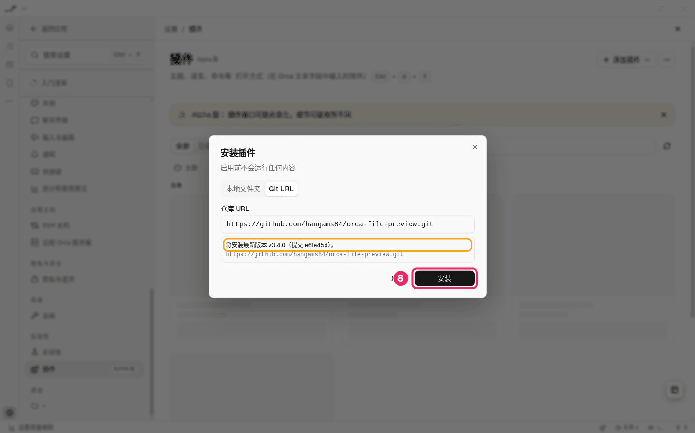

[한국어](README.md) · [English](README.en.md) · [简体中文](README.zh-CN.md) · [繁體中文](README.zh-TW.md) · [日本語](README.ja.md) · [Deutsch](README.de.md) · [Français](README.fr.md) · [Español](README.es.md) · [Português (Brasil)](README.pt-BR.md) · [Русский](README.ru.md) · [Türkçe](README.tr.md)

# File Preview for Orca

[](https://github.com/hangams84/orca-file-preview/actions/workflows/orca-compat.yml)

File Preview 是一款 [Orca](https://github.com/stablyai/orca) 插件，可在 Orca 中以**只读方式预览** Office、韩文（Hangul）文档、PDF、
文本、图片、3D、CAD 和电子设计文件，可在 Orca 桌面版（Windows · macOS · Linux）以及浏览器/移动客户端中运行。

- 最新版本：**v0.4.0** · 需要 Orca **1.4.248** 或更高版本（通过 Git URL 安装需要 **1.4.252** 或更高版本）
- 仅以 `sandboxed-ui` 方式运行：不申请额外权限（capability），不访问网络，也不会修改您的文件。

## 支持的格式

| 格式 | 扩展名 | 引擎 · 显示内容 |
| --- | --- | --- |
| Word | `.docx` `.doc` | docx-preview · 自研 OLE/CFB 解析器（自动识别另存为 RTF、HTML 或 DOCX 的 `.doc`） |
| PowerPoint | `.pptx` `.ppt` | 自研 OOXML 渲染器 · 自研 PPT 记录解析器 |
| Excel | `.xlsx` `.xlsm` `.xls` `.ods` | SheetJS CE（Web Worker、公式计算回退、虚拟滚动） |
| 韩文文档（Hangul） | `.hwp` `.hwpx` | HWP 5 和 HWPX（OWPML），按 Hangul 保存时的分行排版显示。分发用文档、加密文档和 HWP 3 会显示提示信息 |
| PDF | `.pdf` | pdf.js（延迟渲染、韩文 CMap、密码输入） |
| 图片 | `.gif` `.bmp` `.svg` | 浏览器解码器（阻止 SVG 脚本、可选择背景） |
| 网页 | `.html` `.htm` `.xhtml` | DOMPurify + 沙盒 iframe（不执行脚本） |
| 表格 | `.csv` `.tsv` | 自研 RFC 4180 解析器（编码与分隔符检测、排序、筛选） |
| 文本 | `.txt` `.log` | 编码检测（UTF-8/16、EUC-KR 等）、行号、自动换行 |
| 图表 | `.drawio` `.dio` `.vsdx` `.vsdm` `.vstx` `.vssx` | 自研 SVG 渲染器：draw.io（压缩及多页文件、内置图形、连接线、样式，HTML 标签经 DOMPurify 清理），Visio（主控形状与样式表继承、全部 Geometry 行、组合、连接线、文本格式、填充图案、渐变、主题、EMF/WMF 图片、背景页）。页面选择、平移、缩放、适应窗口、深色画布、链接 |
| 3D 模型 | `.stl` `.obj` `.ply` `.glb` `.gltf` `.3mf` `.off` `.fbx` `.dae` | three.js（WebGL、旋转、缩放、平移、触控、Draco 与 meshopt、在 Web Worker 中解析）。OBJ 的 `.mtl` 与纹理、glTF 的外部 `.bin` 与图片、DAE/FBX/3MF 纹理从关联文件（📁 或拖放）读取 |
| CAD（B-rep） | `.step` `.stp` `.stpz` `.iges` `.igs` `.brep` | OpenCascade（occt-import-js、WebAssembly、Web Worker）：装配体、零件列表、颜色、可选网格化质量。`.stpz` 即 gzip 压缩的 STEP |
| 2D CAD 图纸 | `.dxf` `.dwf` `.dwfx` | 自研 Canvas 2D 渲染器：DXF（ASCII 与二进制、R12–2018+、块、标注、图案填充、MTEXT、韩文），DWF（W2D 流、图纸、缩略图回退），DWFx（XPS 页面、嵌入字体）。图层列表、模型/布局（视口）/图纸选择、浅色/深色背景、信息栏。DXF 外部参照（xref）和 IMAGE 从关联文件读取（xref 图层显示为 `XREF\|图层`） |
| AutoCAD 图纸（独立插件） | `.dwg` `.dwt` | **File Preview DWG** —— [独立仓库](https://github.com/hangams84/orca-file-preview-dwg)，GPL-3.0-or-later，需单独安装（Git URL `https://github.com/hangams84/orca-file-preview-dwg.git`，源码见 [dwg-plugin/](dwg-plugin/README.md)）。LibreDWG（WebAssembly、Web Worker）+ Canvas：模型/布局、图层、块、韩文文字、标注、图案填充 |
| 机器人描述（ROS） | `.urdf` `.xacro` | 自研 XML 读取器 + xacro 处理器（遵循 ROS 2 xacro 2.x 规则，不使用 eval 的安全表达式求值器）+ three.js：运动学树、基本几何体、原点与材质、全部 6 种关节、限位、mimic、关节滑块，可切换外观/碰撞/坐标系/关节轴显示。也可打开 `.urdf.xacro`。网格和 `xacro:include` 文件从关联文件读取 |
| KiCad | `.kicad_sch` `.kicad_pcb` `.kicad_mod` `.kicad_sym` `.kicad_pro` `.kicad_wks` | 自研 S-expression 解析器 + SVG 渲染器（KiCad 6–10，KiCad 笔画字体 newstroke）：原理图、PCB（图层显示/隐藏、正反面翻转）、封装、符号库、项目摘要，焊盘、引脚与网络信息提示。提供项目文件夹后可浏览层次图纸并显示自定义图框 |
| SolidWorks | `.sldprt` `.sldasm` `.slddrw` `.slddrt` `.prtdot` `.asmdot` `.drwdot` | 自研容器读取器（2014 及更早的 OLE/CFB、2015 及以后的格式）：保存的预览图、零件的显示网格（3D）、**装配体 3D**（保存的位置 + 网格，若无则使用通过 📁 提供的零件文件）、属性、配置、参考文件、特征名称、保存记录 |
| EPLAN Electric P8 | `.edz` `.zw1` `.elk` `.ell` `.elr` `.els` `.ela` `.elp` `.elx` `.zx1` `.ema` `.emp` | 自研 7z（LZMA/LZMA2）与 ZIP 读取器：EDZ 部件数据、图片与 PDF 文档，**宏图形**（PXF：直线、圆弧、曲线、文字，按宏变量分别显示），项目备份中的属性、页描述、**部件列表**、图片与目录树，链接文件 + 📁 项目文件夹（`.edb`） |
| AI 模型（PyTorch） | `.pt` `.pth` `.ckpt` `.chkpt` `.pt2` `.ptl` `.safetensors` | 自研 pickle 解释器，**绝不执行代码**：state_dict、整体保存的模块、TorchScript、torch.export、Lightning 检查点、旧版 pickle 以及 safetensors。七种视图（**算子图**、模块树、层表、参数图、推断的架构图、**张量检查器**、检查点信息），可导出 SVG/PNG/JSON/Markdown。File Preview 面板按范围读取，可打开数 GB 的文件，也能打开按内容识别的 bin、pkl 文件 |
| AI 模型（ONNX、TFLite、GGUF、Keras、NumPy） | `.onnx` `.tflite` `.gguf` `.keras` `.h5` `.hdf5` `.npy` `.npz` | 使用同样的视图：ONNX、TFLite、Keras 的算子图，GGUF 元数据与量化张量（Q4_K 等）的数值，HDF5 与 NumPy 数组。ONNX 外部数据通过 📁 文件夹关联 |
| （无法读取的文件） | 以上全部格式 | 通用检查器：格式识别、大小、熵、十六进制转储、字符串 |
| **File Preview 面板** | 以上全部格式 | 右侧边栏中的面板，详见下文 [File Preview 面板](#file-preview-面板) |

通用功能：实时跟随 Orca 的深色/浅色主题，韩语/英语界面，Ctrl+滚轮、双指捏合或按钮缩放，在手机屏幕上自适应宽度，
文件变化时自动刷新，文件损坏时显示友好的错误提示。

### 文本格式直接在预览中打开（0.4.0）

Orca 会把 URDF、xacro、KiCad、draw.io、ASCII DXF、STEP/IGES/BREP、OBJ 及其他文本 3D 格式，以及另存为 RTF/HTML 的 `.doc` 和
XML `.xls` 视为文本文件。插件为这些文件另外注册了文本编辑器，因此它们现在默认在预览中打开。不过，Orca 自身处理的格式
（`.txt` `.csv` `.tsv` `.html` `.htm`）按照 Orca 的规则仍先在“源码”视图中打开，请通过标签页右上角的视图切换按钮选择“预览”。

### 关联文件（📁 或拖放）

Orca 只把您打开的那一个文件交给编辑器。点击工具栏中的 📁 按钮选择文件夹（按住 Shift 可改为选择文件），或把文件拖放到
预览上，插件就会在沙盒框架内一并读取这些文件：

| 预览 | 提供文件夹或文件后增加的内容 |
| --- | --- |
| 机器人（URDF/xacro） | 网格（STL、带纹理的 DAE、带 `.mtl` 的 OBJ、glTF）替换占位符，关节姿态保持不变；解析 `xacro:include`（`$(find pkg)`、相对路径、嵌套） |
| 3D | OBJ 材质与纹理、glTF 外部 `.bin` 与图片、DAE 纹理 |
| CAD 图纸（DXF） | 外部参照（xref）以 `XREF\|图层` 插入，绘制 IMAGE 实体 |
| KiCad | 子图纸导航（按实例显示位号）、`.kicad_pro` → 原理图与 PCB、自定义 `.kicad_wks` |
| SolidWorks | 根据保存的位置显示**装配体 3D**（2015 及以后的文件无需零件文件，2014 的文件使用您提供的零件） |
| EPLAN | 绘制宏（`.ema` `.emp`、`.edz` 中的宏）；`.elk` + `.edb` 文件夹 → 项目属性、页、部件列表 |

### File Preview 面板

在右侧边栏打开 **File Preview** 面板，通过“Open file…”“Open folder…”或拖放打开文件（插件界面仅提供韩语和英语）。文件
使用相同的渲染器显示，不受 Orca 编辑器 50 MB 上限的限制（仅受渲染器自身限制，最大 1 GB），工作区以外的文件也能打开。一起
打开的文件会用作关联文件。面板不需要额外权限。

## 安装

### (a) 在 Orca 应用中安装（推荐）

需要 Orca **1.4.252** 或更高版本。

1. 打开 **设置** → **插件**。
2. 选择 **添加插件** → **从 Git URL…**。
3. 在 **仓库 URL** 中粘贴 `https://github.com/hangams84/orca-file-preview.git`，然后点击 **继续** → **安装**。
4. 确认 Orca 显示的访问权限（仅沙盒界面），然后点击 **启用插件**。

带截图的分步指南：[docs/install-guide/zh-CN.md](docs/install-guide/zh-CN.md)

<!-- install-guide-thumbs -->
<a href="docs/install-guide/zh-CN.md"></a>

如需预览 `.dwg` 和 `.dwt`，请用同样的方法安装 `https://github.com/hangams84/orca-file-preview-dwg.git`。

### (b) 通过命令行安装

```sh
# 从 GitHub 安装最新版本（Orca 1.4.252+）。Orca 会输出所请求的权限和批准指纹。
orca plugin install https://github.com/hangams84/orca-file-preview
orca plugin install https://github.com/hangams84/orca-file-preview --approve <fingerprint>
# 指定版本：https://github.com/hangams84/orca-file-preview#v0.4.0

# 或从本地文件夹安装
orca plugin install ./plugin
```

### (c) 发布包、可执行文件和脚本

请从 [GitHub Releases](https://github.com/hangams84/orca-file-preview/releases) 下载。电脑上需已安装 Orca 1.4.248 或更高
版本并至少运行过一次，无需管理员权限。所有安装程序都会显示 Orca 请求您批准的权限，并且只在您确认后才批准。

| 操作系统 | 可执行文件 | 脚本（zip 或 tar.gz 包） |
| --- | --- | --- |
| Windows 10/11 | `FilePreviewSetup-<版本>.exe`（菜单：安装 · 更新 · 卸载 · 状态） | `installer\windows\install.cmd` |
| macOS | `File-Preview-Setup-<版本>-macos.zip` → *File Preview Setup.app* | `installer/macos/Install File Preview.command` |
| macOS · Linux | `sh file-preview-setup-<版本>.run [install\|update\|uninstall\|status]` | `sh installer/linux/install.sh`（Linux） |

这些可执行文件未经签名。如果 Windows SmartScreen 阻止运行，请选择 *更多信息* → *仍要运行*；在 macOS 上按住 Control 点按 →
*打开* 以通过 Gatekeeper。Orca 1.4.248–1.4.251 没有 `plugin install`，安装脚本会改用 `plugin dev load` 注册文件夹，此时请勿
删除该文件夹。Orca 不支持 Windows 7/8，安装程序会给出明确提示并拒绝安装（需要 Windows 10 或更高版本）。详细选项见
[installer/README.md](installer/README.md)。

### (d) 更新与卸载

- **通过 Orca 应用或命令行安装的**：先用 `orca plugin list` 查看插件键（key），然后用 `orca plugin update <键>` 更新、用
  `orca plugin uninstall <键>` 卸载。通过 Git URL 安装的插件在更新时会切换到最新的版本标签。
- **可执行文件**：`FilePreviewSetup-<版本>.exe` 的菜单（或 `/update` · `/uninstall`）、`file-preview-setup-<版本>.run update|uninstall`，
  macOS 上使用 *File Preview Setup.app*。
- **脚本**：Windows `installer\windows\update.cmd` · `uninstall.cmd`，macOS `Update File Preview.command` ·
  `Uninstall File Preview.command`，Linux `sh installer/linux/update.sh` · `sh installer/linux/uninstall.sh`。
- 更新时会检查本仓库最新的 GitHub 发行版，下载安装包并校验 SHA-256，经您批准后重新安装，并保留上一个版本。`--check`
  （Windows 为 `-Check`）只检查不安装。

## 限制

- **50 MB 读取上限**：Orca 最多只把文件的 50 MB 交给插件编辑器（图片和 PDF 除外；插件无法更改，见
  [stablyai/orca#46775](https://github.com/stablyai/orca/issues/46775)）。插件自身的上限是 1 GB。更大的文件请在
  [File Preview 面板](#file-preview-面板)中打开。STEP 文件也可以用 gzip 压缩后以 `.stpz` 打开（STEP 通常可缩小到 1/5–1/8）：
  `gzip -c model.step > model.stpz`。
- **CAD 引擎规模**：OpenCascade（32 位 WebAssembly，最多 4 GB 内存）的实用上限约为 200 MB 的 STEP 原文件。实测（包含大量零件的
  合成装配体）：61 MB 用时 1.5 分钟 · 189 MB 用时 14 分钟 · 343 MB 在 30 分钟内未完成 · 412 MB 内存不足。
- **先在“源码”视图中打开的格式**：`.txt` `.csv` `.tsv` `.html` `.htm` 由 Orca 自行打开，因此先显示“源码”视图。请通过视图切换按钮选择“预览”。
- **不绘制的内容**：
  - EPLAN：原理图页（EPLAN 专有的二进制对象存储 `.eod`/`.eox`）和符号库图形。
  - SolidWorks：不重新绘制精确的 B-rep 几何和工程图视图，而是显示文件中保存的图片。隐藏和压缩的零部件只列出，不绘制。
  - draw.io：未内置的形状库（`mxgraph.aws4.*` 等）显示为标有形状名称的虚线框；远程图片显示为占位符。
  - Visio：不计算公式（使用文件中保存的值）。不支持二进制 `.vsd`（会显示明确提示）。
  - DWF：含有读取器无法处理的绘图命令的图纸，显示包内保存的缩略图并附提示。
  - DWG（独立插件）：3D 实体与面域（ACIS）、光栅图像内容、OLE 对象和 xref 不绘制，会在说明中列出。
  - Office：PPTX 中的图表和 SmartArt 以及电子表格的单元格样式会简化显示；电子表格只显示前 20,000 行。`.hwp` 中的公式、图表和 OLE
    对象显示为带名称的方框。
- 移动客户端仅在浏览器测试工具（手机配置、WebKit、旧引擎模式）中测试过，未在真机上测试。

## 兼容性

需要 Orca **1.4.248** 或更高版本；通过 Git URL 安装需要 **1.4.252** 或更高版本。兼容性 CI 会在 Ubuntu、macOS 和 Windows 上全新
安装每个 Orca 版本，再安装并测试本插件。结果表仅在韩文 README 中维护：[Orca 兼容性（CI）](README.md#ci-matrix)。各平台的测试
证据见 `docs/evidence/platforms/`。

## 开发

```sh
npm ci
npm run vendor            # 将第三方库打包到 plugin/vendor
orca plugin dev load plugin --approve <fingerprint>
npm run typecheck
node tools/harness/run.mjs --only docx,pdf --profiles desktop-dark,mobile-light
node tools/verify.mjs --round <n> && node tools/build-docs.mjs
node tools/check-readmes.mjs   # 检查 11 种语言 README 的语言栏、链接和格式表
```

### 仓库结构

```text
plugin/            发布的插件（orca-plugin.json、editor/、panel/、vendor/）
dwg-plugin/        File Preview DWG 源码（GPL-3.0-or-later，独立插件）
installer/         Windows · macOS · Linux 安装脚本
samples/           测试样例（tools/make-samples.py 等）
tools/harness/     带有类 Orca CSP 和模拟宿主的浏览器测试工具（Playwright）
tools/verify.mjs   验证轮次运行器（tsc、validate、单元测试、4 种测试配置、模糊测试、Orca 应用截图）
docs/              开发与验证文档（README.md、index.html、evidence/、release-notes/）
```

验证记录与截图：[docs/README.md](docs/README.md) · [docs/index.html](docs/index.html)。变更记录：[CHANGELOG.md](CHANGELOG.md)。

## 许可证

本项目采用 MIT 许可证（[LICENSE](LICENSE)）。打包的第三方库遵循各自的许可证：
[plugin/THIRD_PARTY_NOTICES.md](plugin/THIRD_PARTY_NOTICES.md)。
用于 `.dwg` 和 `.dwt` 的 **File Preview DWG** 是采用 GPL-3.0-or-later 的独立插件，不属于本 MIT 插件。
