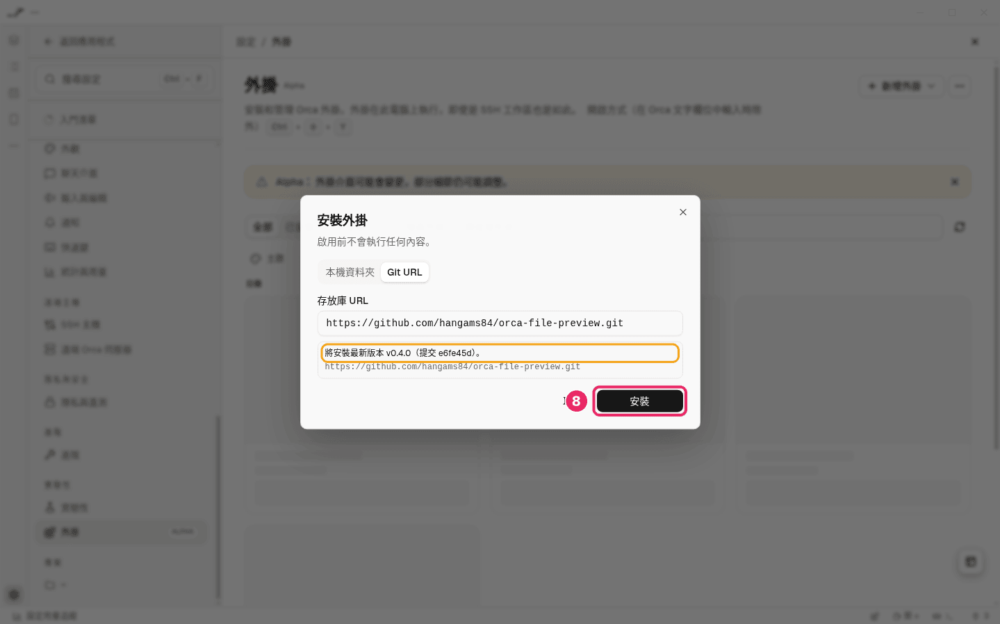
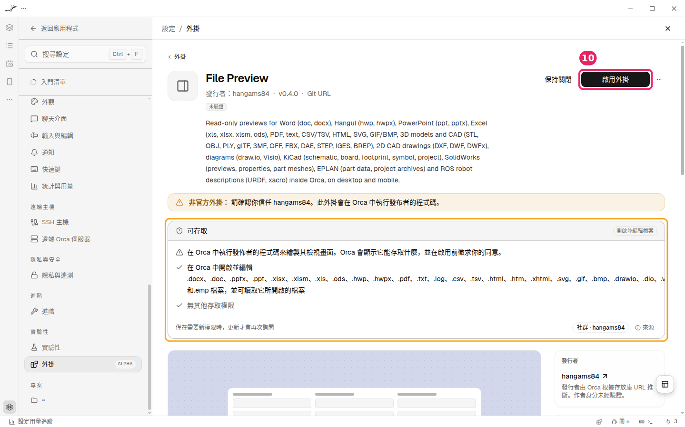

[한국어](README.md) · [English](README.en.md) · [简体中文](README.zh-CN.md) · [繁體中文](README.zh-TW.md) · [日本語](README.ja.md) · [Deutsch](README.de.md) · [Français](README.fr.md) · [Español](README.es.md) · [Português (Brasil)](README.pt-BR.md) · [Русский](README.ru.md) · [Türkçe](README.tr.md)

# File Preview for Orca

[](https://github.com/hangams84/orca-file-preview/actions/workflows/orca-compat.yml)

File Preview 是 [Orca](https://github.com/stablyai/orca) 的外掛程式，可在 Orca 中以**唯讀方式預覽** Office、Hangul（韓文文書處理器）、PDF、
文字、圖片、3D、CAD 與電子設計檔案。支援 Orca 桌面版（Windows · macOS · Linux）以及瀏覽器／行動用戶端。

- 最新版本：**v0.4.0** · 需要 Orca **1.4.248** 以上版本（以 Git URL 安裝需要 **1.4.252** 以上）
- 僅以 `sandboxed-ui` 方式執行：不要求額外權限（capability）、不存取網路，也不會修改您的檔案。

## 支援的格式

| 格式 | 副檔名 | 引擎 · 顯示內容 |
| --- | --- | --- |
| Word | `.docx` `.doc` | docx-preview · 自行開發的 OLE/CFB 剖析器（自動辨識另存為 RTF、HTML 或 DOCX 的 `.doc`） |
| PowerPoint | `.pptx` `.ppt` | 自行開發的 OOXML 轉譯器 · 自行開發的 PPT 記錄剖析器 |
| Excel | `.xlsx` `.xlsm` `.xls` `.ods` | SheetJS CE（Web Worker、公式計算備援、虛擬捲動） |
| Hangul 文件 | `.hwp` `.hwpx` | HWP 5 與 HWPX（OWPML），依 Hangul 儲存時的分行版面顯示。發布用文件、加密文件與 HWP 3 會顯示提示訊息 |
| PDF | `.pdf` | pdf.js（延遲轉譯、韓文 CMap、密碼輸入） |
| 圖片 | `.gif` `.bmp` `.svg` | 瀏覽器解碼器（封鎖 SVG 指令碼、可選擇背景） |
| 網頁 | `.html` `.htm` `.xhtml` | DOMPurify + 沙箱 iframe（不執行指令碼） |
| 表格 | `.csv` `.tsv` | 自行開發的 RFC 4180 剖析器（編碼與分隔符號偵測、排序、篩選） |
| 文字 | `.txt` `.log` | 編碼偵測（UTF-8/16、EUC-KR 等）、行號、自動換行 |
| 圖表 | `.drawio` `.dio` `.vsdx` `.vsdm` `.vstx` `.vssx` | 自行開發的 SVG 轉譯器：draw.io（壓縮與多頁檔案、內建圖形、連接線、樣式，HTML 格式的標籤文字經 DOMPurify 清理），Visio（主圖形與樣式表繼承、所有 Geometry 列、群組、連接線、文字格式、填滿圖樣、漸層、佈景主題、EMF/WMF 圖片、背景頁面）。頁面選擇、平移、縮放、符合視窗、深色畫布、連結 |
| 3D 模型 | `.stl` `.obj` `.ply` `.glb` `.gltf` `.3mf` `.off` `.fbx` `.dae` | three.js（WebGL、旋轉、縮放、平移、觸控、Draco 與 meshopt、在 Web Worker 中剖析）。OBJ 的 `.mtl` 與紋理、glTF 的外部 `.bin` 與圖片、DAE/FBX/3MF 紋理從關聯檔案（📁 或拖放）讀取 |
| CAD（B-rep） | `.step` `.stp` `.stpz` `.iges` `.igs` `.brep` | OpenCascade（occt-import-js、WebAssembly、Web Worker）：組合件、零件清單、顏色、可選擇網格化（tessellation）品質。`.stpz` 為 gzip 壓縮的 STEP |
| 2D CAD 圖面 | `.dxf` `.dwf` `.dwfx` | 自行開發的 Canvas 2D 轉譯器：DXF（ASCII 與二進位、R12–2018+、圖塊、標註、填充線、MTEXT、韓文），DWF（W2D 串流、圖紙、縮圖備援），DWFx（XPS 頁面、內嵌字型）。圖層清單、模型／配置（視埠）／圖紙選擇、淺色／深色背景、資訊列。DXF 外部參考（xref）與 IMAGE 從關聯檔案讀取（xref 圖層顯示為 `XREF\|圖層`） |
| AutoCAD 圖面（獨立外掛） | `.dwg` `.dwt` | **File Preview DWG** —— [獨立存放庫](https://github.com/hangams84/orca-file-preview-dwg)，GPL-3.0-or-later，需另外安裝（Git URL `https://github.com/hangams84/orca-file-preview-dwg.git`，原始碼位於 [dwg-plugin/](dwg-plugin/README.md)）。LibreDWG（WebAssembly、Web Worker）+ Canvas：模型／配置、圖層、圖塊、韓文文字、標註、填充線 |
| 機器人描述（ROS） | `.urdf` `.xacro` | 自行開發的 XML 讀取器 + xacro 處理器（遵循 ROS 2 xacro 2.x 規則，不使用 eval 的安全運算式求值器）+ three.js：運動學樹、基本幾何形狀、原點與材質、全部 6 種關節、限制、mimic、關節滑桿，可切換外觀／碰撞／座標系／關節軸顯示。也能開啟 `.urdf.xacro`。網格與 `xacro:include` 檔案從關聯檔案讀取 |
| KiCad | `.kicad_sch` `.kicad_pcb` `.kicad_mod` `.kicad_sym` `.kicad_pro` `.kicad_wks` | 自行開發的 S-expression 剖析器 + SVG 轉譯器（KiCad 6–10，KiCad 筆畫字型 newstroke）：電路圖、電路板（圖層顯示／隱藏、正反面翻轉）、封裝、符號庫、專案摘要，以及焊墊、接腳與網路的工具提示。提供專案資料夾後可瀏覽階層圖頁並顯示自訂圖框 |
| SolidWorks | `.sldprt` `.sldasm` `.slddrw` `.slddrt` `.prtdot` `.asmdot` `.drwdot` | 自行開發的容器讀取器（2014 以前的 OLE/CFB、2015 以後的格式）：儲存的預覽圖、零件的顯示網格（3D）、**組合件 3D**（儲存的位置 + 網格，若無則使用以 📁 提供的零件檔）、屬性、組態、參考檔案、特徵名稱、儲存記錄 |
| EPLAN Electric P8 | `.edz` `.zw1` `.elk` `.ell` `.elr` `.els` `.ela` `.elp` `.elx` `.zx1` `.ema` `.emp` | 自行開發的 7z（LZMA/LZMA2）與 ZIP 讀取器：EDZ 零件資料、圖片與 PDF 文件，**巨集圖形**（PXF：線、弧、曲線、文字，依變體顯示），專案備份中的屬性、頁面描述、**零件清單**、圖片與內容樹，連結檔案 + 📁 專案資料夾（`.edb`） |
| （無法讀取的檔案） | 以上所有格式 | 通用檢查器：格式辨識、大小、熵、十六進位傾印、字串 |
| **File Preview 面板** | 以上所有格式 | 右側邊欄中的面板，詳見下方 [File Preview 面板](#file-preview-面板) |

共同功能：即時套用 Orca 的深色／淺色佈景主題，韓文／英文介面，Ctrl+滾輪、雙指縮放或按鈕縮放，在手機畫面上自動符合寬度，
檔案變更時自動重新整理，檔案損毀時顯示友善的錯誤說明。

### 文字格式直接在預覽中開啟（0.4.0）

Orca 會把 URDF、xacro、KiCad、draw.io、ASCII DXF、STEP/IGES/BREP、OBJ 及其他文字格式的 3D 檔案，以及另存為 RTF/HTML 的 `.doc` 與
XML `.xls` 判斷為文字檔。外掛另外為這些檔案註冊了文字編輯器，因此現在預設會在預覽中開啟。不過 Orca 本身處理的格式
（`.txt` `.csv` `.tsv` `.html` `.htm`）依 Orca 的規則仍會先在「原始碼」檢視中開啟，請用分頁右上角的檢視切換按鈕選擇預覽。

### 關聯檔案（📁 或拖放）

Orca 只會把您開啟的那一個檔案交給編輯器。按下工具列的 📁 按鈕選擇資料夾（按住 Shift 可選擇個別檔案），或將檔案拖放到
預覽上，外掛便會在沙箱框架內一併讀取這些檔案：

| 預覽 | 提供資料夾或檔案後增加的內容 |
| --- | --- |
| 機器人（URDF/xacro） | 網格（STL、含紋理的 DAE、含 `.mtl` 的 OBJ、glTF）取代預留位置，關節姿勢維持不變；解析 `xacro:include`（`$(find pkg)`、相對路徑、巢狀） |
| 3D | OBJ 材質與紋理、glTF 外部 `.bin` 與圖片、DAE 紋理 |
| CAD 圖面（DXF） | 外部參考（xref）以 `XREF\|圖層` 插入，繪製 IMAGE 圖元 |
| KiCad | 子圖頁導覽（依實例顯示參考編號）、`.kicad_pro` → 電路圖與電路板、自訂 `.kicad_wks` |
| SolidWorks | 依儲存的位置顯示**組合件 3D**（2015 以後的檔案不需零件檔，2014 版檔案則使用您提供的零件檔） |
| EPLAN | 繪製巨集（`.ema` `.emp`、`.edz` 內的巨集）；`.elk` + `.edb` 資料夾 → 專案屬性、頁面、零件清單 |

### File Preview 面板

在右側邊欄開啟 **File Preview** 面板，以「Open file…」「Open folder…」或拖放開啟檔案（外掛介面只提供韓文與英文）。檔案會以
相同的轉譯器顯示，不受 Orca 編輯器 50 MB 上限的約束（只受轉譯器本身的限制，最大 1 GB），工作區以外的檔案也能開啟。一起
開啟的檔案會當作關聯檔案使用。面板不需要額外權限。

## 安裝

### (a) 在 Orca 應用程式中安裝（建議）

需要 Orca **1.4.252** 以上版本。

1. 開啟 **設定** → **外掛**。
2. 選擇 **新增外掛** → **從 Git URL…**。
3. 在 **存放庫 URL** 貼上 `https://github.com/hangams84/orca-file-preview.git`，然後按 **繼續** → **安裝**。
4. 確認 Orca 顯示的存取權限（僅在沙箱中顯示介面），再按 **啟用外掛**。

附截圖的逐步說明：[docs/install-guide/zh-TW.md](docs/install-guide/zh-TW.md)

<!-- install-guide-thumbs -->
<a href="docs/install-guide/zh-TW.md"></a>

若需要預覽 `.dwg` 與 `.dwt`，請用相同方式安裝 `https://github.com/hangams84/orca-file-preview-dwg.git`。

### (b) 使用命令列安裝

```sh
# 從 GitHub 安裝最新版本（Orca 1.4.252+）。Orca 會輸出要求的權限與核准指紋。
orca plugin install https://github.com/hangams84/orca-file-preview
orca plugin install https://github.com/hangams84/orca-file-preview --approve <fingerprint>
# 指定版本：https://github.com/hangams84/orca-file-preview#v0.4.0

# 或從本機資料夾安裝
orca plugin install ./plugin
```

### (c) 發行套件、執行檔與指令碼

請從 [GitHub Releases](https://github.com/hangams84/orca-file-preview/releases) 下載。電腦上須已安裝 Orca 1.4.248 以上版本並至少
執行過一次，不需要系統管理員權限。所有安裝程式都會顯示 Orca 要求您核准的權限，並且只在您確認後才核准。

| 作業系統 | 執行檔 | 指令碼（zip 或 tar.gz 套件） |
| --- | --- | --- |
| Windows 10/11 | `FilePreviewSetup-<版本>.exe`（選單：安裝 · 更新 · 解除安裝 · 狀態） | `installer\windows\install.cmd` |
| macOS | `File-Preview-Setup-<版本>-macos.zip` → *File Preview Setup.app* | `installer/macos/Install File Preview.command` |
| macOS · Linux | `sh file-preview-setup-<版本>.run [install\|update\|uninstall\|status]` | `sh installer/linux/install.sh`（Linux） |

這些執行檔未經簽署。若 Windows SmartScreen 加以封鎖，請選擇 *其他資訊* → *仍要執行*；在 macOS 上按住 Control 點按 → *打開*
以通過 Gatekeeper。Orca 1.4.248–1.4.251 沒有 `plugin install`，安裝指令碼會改以 `plugin dev load` 註冊資料夾，此時請勿刪除該
資料夾。Orca 不支援 Windows 7/8，安裝程式會顯示明確說明並拒絕安裝（需要 Windows 10 以上）。所有選項請見
[installer/README.md](installer/README.md)。

### (d) 更新與解除安裝

- **從 Orca 應用程式或命令列安裝時**：先以 `orca plugin list` 查詢外掛的鍵值（key），再以 `orca plugin update <鍵值>` 更新、以
  `orca plugin uninstall <鍵值>` 解除安裝。以 Git URL 安裝的外掛更新時會移至最新的版本標籤。
- **執行檔**：`FilePreviewSetup-<版本>.exe` 的選單（或 `/update` · `/uninstall`）、`file-preview-setup-<版本>.run update|uninstall`，
  macOS 則使用 *File Preview Setup.app*。
- **指令碼**：Windows `installer\windows\update.cmd` · `uninstall.cmd`，macOS `Update File Preview.command` ·
  `Uninstall File Preview.command`，Linux `sh installer/linux/update.sh` · `sh installer/linux/uninstall.sh`。
- 更新時會檢查本存放庫最新的 GitHub 發行版本，下載套件並驗證 SHA-256，經您核准後重新安裝，並保留前一個版本。`--check`
  （Windows 為 `-Check`）只檢查、不安裝。

## 限制

- **50 MB 讀取上限**：Orca 最多只會把檔案的 50 MB 交給外掛編輯器（圖片與 PDF 除外；外掛無法變更，請見
  [stablyai/orca#46775](https://github.com/stablyai/orca/issues/46775)）。外掛本身的上限為 1 GB。更大的檔案請在
  [File Preview 面板](#file-preview-面板)中開啟。STEP 檔也可以用 gzip 壓縮後以 `.stpz` 開啟（STEP 通常可縮小為 1/5–1/8）：
  `gzip -c model.step > model.stpz`。
- **CAD 引擎處理規模**：OpenCascade（32 位元 WebAssembly，最多 4 GB 記憶體）的實用上限約為 200 MB 的 STEP 原始檔。實測（含大量零件的
  合成組合件）：61 MB 需 1.5 分鐘 · 189 MB 需 14 分鐘 · 343 MB 在 30 分鐘內未完成 · 412 MB 記憶體不足。
- **先在「原始碼」檢視中開啟的格式**：`.txt` `.csv` `.tsv` `.html` `.htm` 由 Orca 自行開啟，因此會先顯示「原始碼」檢視。請用檢視切換按鈕選擇預覽。
- **不繪製的內容**：
  - EPLAN：電路圖頁面（EPLAN 專有的二進位物件儲存區 `.eod`/`.eox`）與符號庫圖形。
  - SolidWorks：不重新繪製精確的 B-rep 幾何與工程圖視圖，而是顯示檔案中儲存的圖片。隱藏與抑制的零組件只列出、不繪製。
  - draw.io：未內建的圖形庫（`mxgraph.aws4.*` 等）顯示為標有名稱的虛線方框；遠端圖片顯示為預留位置。
  - Visio：不計算公式（使用檔案中儲存的值）。不支援二進位 `.vsd`（會顯示明確說明）。
  - DWF：含有讀取器無法處理之繪圖指令的圖紙，會顯示套件內儲存的縮圖並附上說明。
  - DWG（獨立外掛）：3D 實體與面域（ACIS）、點陣影像內容、OLE 物件與 xref 不繪製，會在說明中列出。
  - Office：PPTX 中的圖表與 SmartArt 以及試算表的儲存格樣式會簡化顯示；試算表只顯示前 20,000 列。`.hwp` 中的方程式、圖表與 OLE
    物件會顯示為附名稱的方框。
- 行動用戶端是以瀏覽器測試工具（手機設定檔、WebKit、舊版引擎模式）測試，未在實體裝置上測試。

## 相容性

需要 Orca **1.4.248** 以上版本；以 Git URL 安裝需要 **1.4.252** 以上。相容性 CI 會在 Ubuntu、macOS 與 Windows 上全新安裝每個
Orca 版本，再安裝並測試本外掛。結果表只保存在韓文 README 中：[Orca 相容性（CI）](README.md#ci-matrix)。各平台的測試證據請見
`docs/evidence/platforms/`。

## 開發

```sh
npm ci
npm run vendor            # 將第三方函式庫打包到 plugin/vendor
orca plugin dev load plugin --approve <fingerprint>
npm run typecheck
node tools/harness/run.mjs --only docx,pdf --profiles desktop-dark,mobile-light
node tools/verify.mjs --round <n> && node tools/build-docs.mjs
node tools/check-readmes.mjs   # 檢查 11 種語言 README 的語言列、連結與格式表
```

### 存放庫結構

```text
plugin/            發佈的外掛（orca-plugin.json、editor/、panel/、vendor/）
dwg-plugin/        File Preview DWG 原始碼（GPL-3.0-or-later，獨立外掛）
installer/         Windows · macOS · Linux 安裝指令碼
samples/           測試樣本（tools/make-samples.py 等）
tools/harness/     具備類 Orca CSP 與模擬主機的瀏覽器測試工具（Playwright）
tools/verify.mjs   驗證回合執行器（tsc、validate、單元測試、4 種測試設定檔、模糊測試、Orca 應用程式截圖）
docs/              開發與驗證文件（README.md、index.html、evidence/、release-notes/）
```

驗證紀錄與截圖：[docs/README.md](docs/README.md) · [docs/index.html](docs/index.html)。變更紀錄：[CHANGELOG.md](CHANGELOG.md)。

## 授權

本專案採用 MIT 授權（[LICENSE](LICENSE)）。隨附的函式庫各自沿用其授權：
[plugin/THIRD_PARTY_NOTICES.md](plugin/THIRD_PARTY_NOTICES.md)。
用於 `.dwg` 與 `.dwt` 的 **File Preview DWG** 是採用 GPL-3.0-or-later 的獨立外掛，不屬於本 MIT 外掛。
