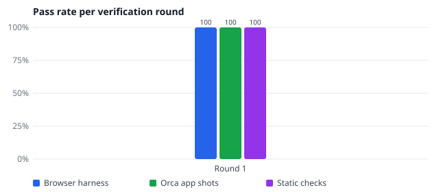
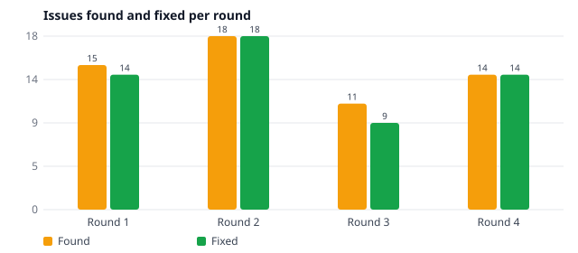

# File Preview for Orca — 개발 문서 / Development docs

Orca 데스크톱(Windows · macOS · Linux)과 브라우저/모바일 클라이언트에서 Office·PDF·텍스트·이미지 파일을 **읽기 전용으로 미리보기** 하는 Orca 플러그인입니다.

> HTML 버전: [index.html](index.html) · 원본 증빙 자료: [evidence/](evidence/)

## 지원 형식 / Supported formats

| 확장자 | 종류 | 엔진 | 기능 |
| --- | --- | --- | --- |
| .docx | Word | docx-preview (Apache-2.0) + JSZip | Pages, styles, tables, images, lists; zoom / fit width |
| .doc | Word 97-2003 | Own OLE/CFB + piece-table parser | Text, paragraphs, tables, page breaks |
| .pptx | PowerPoint | Own OOXML renderer (fflate) | Positioned text, pictures, tables, fills, notes |
| .ppt | PowerPoint 97-2003 | Own CFB record parser | Per-slide titles and body text, pictures |
| .xlsx .xlsm .xls .ods | Spreadsheets | SheetJS CE 0.20.3 (Apache-2.0) | Sheet picker, merged cells, formatted values, sticky headers |
| .pdf | PDF | pdf.js 6.5 (Apache-2.0) | Lazy page rendering, page navigation, zoom, CJK cMaps |
| .gif .bmp | Images | Browser decoder | Animated GIF, fit / zoom / pinch, dimensions |
| .svg | SVG | Browser  (scripts never run) | Zoom, source view |
| .html .htm | HTML | DOMPurify (Apache-2.0 / MPL-2.0) | Sanitised preview, source view, links blocked |
| .csv .tsv | Tables | Own RFC 4180 parser | Encoding + delimiter detection, sort, filter, raw view |
| .txt .log | Text | Own | Encoding detection (UTF-8/16, EUC-KR, …), line numbers, wrap |

## 검증 라운드 요약 / Verification rounds





| Round | 날짜 | 커밋 | 정적 검사 | 브라우저 하네스 | Orca 앱 | 발견/수정 |
| --- | --- | --- | --- | --- | --- | --- |
| [1](#round-1) | 2026-11-12 06:03 | `858c111` | 6/6 | 168/168 | 52/52 | 15/4 |

### Round 1

커밋 `858c111` · 2026-11-12T06:03:19.387Z · Orca 1.4.257 · win32 x64

| 검사 | 결과 | 상세 |
| --- | --- | --- |
| TypeScript (tsc --noEmit) | ✅ |  |
| orca plugin validate | ✅ |  |
| orca plugin test (unit) | ✅ | passed 5 · failed 0 |
| orca plugin check (static) | ✅ | "" |
| Browser harness (4 profiles) | ✅ | 168 / 168 passed |
| Orca app screenshots (plugin shot) | ✅ | 52 / 52 rendered in Orca; 32 open in Orca's own view first (preview via the view toggle) |

**발견된 문제와 조치 / Issues and fixes**

| ID | 심각도 | 영역 | 문제 | 원인 | 조치 | 상태 |
| --- | --- | --- | --- | --- | --- | --- |
| R1-1 | medium | pdf | PDF pages blank in Orca captures and in hidden/occluded windows | Orca captures at first paint (mostly a timing artifact); drawing also relied on IntersectionObserver and pdf.js requestAnimationFrame, which pause in hidden windows | Visibility from scroll geometry, rAF-free print-intent fallback, harness --no-raf mode with pixel check (24/24) | fixed |
| R1-2 | medium | sheet | Formula cells without cached values show '=C2*D2' instead of a result | Files written by scripts (openpyxl) store no cached values; SheetJS CE does not calculate | Safe formula evaluator (no eval) for common operators and functions, with unit tests (fp-office) | in progress |
| R1-3 | low | docx/pptx | Body text falls back to a serif font when Office fonts are missing | Documents name Calibri/Cambria/맑은 고딕, which macOS, Linux and phones lack | @font-face local() aliases to metric-compatible or platform fonts (fp-office) | in progress |
| R1-4 | medium | build | Plugin folder exceeded Orca's 50 MiB limit | Orca counts the whole folder: node_modules, Orca child worktrees and evidence screenshots | Shipped plugin moved to plugin/ (manifest, editor, vendor only: about 6 MB) | fixed |
| R1-5 | low | tooling | orca plugin test fails: cannot import ./orca-runtime.mjs | Orca's Windows test loader rejects its own runtime when the plugin is on a different drive (D:) than Orca (C:) | verify.mjs runs unit tests from a temporary copy on the system drive | fixed |
| R1-6 | info | orca | txt/csv/tsv/log/html/svg open in Orca's own Source view first | Orca always treats suffixes it opens itself (and text-looking files) as priority 'option' | Documented: switch with the view toggle at the tab's top right; preview editors are registered for these suffixes | documented |
| R1-7 | high | core | A .doc that is really DOCX stayed on the spinner in Orca captures; every file rendered twice | Orca delivers the same document more than once; the dedupe compared object identity | main.ts dedupes by file type and bytes; verify.mjs opens, waits, then captures | fixed |
| R1-8 | medium | ppt | Extra "기타 그림" gallery with a placeholder picture after the last slide | All unplaced blips (thumbnail/master pictures) were shown | Only slide-referenced, decodable pictures (fp-legacy) | in progress |
| R1-9 | low | ppt | PPT 97 slide text smaller and tighter than the same slide elsewhere | Font size / master text style defaults | Read sizes from master text styles (fp-legacy) | in progress |
| R1-10 | low | ppt/doc | Korean glyphs heavier than Latin, lines nearly touch | Font stack without Korean fallbacks | Korean font fallbacks and line-height (fp-legacy) | in progress |
| R1-11 | medium | docx | DOCX unreadable on phones (page fitted at ~43%, ~5 px text) | Fixed page width scaled down to fit | Reading/reflow mode by default on phones (fp-office) | in progress |
| R1-12 | medium | docx | Word table style and cell padding not applied | docx-preview ignores conditional table formatting and default cell margins | CSS fallbacks for header/banding and padding (fp-office) | in progress |
| R1-13 | low | docx | List bullets without hanging indent | Numbering indents not applied | Numbering CSS (fp-office) | in progress |
| R1-14 | low | sheet | Dates cut off in narrow columns | No overflow into empty neighbours | Excel-like overflow / minimum widths (fp-office) | in progress |
| R1-15 | low | sheet | .xls column widths about twice the .xlsx widths | BIFF width unit conversion | Prefer wpx, then wch (fp-office) | in progress |

증빙: [harness](evidence/round-1/harness/) · [orca](evidence/round-1/orca/) · [summary.json](evidence/round-1/summary.json)

## 영역별 개발 노트 / Development notes

- [legacy](evidence/legacy/NOTES.md)
- [media](evidence/media/NOTES.md)
- [office](evidence/office/NOTES.md)

## 구조 / Architecture

```text
plugin/                     # 배포되는 Orca 플러그인 (orca-plugin.json, editor/, vendor/)
  editor/main.ts            # 확장자 → 렌더러 디스패처, 파일 변경 시 재렌더
  editor/core/              # 툴바, 줌/핀치, 인코딩 감지, i18n
  editor/renderers/*.ts     # 형식별 렌더러 (지연 로딩)
  vendor/                   # esbuild 로 번들한 서드파티 ESM (네트워크 없음)
samples/                    # 테스트 픽스처 (tools/make-samples.py)
tools/harness/              # Orca 유사 CSP + 모의 호스트 브라우저 하네스 (Playwright)
tools/verify.mjs            # 검증 라운드 실행기
tools/build-docs.mjs        # 이 문서 생성기
docs/evidence/              # 라운드별 스크린샷 · 결과 · 차트
```
