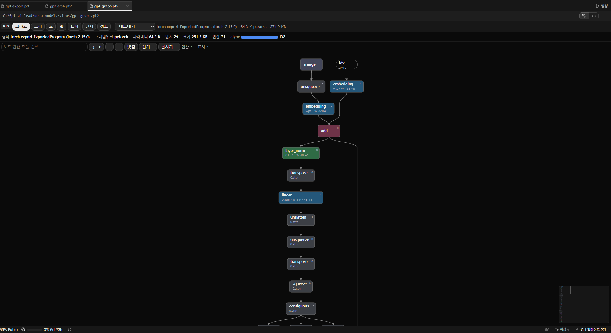
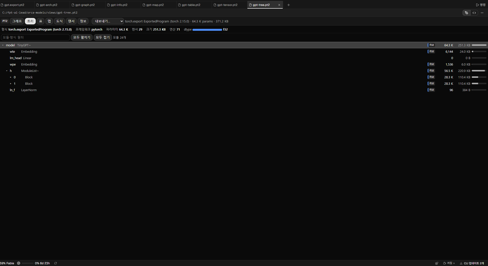
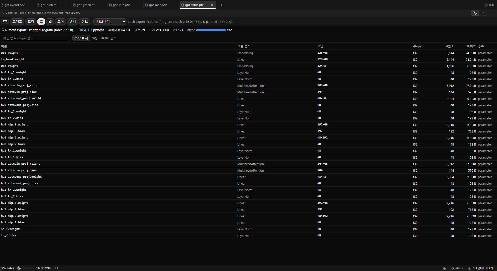
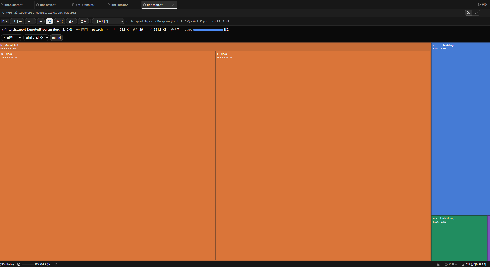
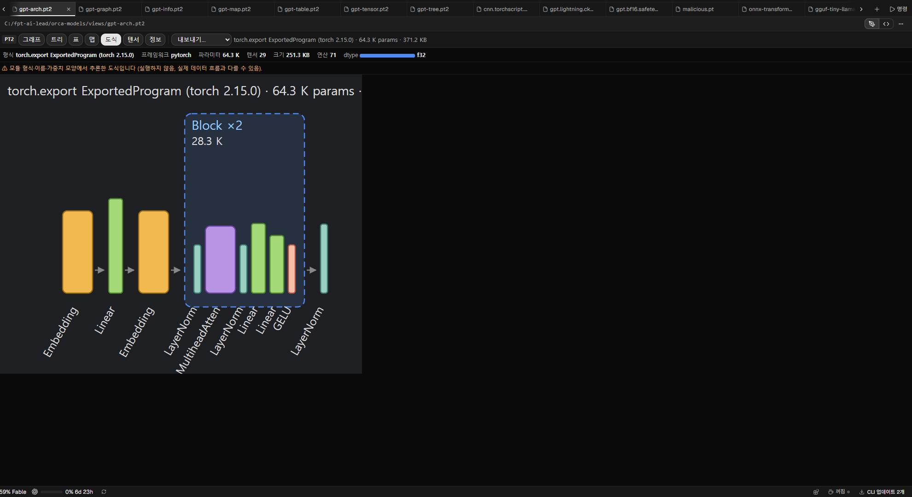
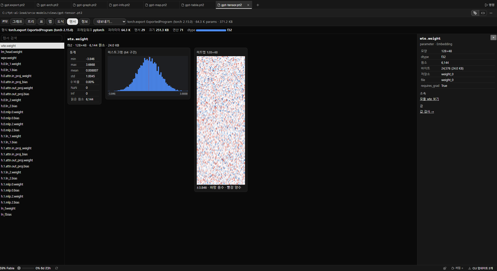
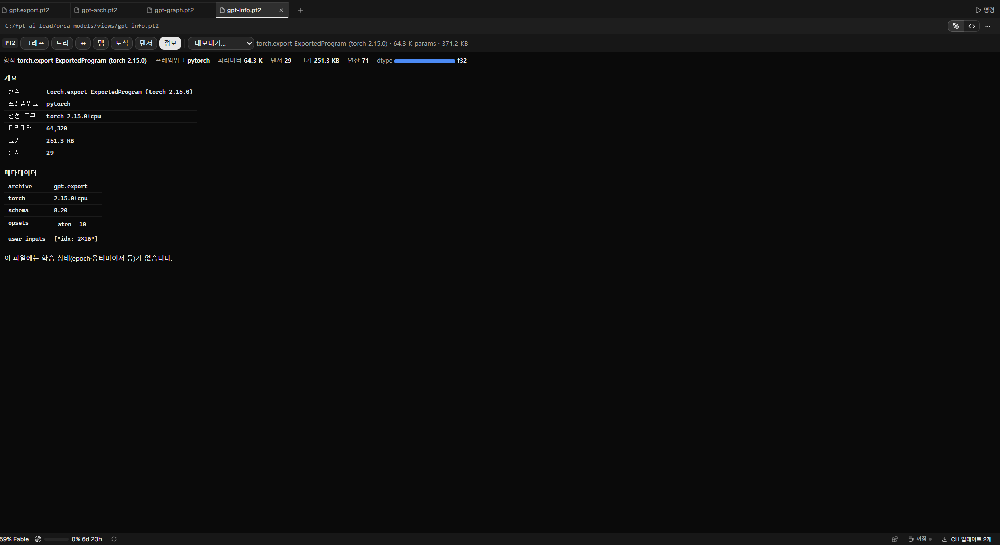
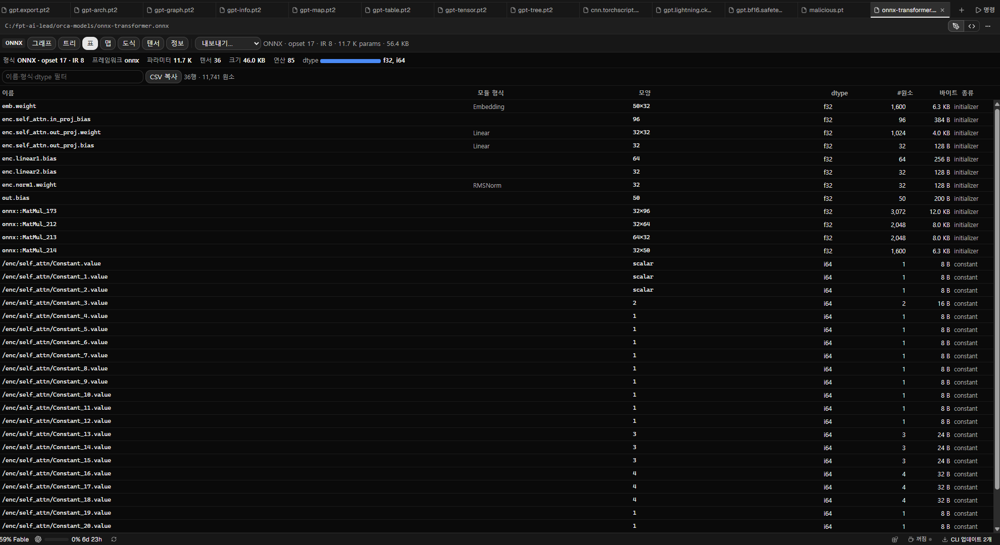

# AI Model Preview — evidence

What: the AI Model Preview (`plugin/editor/renderers/aimodel.ts`, `plugin/editor/renderers/aimodel/`). It reads
PyTorch (`.pt .pth .ckpt .chkpt .pt2 .ptl`, and `.bin`/`.pkl` in the panel), safetensors, ONNX, TFLite, GGUF,
Keras/HDF5 and NumPy files without running any code, and offers seven views plus export. The research and design
(formats, tool survey, layout benchmark, mockups) are in `docs/research/ai-model-visualization.md`. The ONNX,
TFLite, GGUF, Keras/HDF5 and NumPy readers have their own evidence in `docs/evidence/ai-formats/`.

## How it was measured

| Check | Command | Result |
|---|---|---|
| Fidelity vs PyTorch 2.15 | `node --experimental-transform-types tools/aimodel/fidelity.mjs --big C:/fpt-ai-lead/big` | **39/39** files match: tensor count, unique parameter total, every shape and dtype, torch.export op count → [fidelity.md](fidelity.md) |
| Unit tests | `orca plugin test plugin --json` (copied to `C:\fpt-ai-lead`) | 292/292 (17 AI-model tests: pickle VM on protocols 0/2/4, malicious `os.system` pickles, zip, dtypes, readers vs PyTorch, tree inference, layout incl. a 10k chain, TorchScript parser, treemap, sampling) |
| Harness, AI samples | `node tools/harness/run.mjs --dir samples/aimodel --profiles desktop-dark,desktop-light,mobile-light,tablet-dark` | 132/132 (incl. `broken.*` → friendly error) |
| Harness, format samples | same with `--dir samples/ai-formats` | 172/172 |
| Interactions | `node tools/harness/aimodel-interact.mjs --out docs/evidence/aimodel/harness --big C:/fpt-ai-lead/big/gpt-large.pth` | every view on 7 samples × 4 profiles with no page errors and no CSP violations; graph click, search, TB/LR, collapse, zoom/pan; tensor stats, heatmap and kernel grid; SVG/PNG/JSON/Markdown export; table sort and filter → [harness/results.json](harness/results.json) |
| Real Orca 1.4 | dev copy `local.file-preview-ai-lead` (AI editor only), `orca plugin open --editor` + `orca plugin shot --window`, left 285 px and the file pane cropped | [orca/](orca/), `orca plugin logs`: no errors |

Samples are generated by `tools/make-ai-samples.py` (random weights, no downloads; 33 files, 3.8 MB). The large
models (ResNet-18/50 in five forms and a 1.71 GB GPT-style `state_dict` with 459,251,200 parameters) are written by
`--big` and are not committed.

## Views (real Orca, torch.export GPT sample)

| Graph | Tree | Table | Map |
|---|---|---|---|
|  |  |  |  |
| **Diagram (inferred)** | **Tensor** | **Info** | **ONNX graph** |
|  |  |  |  |

Other files in real Orca: TorchScript CNN, Lightning checkpoint, bf16 safetensors, the malicious pickle (warning,
nothing run), GGUF, Keras, TFLite int8, NumPy npz, a 45 MB TorchScript ResNet-18 and a truncated file → `orca/`.
Phone/tablet/light layouts: `harness/*-mobile-light.png`, `harness/*-desktop-light.png`.

## Performance (large files)

| File | Size | Open (reader) | Bytes read to open | Notes |
|---|---:|---:|---:|---|
| gpt-large.pth (state_dict) | 1.71 GB | 1.8 ms (node) / **154 ms to first paint in the panel** (Chromium, `File.slice`) | 0.11 MB | inspecting `wte.weight` (50304×1280 f32, 246 MB): 0.86 s, 4 MB sample, JS heap 26 MB |
| resnet50 TorchScript | 98 MB | 12.9 ms | 0.15 MB | graph of 175 calls, same count as torch.export |
| resnet50 `.pt2` | 99 MB | 7.5 ms | 0.59 MB | 175 ATen ops |
| layout, 10k-node graph | — | 90 ms | — | dagre 3.1.4 overflows its stack at 2k nodes (research §2.1) |

## Editor slots

Orca allows 16 custom editors and all 16 were in use. 2D CAD bytes (`.dxf .dwf .dwfx`) moved into the
engineering editor ("CAD · Engineering Preview"); the free slot is "AI Model Preview". `.bin` and `.pkl` are not
registered (generic suffixes); the panel opens them by content. An `option`-priority editor for them would be a
17th editor, which Orca does not allow.

## Limits seen

- Orca refuses editor files over 50 MB with its own message ("File too large: 97.8MB exceeds 50MB limit",
  `orca/orca-resnet50.pth.png`), before the plugin runs, so the editor cannot point to the panel there. The panel
  opens such files by range (measured in the harness above; driving the panel's file picker in the real Orca
  window would need clicks, which this check does not do).
- Not shown: forward graphs of state_dicts, safetensors and whole pickled modules (not stored in those files);
  output shapes that need execution; values of packed formats other than GGUF quants; TorchScript control flow is
  approximated (both branches of an `if`, loop bodies once).
