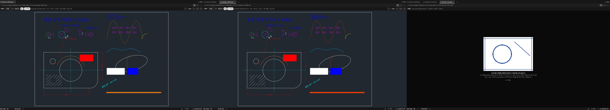

# Evidence — File Preview DWG (`dwg-plugin/`, GPL-3.0-or-later)

Separate plugin for AutoCAD `.dwg` / `.dwt`: GNU LibreDWG (`@mlightcad/libredwg-web` 0.9.4, WebAssembly) in a module
worker, a pure scene builder (`editor/renderers/dwg/scene.ts`) and a Canvas 2D viewer (`view.ts`). Measured on
2026-11-26, Windows 11, Chrome (Playwright, harness CSP = Orca's), Orca 1.4.263.

## How measured

| What | Command | Result |
| --- | --- | --- |
| Engine under a no-eval policy | `node --disallow-code-generation-from-strings .orca/probe.mjs <dwg…>` (patched glue, see `tools/libredwg-patches.mjs`) | all versions parse; unpatched glue throws |
| Typecheck | `npx tsc -p dwg-plugin` (and `npx tsc -p plugin`, unchanged) | 0 errors |
| Unit tests | copy to `C:\fpt-dwg\dwg-plugin`, `orca plugin test dwg-plugin --json` | **35 / 35** (geom 11, text 6, thumbnail 5, scene 13) |
| Browser harness | `node tools/harness/run.mjs --plugin dwg-plugin --profiles desktop-dark,desktop-light,mobile-light,tablet-dark --out docs/evidence/dwg/harness` | **36 / 36** ([results.md](harness/results.md)); canvas ink check per drawing |
| Interaction | `node tools/harness/dwg-interact.mjs --out docs/evidence/dwg/interact` | **16 / 16** ([results.json](interact/results.json)) |
| Corpus (all versions) | `node tools/harness/dwg-interact.mjs --corpus .orca/libredwg-src/test/test-data --recursive` | 142 files, 0 errors, table below ([corpus-all-versions.json](corpus-libredwg/corpus-all-versions.json)) |
| Plugin folder | `node tools/check-dwg-plugin.mjs` | OK — 25 files, 8.09 MB; licence files present; nothing outside the folder referenced; no eval |
| Manifest | `orca plugin validate dwg-plugin --json` | valid, `sandboxed-ui`, no capabilities |
| Real Orca | `orca plugin dev load dwg-plugin` → `plugin open --editor` → `plugin shot --window` (sidebar cropped) | renders; no log lines ([orca/](orca/)) |

## Versions (LibreDWG test data, `github.com/LibreDWG/libredwg` `test/test-data`, commit 80238a2, GPL-3.0; files kept in `.orca/`, not committed)

| Version | Files | Drawn | Preview image (nothing drawable) | Opened, nothing drawable | Error | Median ms |
| --- | ---: | ---: | ---: | ---: | ---: | ---: |
| R2.6 (AC1003) | 2 | 2 | 0 | 0 | 0 | 281 |
| R9 (AC1004) | 1 | 1 | 0 | 0 | 0 | 282 |
| R10 (AC1006) | 2 | 2 | 0 | 0 | 0 | 279 |
| R11/R12 (AC1009) | 3 | 3 | 0 | 0 | 0 | 290 |
| AC1.40 / AC2.10 | 3 | 2 | 0 | 1 | 0 | 300 |
| R13 (AC1012) | 1 | 1 | 0 | 0 | 0 | 593 |
| R14 (AC1014) | 4 | 4 | 0 | 0 | 0 | 411 |
| AutoCAD 2000 (AC1015) | 24 | 21 | 2 | 1 | 0 | 285 |
| AutoCAD 2004 (AC1018) | 22 | 20 | 2 | 0 | 0 | 316 |
| AutoCAD 2007 (AC1021) | 20 | 18 | 1 | 1 | 0 | 328 |
| AutoCAD 2010 (AC1024) | 19 | 18 | 1 | 0 | 0 | 313 |
| AutoCAD 2013 (AC1027) | 20 | 19 | 1 | 0 | 0 | 394 |
| AutoCAD 2018 (AC1032) | 21 | 20 | 0 | 1 | 0 | 287 |

"Preview image": files that hold only HELIX / 3DSOLID / underlay entities fall back to the PNG/BMP stored in the DWG.
"Nothing drawable": `2000/PolyLine2D.dwg` (LibreDWG returns only viewports), `2007/block_acad2027.dwg` (no entities),
`2018/Helix.dwg` (helix only, no stored image), `r2.10/block.dwg` (empty). R2.x–R12 files open, but block
references there are not resolved by LibreDWG ("INSERT (block missing)"). Times = open to settled, in the harness.
Renders of the `example_*` drawings: [corpus-libredwg/](corpus-libredwg/).

Self-made samples (`samples/dwg/`, `tools/make-dwg-samples.py`: ezdxf → GNU LibreDWG 0.14 `dxf2dwg`/`dwgwrite`):
R14, 2000, 2004, 2010, 2013, 2018 `.dwg`, a `.dwt`, `preview-only.dwg` (AC1015 header + PNG preview, no drawing
data) and `broken.dwg` (friendly error) — all pass in 4 profiles.

## Fidelity

| Feature | Status | Evidence |
| --- | --- | --- |
| Lines, LW/2D/3D polylines (bulges, constant width), arcs, circles, ellipses (partial, -Z normal) | ✅ | [01](interact/01-model-dark.png) |
| Splines (NURBS with weights; fit points via centripetal Catmull-Rom) | ✅ (fit-point curve approximates AutoCAD's) | 01 |
| Blocks: rotated, scaled, mirrored (-Z extrusion), arrayed (MINSERT), nested; ByBlock colour, layer 0 inheritance; attributes | ✅ | 01, scene.test.ts |
| TEXT (alignment, rotation, width factor, oblique, %%d %%p %%c) and MTEXT (paragraphs, stacking, wrapping) — Korean | ✅ (formatting codes are dropped: one font/colour per MTEXT) | 01, [orca](orca/drawing-r2018.png) |
| Dimensions (their anonymous blocks), leaders with arrows, multileaders, tolerance (text only) | ✅ | 01 |
| Hatches: solid, pattern lines with dashes (clipped, even-odd holes), two-colour gradients; SOLID/TRACE; wipeouts | ✅ (very dense patterns fall back to a fill) | [02](interact/02-model-zoomed.png), [05](interact/05-layers-dims-hatch-off.png) |
| Colours (ACI, true colour), line weights (toggle), line types (dash patterns × LTSCALE) | ✅ | [06](interact/06-model-light-background.png) |
| Layers: list, visibility toggles, off/frozen start hidden | ✅ | [04](interact/04-layers-panel.png) |
| Paper-space layouts: sheet, viewports showing model space at scale, clipped | ✅ (per-viewport frozen layers ignored) | [07](interact/07-layout-viewport.png) |
| Pan / wheel zoom at cursor / pinch / fit / keys; dark/light background; Orca theme switch | ✅ | 02, 03, [08](interact/08-theme-switched-light-en.png) |
| Info bar: version, units, extents, entity count | ✅ | toolbar in every shot |
| Phone width | ✅ no overflow | [09](interact/09-phone-light.png), [10](interact/10-phone-dwt-dark.png) |
| Embedded preview image when unreadable / nothing drawable | ✅ | [11](interact/11-preview-image-fallback.png), [orca](orca/preview-only.png) |
| Damaged file | ✅ friendly error | [12](interact/12-broken-friendly-error.png) |
| 3D solids/regions (ACIS), helix, raster image content, OLE, SHX shapes, xrefs | ❌ not drawn; listed in the note ("Not drawn: …") | corpus shots |

## Known issues found on the way (upstream)

- libredwg-web 0.9.4 decodes some layer colours wrongly (index in `color.index` with method 0xC3 → reported as 255):
  the worker reads the raw layer colours and `decodeColor` (scene.ts) fixes them.
- GNU LibreDWG 0.14 `dxf2dwg` writes a negative-X-scale INSERT with a wrong Y scale, MTEXT height into the box width,
  drops TEXT alignment points and gradient colours; the samples avoid or tolerate these (mirroring by -Z extrusion;
  the renderer uses the insertion point when an alignment point is unset and ignores a box narrower than two characters).
- Files written by LibreDWG carry two `*Model_Space` records; all are treated as model space.

## Installed from the Git URL (Orca 1.4.263, Windows 11)

`orca plugin install https://github.com/hangams84/orca-file-preview-dwg`, which installs v0.1.0. A DWG (R2018), a DWT (R2000) and a preview-only DWG were opened, with no log errors:

