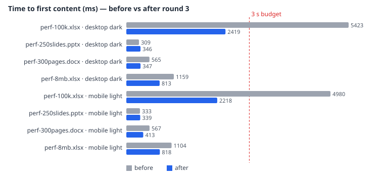

# Office renderers — performance (round 3)

Inputs (generated, git-ignored under `samples/perf/`): `python tools/make-perf.py && node tools/make-perf-sheets.mjs`

| File | Size | Content |
| --- | ---: | --- |
| `perf-300pages.docx` | 0.36 MB | 301 pages (page breaks), 1,500 paragraphs, 50 "Light Grid Accent 1" tables, 30 JPEG images |
| `perf-250slides.pptx` | 2.5 MB | 250 slides, each with a 960×540 JPEG, a 5×3 table, a text box, notes |
| `perf-100k.xlsx` | 28 MB | sheet 1: 100,001 rows × 20 columns; sheet 2: 2,000 merged ranges (2×2) |
| `perf-8mb.xlsx` | 8.1 MB | 53,001 rows × 5 text-heavy columns |

Measured with `node tools/perf.mjs --label before|after [--shots]` (harness page under the Orca-like CSP; Chrome,
`--enable-precise-memory-info`), report by `node tools/perf-report.mjs`. "First content" = the preview reaches
`data-state=ready` (content drawn). Long tasks come from `PerformanceObserver('longtask')`. Interactions: scroll to
the end (30 steps of 50 ms, so ~1.85 s is the floor), switch to sheet 2 and back, two zoom-in clicks.
"Before" is the round-2 code (commit 3d7b5c4 + master), "after" is this round.

Budgets: first content < 3 s on desktop; no single long task > 1 s after first content.

| File | Profile | First content (ms) | Longest task after content (ms) | Scroll to end (ms) | Sheet switch (ms) | Zoom ×2 (ms) | JS heap (MB) | DOM nodes | Budget |
| --- | --- | ---: | ---: | ---: | ---: | ---: | ---: | ---: | :---: |
| `perf-100k.xlsx` | desktop-dark | 5423 → **2419** | 321 → **68** | 4628 → **1876** | 321 → **135** | 299 → **238** | 53 → **72** | 6673 → **1640** | ❌ → ✅ |
| `perf-250slides.pptx` | desktop-dark | 309 → **346** | 0 → **0** | 1854 → **1851** | – → **–** | 99 → **92** | 14 → **14** | 1613 → **1613** | ✅ → ✅ |
| `perf-300pages.docx` | desktop-dark | 565 → **347** | 313 → **0** | 1861 → **1862** | – → **–** | 668 → **84** | 10 → **15** | 8908 → **8908** | ✅ → ✅ |
| `perf-8mb.xlsx` | desktop-dark | 1159 → **813** | 618 → **0** | 2015 → **1865** | – → **–** | 1497 → **143** | 22 → **32** | 35041 → **829** | ✅ → ✅ |
| `perf-100k.xlsx` | mobile-light | 4980 → **2218** | 341 → **63** | 4863 → **1877** | 336 → **133** | 301 → **227** | 53 → **72** | 6673 → **1750** | ❌ → ✅ |
| `perf-250slides.pptx` | mobile-light | 333 → **339** | 0 → **0** | 1852 → **1861** | – → **–** | 101 → **80** | 14 → **14** | 2285 → **2285** | ✅ → ✅ |
| `perf-300pages.docx` | mobile-light | 567 → **413** | 310 → **0** | 1856 → **1856** | – → **–** | 644 → **158** | 10 → **15** | 8908 → **8908** | ✅ → ✅ |
| `perf-8mb.xlsx` | mobile-light | 1104 → **818** | 743 → **54** | 2094 → **1856** | – → **–** | 1698 → **167** | 23 → **32** | 35041 → **864** | ✅ → ✅ |

## What changed

- **Spreadsheets (the only misses).** `perf-100k.xlsx` took 5.4 s to first content (SheetJS parsing all 100k rows
  in the worker, 7.5 s in Node), and the 5,000-row DOM made zoom take 1.5–1.7 s with 620–740 ms long tasks on
  `perf-8mb.xlsx` (35k DOM nodes).
  - The worker parses with SheetJS `sheetRows` = 20,000, so it stops reading rows after what the grid shows; the real
    size comes from `!fullref` for the toolbar and the "showing the first N rows" notice (100k file: 7.5 s → 1.65 s in Node).
  - The grid is virtualised: only the rows near the viewport (±40) exist, between two spacer rows sized from a prefix
    sum of the fixed row heights (stored height or 20 px). Merges are clipped to the rendered window, so a merge that
    starts above it still shows in its first row. Scroll updates run on the next frame and again after 120 ms
    (hidden windows throttle frames); zoom and resize re-window. The cap rose from 5,000 to 20,000 rows.
  - Result: first content 2.2–2.4 s, no long task over 70 ms after it, zoom 140–240 ms, DOM 0.8–1.8k nodes.
- **DOCX.** Already within budget (docx-preview builds 301 pages in ~0.55 s). Pages now use
  `content-visibility: auto` with an intrinsic page size, so off-screen pages skip layout and paint: zoom
  644–668 → 84–158 ms, the 310 ms long task after first content is gone. Progressive attachment was not needed.
- **PPTX.** Already within budget: slides are built lazily as they approach the viewport (IntersectionObserver),
  pictures are blob URLs decoded asynchronously only for built slides. No change.
- JS heap stays modest: 10–15 MB (docx/pptx), 32 MB (8 MB xlsx), 72 MB (100k xlsx: 20k × 20 cells held for the grid
  and the formula evaluator).

Screenshots at the end of each scroll (and sheet 2 of the 100k file) are in `perf/*.end.png` / `*.sheet2.png`.
