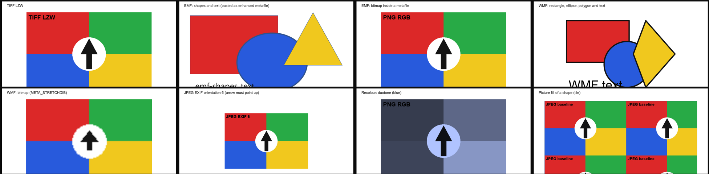

# PPTX pictures by format, size and placement — PowerPoint vs preview

User report: "pictures in some PPTX files are not shown, depending on the picture's format or size/spec".
This is the check-and-review table: every case is a slide built **by PowerPoint itself** (COM), exported by
PowerPoint to PNG as ground truth, then rendered by the preview and compared. BEFORE = the renderer as it
was (commit 1ba1bce); AFTER = this change.

**Result: 31 → 46 of 49 cases match PowerPoint** (PASS); the 3 others are explained below (one is the preview
showing a picture PowerPoint itself cannot). Before: 6 pictures were missing outright and 9 looked different.

| | PASS | CLOSE | DIFFERENT | MISSING |
| --- | ---: | ---: | ---: | ---: |
| before | 31 | 3 | 9 | 6 |
| after | **46** | 2 | 1 | 0 |
| after, WebKit (`--engine webkit`) | **46** | 2 | 1 | 0 |

## How it is built and measured

- `python tools/pptx-images/make-inputs.py` — input pictures with one recognisable design (coloured quadrants,
  a circle, an up arrow, a label), so orientation, crop and colour errors are visible; WMF files are hand-written
  (PowerPoint COM cannot paste as WMF).
- `powershell -File tools\make-pptx-images.ps1` — PowerPoint (COM, no window, alerts off, one job per file with a
  watchdog that kills a blocked Office process) builds `samples/pptx-images/pptx-img-{formats,specs,placements}.pptx`
  (committed) and `samples/perf/pptx-img-large.pptx` (48 MP pictures, git-ignored), writes `cases.json`, runs
  `tools/pptx-images/post-edit.py` for what COM cannot express (picture placeholder, negative crop, duotone,
  50 % transparency), builds the same pictures in Word (`docx-img-formats.docx/.doc`) and the formats deck as
  `.ppt`, and exports every slide to PNG (1280×720) as truth (`samples/pptx-images/truth/`, git-ignored).
- `node tools/pptx-images/render.mjs --label before|after [--engine webkit]` — harness page (Orca-like CSP),
  screenshots each slide frame once its pictures have decoded; also audits the .docx/.doc/.ppt copies.
- `python tools/pptx-images/compare.py --label before --after after` — on the picture area (label strip
  excluded): `diff` = mean absolute RGB difference after downscaling both to 160×90 (0–255);
  PASS ≤ 12, CLOSE ≤ 24, DIFFERENT above; MISSING when PowerPoint shows content and the preview's area is blank.
  Each case links a side-by-side image: PowerPoint | preview | difference ×3.

## Table (49 cases)

| Case | Deck · slide | before | after | Side by side |
| --- | --- | --- | --- | --- |
| PNG RGB | formats · 1 | ✅ PASS (0.0) | ✅ PASS (0.0) | [before](formats-png-rgb.before.jpg) [after](formats-png-rgb.after.jpg) |
| PNG RGBA (transparent quadrant over magenta) | formats · 2 | ✅ PASS (0.4) | ✅ PASS (0.4) | [before](formats-png-rgba.before.jpg) [after](formats-png-rgba.after.jpg) |
| PNG 16-bit grayscale gradient | formats · 3 | ✅ PASS (0.4) | ✅ PASS (0.4) | [before](formats-png-16bit.before.jpg) [after](formats-png-16bit.after.jpg) |
| PNG palette (16 colours) | formats · 4 | ✅ PASS (0.1) | ✅ PASS (0.1) | [before](formats-png-palette.before.jpg) [after](formats-png-palette.after.jpg) |
| JPEG baseline | formats · 5 | ✅ PASS (0.2) | ✅ PASS (0.2) | [before](formats-jpg-baseline.before.jpg) [after](formats-jpg-baseline.after.jpg) |
| JPEG progressive | formats · 6 | ✅ PASS (0.4) | ✅ PASS (0.4) | [before](formats-jpg-progressive.before.jpg) [after](formats-jpg-progressive.after.jpg) |
| JPEG CMYK ¹ | formats · 7 | 🟡 CLOSE (18.6) | 🟡 CLOSE (18.6) | [before](formats-jpg-cmyk.before.jpg) [after](formats-jpg-cmyk.after.jpg) |
| JPEG grayscale | formats · 8 | ✅ PASS (0.5) | ✅ PASS (0.5) | [before](formats-jpg-gray.before.jpg) [after](formats-jpg-gray.after.jpg) |
| JPEG EXIF orientation 6 (arrow must point up) | formats · 9 | 🟠 DIFFERENT (37.4) | ✅ PASS (0.6) | [before](formats-jpg-exif6.before.jpg) [after](formats-jpg-exif6.after.jpg) |
| GIF static | formats · 10 | ✅ PASS (0.1) | ✅ PASS (0.1) | [before](formats-gif-static.before.jpg) [after](formats-gif-static.after.jpg) |
| GIF animated (3 frames) | formats · 11 | ✅ PASS (0.3) | ✅ PASS (0.3) | [before](formats-gif-animated.before.jpg) [after](formats-gif-animated.after.jpg) |
| BMP 24-bit | formats · 12 | ✅ PASS (0.3) | ✅ PASS (0.3) | [before](formats-bmp-24.before.jpg) [after](formats-bmp-24.after.jpg) |
| BMP 32-bit with alpha (over magenta) | formats · 13 | ✅ PASS (0.4) | ✅ PASS (0.4) | [before](formats-bmp-32.before.jpg) [after](formats-bmp-32.after.jpg) |
| TIFF LZW | formats · 14 | ❌ MISSING (90.8) | ✅ PASS (0.1) | [before](formats-tif-lzw.before.jpg) [after](formats-tif-lzw.after.jpg) |
| TIFF multipage (page 1) | formats · 15 | ❌ MISSING (90.9) | ✅ PASS (0.3) | [before](formats-tif-multipage.before.jpg) [after](formats-tif-multipage.after.jpg) |
| ICO ¹ | formats · 16 | ✅ PASS (3.8) | 🟠 DIFFERENT (58.7) | [before](formats-ico.before.jpg) [after](formats-ico.after.jpg) |
| WebP | formats · 17 | ✅ PASS (0.3) | ✅ PASS (0.3) | [before](formats-webp.before.jpg) [after](formats-webp.after.jpg) |
| AVIF | formats · 18 | ✅ PASS (0.3) | ✅ PASS (0.3) | [before](formats-avif.before.jpg) [after](formats-avif.after.jpg) |
| SVG (svgBlip + PNG fallback) | formats · 19 | ✅ PASS (0.1) | ✅ PASS (0.1) | [before](formats-svg.before.jpg) [after](formats-svg.after.jpg) |
| EMF: shapes and text (pasted as enhanced metafile) | formats · 20 | ❌ MISSING (74.7) | ✅ PASS (0.4) | [before](formats-emf-shapes.before.jpg) [after](formats-emf-shapes.after.jpg) |
| EMF: bitmap inside a metafile | formats · 21 | ❌ MISSING (85.8) | ✅ PASS (0.5) | [before](formats-emf-bitmap.before.jpg) [after](formats-emf-bitmap.after.jpg) |
| WMF: rectangle, ellipse, polygon and text | formats · 22 | ❌ MISSING (50.2) | ✅ PASS (4.6) | [before](formats-wmf-shapes.before.jpg) [after](formats-wmf-shapes.after.jpg) |
| WMF: bitmap (META_STRETCHDIB) | formats · 23 | ❌ MISSING (84.7) | ✅ PASS (1.4) | [before](formats-wmf-bitmap.before.jpg) [after](formats-wmf-bitmap.after.jpg) |
| Tiny 8x8 PNG scaled up | specs · 1 | ✅ PASS (1.7) | ✅ PASS (1.7) | [before](specs-tiny-8x8.before.jpg) [after](specs-tiny-8x8.after.jpg) |
| Extreme aspect 50:1 | specs · 2 | ✅ PASS (0.2) | ✅ PASS (0.2) | [before](specs-aspect-wide.before.jpg) [after](specs-aspect-wide.after.jpg) |
| Extreme aspect 1:30 | specs · 3 | ✅ PASS (0.0) | ✅ PASS (0.0) | [before](specs-aspect-tall.before.jpg) [after](specs-aspect-tall.after.jpg) |
| Cropped 25% left and top (srcRect) | specs · 4 | ✅ PASS (0.1) | ✅ PASS (0.1) | [before](specs-crop-25.before.jpg) [after](specs-crop-25.after.jpg) |
| Negative crop (picture smaller than its frame) | specs · 5 | ✅ PASS (0.5) | ✅ PASS (0.5) | [before](specs-crop-negative.before.jpg) [after](specs-crop-negative.after.jpg) |
| Rotated 30 degrees | specs · 6 | ✅ PASS (0.2) | ✅ PASS (0.2) | [before](specs-rotate-30.before.jpg) [after](specs-rotate-30.after.jpg) |
| Flipped horizontally | specs · 7 | ✅ PASS (0.6) | ✅ PASS (0.6) | [before](specs-flip-h.before.jpg) [after](specs-flip-h.after.jpg) |
| Flipped vertically | specs · 8 | ✅ PASS (0.4) | ✅ PASS (0.4) | [before](specs-flip-v.before.jpg) [after](specs-flip-v.after.jpg) |
| Recolour: grayscale | specs · 9 | 🟠 DIFFERENT (42.2) | ✅ PASS (0.5) | [before](specs-grayscale.before.jpg) [after](specs-grayscale.after.jpg) |
| Recolour: black and white | specs · 10 | 🟠 DIFFERENT (74.8) | ✅ PASS (0.0) | [before](specs-black-white.before.jpg) [after](specs-black-white.after.jpg) |
| Recolour: washout | specs · 11 | 🟠 DIFFERENT (77.4) | ✅ PASS (0.1) | [before](specs-washout.before.jpg) [after](specs-washout.after.jpg) |
| Brightness 70% / contrast 30% | specs · 12 | 🟠 DIFFERENT (53.7) | ✅ PASS (0.1) | [before](specs-bright-contrast.before.jpg) [after](specs-bright-contrast.after.jpg) |
| Set transparent colour (red quadrant) | specs · 13 | ✅ PASS (11.1) | ✅ PASS (0.4) | [before](specs-transparent-color.before.jpg) [after](specs-transparent-color.after.jpg) |
| Recolour: duotone (blue) | specs · 14 | 🟠 DIFFERENT (50.8) | ✅ PASS (4.1) | [before](specs-duotone.before.jpg) [after](specs-duotone.after.jpg) |
| Picture transparency 50% (over magenta) | specs · 15 | 🟠 DIFFERENT (39.7) | ✅ PASS (0.3) | [before](specs-alpha-50.before.jpg) [after](specs-alpha-50.after.jpg) |
| Picture placeholder | placements · 1 | ✅ PASS (0.0) | ✅ PASS (0.0) | [before](placements-placeholder.before.jpg) [after](placements-placeholder.after.jpg) |
| Shape picture fill (stretch) | placements · 2 | 🟠 DIFFERENT (55.7) | ✅ PASS (0.6) | [before](placements-fill-stretch.before.jpg) [after](placements-fill-stretch.after.jpg) |
| Shape picture fill (tile) | placements · 3 | 🟠 DIFFERENT (75.2) | ✅ PASS (0.8) | [before](placements-fill-tile.before.jpg) [after](placements-fill-tile.after.jpg) |
| Slide background picture | placements · 4 | ✅ PASS (3.6) | ✅ PASS (0.4) | [before](placements-background.before.jpg) [after](placements-background.after.jpg) |
| Picture in a table cell | placements · 5 | 🟡 CLOSE (14.1) | ✅ PASS (5.6) | [before](placements-table-cell.before.jpg) [after](placements-table-cell.after.jpg) |
| Pictures inside a group | placements · 6 | ✅ PASS (0.4) | ✅ PASS (0.4) | [before](placements-group.before.jpg) [after](placements-group.after.jpg) |
| Picture on the layout | placements · 7 | ✅ PASS (0.1) | ✅ PASS (0.1) | [before](placements-layout-picture.before.jpg) [after](placements-layout-picture.after.jpg) |
| Picture on the master | placements · 8 | ✅ PASS (0.1) | ✅ PASS (0.1) | [before](placements-master-picture.before.jpg) [after](placements-master-picture.after.jpg) |
| Linked (external) picture ¹ | placements · 9 | 🟡 CLOSE (16.0) | 🟡 CLOSE (16.3) | [before](placements-linked.before.jpg) [after](placements-linked.after.jpg) |
| Very large JPEG 8000x6000 (48 MP) | large · 1 | ✅ PASS (0.1) | ✅ PASS (0.1) | [before](large-huge-jpg.before.jpg) [after](large-huge-jpg.after.jpg) |
| Very large PNG 8000x6000 (48 MP) | large · 2 | ✅ PASS (0.3) | ✅ PASS (0.3) | [before](large-huge-png.before.jpg) [after](large-huge-png.after.jpg) |

¹ ICO: PowerPoint stores the .ico but cannot display it (its export shows a 'picture can't be displayed' box); the preview shows the icon.  
¹ Linked (external) picture: PowerPoint reads the linked file from disk; the preview has no file access and shows a placeholder with the file path instead.  
¹ JPEG CMYK: PowerPoint applies a press (SWOP-like) profile to untagged CMYK JPEGs, so its colours are muted; browsers convert CMYK naively.  

## What was wrong and what changed

| Problem (before) | Cases | Fix |
| --- | --- | --- |
| TIFF not shown (only Safari decodes TIFF) | TIFF LZW, multipage | UTIF.js 3.1.0 (MIT) decodes the first page → PNG |
| EMF not shown | EMF shapes/text, EMF bitmap | new in-tree EMF player on canvas (`office/emf.ts`): world/page transforms, save/restore, clip rect/path, pens incl. EXTCREATEPEN, brushes, poly/bezier 16/32, rect/ellipse/roundrect, paths, EXTTEXTOUTW with advances, STRETCHDIBITS/BITBLT/STRETCHBLT with 1–32 bpp DIBs and embedded JPEG/PNG. Office writes "EMF+ dual" files; the GDI records are played. (rtf.js's EMFJS failed on these files: parse error / blank.) |
| WMF not shown | WMF shapes/text, WMF bitmap | rtf.js 3.0.9 WMFJS (MIT) → SVG; headerless WMFs (from .doc/.ppt blips) sized from SETWINDOWEXT |
| EXIF-rotated JPEG turned 90° too far | JPEG EXIF 6 | PowerPoint (and Word) ignore EXIF and store the rotation on the shape (`rot`); the browser applied EXIF as well. `image-orientation: none` (and `imageOrientation: 'none'` when decoding) |
| Recolour / effects ignored | grayscale, black & white, washout, brightness/contrast, duotone, 50 % transparency, set-transparent-colour | blip effects applied on a canvas: `grayscl`, `biLevel` (Rec. 709 luma, as PowerPoint), `duotone`, `lum` (slope and offset fitted to PowerPoint's exports; washout and ±40 % presets exact), `alphaModFix`, `clrChange` |
| Picture fill of a shape not drawn | stretch, tile | `a:blipFill` in `spPr` becomes an SVG pattern (any geometry; tile size/offset from `a:tile`) |
| Picture in a table cell not drawn | table cell | cell `blipFill` → background (stretch/tile) |
| Slide background picture used `cover` | background | stretch to the slide (`100% 100%`) or tile |
| Linked picture: blank box | linked | placeholder with the reason and the linked path |
| Very large pictures (48 MP) | huge JPEG/PNG | already shown; now decoded with a size budget (> 16 MP → `createImageBitmap` resized to ≤ 4096 px) to save memory |

Other improvements: the picture format is taken from the bytes (magic numbers), not the part name; SVG pictures
use the `svgBlip` (crisp) with the PNG fallback when it fails; formats nothing can decode (HEIC, JPEG XR / HD
Photo) show a placeholder naming the format; pictures load asynchronously with `data-pending` until decoded, and
all object URLs are revoked when the preview is replaced.

## Not a match, by design or out of reach

- **ICO** — PowerPoint keeps the .ico in the file but cannot display it (its own export shows a "picture can't
  be displayed" box). Before, the preview showed nothing either, which counted as a match; now the preview shows
  the icon, which "differs" from PowerPoint but is what the user wants.
- **Linked picture** — not inside the file. PowerPoint's export showed its broken-link graphic; the preview shows a
  placeholder with the path (it has no file access).
- **CMYK JPEG** (CLOSE) — PowerPoint applies a press (SWOP-like) colour profile to untagged CMYK, giving muted
  colours; browsers convert CMYK naively. Emulating the profile is out of scope.
- **HEIC** — Pillow here cannot write HEIC, so it is not in the corpus; HEIC and JPEG XR show a placeholder with
  the format name (a wasm decoder would be needed). **AVIF** — PowerPoint converted it to JPEG on insert (shown).
  **BMP** and **WebP** were converted to PNG by PowerPoint. SmartArt/chart pictures were not added (charts are not
  rendered by the preview at all).

## Same pictures in Word and legacy PowerPoint files

The same inputs inserted by Word (`docx-img-formats.docx`, `.doc` without SVG/WebP, which Word 97 cannot hold) and
the formats deck saved by PowerPoint as `.ppt`:

| File | Renderer | Pictures shown before | After |
| --- | --- | ---: | ---: |
| docx-img-formats.docx | docx-preview | 9 / 14 (TIFF, 2 EMF, 2 WMF broken) | **14 / 14** |
| docx-img-formats.doc | legacy Word | 9 / 12 (EMF, WMF metafile blips skipped) | **12 / 12** |
| pptx-img-formats.ppt | legacy PowerPoint | 19 / 23 slides (EMF, WMF, TIFF blips skipped) | **22 / 23** (the ICO slide: PowerPoint stores no usable picture) |

The same decoder is reused: docx-preview's `` blobs are sniffed and re-decoded (`fixImages`), the legacy
blip reader now returns EMF/WMF (inflated) and TIFF blips, and the .doc/.ppt models are converted before drawing
(`normalizePictures`). Word also stores EXIF rotation on the shape and docx-preview applies it, so `.docx`
pictures get `image-orientation: none` as well (checked: the EXIF picture is upright).

## Verification

Harness (`--only docx,pptx,xls,ods,ppt,doc --profiles desktop-dark,mobile-light`): normal 56/56, `--no-raf` 56/56,
`--old-engine` 56/56, `--engine webkit` 56/56; fuzz (`--dir samples/fuzz --fuzz`) 161/161; `orca plugin test`
136/136 (new `office/images.test.ts`: format sniffing, header sizes, PowerPoint-fitted effects).

## In Orca 1.4.258 (Windows 11)

The cases that were missing or wrong before, each opened as a one-slide deck in real Orca after the fix
(TIFF LZW · EMF shapes · EMF bitmap · WMF shapes · WMF bitmap · EXIF orientation 6 · duotone · tiled picture fill):

