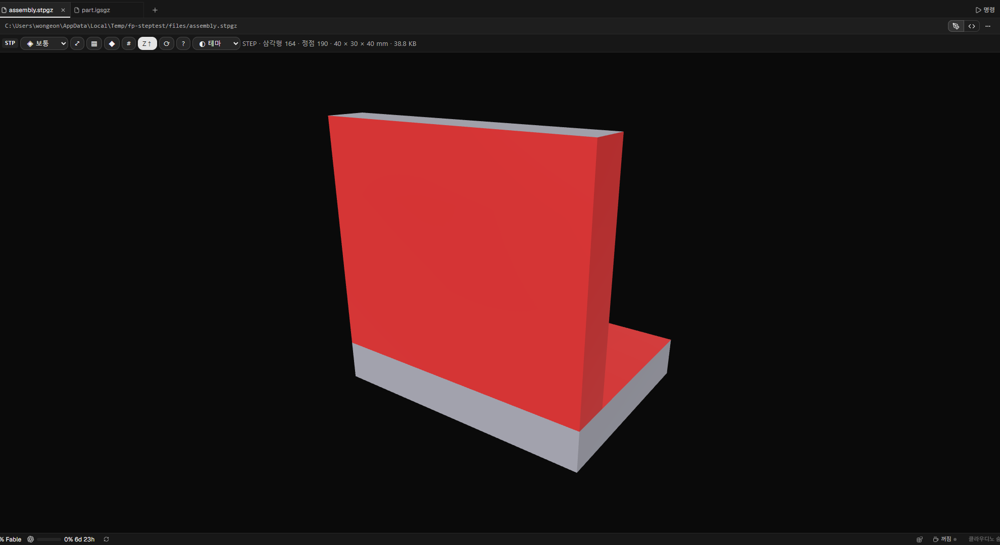
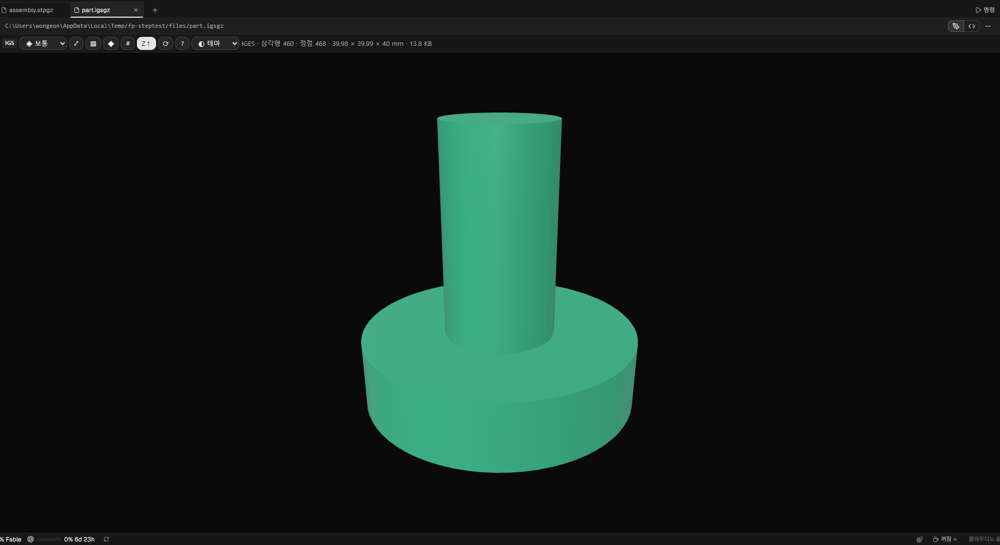

# STEP / IGES in Orca 1.4.258 (Windows 11)

Before the fix, the CAD engine did not start in Orca: the worker loaded the CSP-patched OpenCascade glue
from a `blob:` URL with `importScripts`, and Orca's plugin frames refuse `blob:` scripts
(`preview refused: cad-engine`). The harness allowed `blob:` in `script-src`, so it did not catch this.

Fix: `tools/build-vendor.mjs` writes `vendor/occt/occt-import-js.csp.js` (the library with its two
`new Function` sites replaced, with a modification notice). The worker imports that file by its plugin URL.
The harness CSP no longer allows `blob:` scripts, matching Orca. Result: harness 154/154.

Captured in real Orca with a temporary test copy of the plugin. The CAD files were gzip-wrapped so Orca
opens them in the plugin directly rather than in the Source view.

| File | Result |
| --- | --- |
| `samples/sample-ap242.step` (assembly, colours) |  STEP · 164 triangles · 40 × 30 × 40 mm |
| `samples/sample.igs` |  IGES · 460 triangles · 39.98 × 39.99 × 40 mm |
