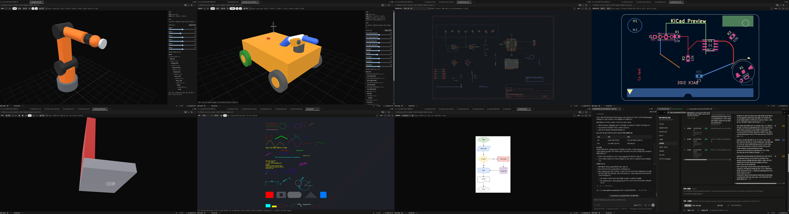
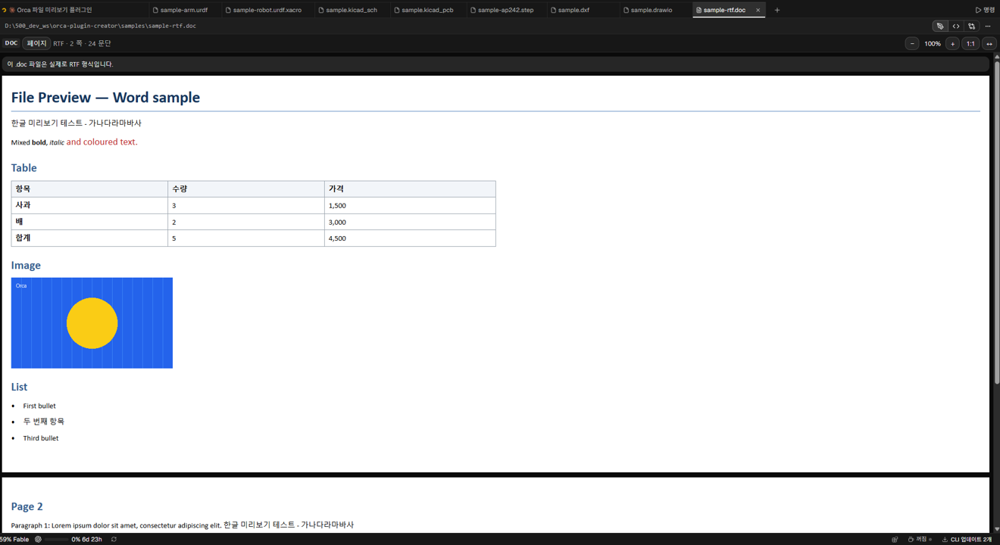

# Text formats open in the preview (Orca 1.4.277)

## What was wrong

URDF, xacro, KiCad, draw.io, ASCII DXF, STEP/IGES/BREP, OBJ and the other text 3D formats showed only XML or text
in Orca. Orca's source (`src/renderer/src/components/editor/panel/editor-panel-render-model.ts`) explains it:
- A `contentKind: "bytes"` editor is offered only when Orca judges the file binary: a NUL byte in its first 8 KB
  (`src/shared/file-preview/binary-buffer.ts`), or a suffix Orca previews by MIME type (png, jpg, gif, svg, webp,
  bmp, ico, pdf).
- Every editor of this plugin was `bytes`, so Orca never offered it for a text file. Not even the view toggle
  listed it.
- Earlier checks used UTF-16 copies (which contain NUL bytes), and the platform tests counted "opens in Orca's own
  view first" as expected. Both hid the problem.

## Fix

- `tools/gen-text-editors.mjs` writes the manifest's editors:
  - 6 `bytes` editors for binary files (entry `editor/main.ts`, dispatch on `fileType`);
  - 9 `text` editors, one per family (text, table, HTML, diagram, 3D, KiCad, DXF, robot, Office RTF/HTML/XML),
    each with entry `editor/text/<family>.ts`.

  Orca allows at most 16 editors. A text document carries no `fileType`, so `textType()` in `editor/app.ts` picks
  the suffix from the content (for example `(kicad_pcb`, `ISO-10303-21;` or `xmlns:xacro`).
- A text editor with `priority: default` opens matching files by default, except Orca's own types (`txt csv tsv
  html htm …`). Those stay in Source, with the preview in the view toggle.
- The browser harness now routes every fixture the way Orca does (`tools/harness/route.mjs`): text fixtures go
  through the text entries as UTF-8 text with no `fileType`. 254/254 pass. Unit tests in
  `editor/text-type.test.ts`.

## Real Orca

Plain UTF-8 samples opened with `orca file open` (the normal way, no `--editor`, no toggle): a URDF arm, a
`.urdf.xacro` robot, a KiCad schematic and board, STEP, ASCII DXF and draw.io all open in the preview. No log
errors.

A `.doc` saved as RTF opens in the Word preview:

