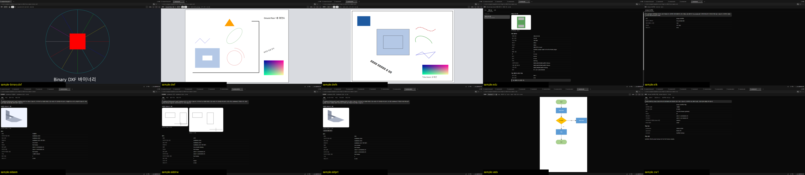

# v0.3.0 — new formats in real Orca (1.4.263, Windows 11)

The merged master was dev-loaded as a test copy, and each binary sample was opened with `orca plugin open --editor`.
The plugin log had no warnings or errors.

| File | Editor | Shown |
| --- | --- | --- |
| `sample-binary.dxf` | CAD Drawing Preview | binary DXF geometry, hatch, Korean text |
| `sample.dwf` | CAD Drawing Preview | DWF 6 W2D sheet: polylines, arcs, image, rotated Korean text |
| `sample.dwfx` | CAD Drawing Preview | XPS sheet: paths, gradient image, Glyphs. The rotated text uses the sample's own test font, whose every glyph is a slanted box, which proves the embedded-font path works. |
| `sample.vsdx` | Diagram Preview | flowchart page |
| `sample.sldprt` / `.sldasm` / `.slddrw` | SolidWorks Preview | stored preview pictures, properties, configurations, references |
| `sample.edz` / `.zw1` / `.elk` | EPLAN Preview | part data and pictures, project properties, link-file details |

ASCII DXF, draw.io and KiCad files are text, so Orca opens them in its Source view first. Their checks in Orca are
in `docs/evidence/cad2d/orca`, `docs/evidence/diagram` and `docs/evidence/kicad/orca`. The DWG/DWT plugin is in
`docs/evidence/dwg`.
