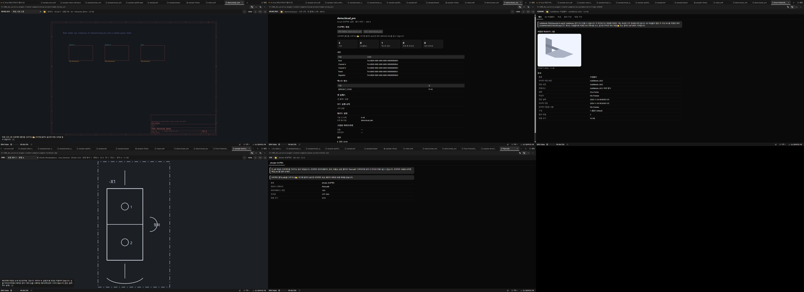

# v0.4.0 — checks in real Orca (1.4.277, Windows 11)

The merged master was dev-loaded as a test copy. The plugin log had no warnings or errors.

| File | How it was opened | Shown |
| --- | --- | --- |
| `samples/kicad-project/demo.kicad_sch` | `orca file open` (text, default) | hierarchical root sheet with three sheet boxes, title block, 📁 hint for the sub-sheets |
| `samples/kicad-project/demo.kicad_pro` | `orca file open` (text, default) | project summary: 5 sheets, text variables, buttons for the root schematic and the board |
| `samples/sw-assembly/Orca-Frame.SLDASM` | `plugin open --editor` | assembly overview with the stored preview, properties and a 3D-assembly tab |
| `samples/sample-terminal.ema` | `plugin open --editor` | EPLAN macro drawn from its PXF geometry (terminal, variant A) |
| `samples/eplan-project/Plant.elk` | `plugin open --editor` | link-file details and the 📁 hint for the `.edb` project folder |

More evidence:
- `docs/evidence/text-editors/`: text formats open by default.
- `docs/evidence/companions/`: meshes, xacro includes, OBJ/glTF side files, DXF xrefs and images, and the File
  Preview panel with a 143 MiB STL.
- `docs/evidence/companions-eng/`: KiCad sub-sheets, SolidWorks assemblies, EPLAN macros and projects.

The native folder dialog and dropping from Explorer need a person at Orca's window. The steps are in
`docs/evidence/companions/README.md` ("Manual steps").
