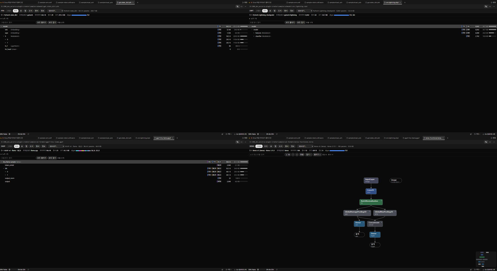

# v0.5.0 — AI models in real Orca (1.4.277, Windows 11)

The merged master was dev-loaded as a test copy, and each sample was opened with `orca plugin open --editor`. The
plugin log had no warnings or errors.

| File | View shown |
| --- | --- |
| `samples/aimodel/gpt.state_dict.pth` | module tree of a PyTorch state_dict (64.3 K params) |
| `samples/aimodel/cnn.lightning.ckpt` | module tree of a Lightning checkpoint |
| `samples/ai-formats/gguf-tiny-llama.gguf` | llama module tree with quantization badges (Q8_0, Q4_K, Q5_K, Q6_K) |
| `samples/ai-formats/keras-functional.keras` | operator graph with two outputs |

Screenshots of every view option, the fidelity tables and the large-model numbers are in `docs/evidence/aimodel/`
and `docs/evidence/ai-formats/`.
