# File Preview installieren (Orca-App)

So installieren und aktivieren Sie das Plugin File Preview über seine GitHub-URL in den Einstellungen der Orca-App. Ein Terminal ist nicht nötig.

> Screenshots: Orca 1.4.279, deutsche Oberfläche. In anderen Orca-Versionen können Namen und Positionen leicht abweichen. Der Pfad oben („Settings / …“) ist in Orca noch nicht übersetzt.

## Schritte

1. Klicken Sie unten links im Orca-Fenster auf die Schaltfläche **Einstellungen** (Zahnradsymbol).

   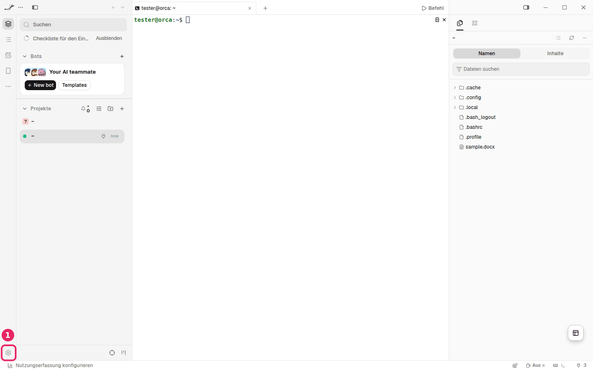

2. Wählen Sie im Menü **Einstellungen** aus.

   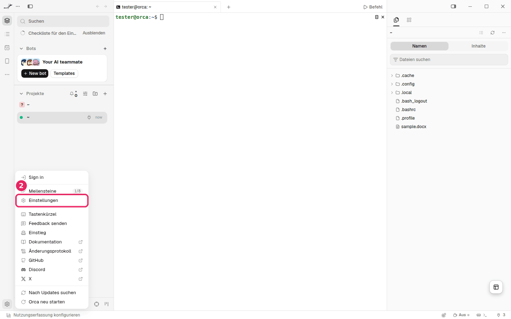

3. Klicken Sie links in der Liste der Einstellungen auf **Plugins**.

   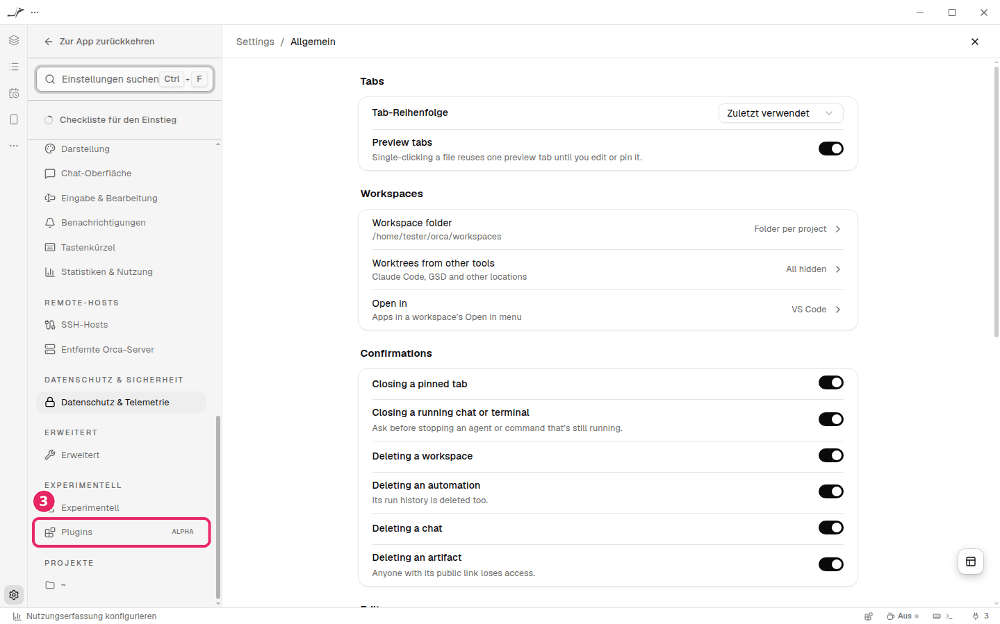

4. Klicken Sie oben rechts auf **Plugin hinzufügen**.

   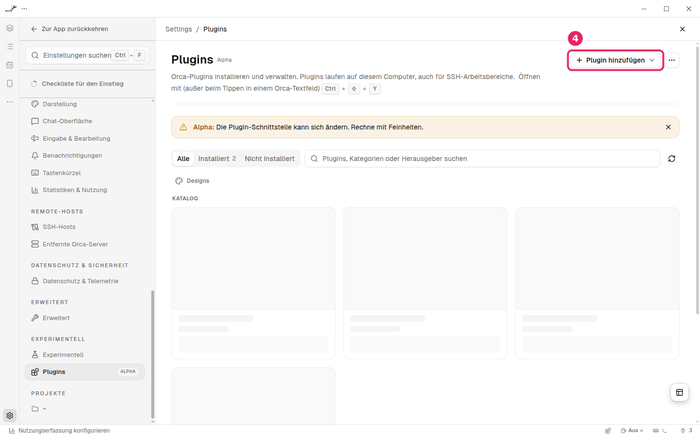

5. Wählen Sie **Aus einer Git-URL…** aus.

   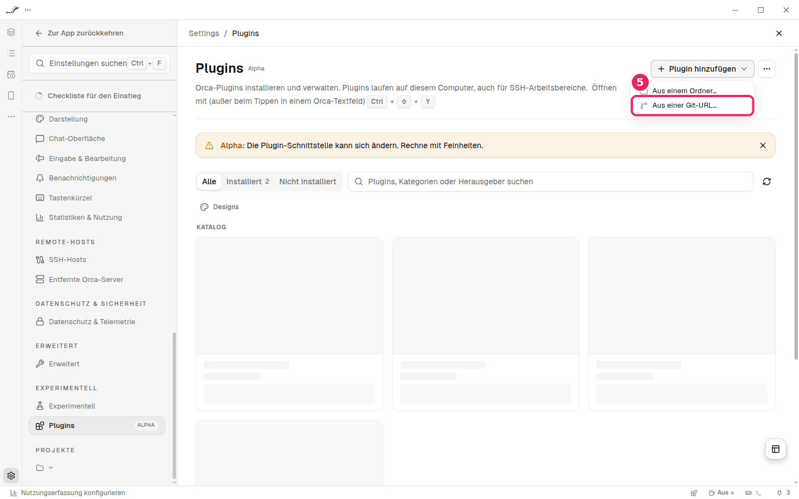

6. Das Dialogfeld **Plugin installieren** öffnet sich mit dem Tab **Git-URL**. Fügen Sie diese Adresse in das Feld **Repository-URL mit #ref** ein:

   ```text
   https://github.com/hangams84/orca-file-preview.git
   ```

   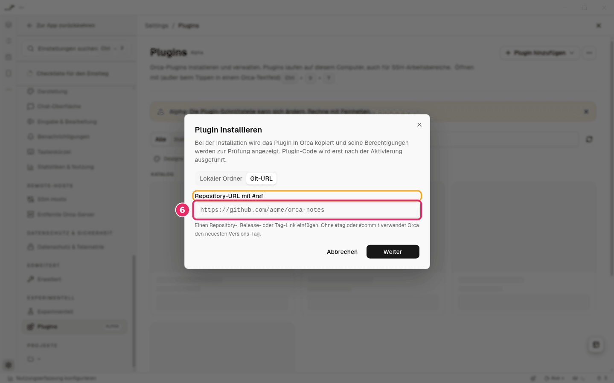

7. Klicken Sie auf **Weiter**.

   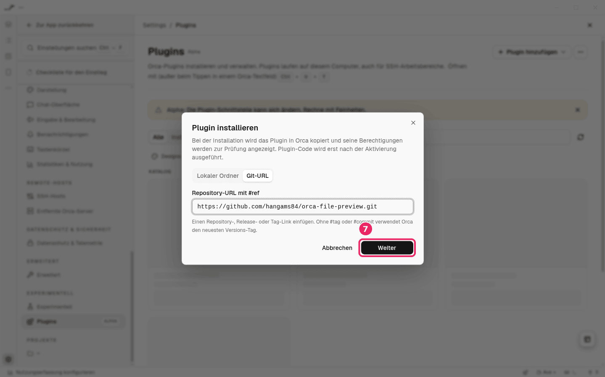

8. Orca ermittelt die neueste Version („Installiert v0.4.0, die neueste Version, bei Commit e6fe45d.“). Klicken Sie auf **Installieren**.

   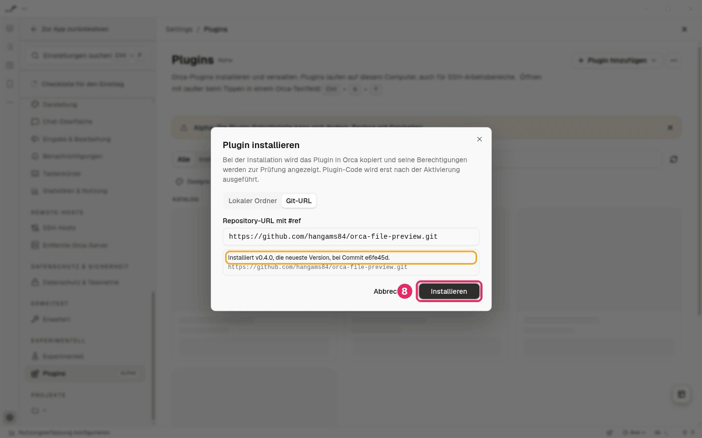

9. Orca fragt, ob Sie dem Herausgeber vertrauen („Stellen Sie sicher, dass Sie hangams84 vertrauen“). Klicken Sie auf **Installieren**.

   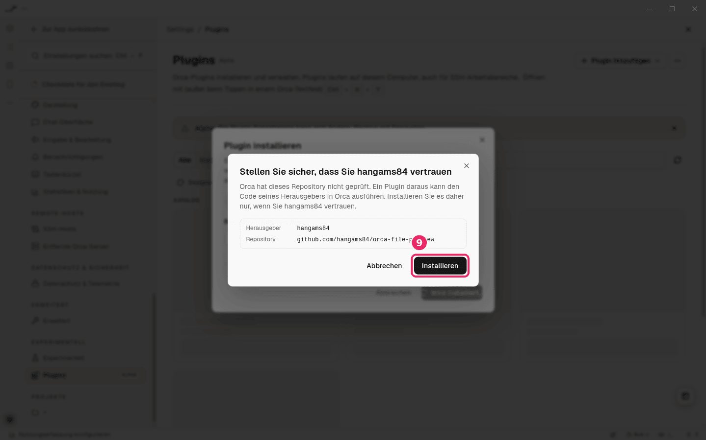

10. Die Plugin-Seite zeigt unter **Kann zugreifen auf**, worauf das Plugin zugreifen darf: Es öffnet nur die Dateitypen, die es in der Vorschau anzeigt. Klicken Sie auf **Plugin aktivieren**. (Mit **Ausgeschaltet lassen** bleibt es installiert, aber ausgeschaltet.)

    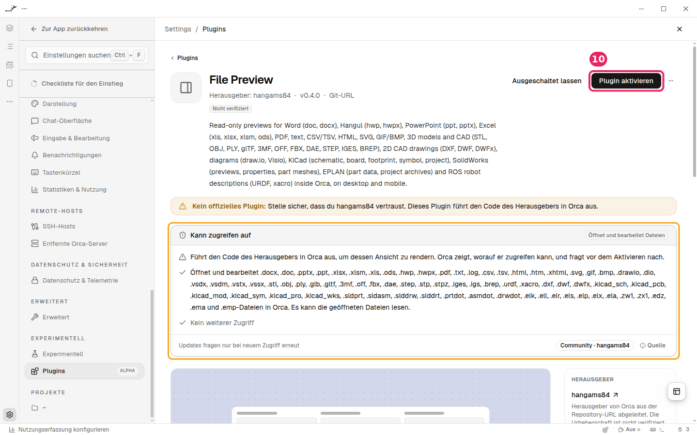

11. Der Status lautet jetzt **An**. Klicken Sie oben links auf **Zur App zurückkehren**.

    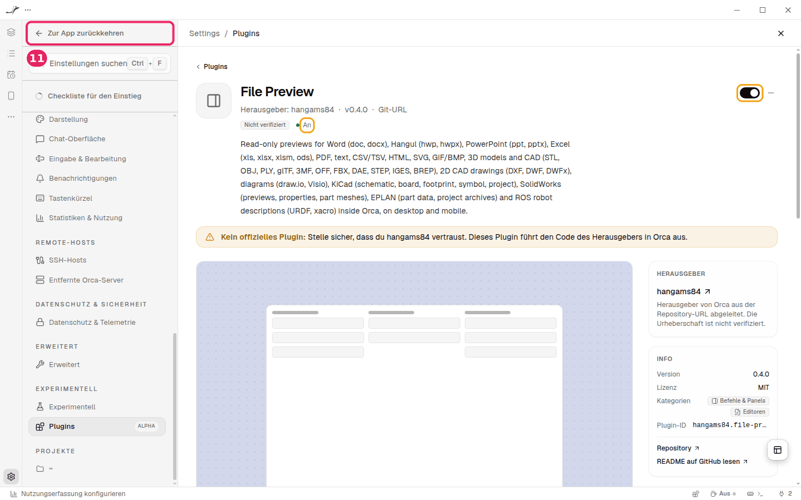

12. Öffnen Sie im Datei-Explorer rechts eine unterstützte Datei, zum Beispiel **sample.docx**.

    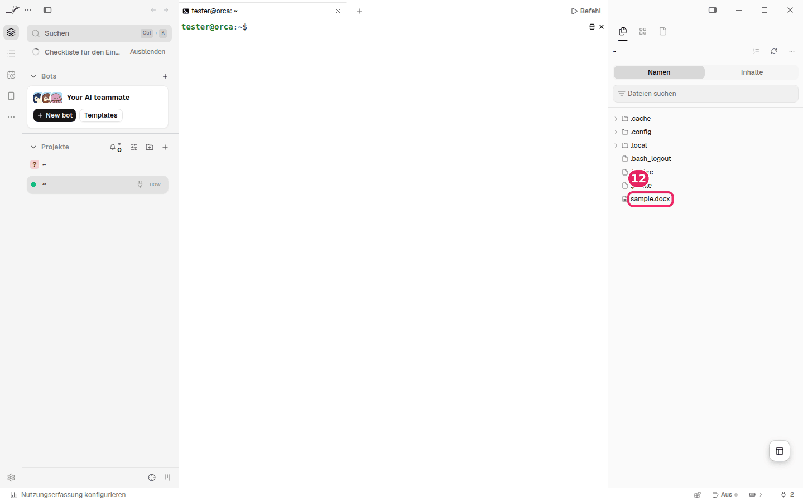

13. Die Datei öffnet sich in der Vorschau.

    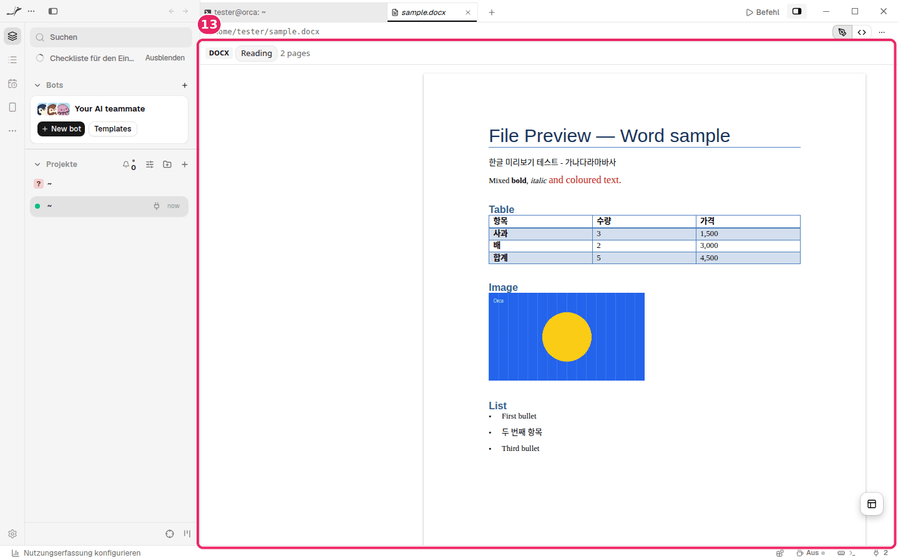

14. Optional: Um DWG-Zeichnungen anzuzeigen, installieren Sie das separate Plugin File Preview DWG auf dieselbe Weise (Schritte 4–10). Fügen Sie die Adresse unten ein, klicken Sie auf **Weiter** und dann auf **Installieren** und aktivieren Sie das Plugin anschließend.

    ```text
    https://github.com/hangams84/orca-file-preview-dwg.git
    ```

    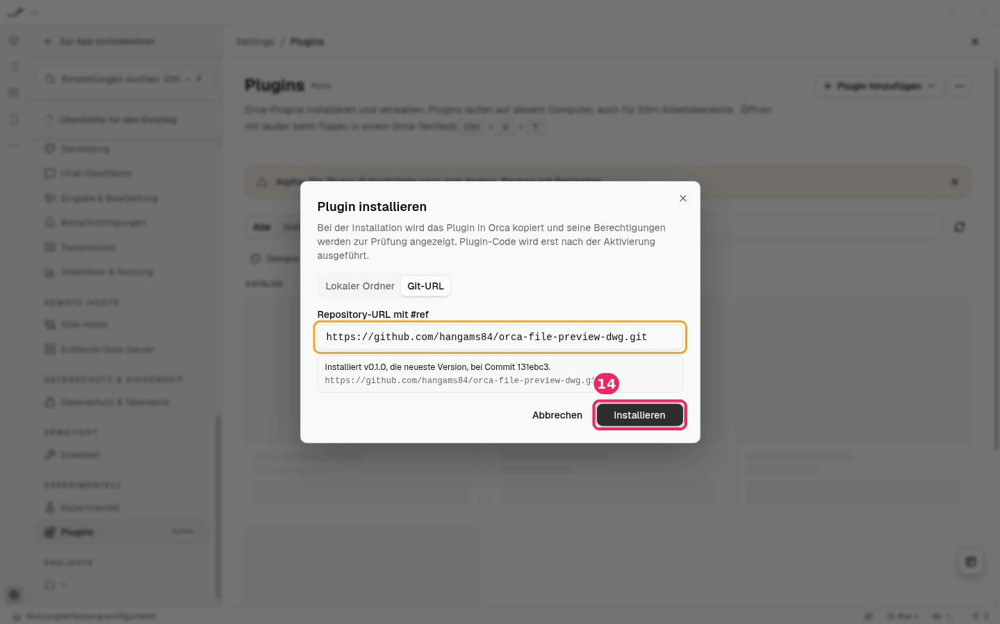

## Fehlerbehebung

- **Die Installation über die Git-URL funktioniert nicht**: Die Installation über eine Git-URL erfordert Orca 1.4.252 oder neuer. Aktualisieren Sie Orca und versuchen Sie es erneut.
- **„plugin exceeds the install size or file count limit“**: Dieser Fehler trat nur bei alten Tags vor v0.2.2 auf (v0.1.0–v0.2.1). Verwenden Sie die Adresse oben ohne `#tag`; Orca installiert dann die neueste Version.
- **Eine `.txt`-, `.csv`-, `.tsv`-, `.html`- oder `.htm`-Datei öffnet sich als Text**: Diese Dateitypen öffnet Orca selbst, und zwar zuerst in der Quelltextansicht. Wechseln Sie über den Ansichtsumschalter oben rechts im Tab zur Vorschau.
- **Einem 3D-Modell, Roboter (URDF) oder einer Zeichnung fehlen Texturen, Meshes oder referenzierte Dateien**: Der Editor erhält nur die geöffnete Datei. Klicken Sie in der Symbolleiste der Vorschau auf 📁 und wählen Sie den Ordner mit den referenzierten Dateien aus (mit gedrückter Umschalttaste einzelne Dateien), oder ziehen Sie die Dateien auf die Vorschau.
- **Dateien über 50 MB („exceeds 50MB limit“)**: Orca übergibt einem Editor höchstens 50 MB. Öffnen Sie die Datei mit „Open file…“ im Panel **File Preview** in der rechten Seitenleiste; dort gilt diese Grenze nicht (bis 1 GB).

---

[Andere Sprachen](README.md) · [File-Preview-Repository](https://github.com/hangams84/orca-file-preview)
