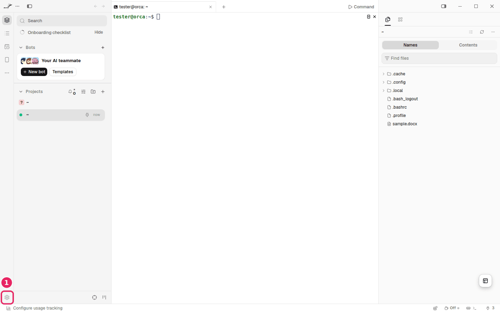
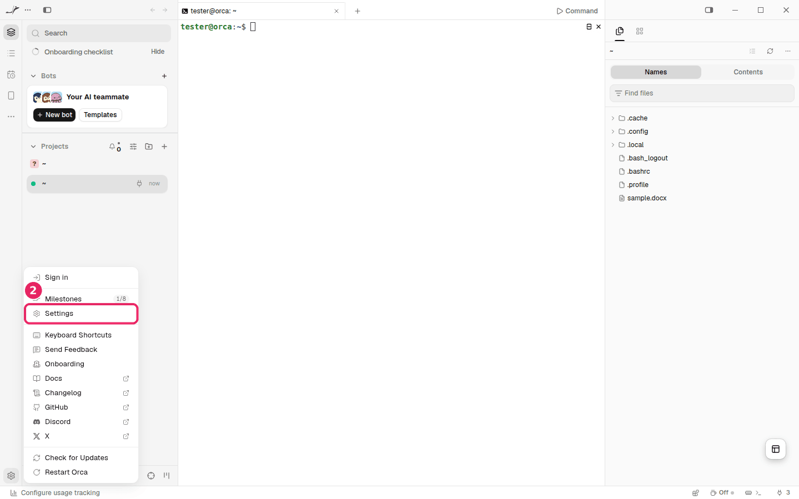
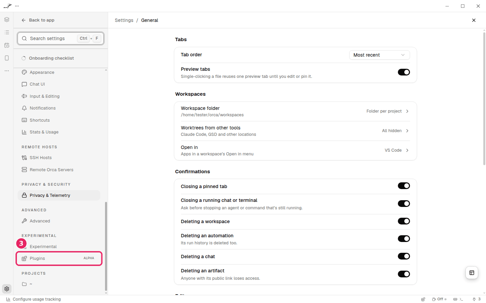
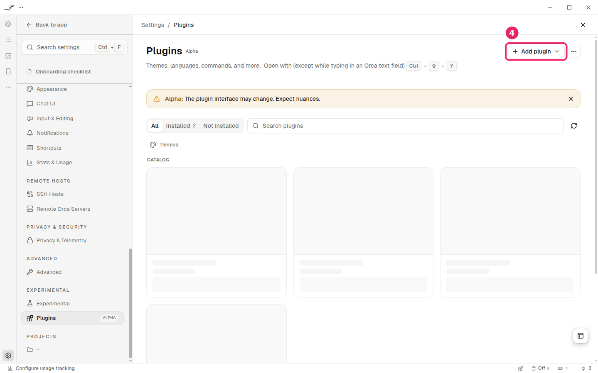
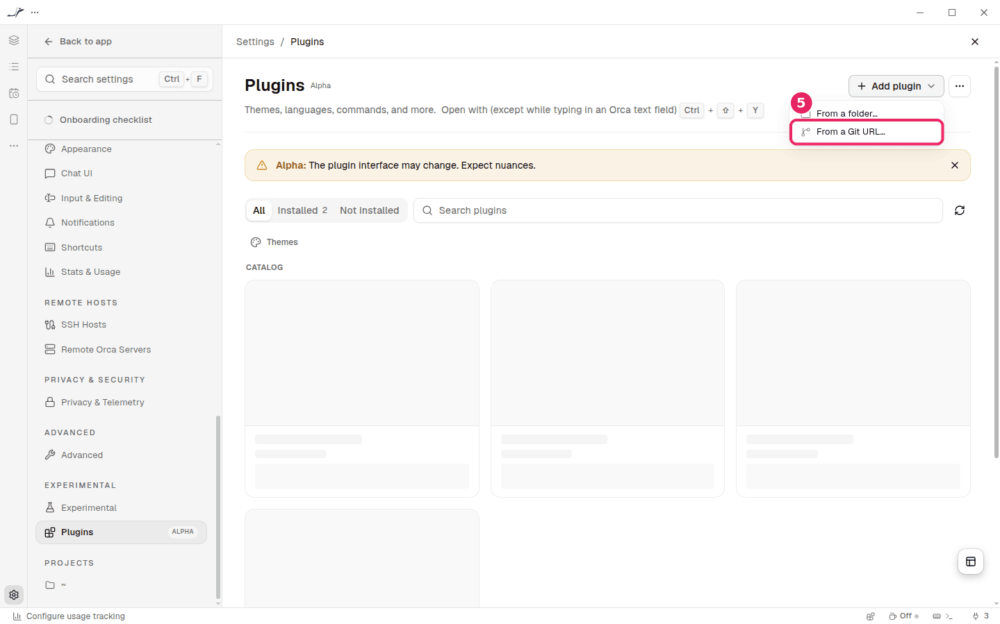
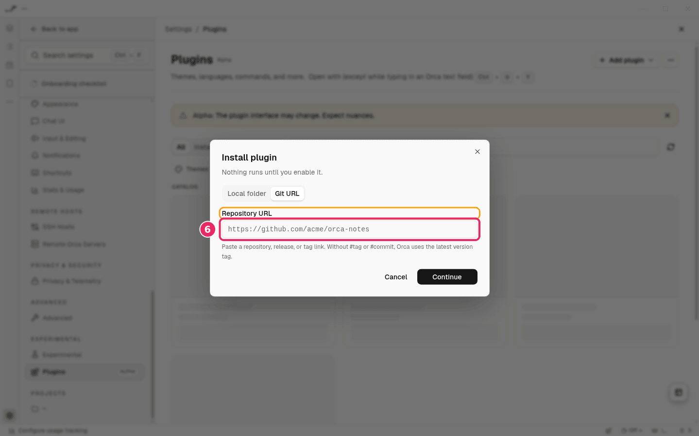
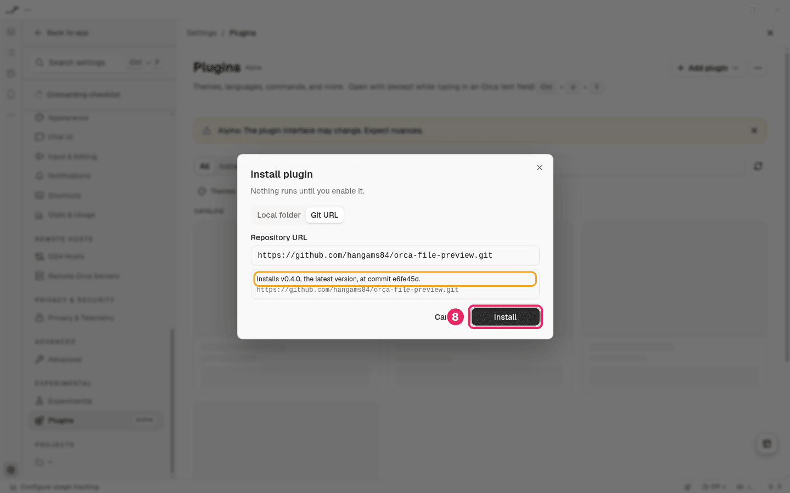
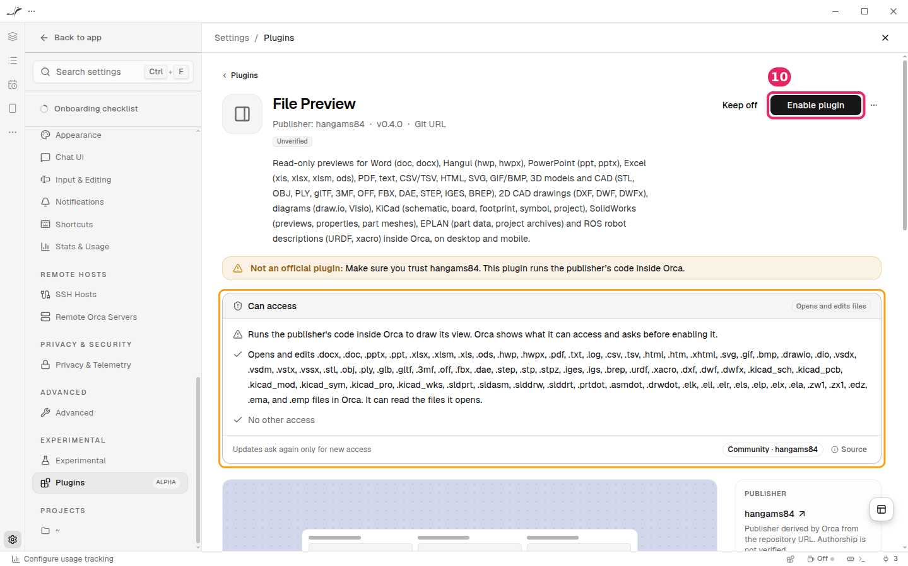
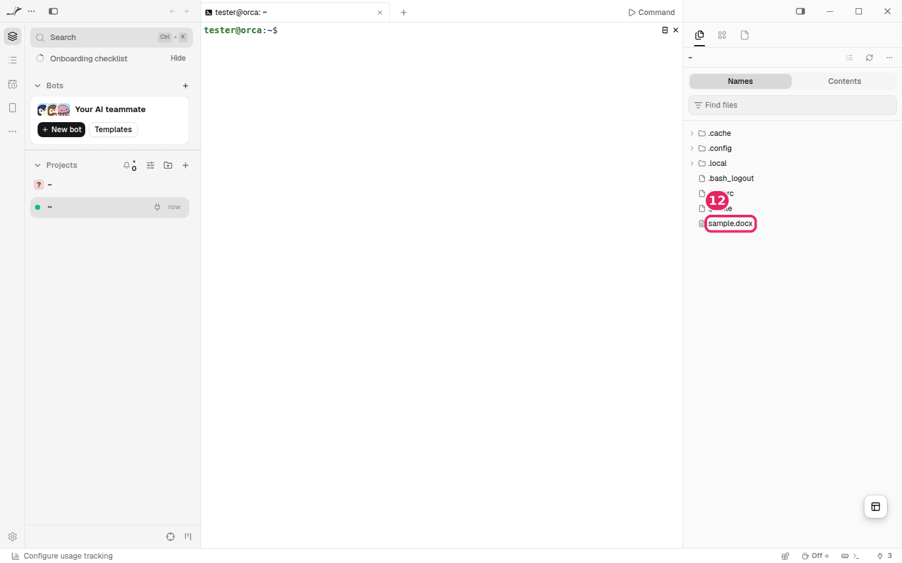
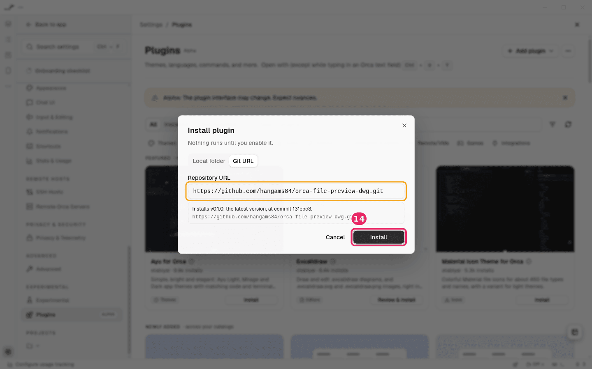

# Installing File Preview (Orca app)

How to install and turn on the File Preview plugin from its GitHub URL in the Orca app settings. No terminal needed.

> Screenshots: Orca 1.4.279, English UI. Names and positions can differ slightly in other Orca versions.

## Steps

1. Click the **Settings** button (gear icon) at the bottom left of the Orca window.

   

2. Choose **Settings** in the menu.

   

3. In the settings list on the left, click **Plugins**.

   

4. Click **Add plugin** at the top right.

   

5. Choose **From a Git URL…**.

   

6. The **Install plugin** dialog opens on the **Git URL** tab. Paste this address into **Repository URL**:

   ```text
   https://github.com/hangams84/orca-file-preview.git
   ```

   

7. Click **Continue**.

   

8. Orca finds the newest version (“Installs v0.4.0, the latest version, at commit e6fe45d.”). Click **Install**.

   

9. Orca asks whether you trust the publisher (“Make sure you trust hangams84”). Click **Install**.

   

10. The plugin page shows the **Can access** list: the plugin only opens the file types it previews. Click **Enable plugin**. (**Keep off** leaves it installed but off.)

    

11. The status now shows **On**. Click **Back to app**.

    

12. Open a supported file in the Explorer, for example **sample.docx**.

    

13. The file opens in the preview.

    

14. Optional: to view DWG drawings, install the DWG companion plugin the same way (steps 4–10). Paste the address below, click **Continue** and **Install**, then turn it on.

    ```text
    https://github.com/hangams84/orca-file-preview-dwg.git
    ```

    

## Troubleshooting

- **Installing from the Git URL does not work**: installing from a Git URL needs Orca 1.4.252 or newer. Update Orca and try again.
- **“plugin exceeds the install size or file count limit”**: this happened only with old tags (v0.1.0–v0.2.1), before v0.2.2. Use the address above without a `#tag`; Orca then installs the newest version.
- **A `.txt` `.csv` `.tsv` `.html` `.htm` file opens as text**: Orca opens these types itself, in the Source view first. Pick the preview with the view toggle at the top right of the tab.
- **A 3D model, robot (URDF) or drawing misses textures, meshes or referenced files**: the editor only gets the opened file. Click the 📁 button in the preview toolbar and pick the folder with the referenced files (Shift: single files), or drop them on the preview.
- **Files over 50 MB (“exceeds 50MB limit”)**: Orca hands an editor at most 50 MB. Open the file with “Open file…” in the **File Preview** panel in the right sidebar; it has no such limit (up to 1 GB).

---

[Other languages](README.md) · [File Preview repository](https://github.com/hangams84/orca-file-preview)
