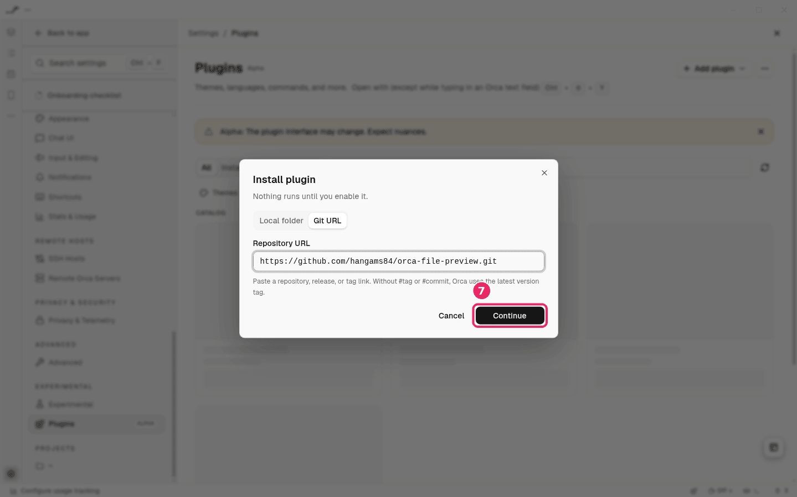
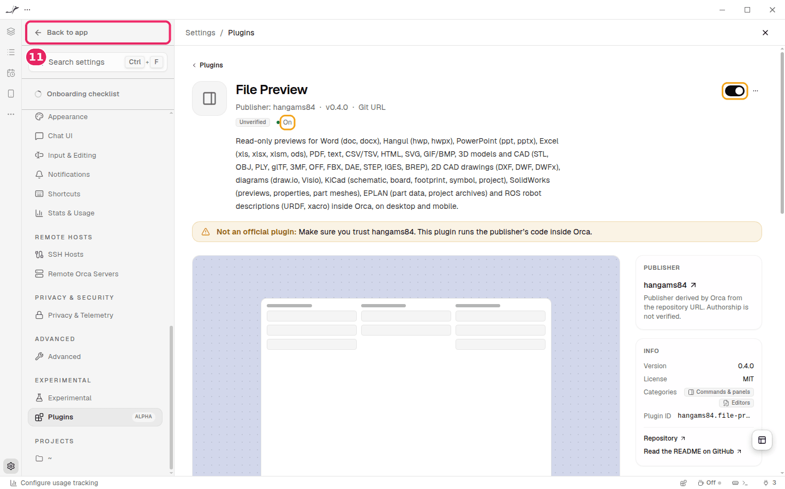
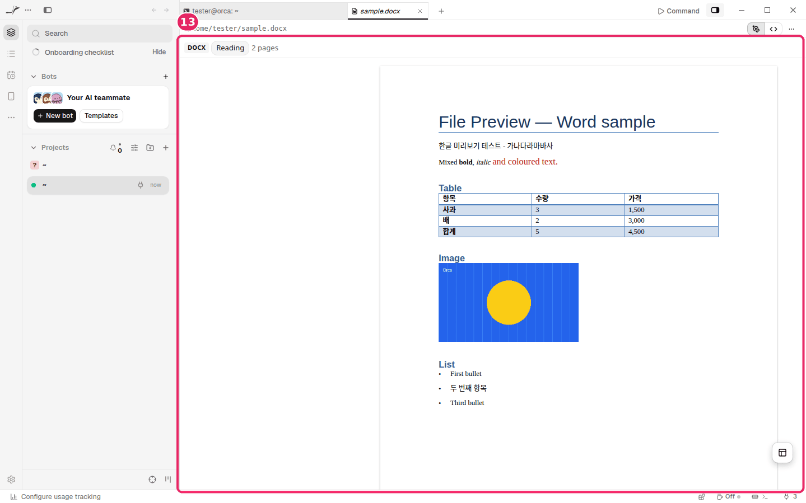

# Installing File Preview (Orca app)

This guide shows how to install the File Preview plugin from its GitHub URL in the Orca app settings and turn it on. No terminal needed.

> Screenshots: Orca 1.4.279, English UI. Names and positions may differ slightly in other Orca versions.

## Steps

1. Click the **Settings** button (gear icon) at the bottom left of the Orca window.

   

2. Choose **Settings** from the menu.

   

3. In the settings list on the left, click **Plugins**.

   

4. Click **Add plugin** at the top right.

   

5. Choose **From a Git URL…** from the menu.

   

6. The **Install plugin** dialog opens on the **Git URL** tab. Paste this address into the **Repository URL** field:

   ```text
   https://github.com/hangams84/orca-file-preview.git
   ```

   

7. Click **Continue**.

   

8. Orca finds the latest version (“Installs v0.4.0, the latest version, at commit e6fe45d.”). Click **Install**.

   

9. Orca asks whether you trust the publisher (“Make sure you trust hangams84”). Click **Install**.

   

10. On the plugin page, review the permissions under **Can access**: the plugin opens the file types it previews, and “No other access”. Click **Enable plugin** at the top right. (**Keep off** leaves it installed but turned off.)

    

11. The status now shows **On**. Click **Back to app** at the top left.

    

12. In the file explorer on the right, open a supported file, for example **sample.docx**.

    

13. The file opens in the preview.

    

14. Optional: to view DWG drawings, install the DWG companion plugin the same way (steps 4–10). Paste the address below, click **Continue** and **Install**, then click **Enable plugin**.

    ```text
    https://github.com/hangams84/orca-file-preview-dwg.git
    ```

    

## Troubleshooting

- **Installing from a Git URL fails**: Installing from a Git URL requires Orca 1.4.252 or later. Update Orca and try again.
- **“plugin exceeds the install size or file count limit”**: This only affected old tags before v0.2.2 (v0.1.0–v0.2.1). Use the address above without a `#tag`, and Orca installs the latest version.
- **A `.txt` `.csv` `.tsv` `.html` `.htm` file opens as text**: Orca opens these types itself, so they open in the Source view first. Pick the preview with the view toggle at the top right of the tab.
- **A 3D model, robot (URDF) or drawing is missing textures, meshes or companion files**: Orca hands the editor only the file you opened. Click the 📁 button in the preview toolbar and pick the folder with the companion files (hold Shift to pick individual files), or drop the files onto the preview.
- **Files over 50 MB (“exceeds 50MB limit”)**: Orca hands an editor at most 50 MB of a file. Open the file with “Open file…” in the **File Preview** panel in the right sidebar; the panel has no such limit (up to 1 GB).

---

[Other languages](README.md) · [File Preview repository](https://github.com/hangams84/orca-file-preview)
