# Instalar File Preview (aplicación Orca)

Cómo instalar y activar el plugin File Preview desde su URL de GitHub en la configuración de la aplicación Orca. No hace falta usar la terminal.

> Capturas: Orca 1.4.279, interfaz en español. Los nombres y las posiciones pueden variar un poco en otras versiones de Orca. La ruta de arriba («Settings / …») todavía no está traducida en Orca.

## Pasos

1. Haz clic en el botón **Ajustes** (engranaje), abajo a la izquierda de la ventana de Orca.

   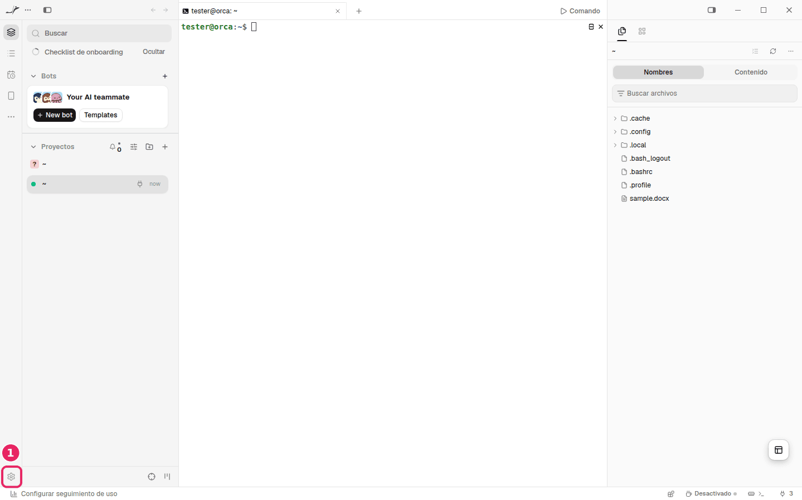

2. Elige **Ajustes** en el menú.

   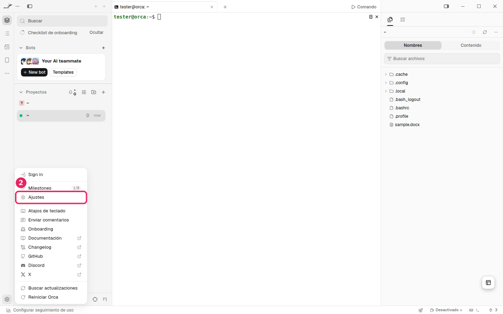

3. En la lista de configuración de la izquierda, haz clic en **Plugins**.

   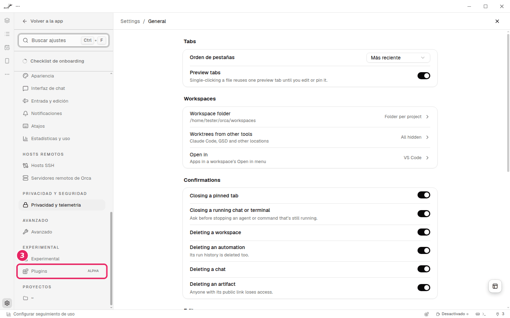

4. Haz clic en **Añadir plugin**, arriba a la derecha.

   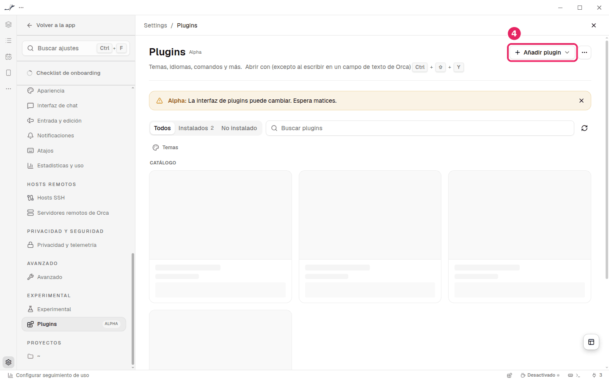

5. Elige **Desde una URL de Git…**.

   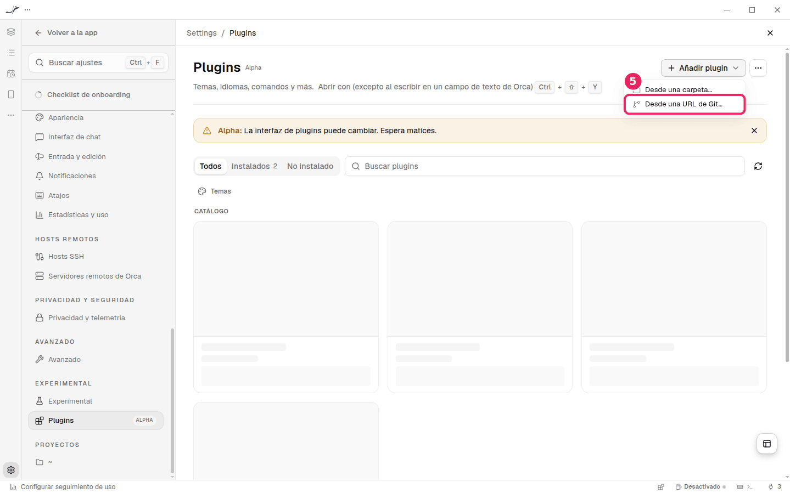

6. El cuadro **Instalar plugin** se abre en la pestaña **Git URL**. Pega esta dirección en **URL del repositorio**:

   ```text
   https://github.com/hangams84/orca-file-preview.git
   ```

   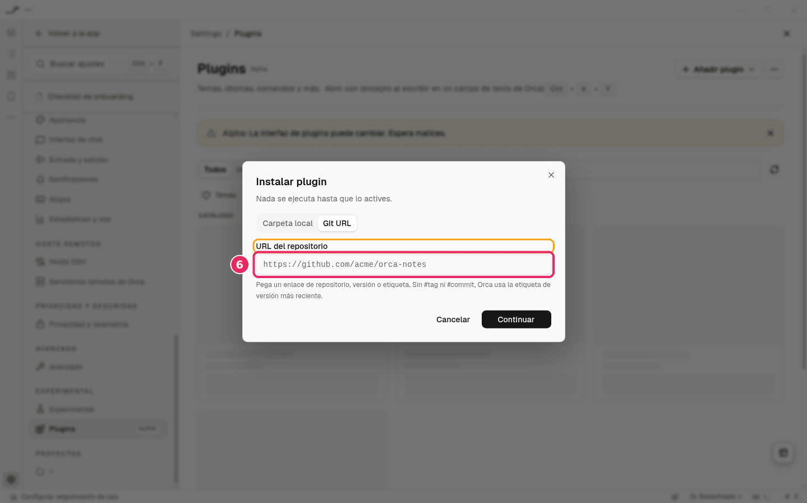

7. Haz clic en **Continuar**.

   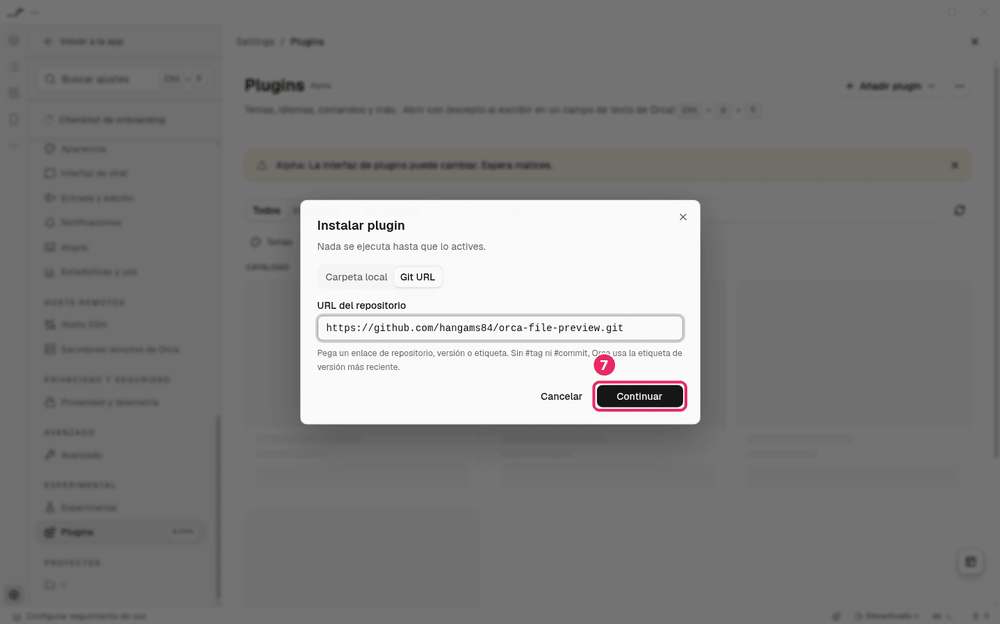

8. Orca encuentra la versión más reciente («Instala v0.4.0, la versión más reciente, en el commit e6fe45d.»). Haz clic en **Instalar**.

   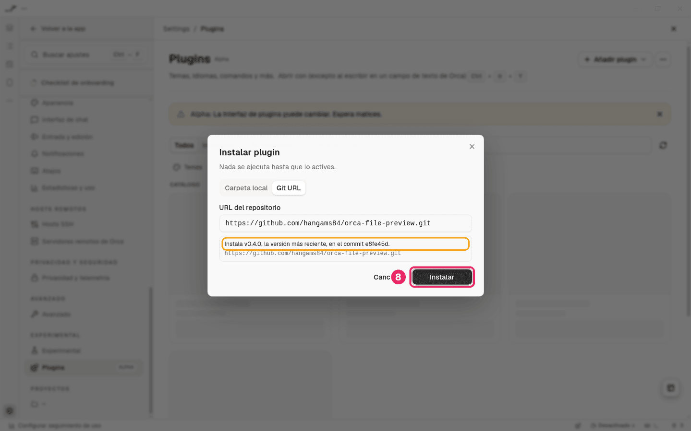

9. Orca pregunta si confías en el editor («Asegúrate de que confías en hangams84»). Haz clic en **Instalar**.

   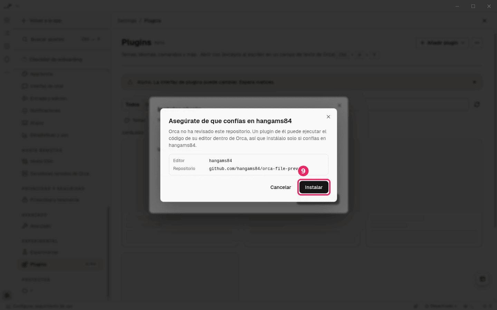

10. La página del plugin muestra en **Puede acceder a** lo que puede hacer el plugin: abrir los tipos de archivo que previsualiza. Haz clic en **Activar plugin**. (**Mantener desactivado** lo deja instalado pero desactivado.)

    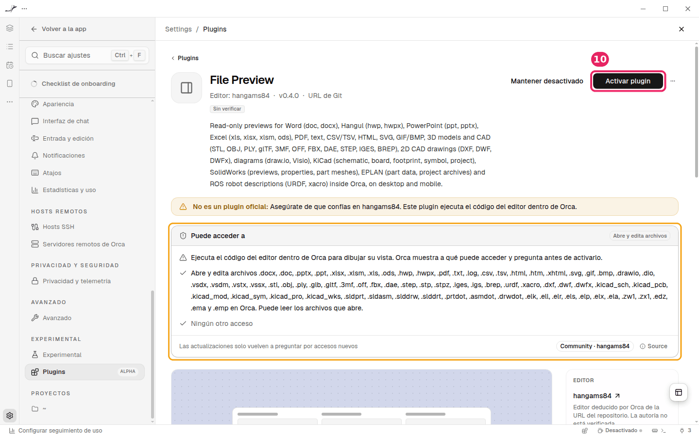

11. El estado ahora muestra **Activado**. Haz clic en **Volver a la app**.

    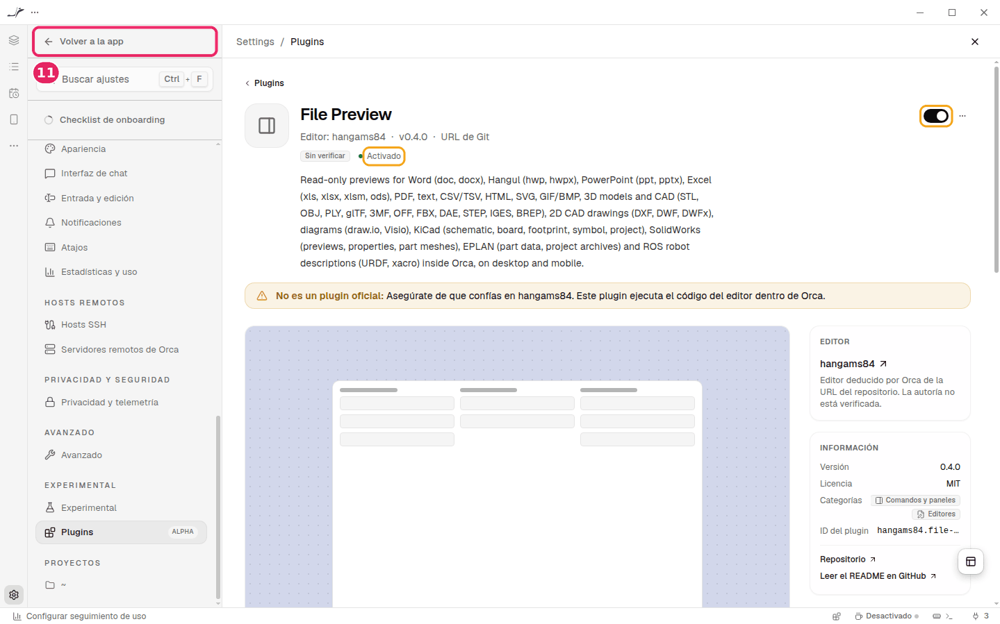

12. Abre un archivo compatible en el explorador, por ejemplo **sample.docx**.

    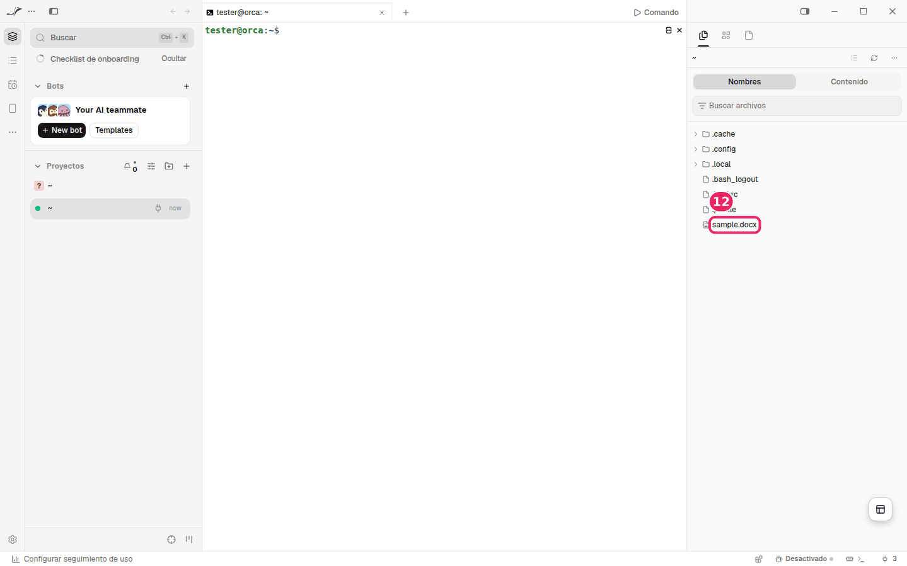

13. El archivo se abre en la vista previa.

    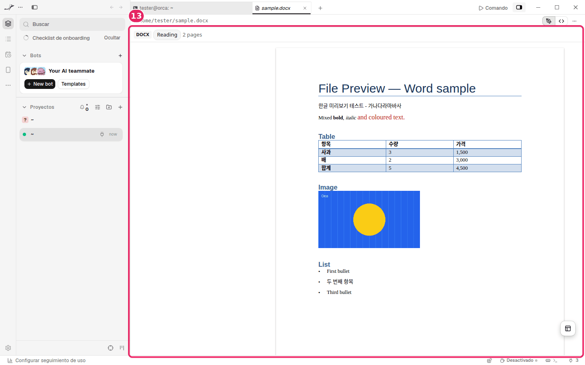

14. Opcional: para ver planos DWG, instala el plugin complementario de DWG de la misma forma (pasos 4–10). Pega la dirección de abajo, haz clic en **Continuar** y en **Instalar**, y luego actívalo.

    ```text
    https://github.com/hangams84/orca-file-preview-dwg.git
    ```

    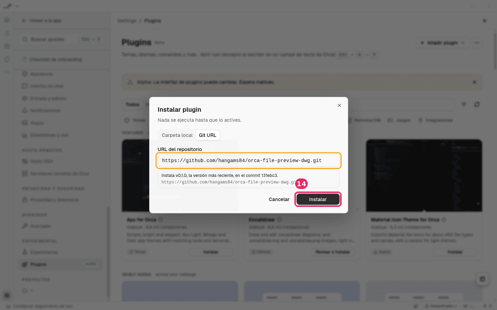

## Solución de problemas

- **La instalación desde la URL de Git no funciona**: instalar desde una URL de Git requiere Orca 1.4.252 o posterior. Actualiza Orca y vuelve a intentarlo.
- **«plugin exceeds the install size or file count limit»**: esto solo ocurría con etiquetas antiguas (v0.1.0–v0.2.1), anteriores a v0.2.2. Usa la dirección de arriba sin `#etiqueta`; Orca instalará la versión más reciente.
- **Un archivo `.txt`, `.csv`, `.tsv`, `.html` o `.htm` se abre como texto**: Orca abre estos tipos por sí mismo, primero en la vista Source. Elige la vista previa con el selector de vista de la esquina superior derecha de la pestaña.
- **A un modelo 3D, robot (URDF) o plano le faltan texturas, mallas o archivos referenciados**: el editor solo recibe el archivo abierto. Haz clic en el botón 📁 de la barra de herramientas de la vista previa y elige la carpeta con los archivos referenciados (Mayús: archivos sueltos), o arrástralos a la vista previa.
- **Archivos de más de 50 MB («exceeds 50MB limit»)**: Orca pasa como máximo 50 MB a un editor. Abre el archivo con «Open file…» en el panel **File Preview** de la barra lateral derecha; no tiene ese límite (hasta 1 GB).

---

[Otros idiomas](README.md) · [Repositorio de File Preview](https://github.com/hangams84/orca-file-preview)
