# Installer File Preview (application Orca)

Comment installer et activer le plugin File Preview depuis son URL GitHub dans les paramètres de l’application Orca. Aucun terminal n’est nécessaire.

> Captures : Orca 1.4.279, interface en français. Les noms et les positions peuvent varier légèrement dans d’autres versions d’Orca. Le chemin affiché en haut (« Settings / … ») n’est pas encore traduit dans Orca.

## Étapes

1. Cliquez sur le bouton **Paramètres** (roue dentée) en bas à gauche de la fenêtre Orca.

   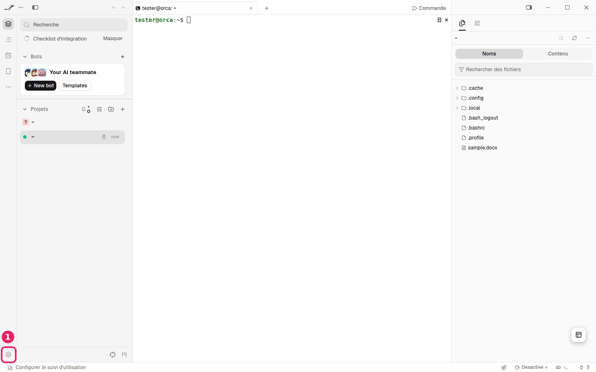

2. Choisissez **Paramètres** dans le menu.

   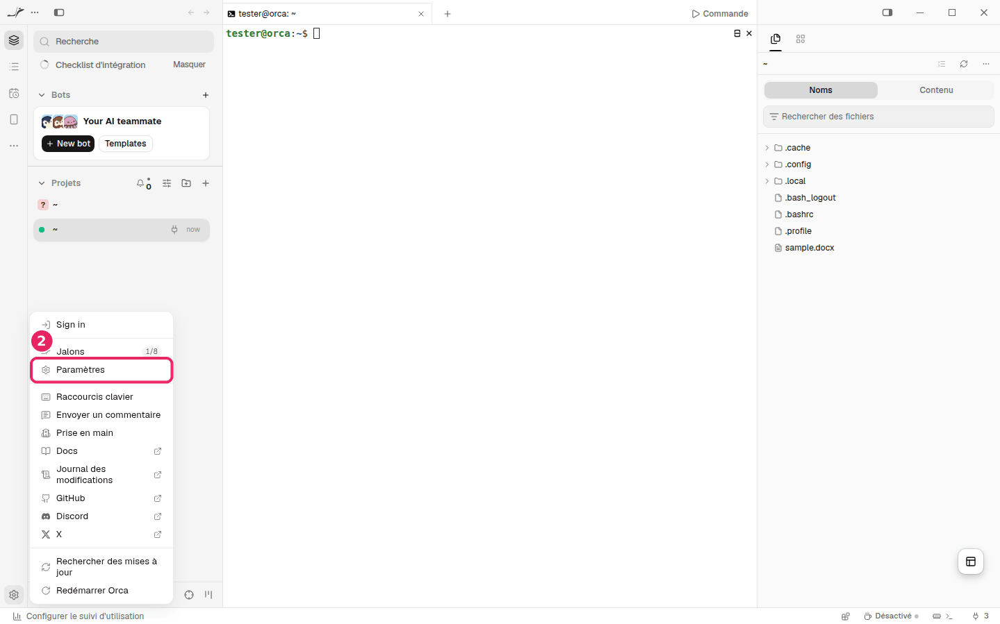

3. Dans la liste des paramètres à gauche, cliquez sur **Plugins**.

   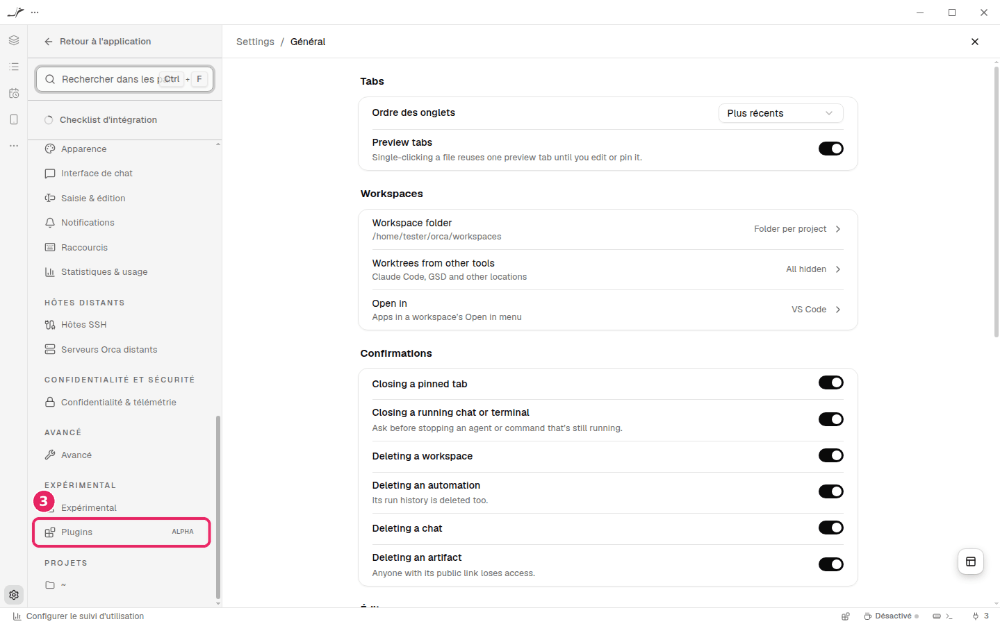

4. Cliquez sur **Ajouter un plugin** en haut à droite.

   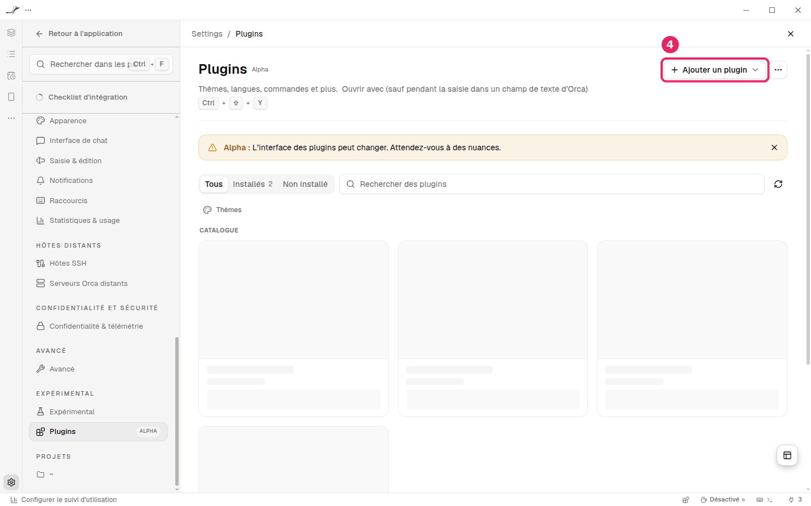

5. Choisissez **Depuis une URL Git…**.

   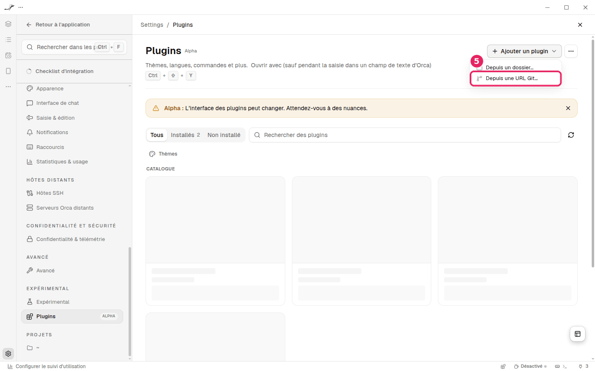

6. La boîte de dialogue **Installer le plugin** s’ouvre sur l’onglet **URL Git**. Collez cette adresse dans le champ **URL du dépôt** :

   ```text
   https://github.com/hangams84/orca-file-preview.git
   ```

   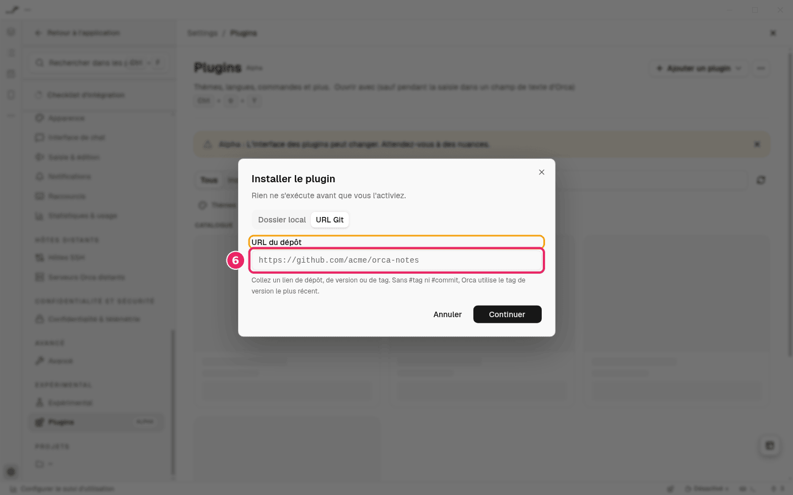

7. Cliquez sur **Continuer**.

   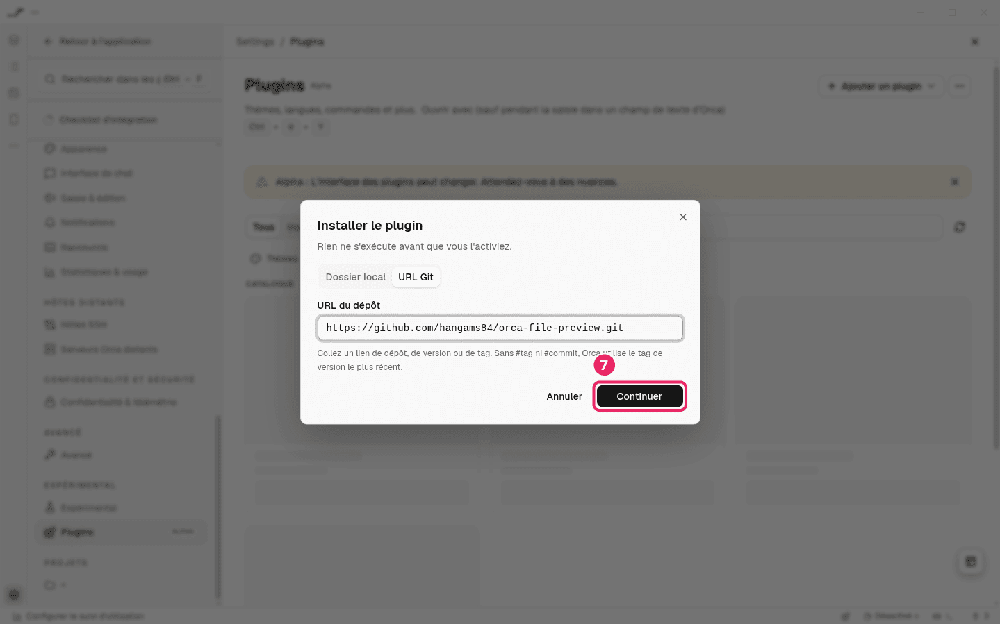

8. Orca détecte la dernière version (« Installe v0.4.0, la version la plus récente, au commit e6fe45d. »). Cliquez sur **Installer**.

   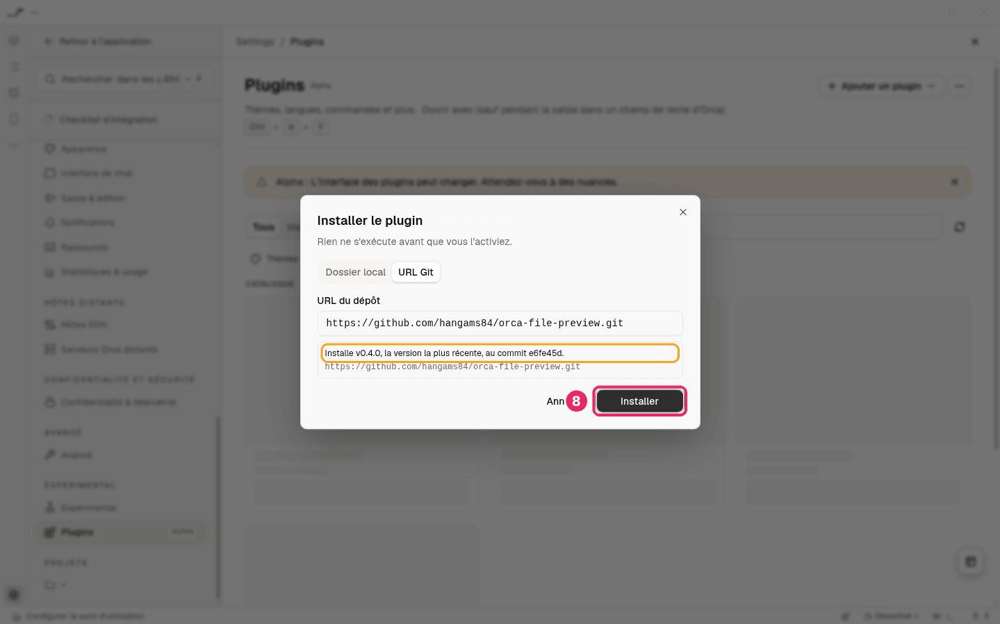

9. Orca vous demande si vous faites confiance à l’éditeur (« Assurez-vous de faire confiance à hangams84 »). Cliquez sur **Installer**.

   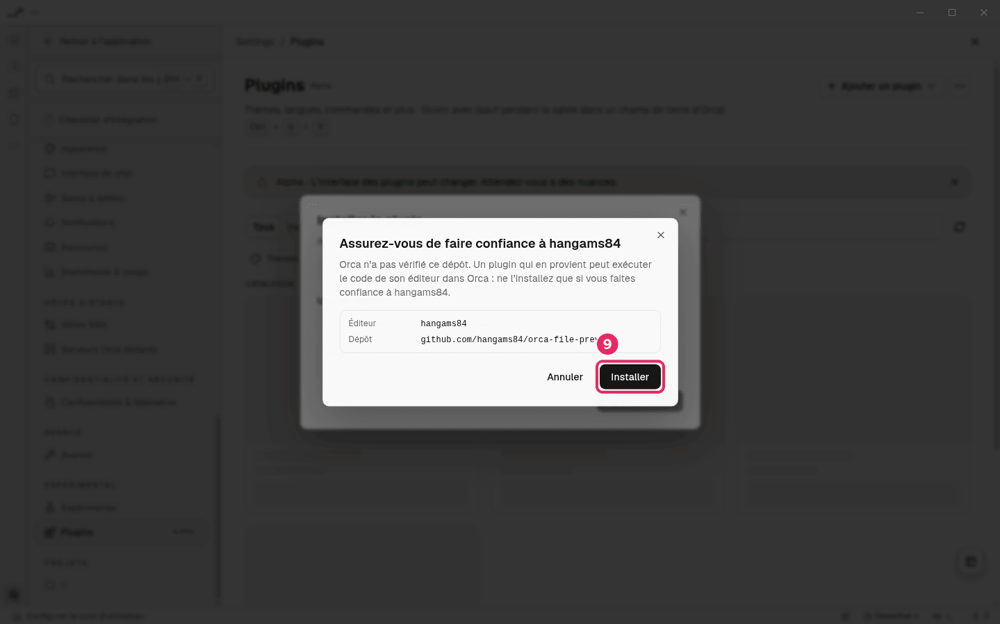

10. Sous **Peut accéder à**, la page du plugin indique ce à quoi il a accès : il ouvre uniquement les types de fichiers dont il affiche l’aperçu. Cliquez sur **Activer le plugin**. (Avec **Laisser désactivé**, il reste installé mais désactivé.)

    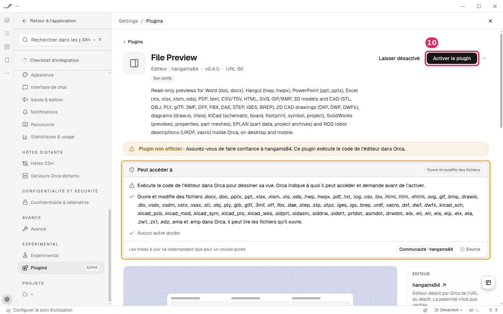

11. L’état indique maintenant **Activé**. Cliquez sur **Retour à l'application** en haut à gauche.

    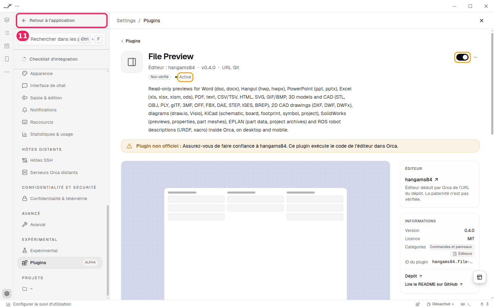

12. Dans l’explorateur de fichiers à droite, ouvrez un fichier pris en charge, par exemple **sample.docx**.

    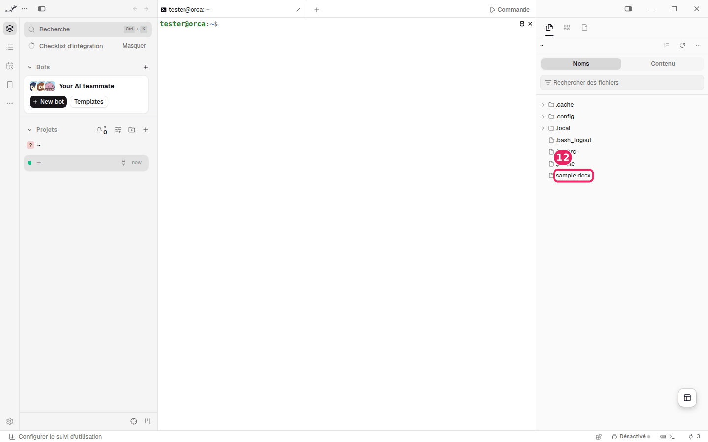

13. Le fichier s’ouvre dans l’aperçu.

    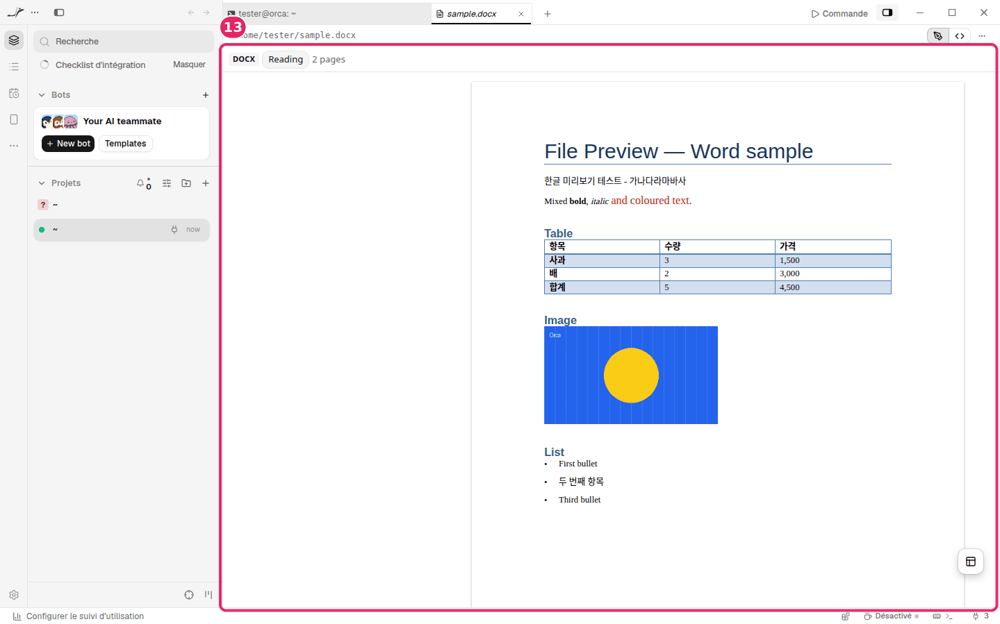

14. Facultatif : pour afficher les dessins DWG, installez de la même façon le plugin distinct File Preview DWG (étapes 4 à 10). Collez l’adresse ci-dessous, cliquez sur **Continuer** puis sur **Installer**, et activez-le ensuite.

    ```text
    https://github.com/hangams84/orca-file-preview-dwg.git
    ```

    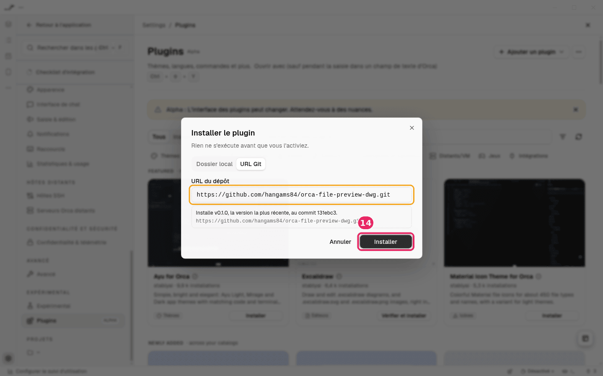

## Dépannage

- **L’installation depuis l’URL Git ne fonctionne pas** : l’installation depuis une URL Git nécessite Orca 1.4.252 ou version ultérieure. Mettez Orca à jour et réessayez.
- **« plugin exceeds the install size or file count limit »** : ce problème ne concernait que les anciens tags antérieurs à v0.2.2 (v0.1.0 à v0.2.1). Utilisez l’adresse ci-dessus sans `#tag` ; Orca installe alors la dernière version.
- **Un fichier `.txt`, `.csv`, `.tsv`, `.html` ou `.htm` s’ouvre en mode texte** : Orca ouvre lui-même ces types de fichiers, d’abord dans la vue Source. Passez à l’aperçu avec le sélecteur de vue en haut à droite de l’onglet.
- **Un modèle 3D, un robot (URDF) ou un dessin n’affiche pas ses textures, maillages ou fichiers associés** : l’éditeur ne reçoit que le fichier ouvert. Cliquez sur le bouton 📁 de la barre d’outils de l’aperçu et choisissez le dossier contenant les fichiers associés (maintenez Maj enfoncée pour choisir des fichiers individuels), ou glissez-déposez-les sur l’aperçu.
- **Fichiers de plus de 50 Mo (« exceeds 50MB limit »)** : Orca transmet au plus 50 Mo à un éditeur. Ouvrez le fichier avec « Open file… » dans le panneau **File Preview** de la barre latérale droite ; ce panneau n’est pas soumis à cette limite (jusqu’à 1 Go).

---

[Autres langues](README.md) · [Dépôt File Preview](https://github.com/hangams84/orca-file-preview)
