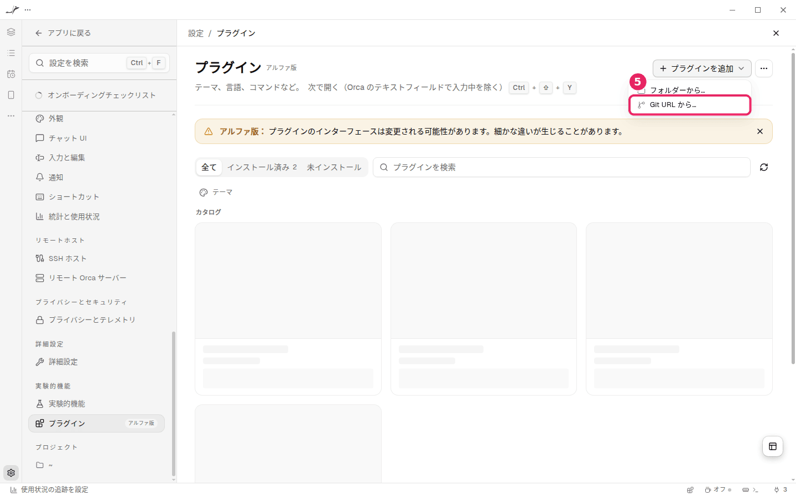
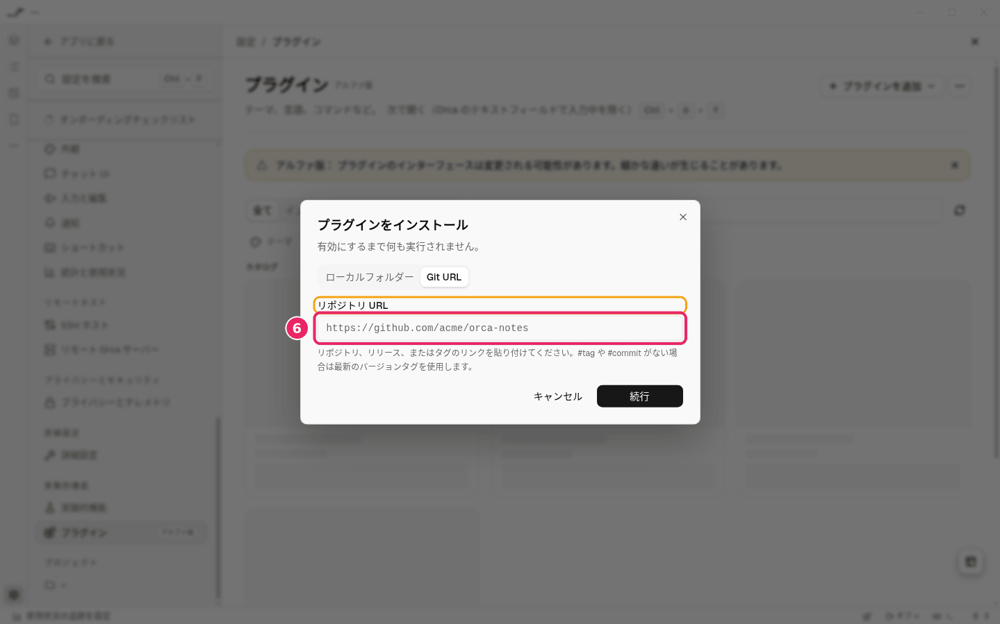
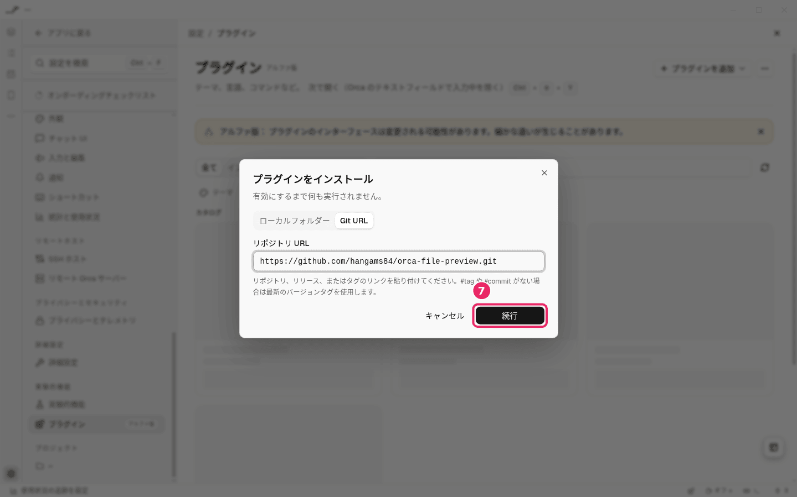
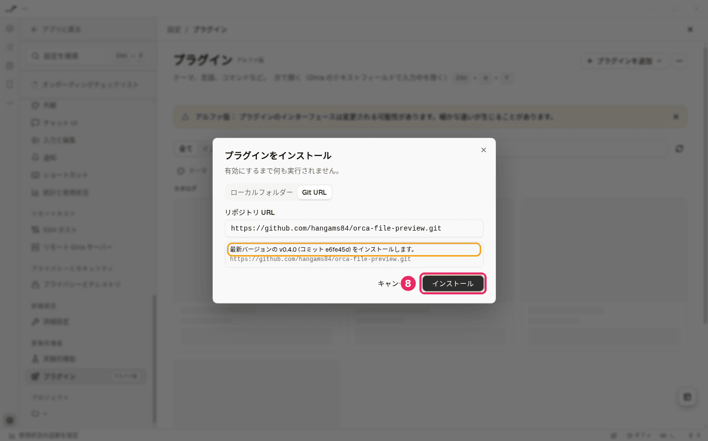
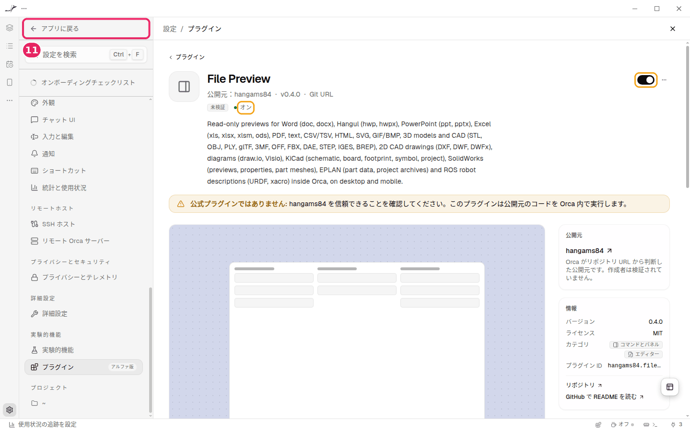
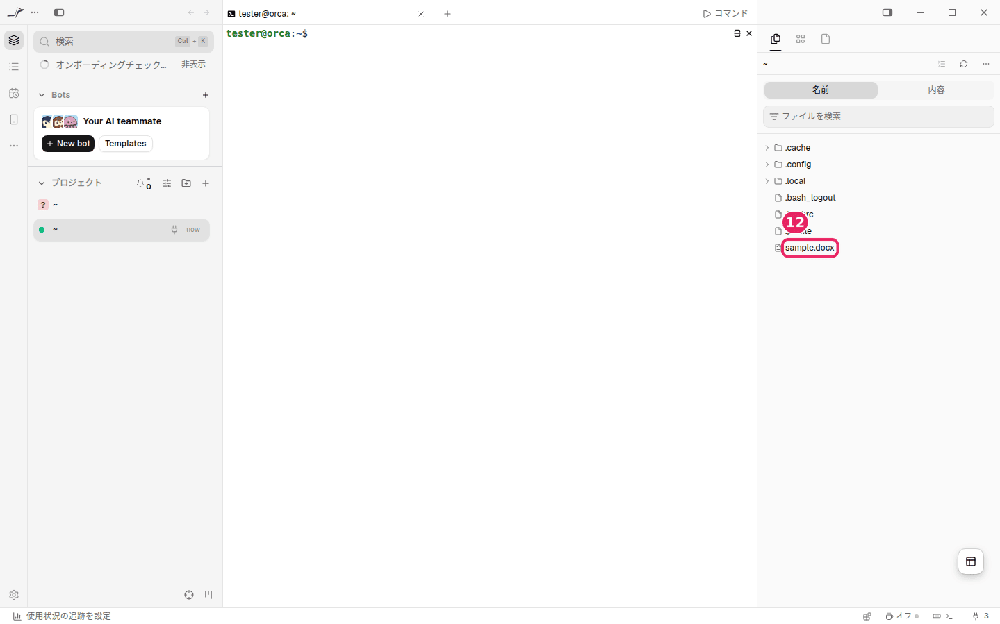
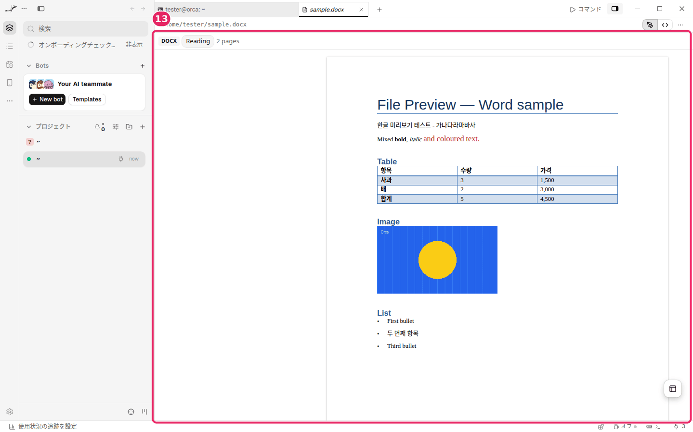

# File Preview のインストール（Orca アプリ）

Orca アプリの設定から、GitHub の URL で File Preview プラグインをインストールして有効にする手順です。ターミナルは不要です。

> スクリーンショット：Orca 1.4.279、日本語 UI。Orca のバージョンによって名前や位置が少し異なる場合があります。

## 手順

1. Orca ウィンドウ左下の「設定」ボタン（歯車アイコン）をクリックします。

   

2. メニューから「設定」を選びます。

   

3. 左側の設定一覧で「プラグイン」をクリックします。

   

4. 右上の「プラグインを追加」をクリックします。

   

5. メニューから「Git URL から…」を選びます。

   

6. 「プラグインをインストール」ダイアログが「Git URL」タブで開きます。「リポジトリ URL」に次のアドレスを貼り付けます。

   ```text
   https://github.com/hangams84/orca-file-preview.git
   ```

   

7. 「続行」をクリックします。

   

8. Orca が最新バージョンを見つけます（「最新バージョンの v0.4.0 (コミット e6fe45d) をインストールします。」）。「インストール」をクリックします。

   

9. 公開元を信頼するかどうかの確認が表示されます（「hangams84 を信頼できることを確認してください」）。「インストール」をクリックします。

   

10. プラグインのページの「アクセスできる範囲」で、プラグインが要求する権限（プレビューする形式のファイルを開くこと、「その他のアクセスはありません」）を確認し、右上の「プラグインを有効にする」をクリックします。「オフのままにする」をクリックすると、インストールだけされて無効のままになります。

    

11. 状態が「オン」に変わります。左上の「アプリに戻る」をクリックします。

    

12. 右側のエクスプローラーで対応ファイル（例：**sample.docx**）を開きます。

    

13. ファイルがプレビューで開きます。

    

14. （任意）DWG 図面も表示するには、同じ方法（手順 4～10）で DWG 用の追加プラグインをインストールします。次のアドレスを貼り付けて「続行」「インストール」の順にクリックし、「プラグインを有効にする」をクリックします。

    ```text
    https://github.com/hangams84/orca-file-preview-dwg.git
    ```

    

## トラブルシューティング

- **Git URL からインストールできない**：Git URL からのインストールには Orca 1.4.252 以降が必要です。Orca を更新してからもう一度お試しください。
- **「plugin exceeds the install size or file count limit」**：v0.2.2 より前の古いタグ（v0.1.0～v0.2.1）でのみ起きていた問題です。上のアドレスを `#タグ` なしで使えば、Orca が最新バージョンをインストールします。
- **`.txt` `.csv` `.tsv` `.html` `.htm` ファイルがテキストで開く**：これらは Orca 自身が開く形式のため、まず「ソース」ビューで開きます。タブ右上の表示切り替えボタンで「プレビュー」を選んでください。
- **3D モデル、ロボット（URDF）、図面でテクスチャ・メッシュ・関連ファイルが読み込まれない**：Orca がエディターに渡すのは、開いたファイル 1 つだけです。プレビューのツールバーの 📁 ボタンで関連ファイルのあるフォルダーを選ぶか（Shift キーを押しながらクリックするとファイルを個別に選択）、ファイルをプレビューにドロップしてください。
- **50 MB を超えるファイル（「exceeds 50MB limit」）**：Orca がエディターに渡すのは最大 50 MB です。右サイドバーの **File Preview** パネルで「Open file…」から開くと、この上限は適用されません（最大 1 GB）。

---

[ほかの言語](README.md) · [File Preview リポジトリ](https://github.com/hangams84/orca-file-preview)
