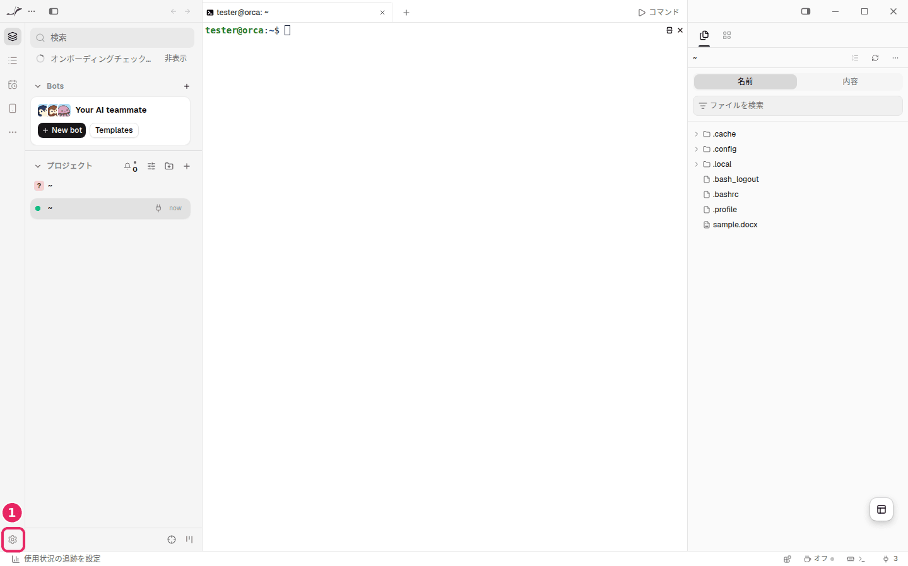
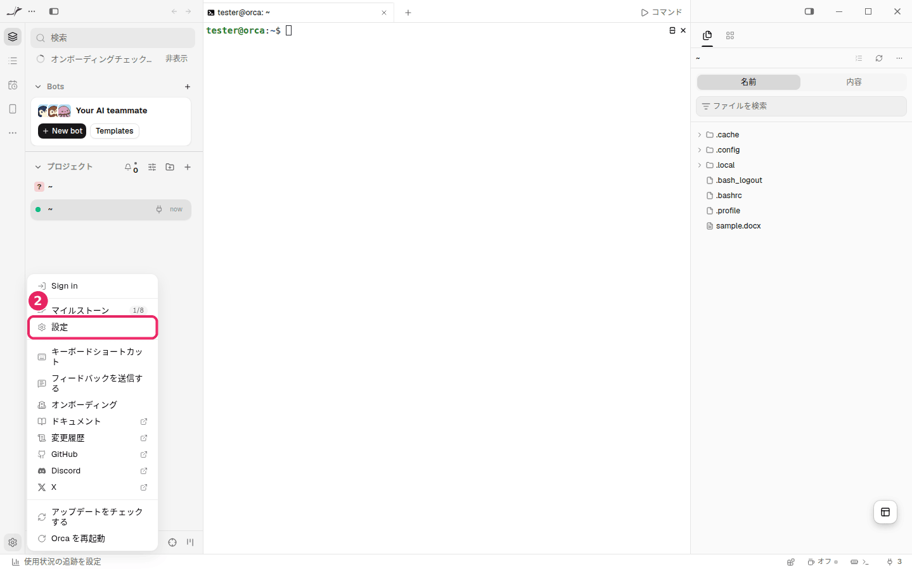
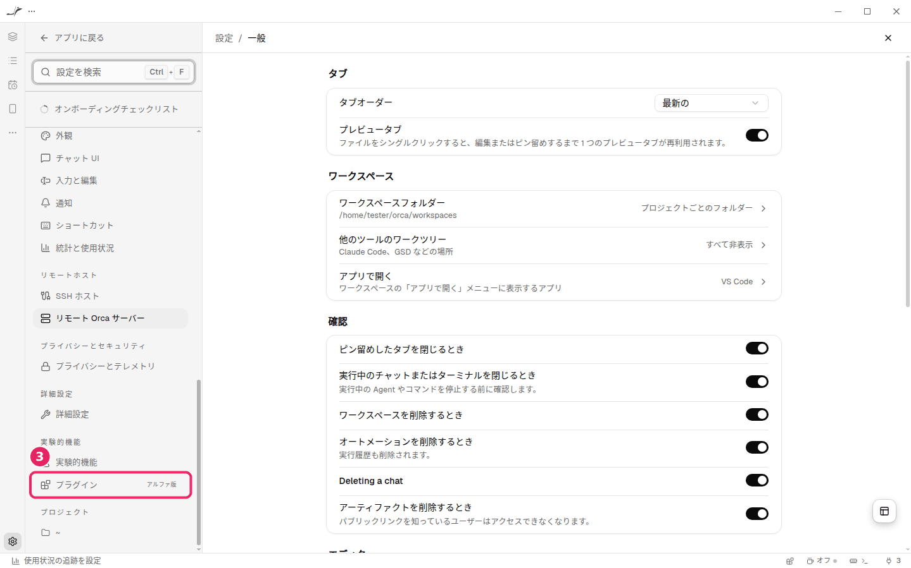
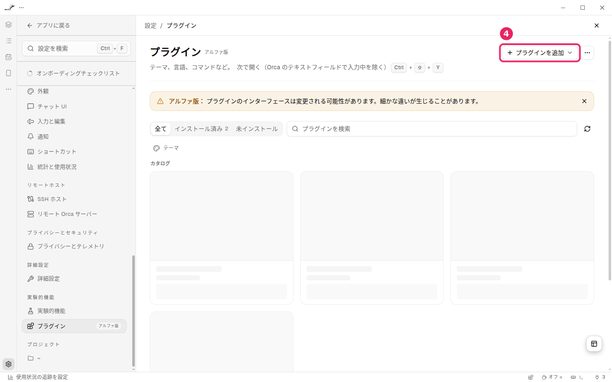
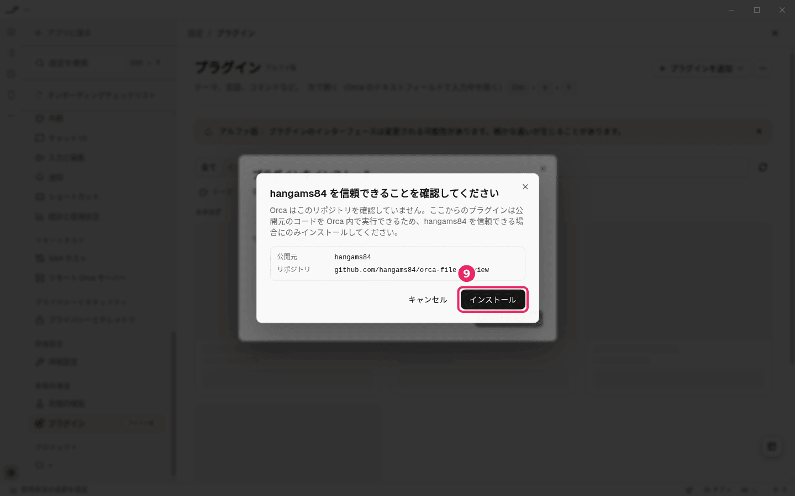
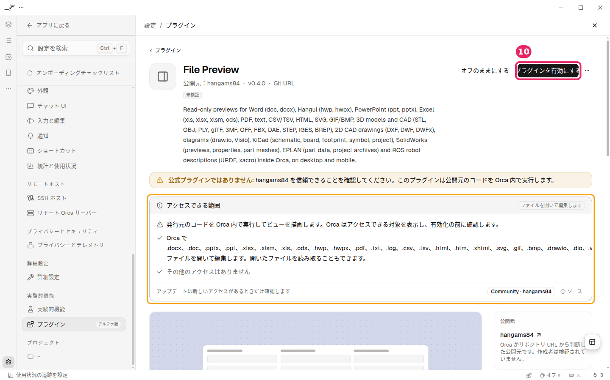
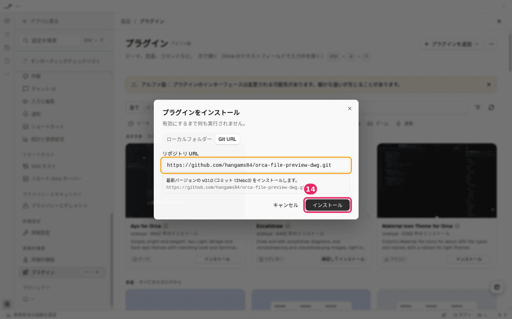

# File Preview のインストール（Orca アプリ）

Orca アプリの設定から、GitHub の URL で File Preview プラグインをインストールして有効にする手順です。ターミナルは不要です。

> スクリーンショット：Orca 1.4.279、日本語 UI。Orca のバージョンによって名前や位置が少し異なる場合があります。

## 手順

1. Orca ウィンドウ左下の **設定** ボタン（歯車アイコン）をクリックします。

   

2. メニューから **設定** を選びます。

   

3. 左側の設定一覧で **プラグイン** をクリックします。

   

4. 右上の **プラグインを追加** をクリックします。

   

5. **Git URL から…** を選びます。

   

6. **プラグインをインストール** ダイアログが **Git URL** タブで開きます。**リポジトリ URL** に次のアドレスを貼り付けます。

   ```text
   https://github.com/hangams84/orca-file-preview.git
   ```

   

7. **続行** をクリックします。

   

8. Orca が最新バージョンを見つけます（「最新バージョンの v0.4.0 (コミット e6fe45d) をインストールします。」）。**インストール** をクリックします。

   

9. 発行者を信頼するか確認されます（「hangams84 を信頼できることを確認してください」）。**インストール** をクリックします。

   

10. プラグインのページの **アクセスできる範囲** に、プラグインができること（プレビューする形式のファイルを開くこと）が表示されます。**プラグインを有効にする** をクリックします。（**オフのままにする** を選ぶと、インストールだけして無効のままになります。）

    

11. 状態が **オン** になりました。**アプリに戻る** をクリックします。

    

12. エクスプローラーで対応ファイル（例：**sample.docx**）を開きます。

    

13. ファイルがプレビューで開きます。

    

14. 任意：DWG 図面も表示するには、同じ方法（手順 4–10）で DWG 用の追加プラグインをインストールします。次のアドレスを貼り付け、**続行**、**インストール** をクリックしてから有効にします。

    ```text
    https://github.com/hangams84/orca-file-preview-dwg.git
    ```

    

## トラブルシューティング

- **Git URL からインストールできない**：Git URL からのインストールには Orca 1.4.252 以降が必要です。Orca を更新してからもう一度お試しください。
- **「plugin exceeds the install size or file count limit」**：v0.2.2 より前の古いタグ（v0.1.0–v0.2.1）でのみ起きた問題です。上のアドレスを `#タグ` なしで使えば、Orca が最新バージョンをインストールします。
- **`.txt` `.csv` `.tsv` `.html` `.htm` ファイルがテキストで開く**：これらは Orca 自身が開く形式で、まず Source 表示で開きます。タブ右上の表示切り替えボタンでプレビューを選んでください。
- **3D モデル、ロボット（URDF）、図面でテクスチャ・メッシュ・参照ファイルが表示されない**：エディターが受け取るのは開いたファイルだけです。プレビューのツールバーの 📁 ボタンで参照ファイルのあるフォルダーを選ぶか（Shift：個別のファイル）、ファイルをプレビューにドロップしてください。
- **50 MB を超えるファイル（「exceeds 50MB limit」）**：Orca がエディターに渡すのは最大 50 MB です。右サイドバーの **File Preview** パネルで「Open file…」から開くと、この制限はありません（最大 1 GB）。

---

[ほかの言語](README.md) · [File Preview リポジトリ](https://github.com/hangams84/orca-file-preview)
