# File Preview 설치 안내 (Orca 앱)

Orca 앱의 설정 화면에서 GitHub 주소로 File Preview 플러그인을 설치하고 켜는 방법입니다. 터미널은 필요 없습니다.

> 스크린샷: Orca 1.4.279, 한국어 UI. Orca 버전에 따라 이름이나 위치가 조금 다를 수 있습니다.

## 설치 순서

1. Orca 창 왼쪽 아래의 **설정** 버튼(톱니바퀴)을 누릅니다.

   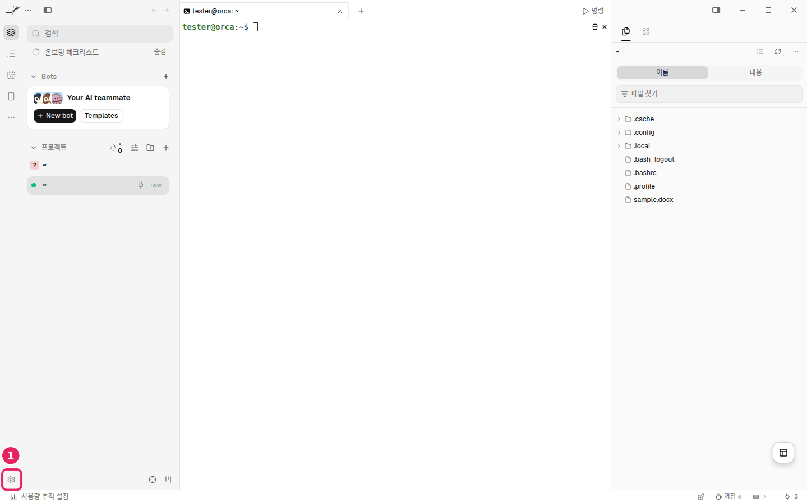

2. 메뉴에서 **설정**을 선택합니다.

   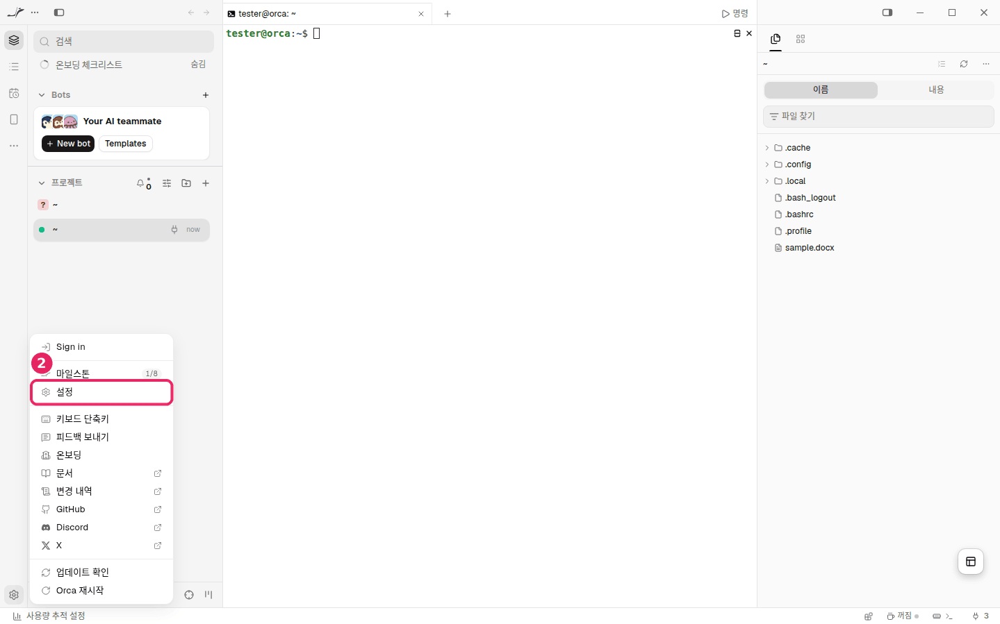

3. 왼쪽 설정 목록에서 **플러그인**을 누릅니다.

   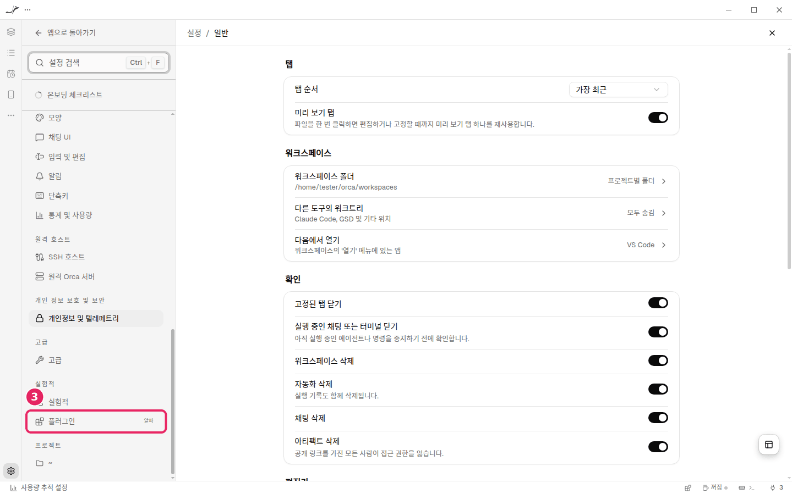

4. 오른쪽 위의 **플러그인 추가**를 누릅니다.

   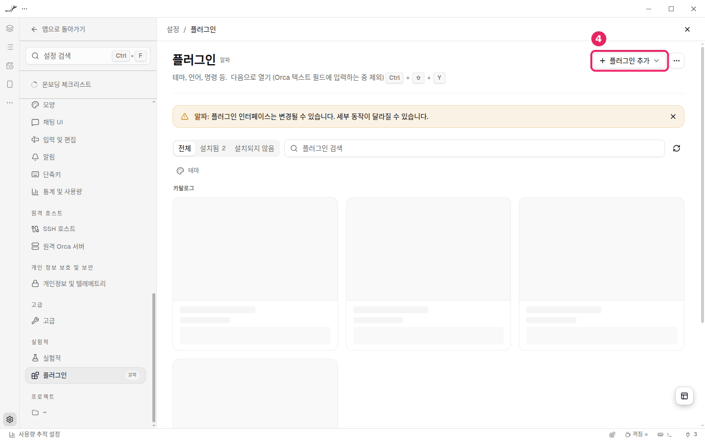

5. 메뉴에서 **Git URL에서…**를 선택합니다.

   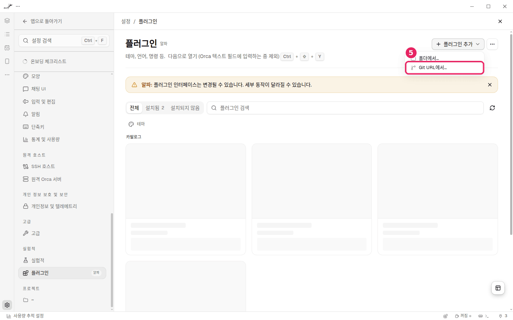

6. **플러그인 설치** 창이 **Git URL** 탭으로 열립니다. **저장소 URL** 칸에 아래 주소를 붙여 넣습니다.

   ```text
   https://github.com/hangams84/orca-file-preview.git
   ```

   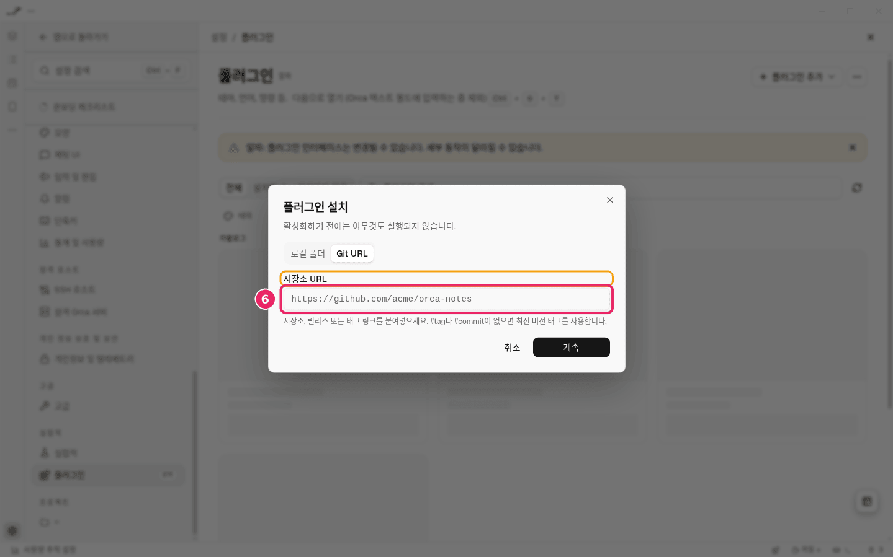

7. **계속**을 누릅니다.

   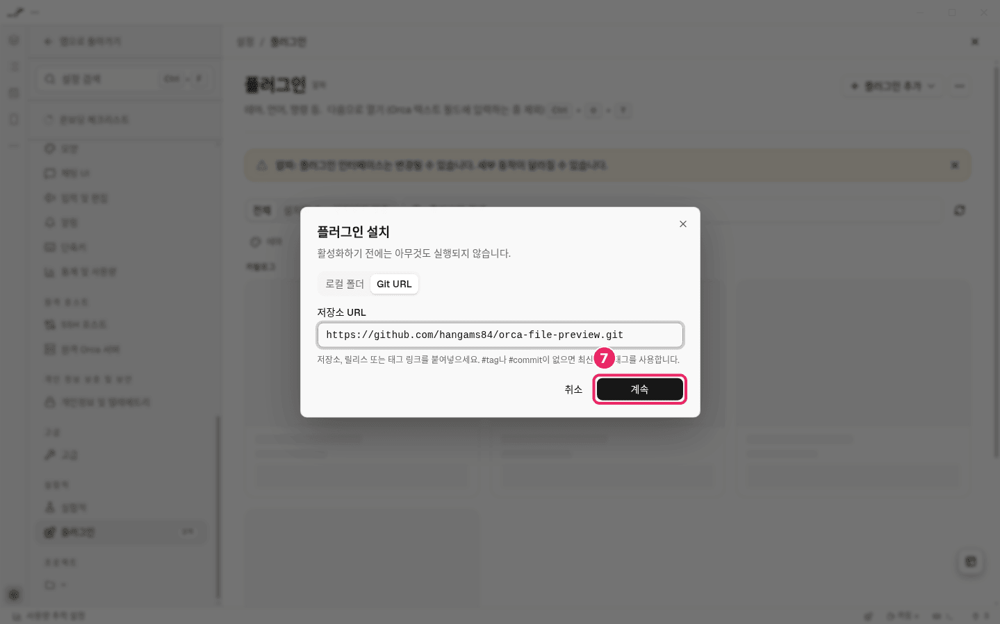

8. Orca가 최신 버전을 찾습니다(“최신 버전 v0.4.0(커밋 e6fe45d)을 설치합니다.”). **설치**를 누릅니다.

   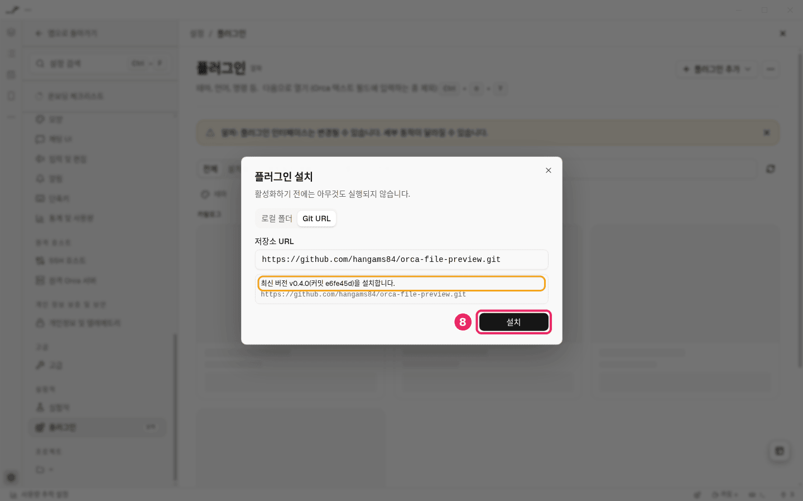

9. 게시자를 신뢰하는지 확인하는 창(“hangams84을(를) 신뢰하는지 확인하세요”)이 나타납니다. **설치**를 누릅니다.

   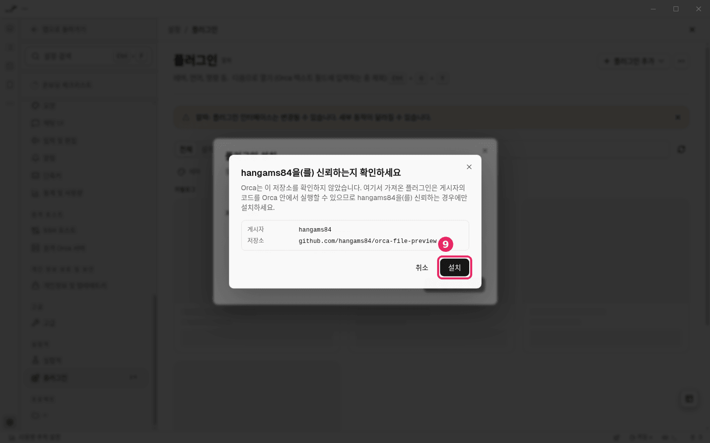

10. 플러그인 화면의 **접근 가능 범위**에서 플러그인이 요청하는 권한(미리 볼 형식의 파일 열기, “다른 접근 권한 없음”)을 확인하고 오른쪽 위의 **플러그인 활성화**를 누릅니다. **꺼짐 유지**를 누르면 설치만 되고 꺼진 상태로 남습니다.

    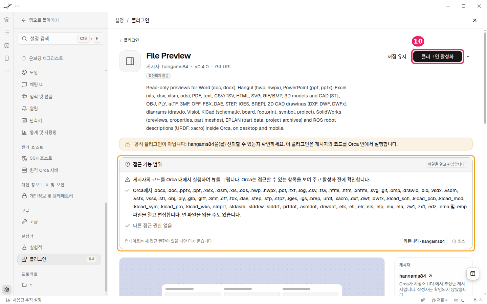

11. 상태가 **켜짐**으로 바뀝니다. 왼쪽 위의 **앱으로 돌아가기**를 누릅니다.

    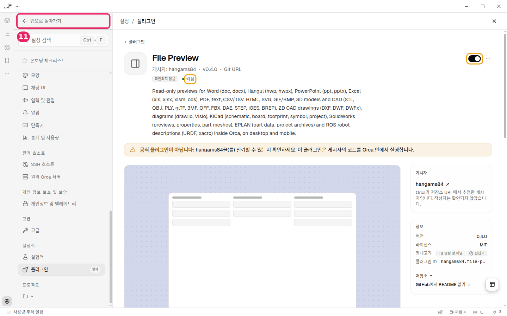

12. 오른쪽 탐색기에서 지원하는 파일(예: **sample.docx**)을 엽니다.

    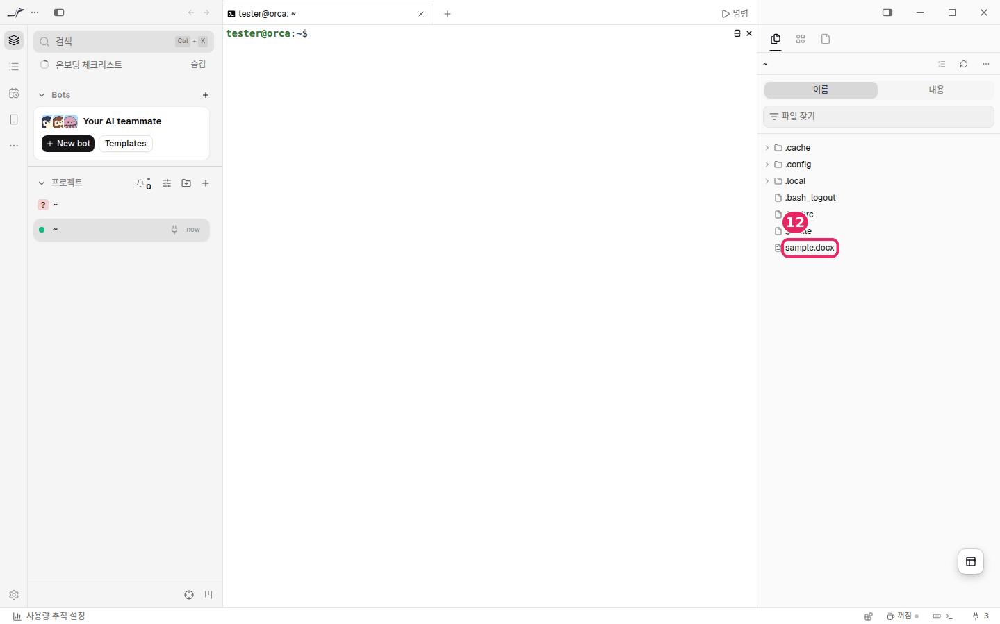

13. 파일이 미리보기로 열립니다.

    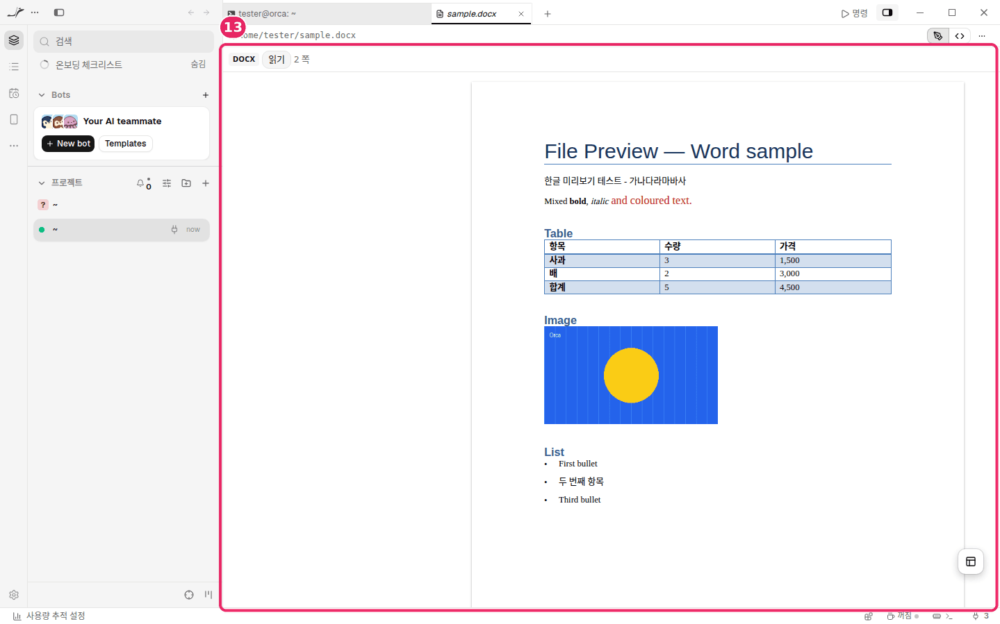

14. (선택 사항) DWG 도면도 보려면 같은 방법(4–10단계)으로 DWG 확장 플러그인을 설치합니다. 아래 주소를 붙여 넣고 **계속**과 **설치**를 누른 뒤 **플러그인 활성화**를 누릅니다.

    ```text
    https://github.com/hangams84/orca-file-preview-dwg.git
    ```

    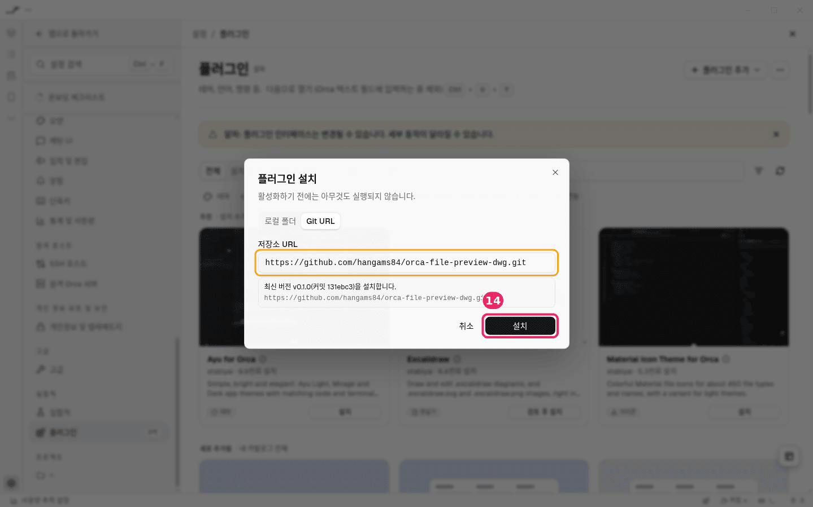

## 문제 해결

- **Git URL로 설치할 수 없을 때**: Git URL 설치는 Orca 1.4.252 이상이 필요합니다. Orca를 업데이트한 뒤 다시 시도하세요.
- **“plugin exceeds the install size or file count limit” 오류**: v0.2.2보다 오래된 태그(v0.1.0–v0.2.1)에서만 생기던 문제입니다. 위 주소를 `#태그` 없이 그대로 쓰면 Orca가 최신 버전을 설치합니다.
- **`.txt` `.csv` `.tsv` `.html` `.htm` 파일이 텍스트로 열릴 때**: Orca가 직접 여는 형식이라 ‘소스’ 보기로 먼저 열립니다. 탭 오른쪽 위의 보기 전환 버튼에서 미리보기를 선택하세요.
- **3D 모델·로봇(URDF)·도면에서 텍스처, 메시, 참조 파일이 빠질 때**: Orca는 편집기에 연 파일 하나만 전달합니다. 미리보기 툴바의 📁 버튼으로 참조 파일이 있는 폴더를 선택하거나(Shift를 누른 채 누르면 파일 선택) 파일을 미리보기에 끌어다 놓으세요.
- **50 MB보다 큰 파일(“exceeds 50MB limit”)**: Orca는 편집기에 파일을 최대 50 MB까지만 전달합니다. 오른쪽 사이드바의 **File Preview** 패널에서 “파일 열기…”로 열면 이 한도가 적용되지 않습니다(최대 1 GB).

---

[다른 언어](README.md) · [File Preview 저장소](https://github.com/hangams84/orca-file-preview)
