# Instalar o File Preview (app Orca)

Como instalar e ativar o plugin File Preview pela URL do GitHub nas configurações do app Orca. Não é preciso usar o terminal.

> Capturas: Orca 1.4.279, interface em português (Brasil). Os nomes e as posições podem variar um pouco em outras versões do Orca. O caminho de navegação no topo (“Settings / …”) ainda não está traduzido no Orca.

## Passos

1. Clique no botão **Configurações** (ícone de engrenagem), no canto inferior esquerdo da janela do Orca.

   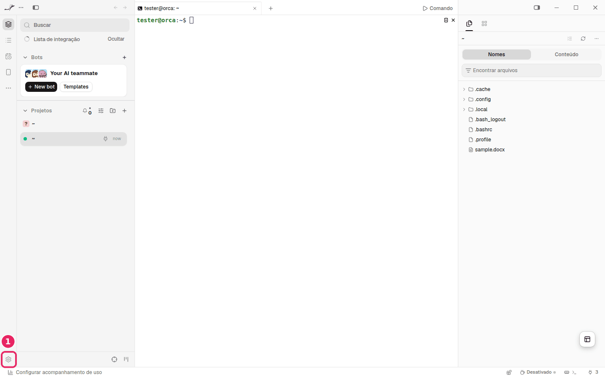

2. Escolha **Configurações** no menu.

   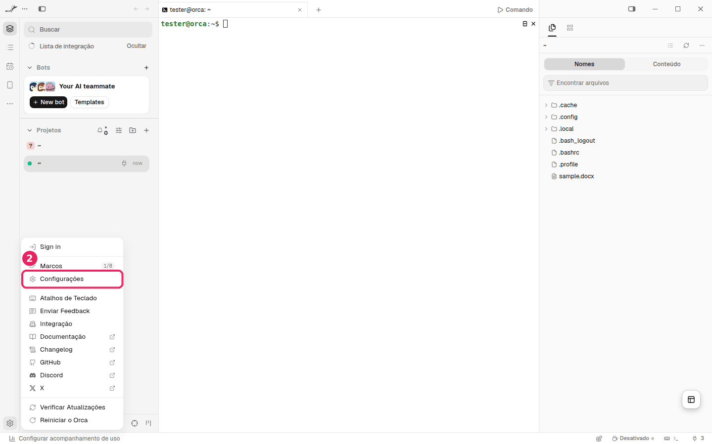

3. Na lista de configurações à esquerda, clique em **Plugins** (seção **Experimental**).

   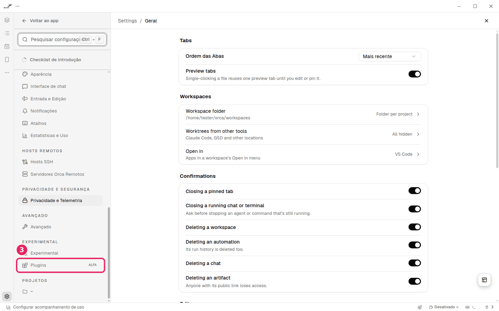

4. Clique em **Adicionar plugin**, no canto superior direito.

   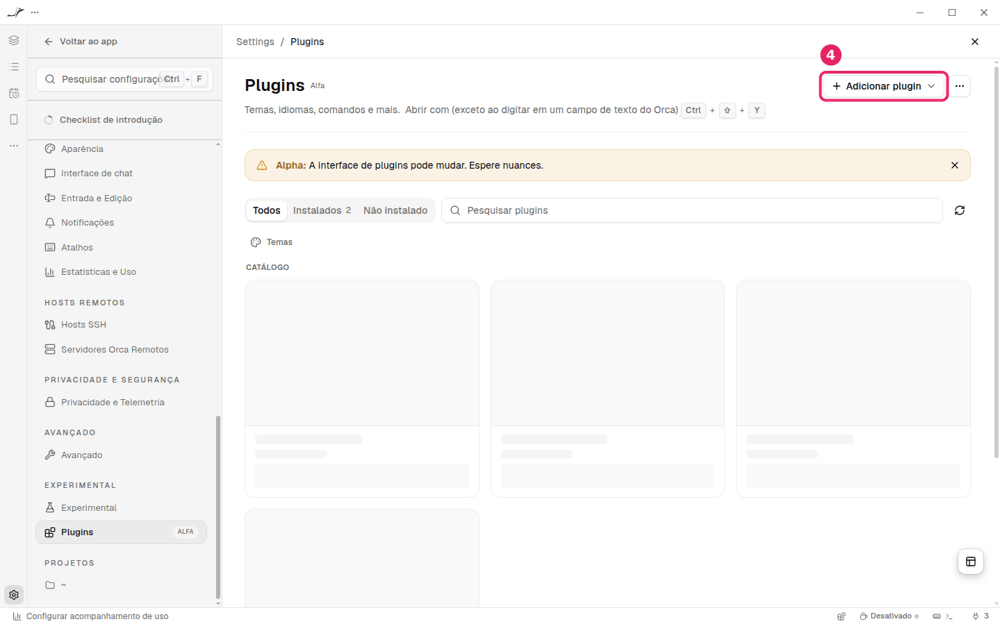

5. Escolha **De uma URL do Git…**.

   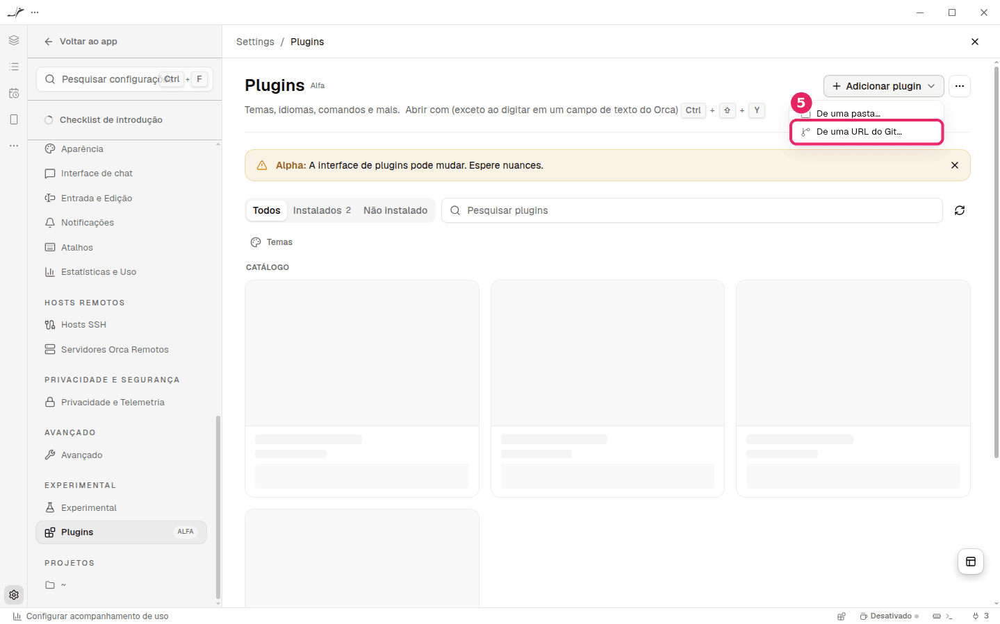

6. A janela **Instalar plugin** é aberta na aba **URL do Git**. Cole este endereço em **URL do repositório**:

   ```text
   https://github.com/hangams84/orca-file-preview.git
   ```

   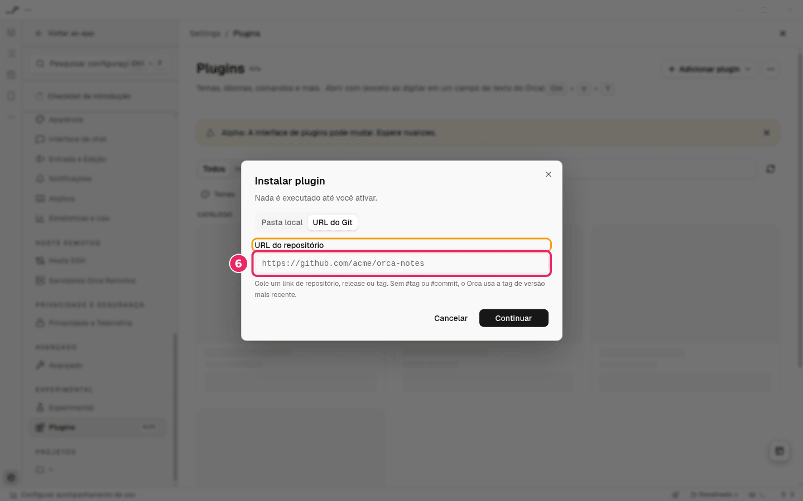

7. Clique em **Continuar**.

   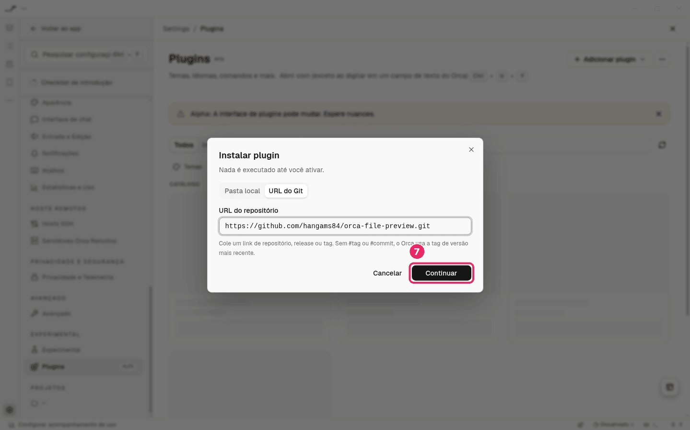

8. O Orca encontra a versão mais recente (“Instala v0.4.0, a versão mais recente, no commit e6fe45d.”). Clique em **Instalar**.

   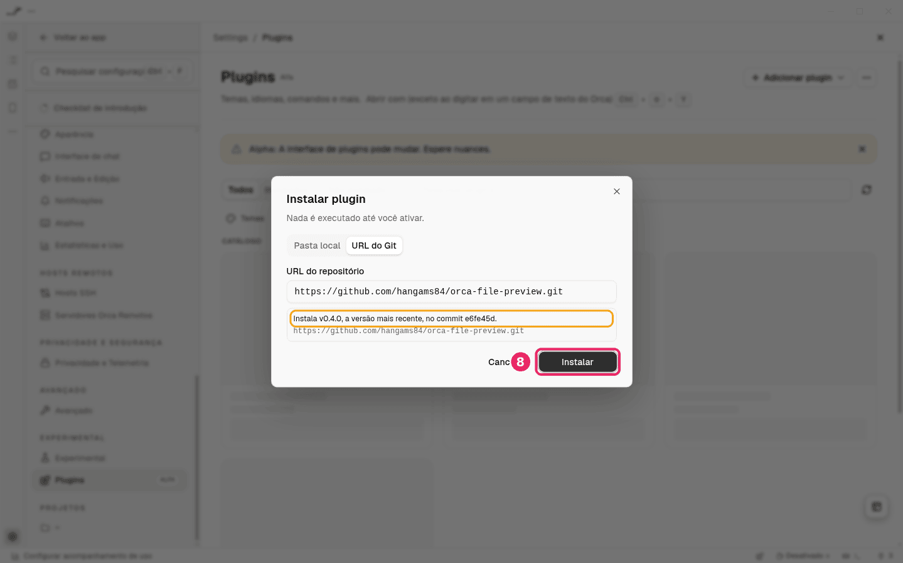

9. O Orca pede que você confirme que confia no publicador (“Confirme que você confia em hangams84”). Clique em **Instalar**.

   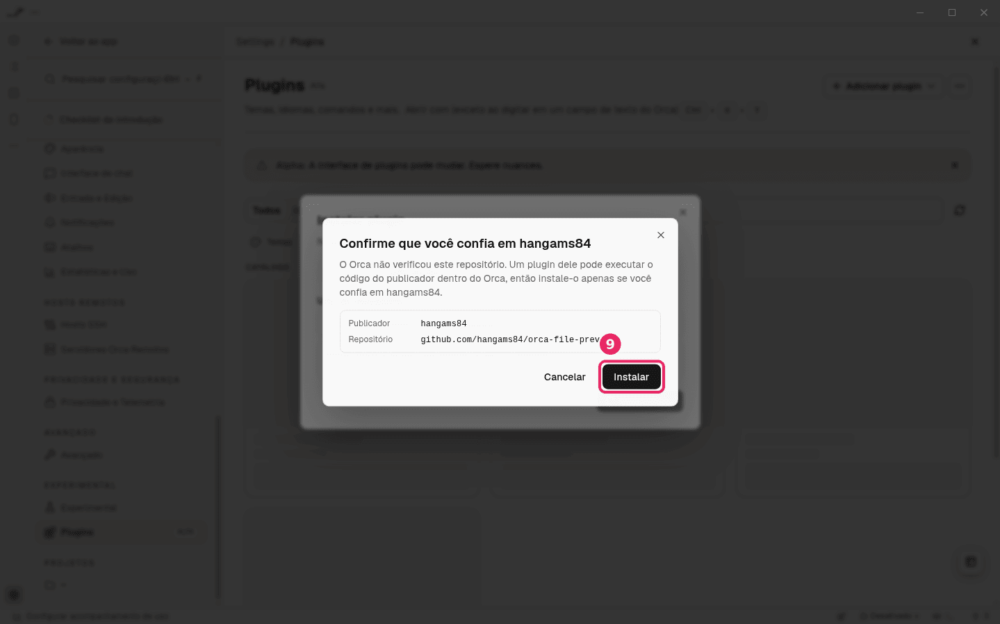

10. Na página do plugin, a seção **Pode acessar** mostra o que o plugin pode fazer: abrir os tipos de arquivo que ele exibe e ler os arquivos que abre (“Nenhum outro acesso”). Clique em **Ativar plugin**. (**Manter desativado** deixa o plugin instalado, mas desativado.)

    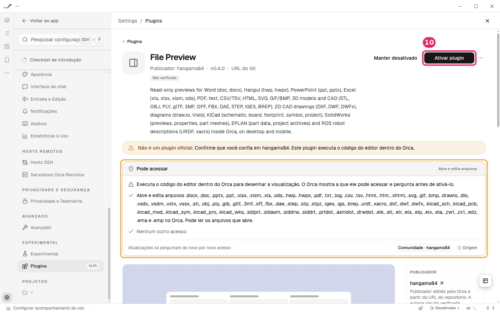

11. O status agora mostra **Ativado**. Clique em **Voltar ao app**, no canto superior esquerdo.

    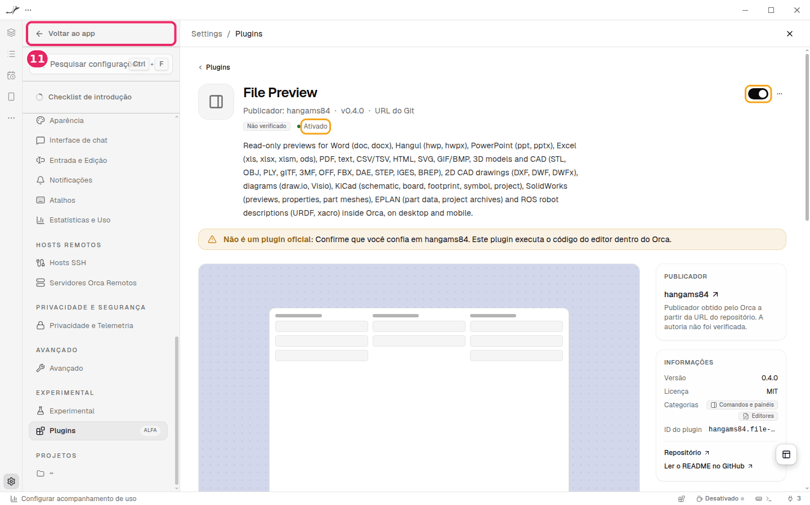

12. Abra um arquivo compatível no explorador de arquivos à direita, por exemplo **sample.docx**.

    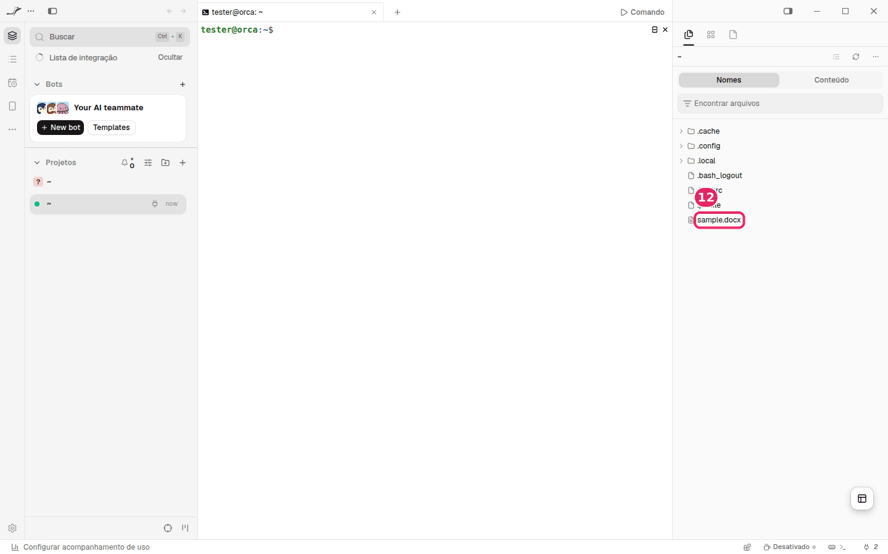

13. O arquivo é aberto na visualização.

    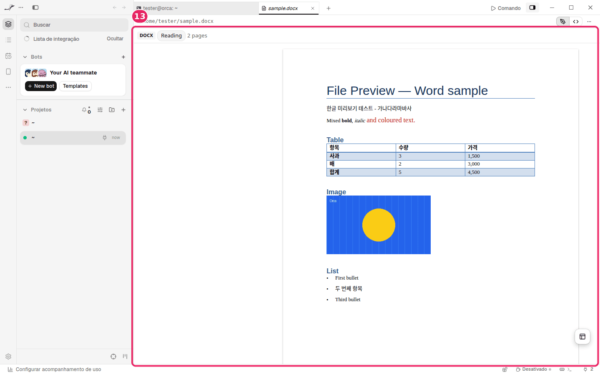

14. Opcional: para ver desenhos DWG, instale o plugin complementar de DWG da mesma forma (passos 4–10). Cole o endereço abaixo, clique em **Continuar** e em **Instalar** e depois ative-o.

    ```text
    https://github.com/hangams84/orca-file-preview-dwg.git
    ```

    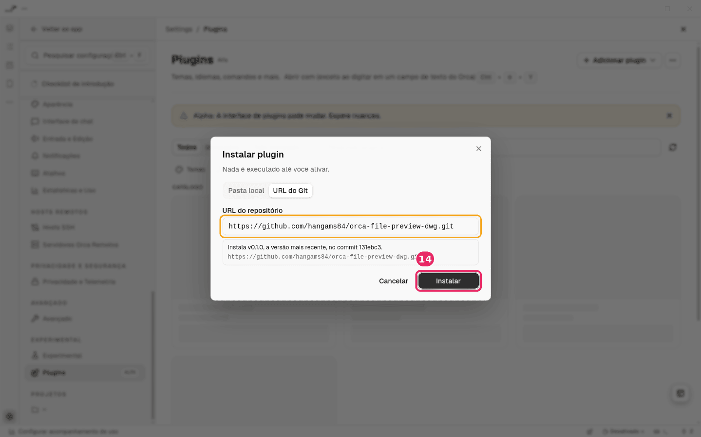

## Solução de problemas

- **A instalação pela URL do Git não funciona**: instalar por uma URL do Git exige o Orca 1.4.252 ou mais recente. Atualize o Orca e tente de novo.
- **“plugin exceeds the install size or file count limit”**: isso só acontecia com tags antigas (v0.1.0–v0.2.1), anteriores à v0.2.2. Use o endereço acima sem `#tag`; o Orca então instala a versão mais recente.
- **Um arquivo `.txt`, `.csv`, `.tsv`, `.html` ou `.htm` abre como texto**: o próprio Orca abre esses tipos, primeiro na visualização “Origem”. Escolha a visualização do plugin com o alternador de modo de exibição no canto superior direito da aba.
- **Faltam texturas, malhas ou arquivos referenciados em um modelo 3D, robô (URDF) ou desenho**: o editor só recebe o arquivo aberto. Clique no botão 📁 da barra de ferramentas da visualização e escolha a pasta com os arquivos referenciados (com Shift: arquivos avulsos), ou arraste-os para a visualização.
- **Arquivos com mais de 50 MB (“exceeds 50MB limit”)**: o Orca entrega no máximo 50 MB a um editor. Abra o arquivo com “Open file…” no painel **File Preview** da barra lateral direita; o painel não tem esse limite (aceita até 1 GB).

---

[Outros idiomas](README.md) · [Repositório do File Preview](https://github.com/hangams84/orca-file-preview)
