# Установка File Preview (приложение Orca)

Как установить и включить плагин File Preview по его адресу на GitHub в настройках приложения Orca. Терминал не нужен.

> Снимки экрана: Orca 1.4.279, русский интерфейс. В других версиях Orca названия и расположение могут немного отличаться. Путь вверху страницы настроек («Settings / …») в Orca пока не переведён.

## Шаги

1. Нажмите кнопку настроек (значок шестерёнки) в левом нижнем углу окна Orca.

   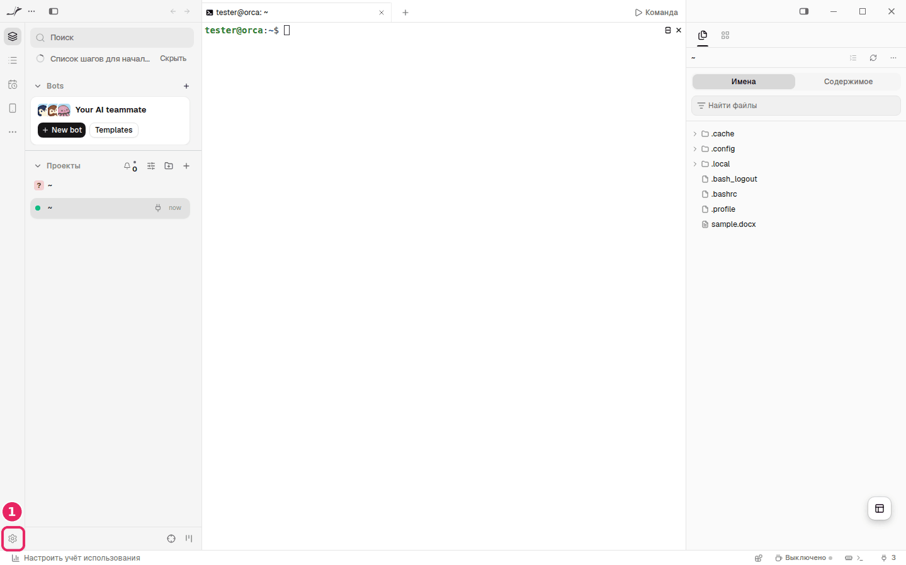

2. Выберите в меню пункт **Настройки**.

   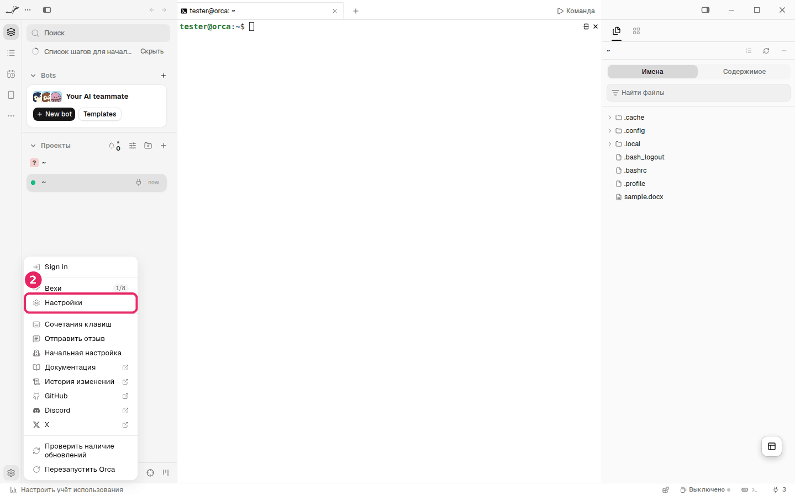

3. В списке настроек слева нажмите **Плагины** (раздел «Экспериментальные»).

   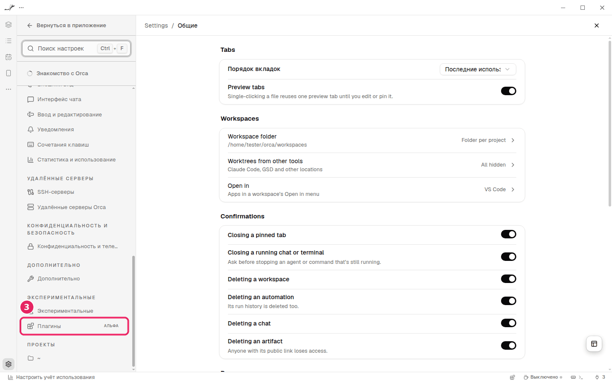

4. Нажмите **Добавить плагин** в правом верхнем углу.

   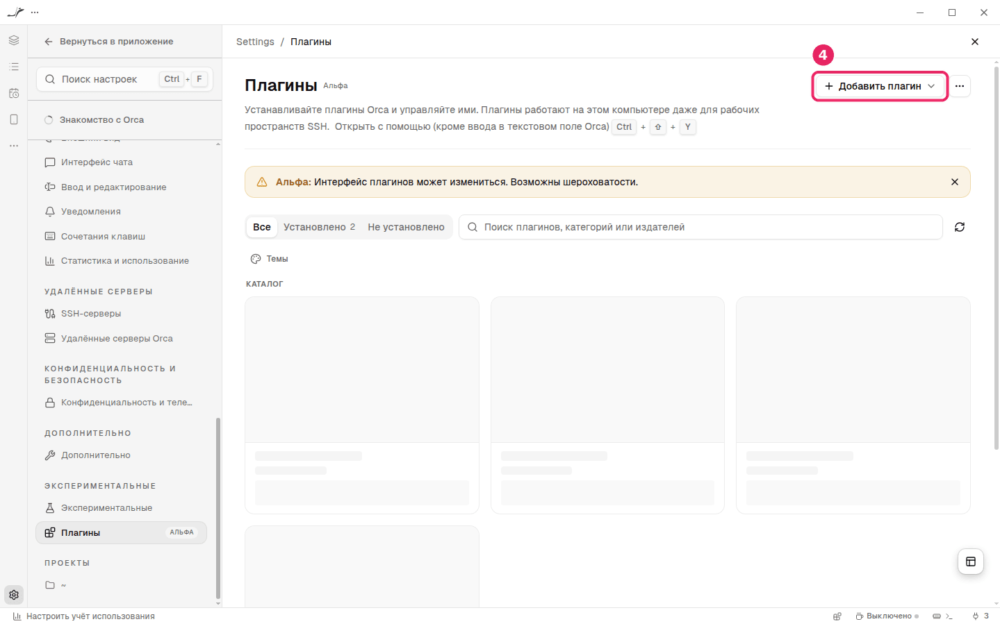

5. Выберите **По URL Git…**.

   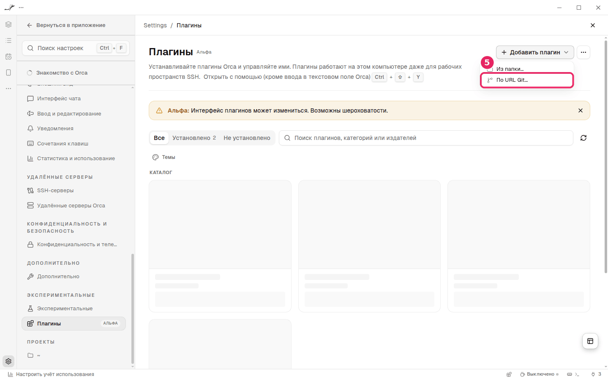

6. Откроется окно **Установить плагин** на вкладке **URL Git**. Вставьте этот адрес в поле **URL репозитория с #ref**:

   ```text
   https://github.com/hangams84/orca-file-preview.git
   ```

   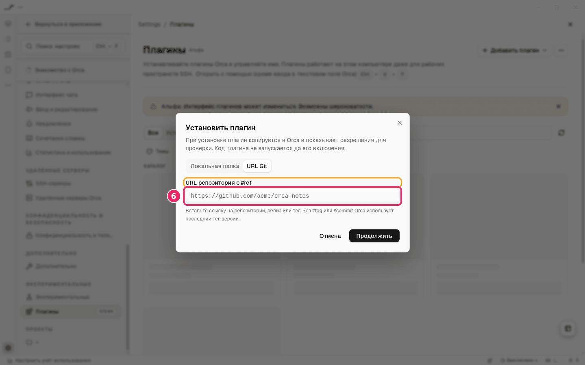

7. Нажмите **Продолжить**.

   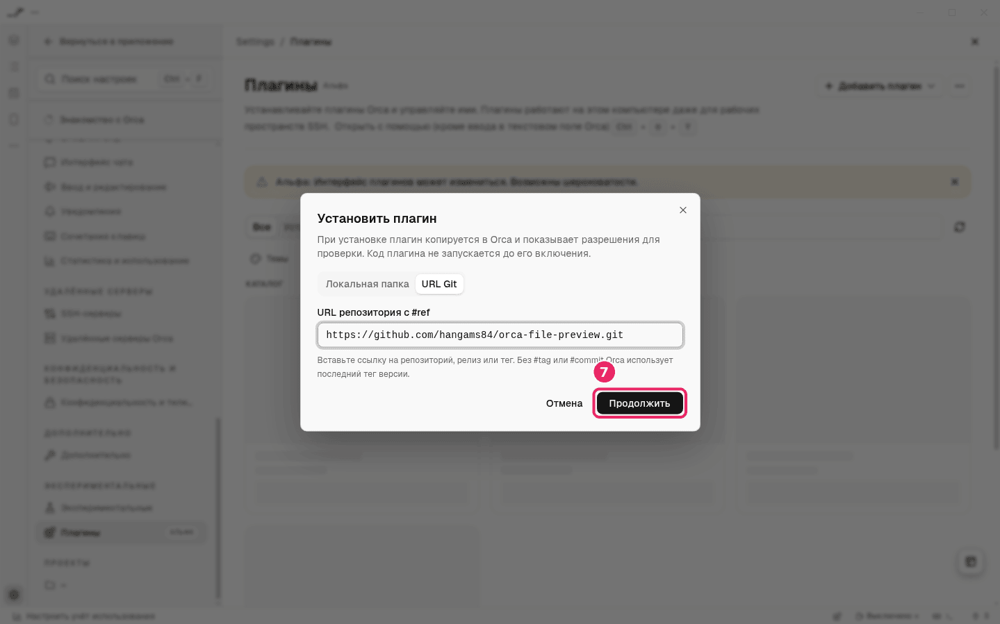

8. Orca находит последнюю версию («Будет установлена последняя версия v0.4.0, коммит e6fe45d.»). Нажмите **Установить**.

   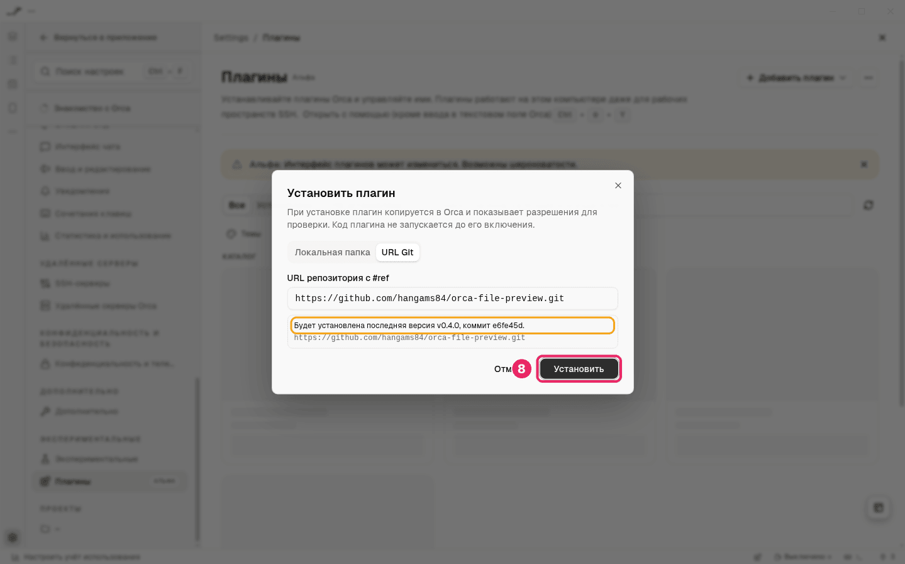

9. Orca спрашивает, доверяете ли вы издателю («Убедитесь, что доверяете hangams84»). Нажмите **Установить**.

   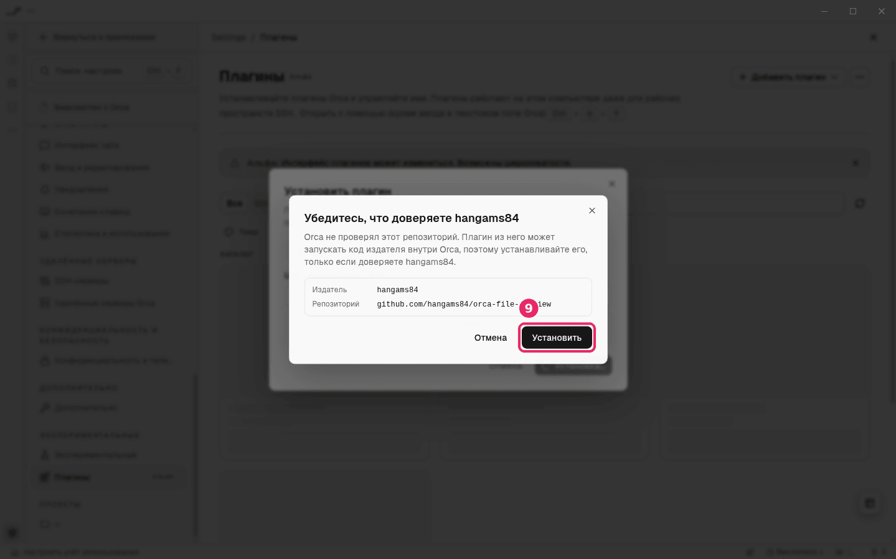

10. На странице плагина в разделе **Имеет доступ к** перечислено, что разрешено плагину: открывать файлы поддерживаемых типов, других разрешений нет. Нажмите **Включить плагин**. (Если нажать **Оставить выключенным**, плагин останется установленным, но выключенным.)

    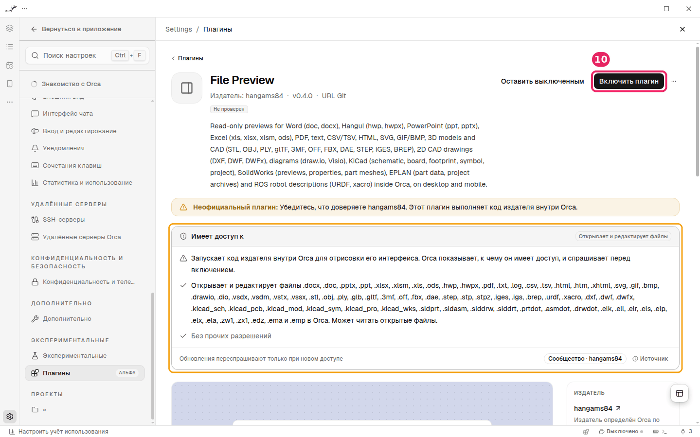

11. Плагин включён: рядом с названием отображается статус **Вкл.**, переключатель справа включён. Нажмите **Вернуться в приложение** в левом верхнем углу.

    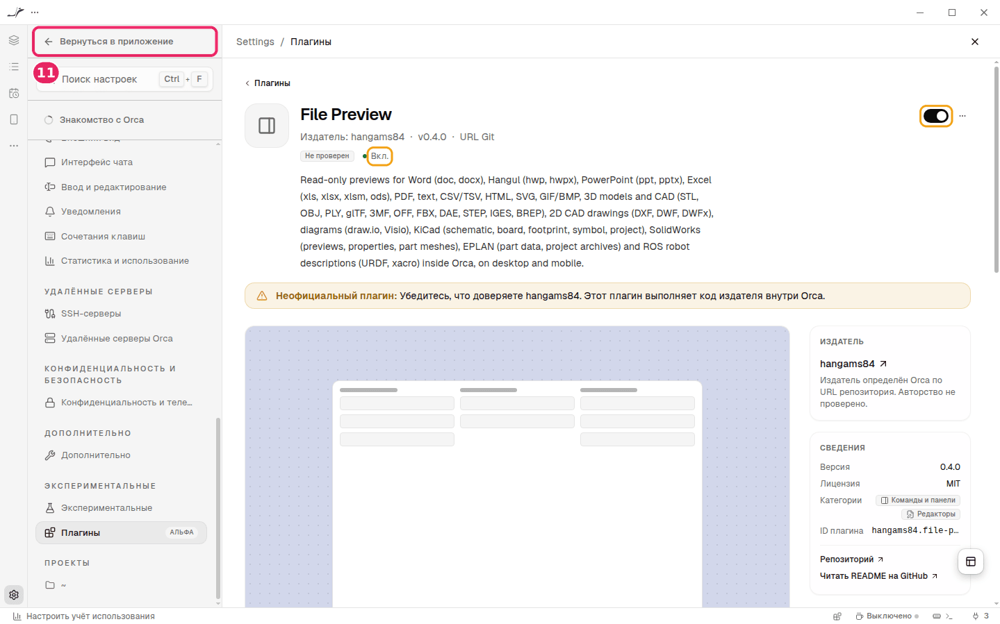

12. Откройте поддерживаемый файл в проводнике справа, например **sample.docx**.

    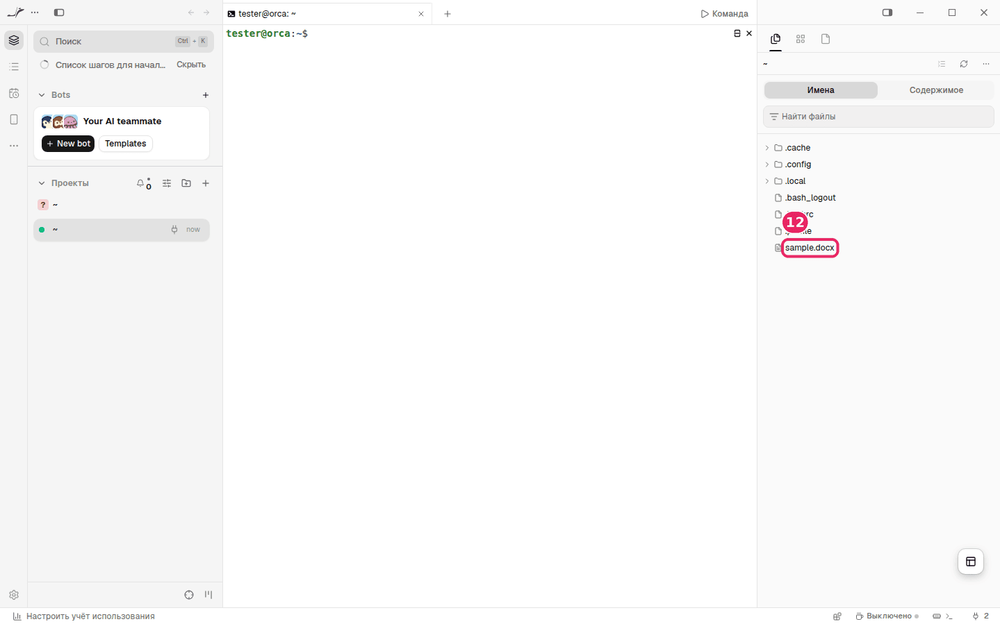

13. Файл откроется в режиме предпросмотра.

    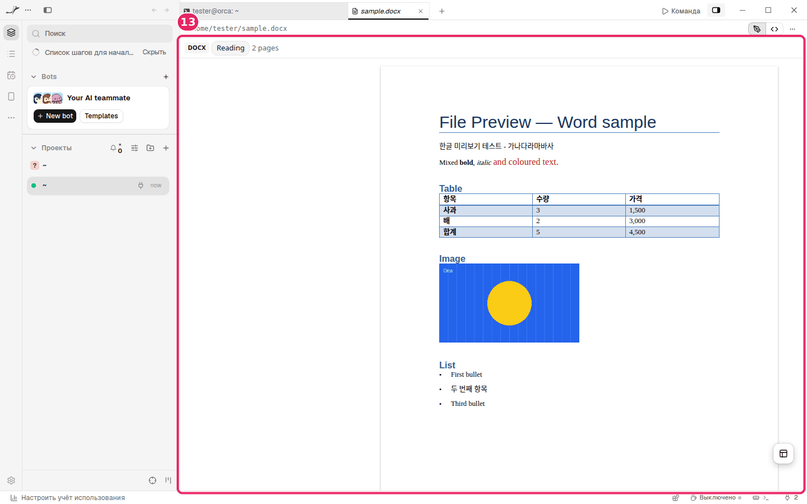

14. Необязательно: чтобы просматривать чертежи DWG, установите дополнительный плагин для DWG тем же способом (шаги 4–10). Вставьте адрес ниже, нажмите **Продолжить** и **Установить**, затем включите плагин.

    ```text
    https://github.com/hangams84/orca-file-preview-dwg.git
    ```

    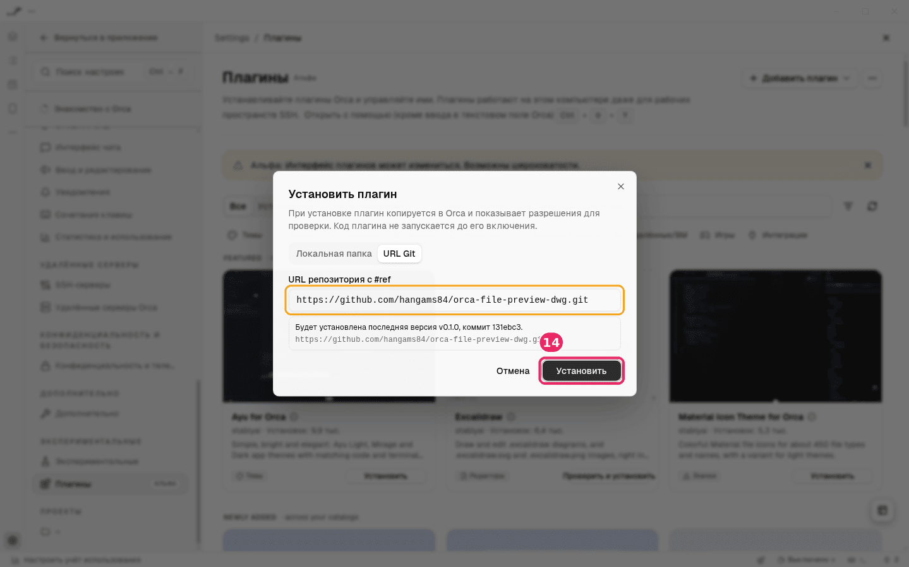

## Устранение неполадок

- **Установка по Git URL не работает**: для установки по Git URL нужна Orca 1.4.252 или новее. Обновите Orca и попробуйте снова.
- **«plugin exceeds the install size or file count limit»**: это случалось только со старыми тегами (v0.1.0–v0.2.1), до v0.2.2. Используйте адрес выше без `#тега` — тогда Orca установит последнюю версию.
- **Файл `.txt`, `.csv`, `.tsv`, `.html` или `.htm` открывается как текст**: эти типы Orca открывает сама, и сначала они показываются в режиме «Исходный текст». Выберите «Предпросмотр» переключателем режимов в правом верхнем углу вкладки.
- **У 3D-модели, робота (URDF) или чертежа нет текстур, сеток или сопутствующих файлов**: Orca передаёт редактору только открытый файл. Нажмите кнопку 📁 на панели инструментов предпросмотра и выберите папку с сопутствующими файлами (с нажатой клавишей Shift — отдельные файлы) или перетащите их на предпросмотр.
- **Файлы больше 50 МБ («exceeds 50MB limit»)**: Orca передаёт редактору не более 50 МБ. Откройте файл кнопкой «Open file…» на панели **File Preview** (правая боковая панель) — там этого ограничения нет (до 1 ГБ).

---

[Другие языки](README.md) · [Репозиторий File Preview](https://github.com/hangams84/orca-file-preview)
