# File Preview kurulumu (Orca uygulaması)

File Preview eklentisini Orca uygulamasının ayarlarından GitHub adresiyle kurma ve etkinleştirme adımları. Terminal gerekmez.

> Ekran görüntüleri: Orca 1.4.279, Türkçe arayüz. Diğer Orca sürümlerinde adlar ve konumlar biraz farklı olabilir.

## Adımlar

1. Orca penceresinin sol altındaki ayarlar düğmesine (dişli simgesi) tıklayın.

   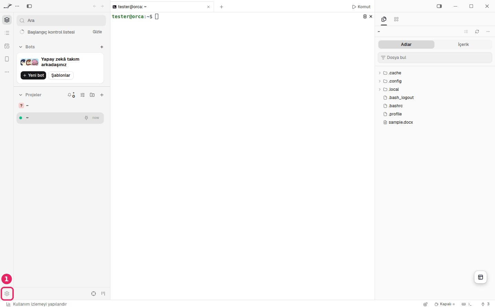

2. Açılan menüde **Ayarlar**'a tıklayın.

   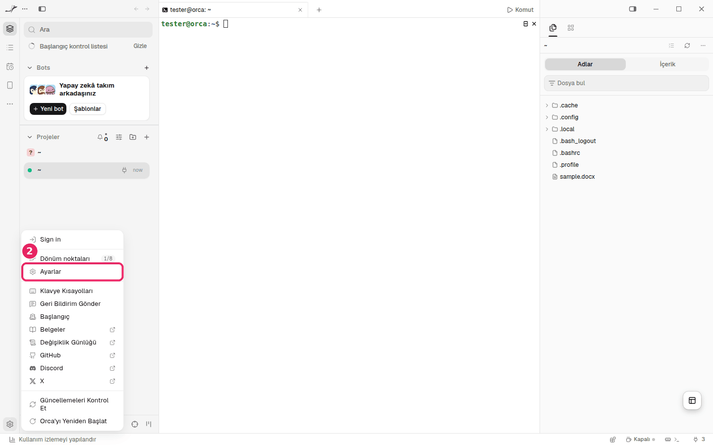

3. Soldaki ayarlar listesinde, **Deneysel** bölümündeki **Eklentiler**'e tıklayın.

   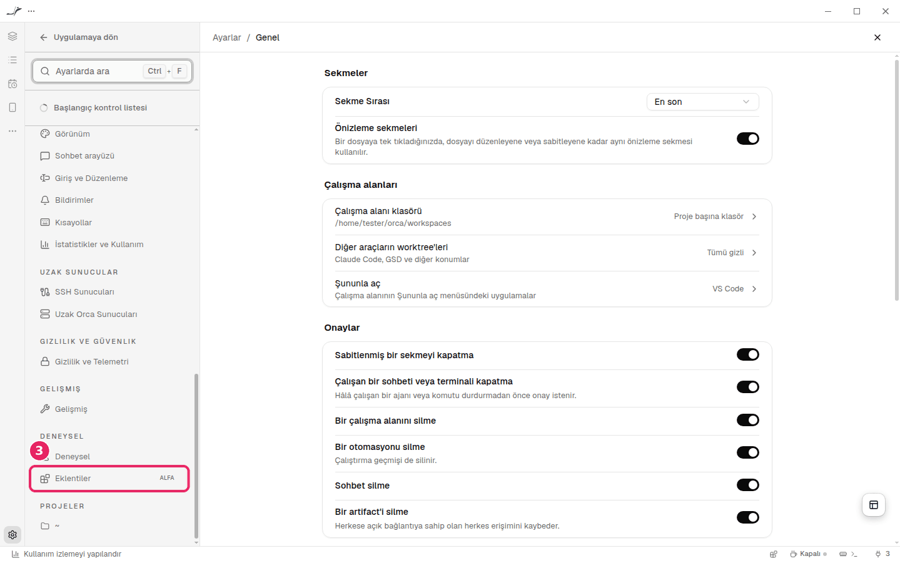

4. Sağ üstteki **Eklenti ekle** düğmesine tıklayın.

   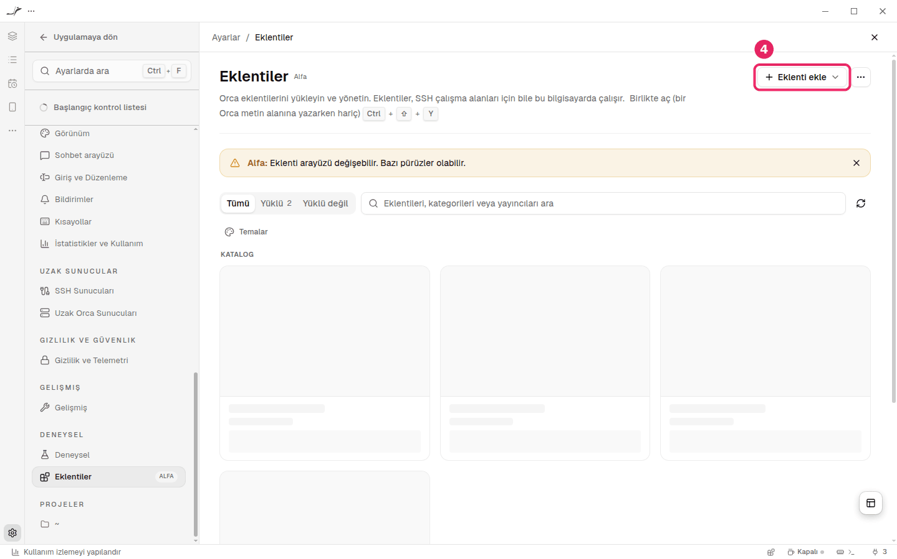

5. **Bir Git URL'sinden…** seçeneğini seçin.

   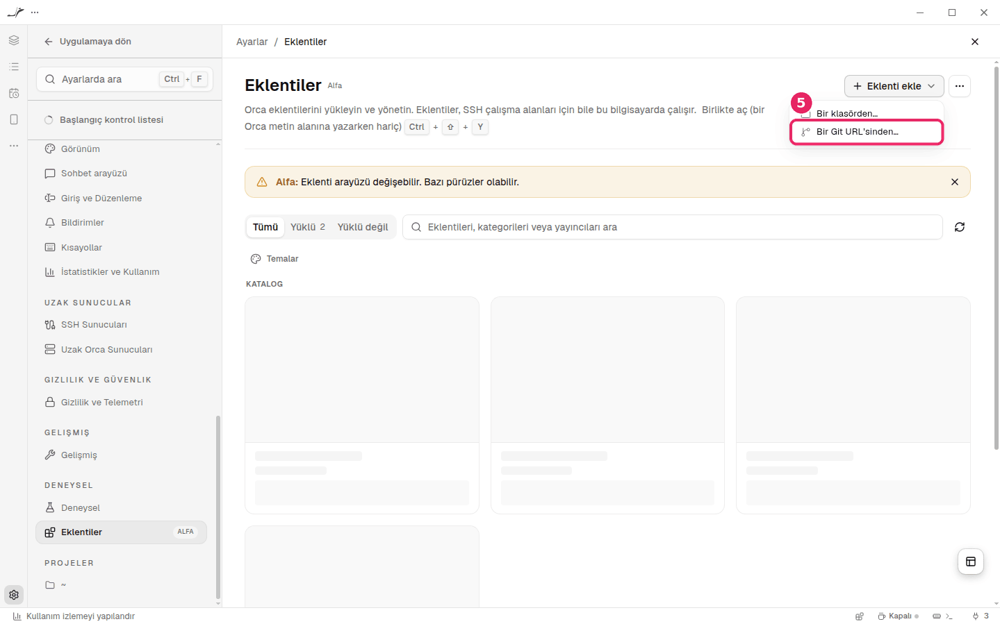

6. **Eklenti yükle** penceresi **Git URL'si** sekmesinde açılır. Aşağıdaki adresi **#ref içeren repository URL'si** alanına yapıştırın:

   ```text
   https://github.com/hangams84/orca-file-preview.git
   ```

   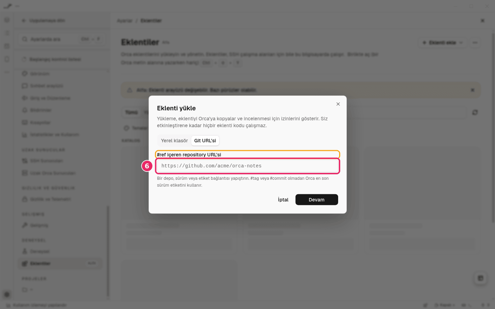

7. **Devam** düğmesine tıklayın.

   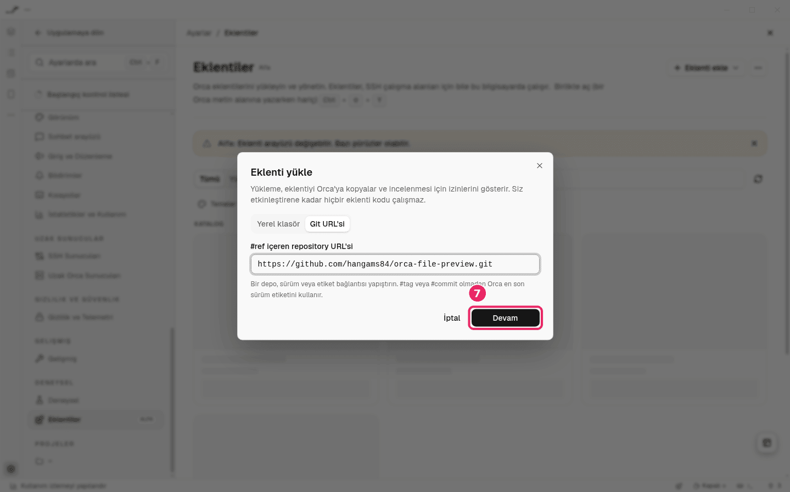

8. Orca en yeni sürümü bulur (“En son sürüm olan v0.4.0, e6fe45d commit'inde yüklenir.”). **Yükle** düğmesine tıklayın.

   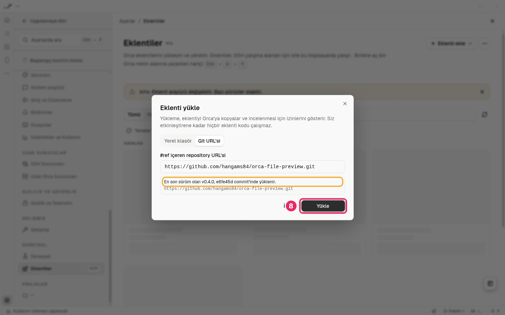

9. Orca yayıncıya güvenip güvenmediğinizi sorar (“hangams84 kaynağına güvendiğinizden emin olun”). **Yükle** düğmesine tıklayın.

   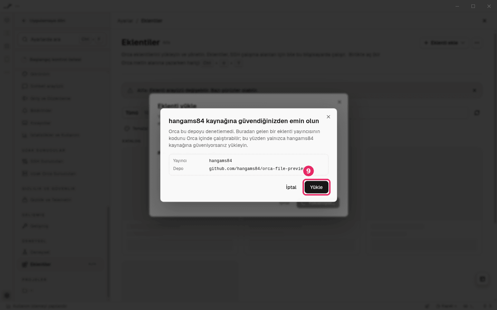

10. Eklenti sayfasındaki **Erişebildikleri** bölümünde eklentinin nelere erişebildiği listelenir: desteklenen türlerdeki dosyaları açar, başka erişimi yoktur. **Eklentiyi etkinleştir** düğmesine tıklayın. (**Kapalı tut**'a tıklarsanız eklenti kurulu kalır ama kapalı olur.)

    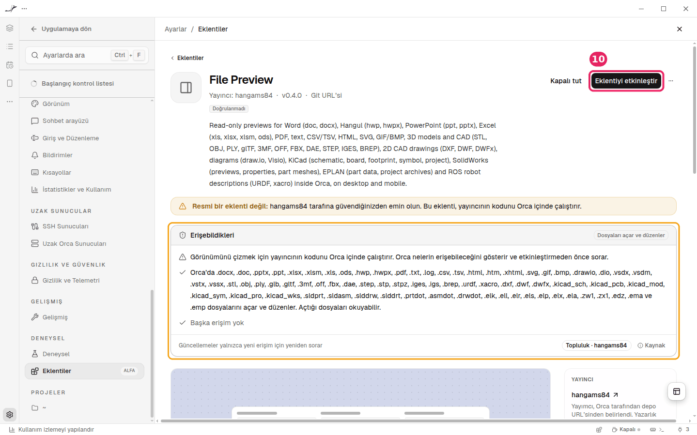

11. Eklenti etkinleşti: adının altında **Açık** durumu görünür ve sağdaki anahtar açık konumdadır. Sol üstteki **Uygulamaya dön** düğmesine tıklayın.

    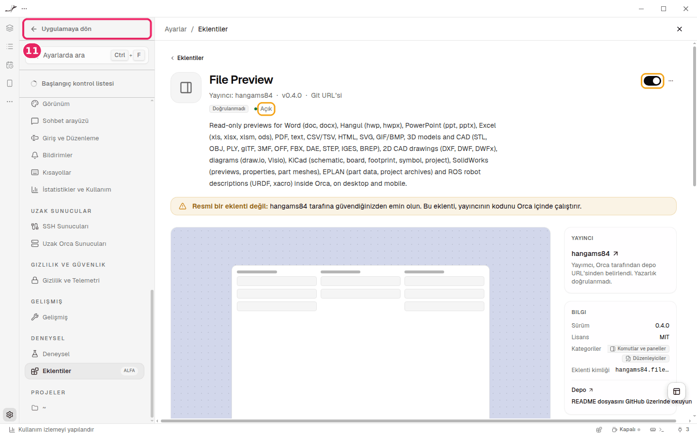

12. Sağdaki dosya gezgininde desteklenen bir dosyayı açın, örneğin **sample.docx**.

    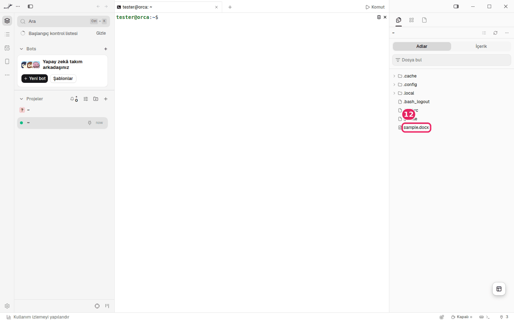

13. Dosya önizlemede açılır.

    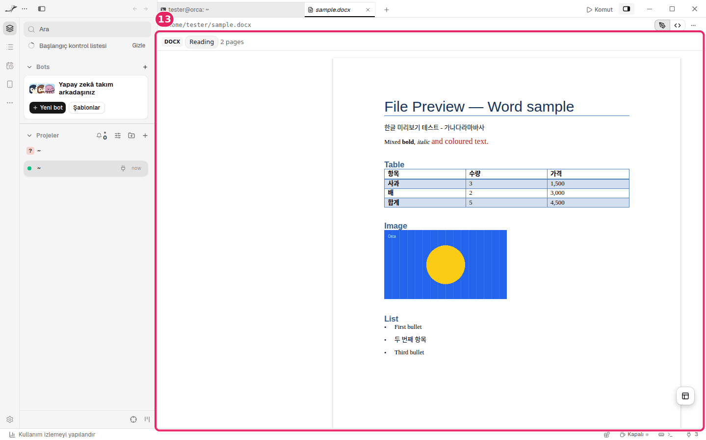

14. İsteğe bağlı: DWG çizimlerini görüntülemek için ayrı DWG eklentisini aynı şekilde (4–10. adımlar) kurun. Aşağıdaki adresi yapıştırın, **Devam** ve **Yükle** düğmelerine tıklayın, ardından eklentiyi etkinleştirin.

    ```text
    https://github.com/hangams84/orca-file-preview-dwg.git
    ```

    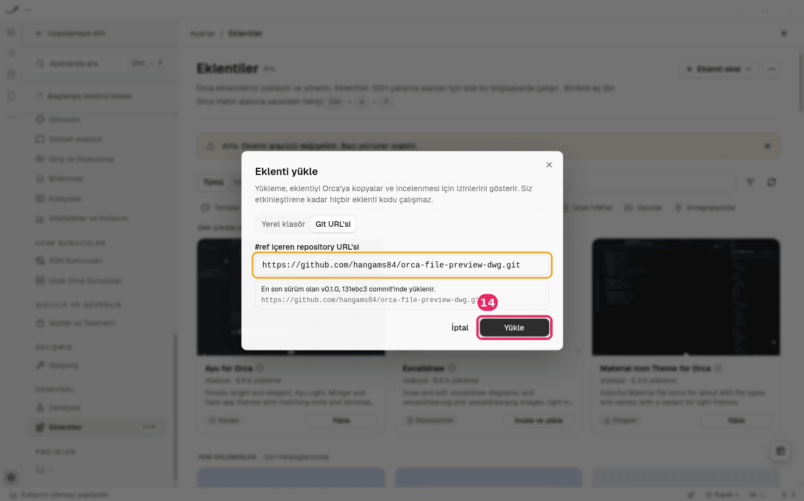

## Sorun giderme

- **Git URL'si ile kurulum çalışmıyor**: Git URL'si ile kurulum için Orca 1.4.252 veya üzeri gerekir. Orca'yı güncelleyip yeniden deneyin.
- **“plugin exceeds the install size or file count limit”**: Bu sorun yalnızca v0.2.2'den önceki eski etiketlerde (v0.1.0–v0.2.1) görüldü. Yukarıdaki adresi `#etiket` olmadan kullanın; Orca en yeni sürümü kurar.
- **`.txt`, `.csv`, `.tsv`, `.html` veya `.htm` dosyası metin olarak açılıyor**: Bu türleri Orca kendisi açtığı için önce **Kaynak** görünümü gelir. **Önizleme**'yi sekmenin sağ üst köşesindeki görünüm değiştiriciden seçin.
- **3D model, robot (URDF) veya çizimde doku, mesh ya da eşlik eden dosyalar eksik**: Orca, düzenleyiciye yalnızca açtığınız dosyayı verir. Önizleme araç çubuğundaki 📁 düğmesine tıklayıp eşlik eden dosyaların bulunduğu klasörü seçin (tek tek dosya seçmek için Shift tuşunu basılı tutun) veya dosyaları önizlemenin üzerine bırakın.
- **50 MB'tan büyük dosyalar (“exceeds 50MB limit”)**: Orca, bir düzenleyiciye en fazla 50 MB veri verir. Dosyayı sağ kenar çubuğundaki **File Preview** panelinde “Open file…” ile açın; orada bu sınır yoktur (1 GB'a kadar).

---

[Diğer diller](README.md) · [File Preview deposu](https://github.com/hangams84/orca-file-preview)
