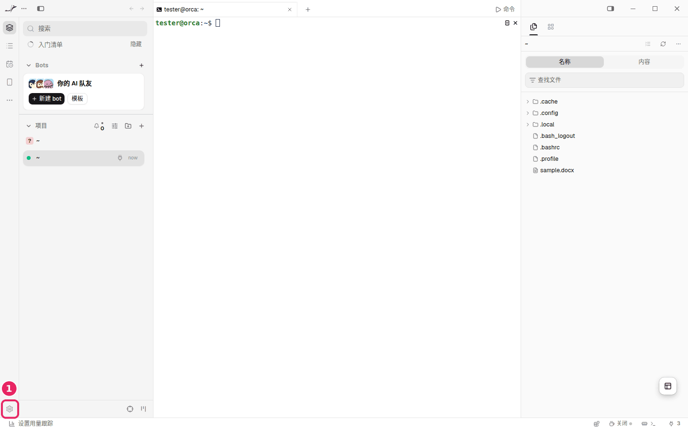
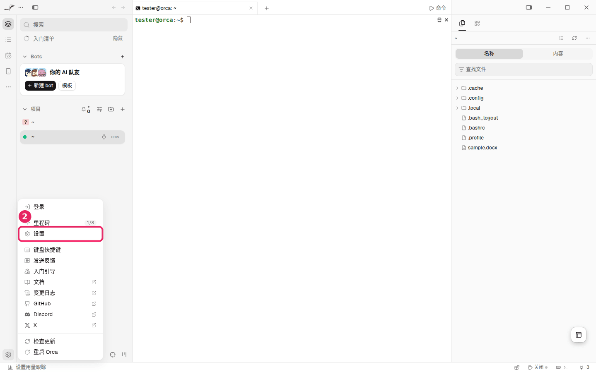
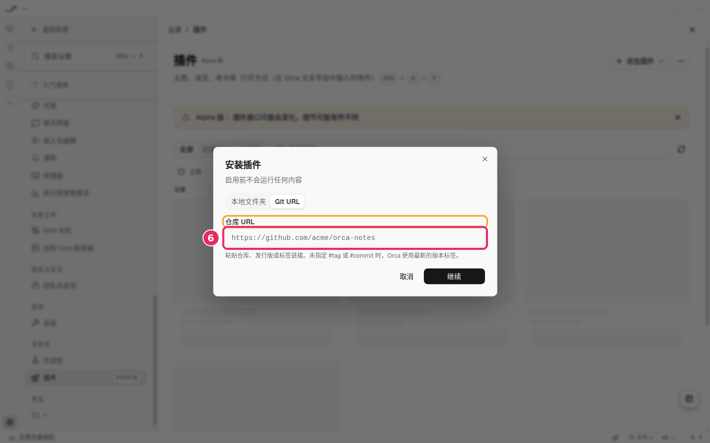
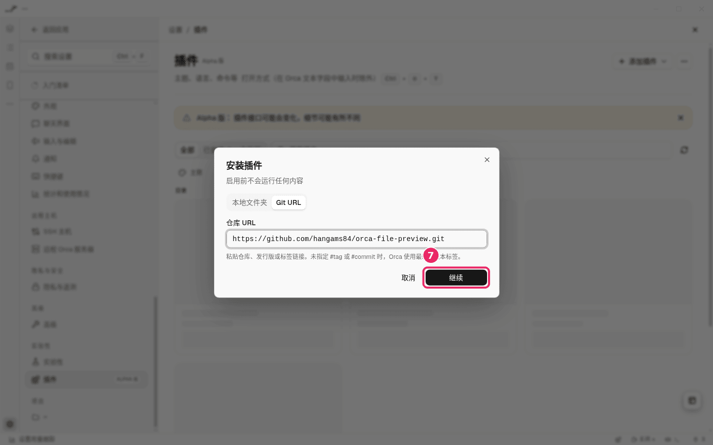
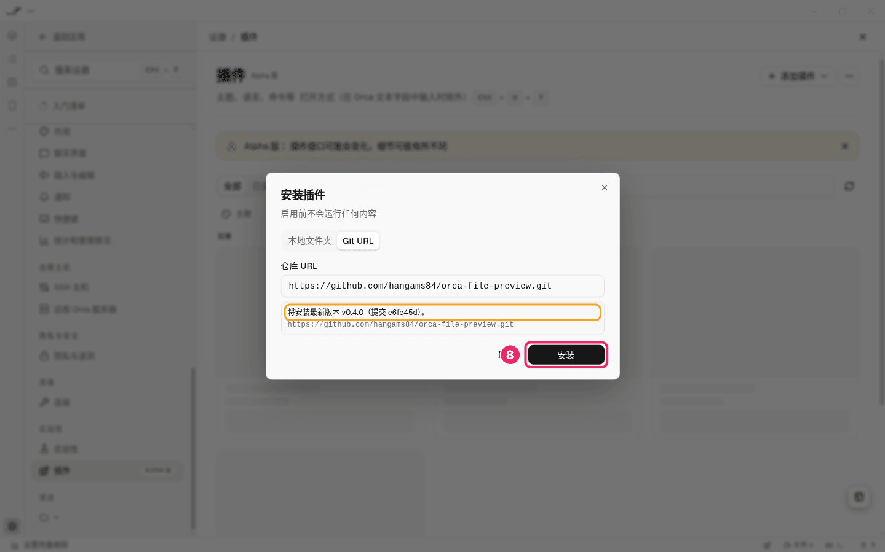
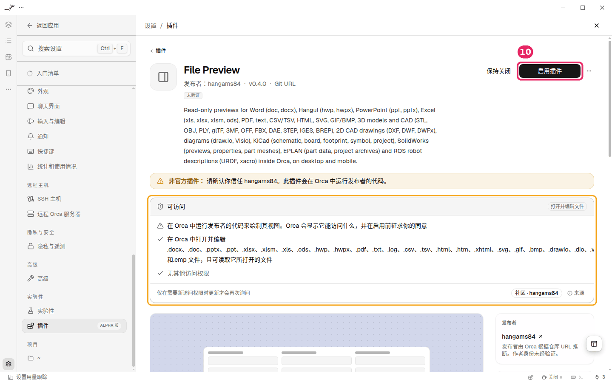
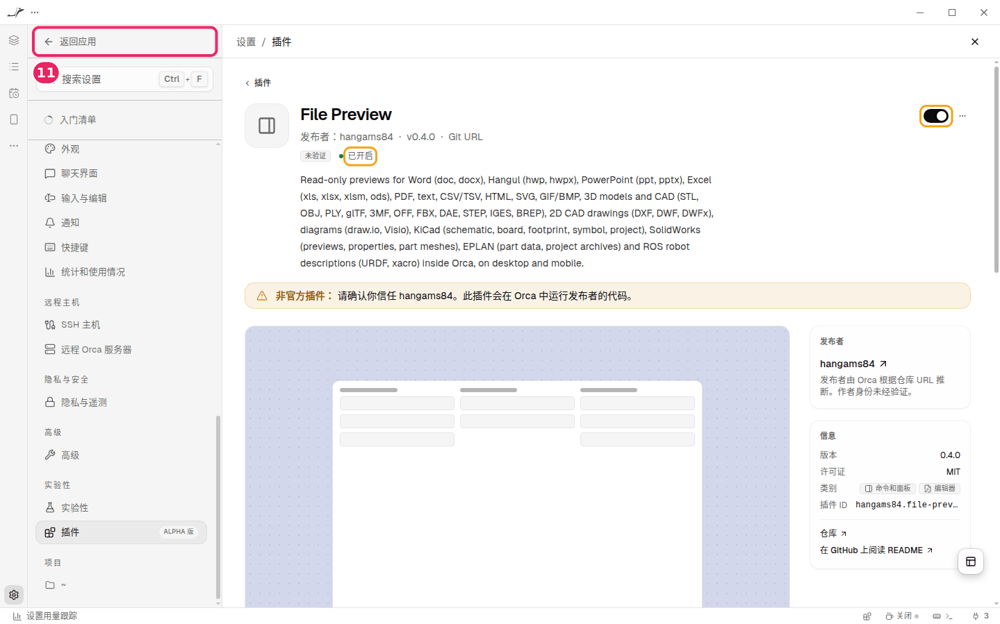
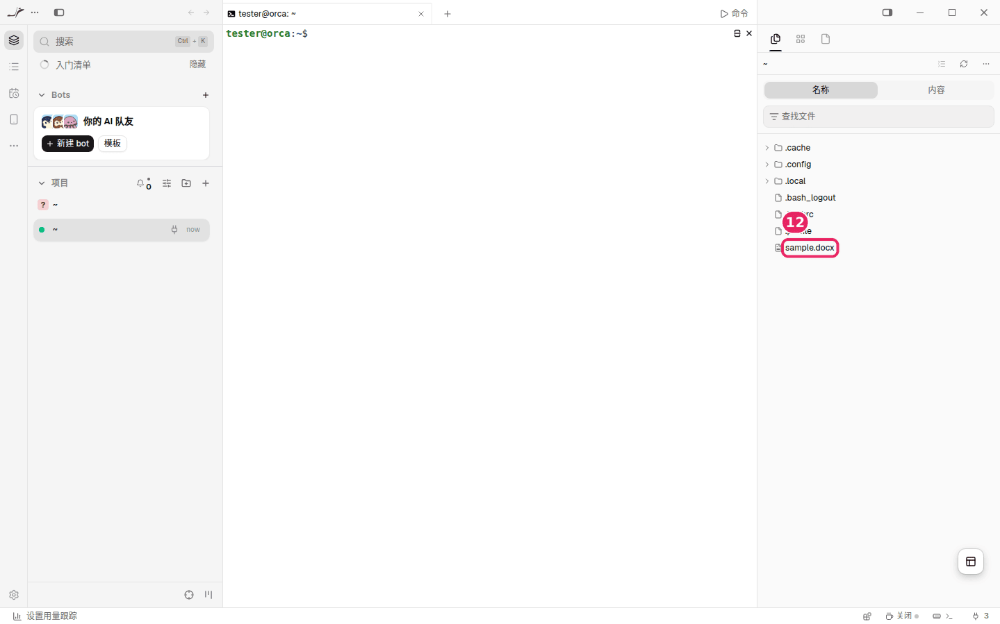
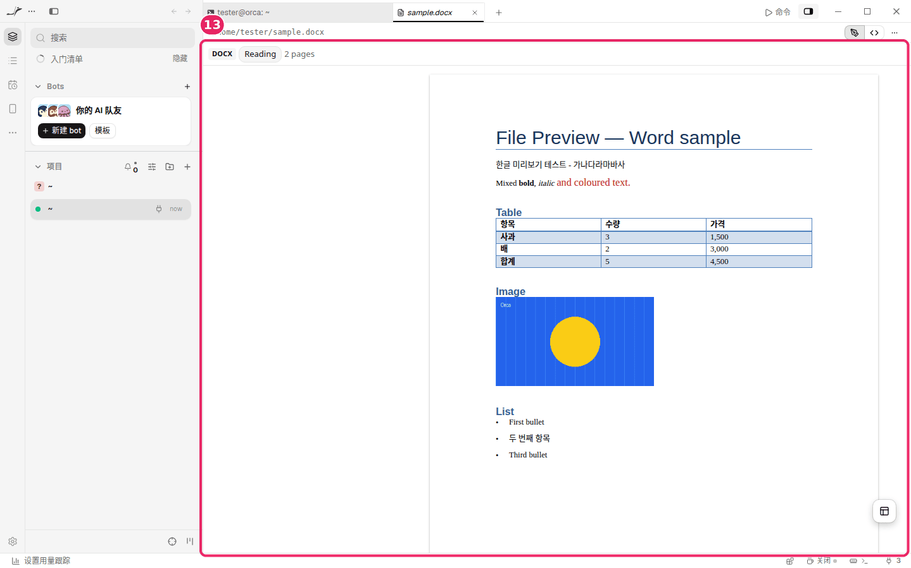
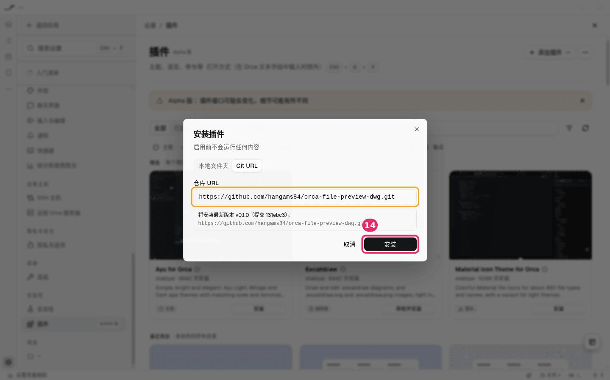

# 安装 File Preview（Orca 应用）

在 Orca 应用的设置中，通过 GitHub 地址安装并启用 File Preview 插件。无需使用终端。

> 截图：Orca 1.4.279，简体中文界面。其他 Orca 版本中的名称和位置可能略有不同。

## 步骤

1. 点击 Orca 窗口左下角的齿轮按钮。

   

2. 在菜单中选择 **设置**。

   

3. 在左侧的设置列表中点击 **插件**。

   

4. 点击右上角的 **添加插件**。

   

5. 选择 **从 Git URL…**。

   

6. **安装插件** 对话框会在 **Git URL** 标签页中打开。将下面的地址粘贴到 **仓库 URL** 输入框中：

   ```text
   https://github.com/hangams84/orca-file-preview.git
   ```

   

7. 点击 **继续**。

   

8. Orca 会找到最新版本（“将安装最新版本 v0.4.0（提交 e6fe45d）。”）。点击 **安装**。

   

9. Orca 会询问你是否信任发布者（“请确认你信任 hangams84”）。点击 **安装**。

   

10. 插件详情页的 **可访问** 部分列出了插件的访问范围：在 Orca 中打开它可预览的文件类型，此外“无其他访问权限”。点击右上角的 **启用插件**。（若选择左侧的 **保持关闭**，则只安装、不启用。）

    

11. 插件名称下方的状态变为 **已开启**，右上角的开关也已打开。点击左上角的 **返回应用**。

    

12. 在右侧边栏的文件列表中点击一个支持的文件，例如 **sample.docx**。

    

13. 文件会在新标签页中以预览方式打开。

    

14. 可选：如需查看 DWG 图纸，请用同样的方法（第 4–10 步）安装 DWG 配套插件。粘贴下面的地址，依次点击 **继续** 和 **安装**，然后启用插件。

    ```text
    https://github.com/hangams84/orca-file-preview-dwg.git
    ```

    

## 故障排除

- **无法通过 Git URL 安装**：通过 Git URL 安装需要 Orca 1.4.252 或更高版本，请更新 Orca 后重试。
- **“plugin exceeds the install size or file count limit”**：此问题只出现在 v0.2.2 之前的旧标签（v0.1.0–v0.2.1）。请使用上面不带 `#标签` 的地址，Orca 会安装最新版本。
- **`.txt` `.csv` `.tsv` `.html` `.htm` 文件以文本形式打开**：这些格式由 Orca 自行打开，因此先显示“源码”视图。请通过标签页右上角的视图切换按钮选择“预览”。
- **3D 模型、机器人（URDF）或图纸缺少纹理、网格或外部参照**：Orca 只把你打开的那一个文件交给编辑器。点击预览工具栏中的 📁 按钮，选择包含关联文件的文件夹（按住 Shift 可改为选择文件），或把文件拖放到预览上。
- **超过 50 MB 的文件（“exceeds 50MB limit”）**：Orca 最多只把文件的 50 MB 交给插件编辑器。请在右侧边栏的 **File Preview** 面板中通过“Open file…”打开文件，面板不受此上限限制（最大 1 GB）。

---

[其他语言](README.md) · [File Preview 仓库](https://github.com/hangams84/orca-file-preview)
