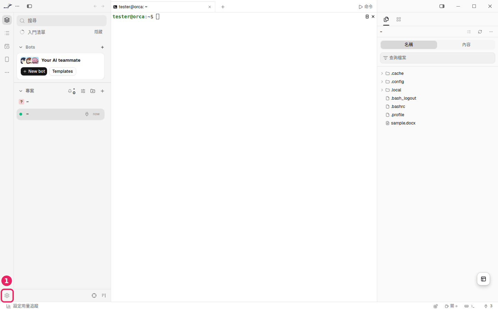
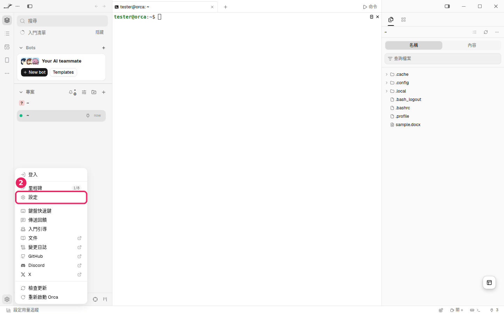
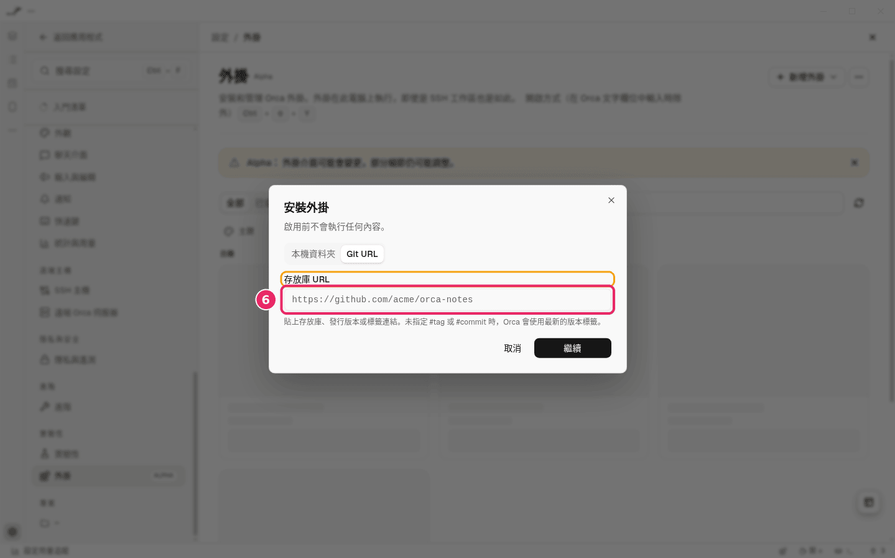
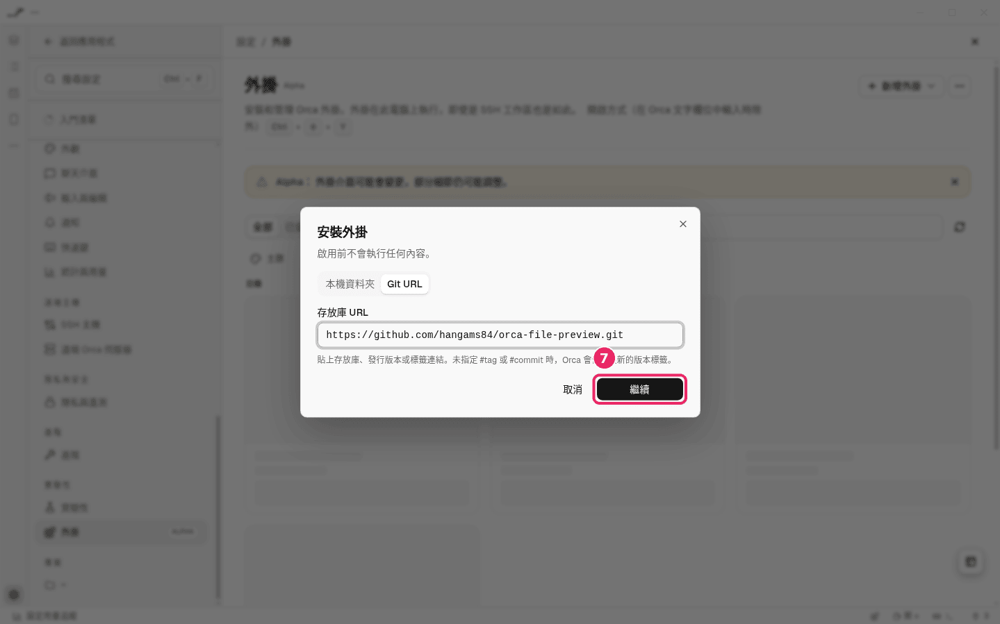
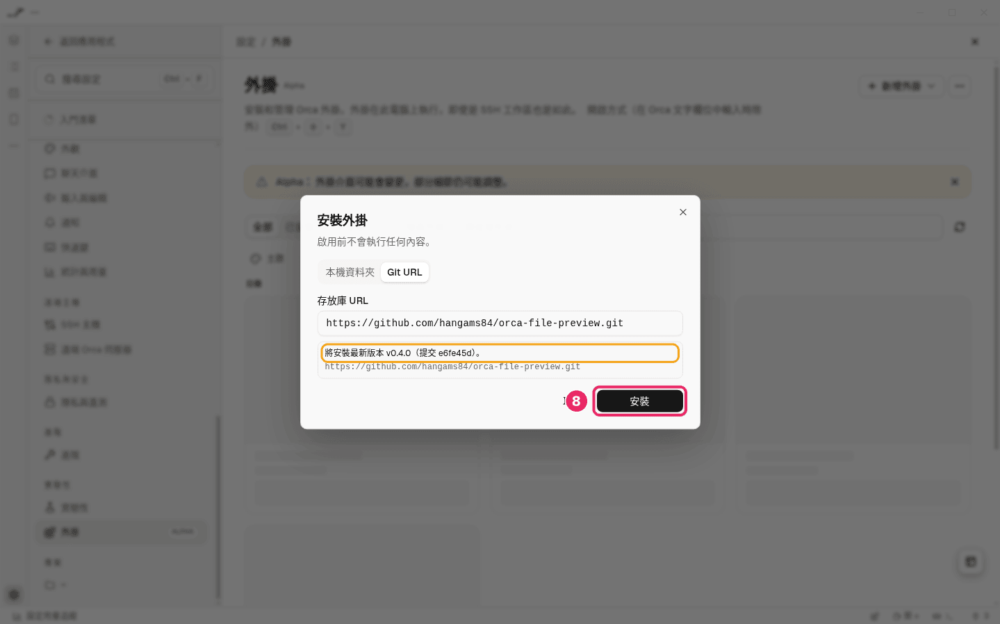
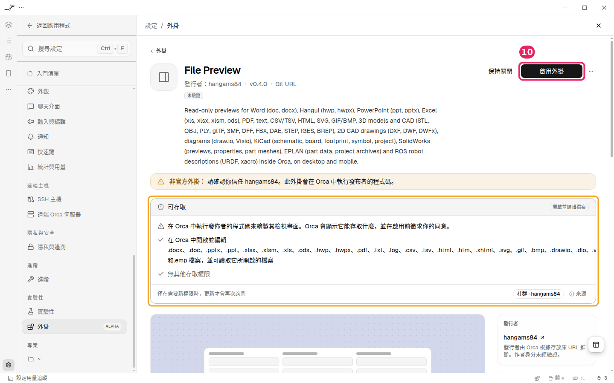
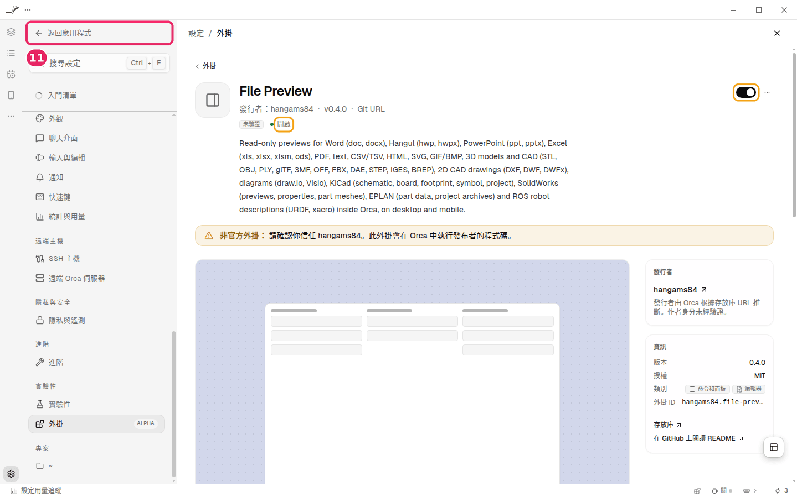
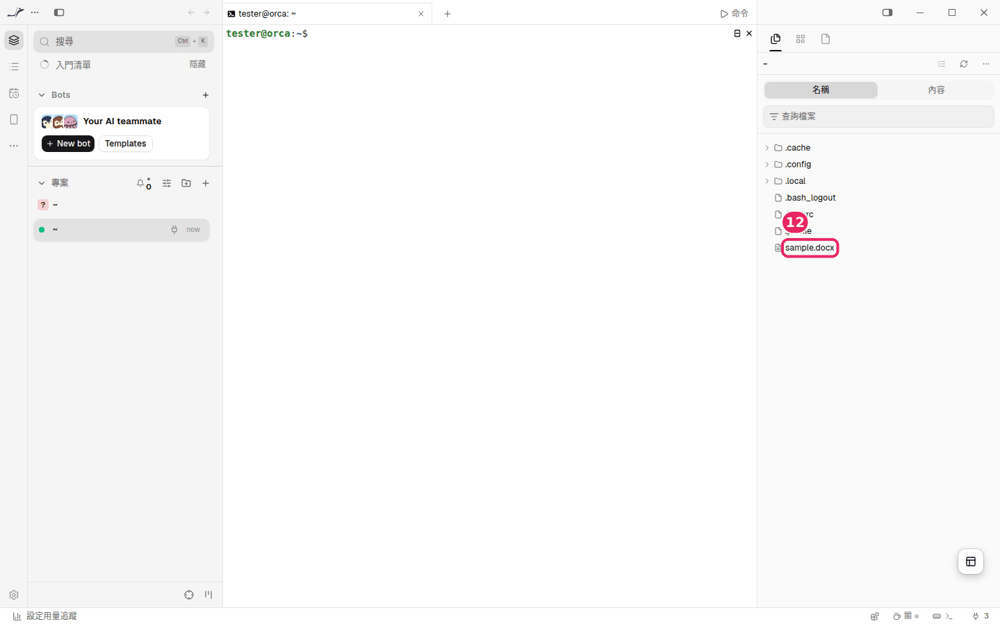
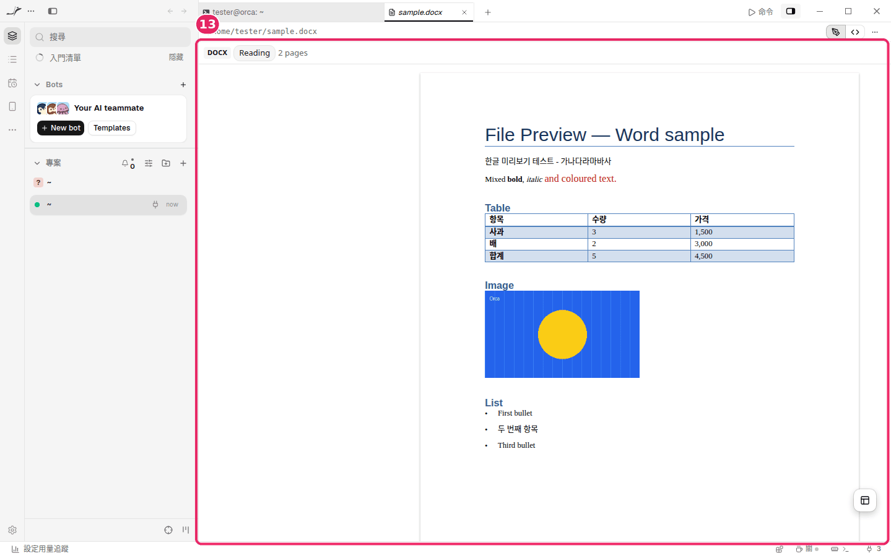
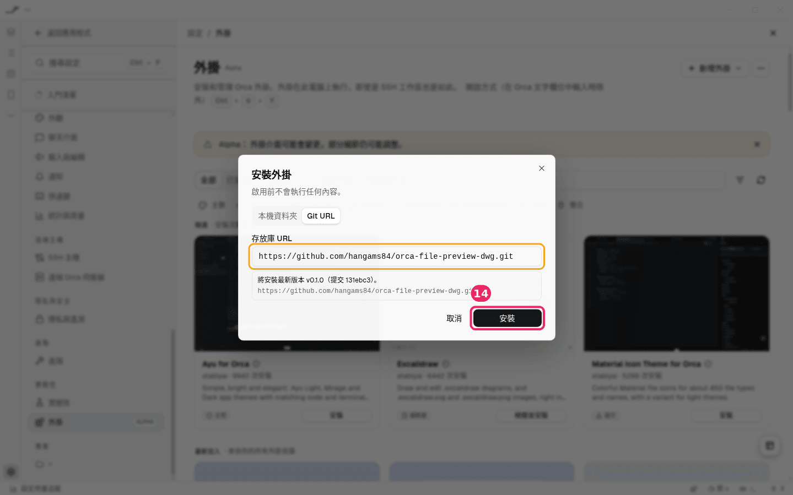

# 安裝 File Preview（Orca 應用程式）

在 Orca 應用程式的設定中，透過 GitHub 網址安裝並啟用 File Preview 外掛。不需要使用終端機。

> 截圖：Orca 1.4.279，繁體中文介面。其他 Orca 版本中的名稱和位置可能略有不同。

## 步驟

1. 點選 Orca 視窗左下角的齒輪按鈕。

   

2. 在選單中選擇 **設定**。

   

3. 在左側的設定清單中點選 **外掛**。

   

4. 點選右上角的 **新增外掛**。

   

5. 選擇 **從 Git URL…**。

   

6. **安裝外掛** 對話方塊會在 **Git URL** 分頁中開啟。將下面的網址貼到 **存放庫 URL** 欄位：

   ```text
   https://github.com/hangams84/orca-file-preview.git
   ```

   

7. 點選 **繼續**。

   

8. Orca 會找到最新版本（「將安裝最新版本 v0.4.0（提交 e6fe45d）。」）。點選 **安裝**。

   

9. Orca 會詢問你是否信任發布者（「請確認你信任 hangams84」）。點選 **安裝**。

   

10. 外掛詳細資料頁的 **可存取** 區塊會列出外掛的存取範圍：在 Orca 中開啟它可預覽的檔案類型，此外「無其他存取權限」。點選右上角的 **啟用外掛**。（若選擇左側的 **保持關閉**，則只安裝、不啟用。）

    

11. 外掛名稱下方的狀態變為 **開啟**，右上角的開關也已開啟。點選左上角的 **返回應用程式**。

    

12. 在右側邊欄的檔案清單中點選一個支援的檔案，例如 **sample.docx**。

    

13. 檔案會在新分頁中以預覽方式開啟。

    

14. 選用：如需檢視 DWG 圖面，請用同樣的方法（第 4–10 步）安裝 DWG 配套外掛。貼上下面的網址，依序點選 **繼續** 和 **安裝**，然後啟用外掛。

    ```text
    https://github.com/hangams84/orca-file-preview-dwg.git
    ```

    

## 疑難排解

- **無法透過 Git URL 安裝**：透過 Git URL 安裝需要 Orca 1.4.252 以上版本，請更新 Orca 後再試一次。
- **「plugin exceeds the install size or file count limit」**：這個問題只發生在 v0.2.2 之前的舊標籤（v0.1.0–v0.2.1）。請使用上面不帶 `#標籤` 的網址，Orca 會安裝最新版本。
- **`.txt` `.csv` `.tsv` `.html` `.htm` 檔案以文字形式開啟**：這些格式由 Orca 自行開啟，因此會先顯示「原始碼」檢視。請用分頁右上角的檢視切換按鈕選擇預覽。
- **3D 模型、機器人（URDF）或圖面缺少紋理、網格或外部參考**：Orca 只會把你開啟的那一個檔案交給編輯器。點選預覽工具列中的 📁 按鈕，選擇含有關聯檔案的資料夾（按住 Shift 可選擇個別檔案），或將檔案拖放到預覽上。
- **超過 50 MB 的檔案（「exceeds 50MB limit」）**：Orca 最多只會把檔案的 50 MB 交給外掛編輯器。請在右側邊欄的 **File Preview** 面板中以「Open file…」開啟檔案，面板不受此上限約束（最大 1 GB）。

---

[其他語言](README.md) · [File Preview 存放庫](https://github.com/hangams84/orca-file-preview)
