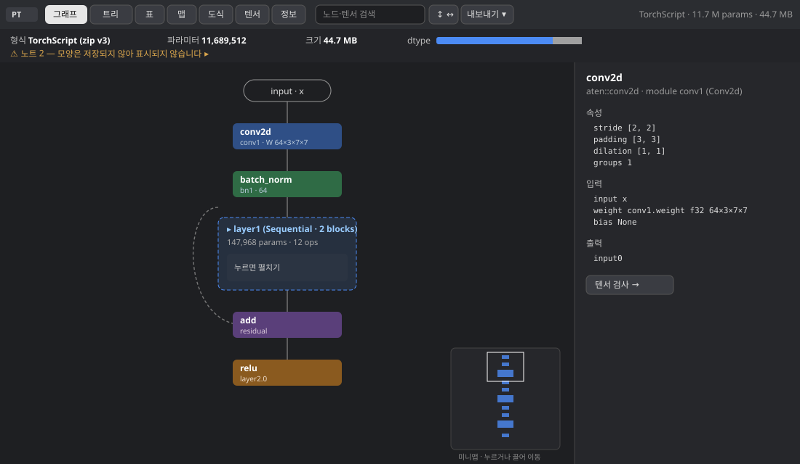
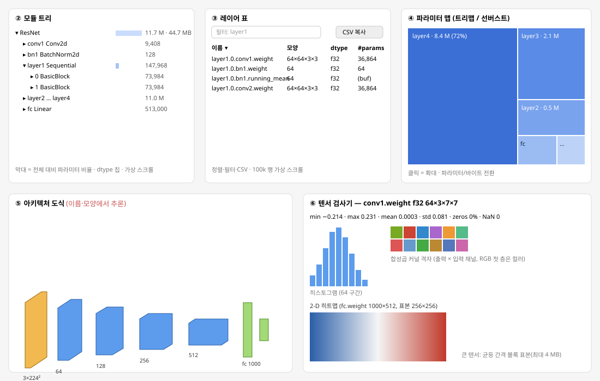
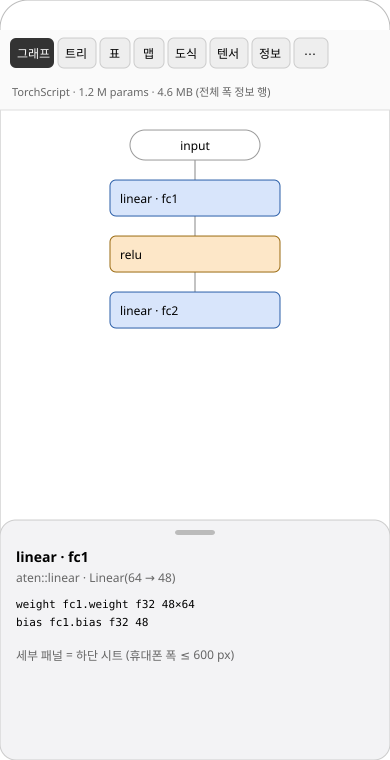

# AI model visualization — research and design (AI 모델 시각화 사전조사)

작성: 2026-11-27 · 대상: File Preview for Orca 플러그인 (MIT) · 범위: PyTorch 계열(`.pt .pth .ckpt .chkpt .pt2 .ptl .bin .pkl .safetensors`)과 ONNX·TFLite·GGUF·Keras/HDF5·NumPy

요약: 사용자 코드를 **절대 실행하지 않고** 파일 바이트만 읽어 모델을 보여 준다. 모든 형식을 하나의 공통 설명 `ModelIR`
(`plugin/editor/renderers/aimodel/ir.ts`)로 바꾼 뒤, 8가지 보기(그래프·모듈 트리·레이어 표·파라미터 맵·아키텍처 도식·텐서
검사기·체크포인트 정보·내보내기)를 툴바에서 고른다. 그래프 배치는 직접 작성한 계층형 레이아웃(10k 노드 ~90 ms)을 쓴다.
dagre는 2k 노드 이상에서 스택 넘침, elkjs는 EPL-2.0/GPL 이중 라이선스라 채택하지 않았다.

## 1. Formats and what can be recovered (형식별로 복원할 수 있는 정보)

공통 원칙: pickle을 쓰는 형식(PyTorch)은 **pickle VM을 직접 구현**하되 `GLOBAL/STACK_GLOBAL/REDUCE/BUILD/NEWOBJ`가 아무것도
import·호출하지 않고 `{class, args, state}` 기록만 만든다. 텐서는 `torch._utils._rebuild_tensor_v2` 같은 알려진 이름을 인식해
메타데이터(이름·모양·dtype·저장소 위치)로 바꾸고, 값은 필요할 때 범위 읽기로만 가져온다.

| 형식 | 구조 | 복원 가능 | 복원 불가 |
|---|---|---|---|
| PyTorch zip (`torch.save`, 1.6+) | ZIP(무압축): `<root>/data.pkl`, `<root>/data/<key>` 저장소, `version`, `byteorder`, `.format_version` | `state_dict`면 파라미터 이름·모양·dtype·stride·저장소 공유(가중치 묶음) | 연산 그래프 없음 |
| 전체 `nn.Module` pickle (`torch.save(model)`) | 같은 zip, data.pkl 안에 모듈 객체 | 모듈 클래스 이름(`torch.nn.modules.conv.Conv2d`), 속성 트리(`in_channels`, `kernel_size`, `training` …), `_parameters`/`_buffers`/`_modules` 계층 | `forward` 코드(그래프)는 저장되지 않음 — 클래스 이름만 있음 |
| TorchScript (`torch.jit.save`) | zip: `data.pkl`(모듈 객체, `__torch__.*` 클래스), `code/__torch__/**.py`(Python 비슷한 생성 코드), `constants.pkl`, `*.debug_pkl` | 모듈 트리 + `forward` 본문을 파싱해 호출 그래프 재구성(서브모듈 forward 인라인, `torch.linear` 등 연산 노드) | 동적 제어 흐름은 근사(분기 모두 표시), 모양은 저장되지 않음 |
| `torch.export` `.pt2` | zip: `models/model.json`(ExportedProgram 직렬화 그래프), `data/weights/weight_<n>` + `model_weights_config.json`, `data/constants/*` | ATen 연산 그래프(노드·입출력·인자), `nn_module_stack`으로 모듈 그룹, 가중치 메타·값, 입력/출력 사양 | 텐서 모양은 `tensor_values`에 있을 때만(버전에 따라 다름) |
| 레거시 비-zip `.pt` (1.5 이하, `_use_new_zipfile_serialization=False`) | 연속 pickle 5개: 매직, 프로토콜, sys_info, 본체, 저장소 키 목록, 이어서 원시 저장소(각 8바이트 길이+데이터) | state_dict와 같음 | 그래프 없음 |
| Lightning `.ckpt` | PyTorch zip, dict: `state_dict`, `epoch`, `global_step`, `optimizer_states`, `lr_schedulers`, `hyper_parameters`, `pytorch-lightning_version`, `callbacks`, `loops` | 학습 상태 전부(옵티마이저 param_groups와 상태 텐서 수/크기, 스케줄러 상태, 하이퍼파라미터) | 옵티마이저 클래스는 저장되지 않음 → 상태 키(`exp_avg`·`exp_avg_sq` → Adam 계열, `momentum_buffer` → SGD)로 **추정** 표시 |
| Hugging Face `pytorch_model.bin` | PyTorch zip(또는 레거시) state_dict | state_dict와 같음, 이름 규칙(`transformer.h.0.attn…`)으로 트리 추론 | `config.json`은 별도 파일이라 없음 |
| `.safetensors` | 8바이트 LE 길이 N + JSON 헤더(N바이트) + 원시 데이터. 헤더: `{name: {dtype, shape, data_offsets}}` + `__metadata__`(문자열 dict) | 이름·모양·dtype·오프셋, 메타데이터. 헤더만 읽으면 되므로 수 GB도 즉시 | 그래프·모듈 클래스 없음 |
| ONNX | protobuf `ModelProto` → `GraphProto`(node, initializer, input/output, value_info) | 완전한 연산 그래프, opset, 초기값 텐서, 메타데이터 | — (외부 데이터 파일은 별도) |
| TFLite | FlatBuffers `Model` → subgraphs(tensors, operators), buffers | 연산 그래프, 양자화 파라미터, 서명 | — |
| GGUF | 매직 `GGUF`, 버전, 텐서 수, KV 메타데이터, 텐서 정보(이름·차원·ggml 타입·오프셋), 정렬된 데이터 | 하이퍼파라미터(`llama.block_count` …), 토크나이저 정보, 양자화 타입(Q4_K 등) | 그래프 없음(아키텍처 이름으로 블록 구조 추론) |
| Keras `.keras` | zip: `config.json`(모델 구성), `metadata.json`, `model.weights.h5` | 레이어 그래프(functional), 레이어 설정, 가중치 | — |
| Keras `.h5`/`.hdf5` | HDF5: `model_config` 속성(JSON), `model_weights/` 그룹 | 레이어 구성·가중치 | HDF5 파서 필요(두 번째 작업자) |
| NumPy `.npy`/`.npz` | `\x93NUMPY` + 헤더 dict(`descr`, `fortran_order`, `shape`) + 데이터 / npz = zip of npy | 배열 이름·모양·dtype·값 | — |

이 작업(리드)은 PyTorch 계열과 safetensors 리더를, 두 번째 작업자는 ONNX·TFLite·GGUF·Keras/HDF5·NumPy 리더를 맡는다(계약은 §5).

### 1.1 pickle 안전성 (Safe pickle VM)

`pickle.load`는 `GLOBAL`+`REDUCE`로 임의 함수를 호출하므로(예: `os.system`) 웹 뷰어에서도 “Python 객체를 재구성”하는 순간
위험하다. 이 플러그인은 JS로 VM을 구현해 **호출 자체가 없다**: `REDUCE(callable, args)`는 `{kind:'reduce', class:'posix.system',
args:['echo …']}` 같은 불활성 기록이 될 뿐이며, 화면에는 “실행하지 않은 호출” 경고와 함께 클래스 이름이 보인다. 지원 opcode:
프로토콜 0–5 전부(MEMOIZE, FRAME, BINPERSID, BYTEARRAY8, NEXT_BUFFER 제외 처리 포함). 인식하는 재구성 함수:
`torch._utils._rebuild_tensor`, `_rebuild_tensor_v2`, `_rebuild_tensor_v3`, `_rebuild_parameter`, `_rebuild_parameter_with_state`,
`_rebuild_qtensor`, `_rebuild_meta_tensor_no_storage`, `torch.*Storage`, `collections.OrderedDict`, `builtins.set/frozenset/slice`,
`numpy.core.multiarray._reconstruct`/`scalar`, `torch.Size`, `torch.device`, `torch.dtype`(이름), `argparse.Namespace`.

## 2. Survey of existing tools (기존 도구 조사)

| 도구 | 라이선스 | 접근 | 배울 점 | 재사용 여부 |
|---|---|---|---|---|
| **Netron** (lutzroeder/netron) | MIT | 브라우저/Electron, 형식마다 JS 파서(약 40개 형식), dagre 기반 레이아웃, 노드 속성 패널 | 형식 커버리지, “가중치는 노드 안에 접어 표시”(초기값을 노드로 만들지 않음 → 그래프가 깔끔), 속성 사이드바, PyTorch는 pickle을 **직접 해석**하고 실행하지 않음 | 코드 복사 안 함(크고 `eval`은 없지만 구조가 다름). 아이디어(가중치 인라인, 사이드바)만 채택 |
| **Google Model Explorer** | Apache-2.0 | Angular + WebGL, 계층(네임스페이스) 그래프를 펼치고 접기, 대형 모델 탐색, 서버(Python 어댑터) 필요 | **모듈 그룹 접기/펼치기**, 미니맵, 노드 수만 개에서도 그룹 단위로 보여 주는 정보 구조 | 런타임은 서버·WebGL이라 부적합. 그룹 접기 UX 채택 |
| TensorBoard Graph | Apache-2.0 | TF GraphDef, 이름 범위(name scope)로 계층 묶음, dagre 계열 | 이름 범위 → 그룹, 시리즈 노드 압축(반복 블록) | 아이디어만 |
| torchview | MIT | 실행 추적(forward hook) → graphviz | 모듈 경계 박스, 깊이 제한 | 실행이 필요해 불가. 깊이 제한 아이디어 채택 |
| torchviz | MIT | autograd 그래프 → graphviz | — | 실행 필요, 불가 |
| hiddenlayer | MIT | 추적 + 패턴 접기(Conv-BN-ReLU 묶음) | **반복 패턴 접기** | 추후 과제 |
| NN-SVG | MIT | 웹 폼으로 FCNN/LeNet/AlexNet 스타일 블록도 SVG | 블록도 시각 언어(층 너비 ∝ 채널, 깊이 ∝ 공간 크기) | 시각 언어 채택(직접 그림) |
| PlotNeuralNet | MIT | LaTeX/TikZ 블록도 | 3D 블록 모양 | 시각 언어만 |
| torchinfo (torch-summary) | MIT | 실행 + 표 | **요약 표 열 구성**(Layer, Output shape, Param #, 합계, 크기 MB) | 표 열 구성 채택(출력 모양은 실행 없이는 불가 → 파라미터 모양) |
| Weights & Biases model view | 서비스(클라이언트 MIT) | 업로드된 그래프/파라미터 히스토그램 | 파라미터 분포 히스토그램 | 히스토그램 개념 채택 |

### 2.1 Layout engines (레이아웃 엔진 측정)

측정: Node 24, 같은 PC, 합성 그래프(ResNet형 사슬+4칸 skip, Transformer 블록형 13노드/블록), 노드 120×40.
스크립트: `tools/aimodel/bench-layout.mjs` (`npm i --no-save @dagrejs/dagre`로 비교 가능).

| 그래프 | 노드 | 간선 | 자체 레이아웃 | @dagrejs/dagre 3.1.4 |
|---|---:|---:|---:|---:|
| ResNet형 | 500 | 623 | 8 ms | 213 ms |
| ResNet형 | 2,000 | 2,498 | 21 ms | **RangeError (스택 넘침)** |
| ResNet형 | 10,000 | 12,498 | 90 ms | **RangeError** |
| Transformer형 | 508 | 663 | 4 ms | 210 ms |
| Transformer형 | 2,003 | 2,618 | 16 ms | 842 ms |
| Transformer형 | 10,011 | 13,090 | 86 ms | **RangeError** |

| 후보 | 라이선스 | 크기(min) | 결론 |
|---|---|---:|---|
| @dagrejs/dagre 3.1.4 (+graphlib) | MIT | 49 KB | 품질 좋으나 재귀 구현이라 긴 사슬(2k+)에서 스택 넘침, 2k 노드 0.8 s |
| elkjs 0.12.2 | **EPL-2.0 OR GPL-3.0** | 1.6 MB | MIT 플러그인에 넣으면 EPL 파일 단위 카피레프트·고지 의무 → 허용 목록(MIT/BSD/Apache/ISC/zlib) 밖. 크기도 큼. **불채택** |
| 자체 계층형(Sugiyama 축약) | MIT(이 저장소) | ~8 KB 소스 | 최장 경로 계층화 → 소스 노드를 소비자 옆으로 → 긴 간선 더미점(상한) → 무게중심 정렬 → 좌표 평균+밀어내기. 10k 노드 90 ms, 재귀 없음. **채택** |

CSP 측면: 세 후보 모두 eval 없음. 직접 구현은 워커 없이도 충분히 빠르다.

## 3. Design (설계)

### 3.1 Information architecture (정보 구조)

```
[툴바]  [그래프][트리][표][맵][도식][텐서][정보]  │ 검색 ▢ │ ↕/↔ │ 내보내기 ▾ │ PyTorch zip · 1.2 M params · 4.6 MB
[본문]  선택한 보기                                         │ [세부 패널] 선택한 노드/모듈/텐서
```

- 보기 선택은 툴바 버튼 그룹(눌림 상태 `aria-pressed`)이며, 형식에 해당 정보가 없으면 버튼을 **비활성** + 툴팁으로 이유
  (“이 파일에는 연산 그래프가 저장되어 있지 않습니다”)를 알린다. 첫 보기: 그래프가 있으면 그래프, 없으면 모듈 트리.
- 모든 보기는 같은 선택 상태를 공유한다: 트리에서 모듈을 고르면 표가 그 모듈로 필터링되고, 텐서를 누르면 텐서 검사기로 이동.
- 상단 요약 띠(카드): 형식 라벨, 프레임워크, 총 파라미터(공유 저장소 1회 계산), 바이트, dtype 분포 막대, 노트(제한 사항) 수.
- 노트(`ModelIR.notes`)는 요약 띠 아래 접이식 목록 — “전체 모듈 pickle: forward 코드는 저장되지 않아 그래프가 없습니다” 등.

### 3.2 Visualization options (툴바 보기 옵션)

| # | 보기 | 내용 | 데이터 출처 | 대형 모델 처리 |
|---|---|---|---|---|
| 1 | **그래프** | 연산 DAG, 모듈 그룹 접기/펼치기(처음엔 깊이 1로 접힘), TB/LR 전환, 미니맵, 검색, 노드 세부(op·속성·입출력 모양·가중치) | TorchScript, `.pt2`, ONNX, TFLite, Keras | 접힌 그룹 단위 레이아웃, 화면 안 노드만 DOM(가상화), 노드 > 3000이면 깊이 자동 축소 |
| 2 | **모듈 트리** | 접이식 계층, 모듈별 파라미터 수·바이트·dtype·클래스 | 모듈 객체 또는 이름 추론 | 펼친 행만 렌더(가상 스크롤) |
| 3 | **레이어 표** | 이름·종류·모양·dtype·#params·바이트, 정렬·필터·CSV 복사 | `tensors` | 가상 스크롤(100k 행) |
| 4 | **파라미터 맵** | 트리맵/선버스트 전환, 모듈별 파라미터 또는 바이트 비율, 클릭 확대 | 모듈 트리 | 상위 N개 + “기타” 묶음 |
| 5 | **아키텍처 도식** | NN-SVG/PlotNeuralNet 스타일 블록도(Conv=상자 깊이∝채널, Linear=세로 막대, Transformer 블록 ×N 반복 표시). “이름·모양에서 추론” 표시 | 모듈 트리+모양 | 반복 블록 압축 |
| 6 | **텐서 검사기** | 통계(min/max/mean/std/0 비율/NaN·Inf), 히스토그램, 2-D 히트맵, 4-D 합성곱 커널 격자, 큰 텐서는 표본 읽기 | `TensorInfo.read(range)` | 최대 4 MB까지 균등 간격 블록 표본 |
| 7 | **체크포인트 정보** | epoch/step, 하이퍼파라미터, 옵티마이저(추정 표시)·그룹 설정, 스케줄러, 라이브러리 버전, 메타데이터 | `checkpoint`, `metadata` | — |
| 8 | **내보내기** | 현재 보기 SVG/PNG, 요약 JSON/Markdown 저장(다운로드 링크) | — | — |

### 3.3 Visual language (시각 언어)

- 플러그인 테마 변수(`--orca-*`)만 사용, 다크/라이트 자동. 연산 범주 색: 합성곱/선형(파랑), 정규화(초록), 활성화(주황),
  풀링/모양 변경(회색), 어텐션/행렬곱(보라), 입력/출력(테두리만). 색 외에 노드 위 작은 범주 글자도 표시(색약 대비).
- dtype 칩: f32/f16/bf16/int8 … 모노스페이스 작은 배지. 숫자는 `1.2 M`, `4.6 MB`처럼 축약 + 툴팁에 정확한 값.
- 휴대폰 폭(≤600 px): 세부 패널은 하단 시트, 툴바 보기 버튼은 짧은 라벨(아이콘 글자), 표는 이름·#params·dtype만.
- 모크업: `docs/research/ai-model-visualization/mockup-desktop.svg`, `mockup-views.svg`, `mockup-phone.svg`.





### 3.4 Reading large files (큰 파일 읽기)

- 편집기: Orca가 최대 50 MB를 넘겨 준다. 더 큰 파일은 Orca가 잘라서 주지 않으므로 화면에 “패널에서 열기” 안내.
- 패널: `File.slice()` 기반 `ByteSource`로 **필요한 범위만** 읽는다 — ZIP 끝 64 KB(EOCD/ZIP64) → 중앙 디렉터리 →
  `data.pkl` → 보고 있는 저장소만. safetensors는 8바이트+헤더만. 1 GB 패널 상한은 AI 모델에는 적용하지 않는다.

## 4. Editor slots (편집기 슬롯)

Orca는 플러그인당 사용자 정의 편집기 16개까지 허용하며 이미 16개(바이트 6 + 텍스트 10)를 쓴다. `cad2d`(dxf dwf dwfx)를
`engineering` 바이트 그룹에 합쳐 1개를 비우고 바이트 그룹 “AI Model Preview”를 추가한다(텍스트 DXF는 `dxf-text`가 그대로
담당). `.bin`/`.pkl`은 범용 확장자라 기본 편집기로 등록하지 않고, 패널이 내용(ZIP의 `data.pkl`, pickle 프로토콜 바이트)으로
판별해 연다.

## 5. Contract (두 번째 작업자와의 계약)

- `plugin/editor/renderers/aimodel/ir.ts`: `ModelIR`, `TensorInfo`, `ModuleNode`, `Graph`, `CheckpointInfo`, `ByteSource`.
- 리더: `aimodel/formats/<format>.ts`가 `read(source: ByteSource): Promise<ModelIR>`를 내보낸다.
- 공유 도우미: `bytes.ts`(Cursor, bytesSource/fileSource/subSource), `zip.ts`(범위 읽기 ZIP, ZIP64), `dtype.ts`(디코딩).

## 6. Not shown (보여 주지 않는 것)

- 전체 모듈 pickle·state_dict의 forward 그래프(파일에 없음). 실행 추적 기반 출력 모양(torchinfo의 Output shape).
- pickle 안의 사용자 정의 객체 값(불활성 기록으로 클래스·인자만).
- 양자화 텐서의 실수 복원 값은 스케일/영점이 저장된 경우에만, packed 형식(Q4_K, int4)은 디코딩하지 않음.
